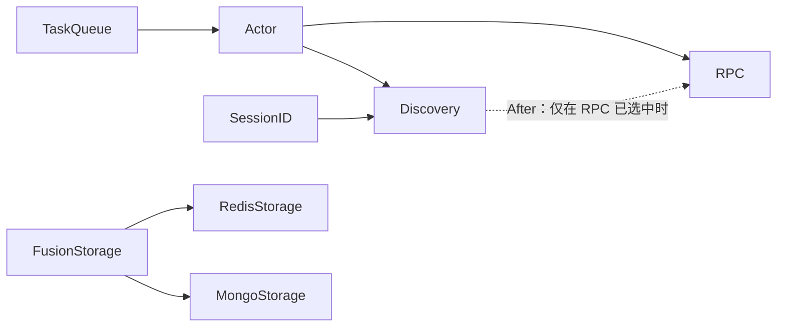

<p align="center">
  
</p>

# tx

`tx` 是面向游戏服务端的 Go 运行时基础库，提供类型元数据、字段级变更追踪、Redis/Mongo/Fusion 存储适配、单机事务、生命周期以及可选的分布式服务模块。

本文是 `tx` 使用者的主手册，记录当前已经实现并验证的公共能力、配置方式和业务示例。框架维护者需要理解内部数据结构、并发模型、状态机或技术选型时，请阅读 [设计文档](docs/design.md)；当前进度和后续任务见 [实施计划](docs/IMPLEMENTATION_PLAN.md)，架构质量要求见 [审计标准](docs/architecture_audit_standard.md)。

README 回答“怎么使用”，不记录施工步骤、逐轮进度或本机验收流水账。设计文档回答“为什么这样设计”，实施计划回答“接下来做什么”；当前方案的容量验收证据保存在 `docs/audits/`，中间过程由 Git 历史追溯。

## 阅读路径

- 初次接入：从“定位”和“快速接入流程”开始。
- 数据开发：重点阅读“类型注解”“变更追踪与同步遍历”“Redis/Mongo/Fusion 存储模型”。
- 有状态服务：继续阅读“单机事务”和“有状态落盘调度”。
- 分布式服务：按需阅读“服务发现”“内部 gRPC 协议”“msgq”“Agent”和“Actor Cluster”。
- 框架维护：转到 [docs/design.md](docs/design.md)，不要仅根据公共 API 示例推断内部实现。

## 核心使用约定

- `bee` 提供无状态服务门面，`ant` 提供有状态服务门面；两者共有 Builder、Server、Service 和基础 CMod API 同名同义。项目只读取配置并转换为对应的强类型 `Config`，再注入生成包和业务服务。
- `GD*` 是业务数据对象，`GD*Store` 是绑定该数据的变更追踪结构，不保存第二份完整数据。
- Store 不是协议字段。cmd 和业务输入模型不得直接声明生成的 `*Store` 类型。
- handler 优先使用项目 facade，例如 `db.Save(ctx, role)`；沿用当前请求 context，直接传入 Store、writer 属于扩展层用法。
- 高频大对象修改使用 Store wrapper；低频请求可以使用 `BeginChange/SaveChange`。同一变更周期不要混用两种模式。
- `Set` 写入零值，`Replace` 整体覆盖复杂值，`Delete` 删除集合元素或存储路径，`Clear` 清空容器。
- 保存失败时 Store 保留变更状态。业务必须处理返回的 `error`，不能把外部服务异常当成成功。
- Fusion 同时要求 Redis 和 Mongo 健康；Redis 是热数据，Mongo 是持久化数据，Fusion 延迟任务队列只保存记录定位。
- `delaySaveTime` 表示回写 Mongo 的延迟；`delayDelTime` 表示已确认回写后的热数据保留时间；`runtime.cmods.fusionStorage.dirtyTTL` 是尚未确认回写时的安全 TTL。三者都不会删除 Mongo 数据。
- 单机事务只回滚通过 Store 受控 API 发生的修改；事务内子流程使用 `tx.Call` 动态复用或增加直接锁，不能嵌套启动根事务。
- `msgq` 管理客户端会话和下行邮箱；Actor 负责业务实体投递；普通 gRPC RPC 负责服务或实例调用，三者不是同一个中继层。
- 需要理解内部变更追踪、锁注册表、Fusion 状态机或分布式拓扑时，阅读 [设计文档](docs/design.md)。

## 子服务初始化与启动

Bee/Ant 的 `Service` 实现 `Init(ctx)`，用于模块、Handler 和资源装配。只有需要通信就绪后执行必备加载的服务才额外实现 `ServiceStarter.Start(ctx)`；无需额外工作的服务不必添加空方法。

```go
func (s *Service) Init(ctx context.Context) error {
    if err := s.initModules(ctx); err != nil { return err }
    s.bindHandlers()
    return nil
}

// 可选：复用框架控制面加载项目要求的 Actor，等待业务初始化成功。
func (s *Service) Start(ctx context.Context) error {
    return s.loadRequiredActors(ctx)
}
```

框架依次执行全部 Init → RPC/控制监听与进程发现 Running → 全部可选 Start → 开放业务准入。启动钩子可以使用 Actor 控制接口，不应同步等待仍未开放的普通业务消息。启动钩子响应调用方取消；长期后台任务使用服务 Context 的 `Tasks()`。

`server.ServiceStatus(name)` 返回 `lifecycle.ServiceStatus`，阶段为 Created、Initializing、Initialized、Starting、Running、Draining、Stopped；停止后仍保留 Failure。进程发现 Running 只表示基础设施就绪；Actor Ready 表示该激活的工厂及初始化成功，它们不等同于子服务 Running。排水超时保留资源和 Draining，不伪装成 Stopped。

## 定位

`tx` 是运行时基础库，负责：

- 解析和保存类型元数据。
- 追踪字段级变更。
- 将生成 Store 的同步变更遍历结果落地到 Redis、Mongo 或 Fusion 策略。
- 提供 Redis 延迟任务 backend 和 Fusion 后台回写所需组件。
- 通过 Bee 或 Ant 统一装配 Storage、共享 gRPC Host、Discovery、Actor、健康探针、后台 worker 与服务生命周期；Ant 额外提供 CModProcedure、缓存运行时 和逻辑槽位。

生成代码依赖 `tx`，`tx` 不依赖生成器工程。

## 快速接入流程

业务工程通常按下面顺序接入运行时：

1. 由生成工程输出 `server/gen/data` 和 `server/gen/cmd`。
2. 项目读取本地 yml，严格解析后转换为只含 Go 值的 `bee.Config` 或 `ant.Config`；tx 不读取 yml、环境变量或命令行。
3. 项目注册生成数据元数据和子服务；业务 facade 从调用上下文取得所属服务能力。
4. 项目先决定本进程服务及启动顺序，再通过 `bee.RunOptions` 或 `ant.RunOptions` 传入明确名称清单，并提供版本、监听和发布地址；选择 Discovery 的节点由运行时自动取得实例身份。
5. Bee/Ant Server 解析所选服务的 CMod 依赖闭包，只创建本进程实际需要的外部连接、共享 Host 和后台任务。
6. handler 使用 `db.Save(ctx, role)` 或项目事务 facade，不直接装配 writer/client。

`RunOptions.Services` 不解析 `*`、`!name` 或命令行语法；这些部署选择由项目负责。完整注册清单保留远端 Actor Type 目录，本地只启动选定的服务。项目选择同进程 Agent/MsgQ 时显式注入 `agent.Options.LocalMsgQ` 并先启动 MsgQ；框架不再根据实例服务标签猜测部署关系。

一个简化的项目组合根如下：

```go
func NewApplication(config bee.Config, services ...bee.ServiceRegistration) (*bee.Server, error) {
	return bee.New(config).
		GeneratedData(data.DefaultTypeRegistry(), nil).
		Services(services...).
		Build()
}

func Run(ctx context.Context, app *bee.Server) error {
	return app.Run(ctx, bee.RunOptions{
		Services:          []string{"msgq", "game", "agent"},
		InstanceVersion:   "20260823.1",
		InstanceEndpoint:  "10.0.1.21:9000",
		InstanceEndpoints: map[string]string{"agent.tcp": "203.0.113.21:30000"},
		RPCListen:         "0.0.0.0:9000",
	})
}
```

`RunOptions` 不接受人工 `InstanceID`。声明 `CModDiscovery` 的节点会在 Service Factory 运行前申请
`workSlot`，并生成形如 `<AppID>-<workSlot>-<ModRevision>` 的本次启动身份；未选择 Discovery 的纯单机进程允许
`runtime.Instance().ID` 为空。`SlotAssignment` 维护独立的稳定业务归属，不能用会随租约复用的 `workSlot` 替代。
`InstanceEndpoint` 只发布内部业务 gRPC 地址；`InstanceEndpoints` 由项目用稳定名称发布客户端或其他项目地址，框架不解释其中的名称。

`Setup` 是项目组合根使用的装配扩展点，适合安装 `db` facade。回调拿到的是受控
`bee.Context` 或 `ant.Context`：可以读取当前注册单元已经声明的能力，但不能取消根生命周期、关闭共享 gRPC Host、停止 Actor/Procedure，
或替换 discovery 快照。普通 handler 不应保存或传递 Context；若只需要单独使用某个底层存储 adapter，
后文仍提供手动装配接口。

可选服务也使用同一能力门面：

```go
game := bee.ServiceRegistration{
	Spec: bee.ServiceSpec{
		Name:     "game",
		Requires: []bee.CModID{bee.CModRPC, bee.CModFusionStorage},
	},
	Factory: func(runtime bee.Context) (bee.Service, error) {
		rpc := runtime.CModRPC()
		return newGameService(rpc), nil
	},
}
```

`Requires` 负责启用依赖并保证服务 Factory 在依赖 CMod 启动成功后执行。`Storage()` 和 `CMod*()` 直接返回能力，
未声明、不可用或在自定义 CMod `Validate` 阶段读取运行时能力时，tx 立即报告带 owner 的能力错误。
Service 构造/启动、Setup、CMod Validate/Start 的同步回调边界把该专用错误转回启动 error，沿既有流程回滚已托管资源；普通业务 panic 不会被当作能力错误吞掉。
Context 仅在装配回调内取得依赖，不应保存到 Handler 或传入后台 goroutine；绕过框架直接调用 Factory 时，能力错误会直接 panic。
配置、I/O、业务构造继续返回并处理 error。工厂在返回前创建但尚未交给框架的私有资源，仍须用 defer 在失败时释放；框架无法清理未交接的对象。

`runtime.CModActor()` 直接返回已声明的 Actor 能力。
Ant 常规槽位路由使用 `runtime.CModSlotResolver()`，底层 `SlotReader`、`NewSlotResolver` 和高级 `SlotStore/SlotRouter` 保留。
知道目标服务时使用 `ResolveServiceSlot(ctx, service, slotID)`，同时检查 owner 在线且承载该服务；不匹配返回 `ErrSlotRuntimeUnavailable`，不自动改派。`ResolveSlot` 保留仅按槽位查询的高级入口。内置目录在本地快照内完成检查，自定义 Directory 无需实现额外接口。

常规服务通过 `Tasks/Admission/CModRedisStorage/CModMongoStorage/CModFusionStorage/CModRPC/CModDiscovery/CModSessionID/CModActor`
等最小契约取得已经声明的能力；项目组合根才使用通用 `Storage()` 安装 `db.Save` facade。
Ant 在同一基础 API 上增加 `CModProcedure/CModSlots`。这些能力视图都不授予连接关闭、
runtime shutdown 或 discovery 快照写权限。

`CModSessionID` 依赖 Discovery 已取得的租约和 `workSlot`，只向确实需要发号的 Login Service 暴露
`AllocateSessionID`；Agent、MsgQ、Game、SLGGame 和 SLGWorld 不应声明该能力，也不能读取 `workSlot`。

三类存储 CMod 返回不同的窄接口：Redis 暴露 `RedisReader` 和脚本路由，MongoDB 暴露 `MongoReader`、`FindDocument`、条件回填和原子
`CounterStore`，Fusion 暴露 `FusionReader`；对应 `ChangeWriter` 也只接受相同 `TypeSpec.Storage.Mode`。这些接口不返回底层
客户端或连接关闭权。即使同一进程中的其他服务启用了更多后端，当前服务也不能越过 `ServiceSpec.Requires` 使用未声明存储。

`MongoStorage.FindDocument(ctx, spec, shardKey, filter, fields...)` 使用显式路由键选择唯一 Mongo 目标，
再按 `mongo.Filter` 中的 BSON 字段等值条件查询。联合查询使用 `Conditions`，例如平台与平台用户标识；
查询经过 Mongo 健康准入，返回公共 JSON 字段名文档。该接口不扫描其他分片，也不更改记录主键；
调用方必须保证该路由目标与记录写入位置一致，不能把查询字段自行当成另一套分片规则。

`runtime.Instance()` 返回本进程身份和当前生命周期状态的只读快照，`Services` 切片也会复制，调用方修改
返回值不会污染运行时。服务 `Start` 阶段看到 `starting`；共享 RPC Host、控制面和 discovery 全部就绪后
变为 `running`；调用 `Server.Drain` 并发布排水状态后变为 `draining`：

```go
instance := runtime.Instance()
if instance.Status != discovery.StatusRunning {
	return fmt.Errorf("game: local instance is not running: %s", instance.Status)
}

if err := app.Drain(ctx); err != nil {
	return err
}
// 此后新取得的快照为 draining；旧 instance 变量仍是独立快照。
```

handler 中常见写法：

```go
func RenameRole(ctx context.Context, roleID int64, name string) error {
	role, exists, err := data.FindGDRoleByID(ctx, roleID)
	if err != nil {
		return err
	}
	if !exists {
		return storage.ErrNotExists
	}

	role.SetName(name)
	if err := db.Save(ctx, role); err != nil {
		return err
	}
	return nil
}
```

读取走默认 reader，写入走项目侧 facade。这样业务代码能清楚看到哪些操作会落地，避免“修改内存对象后自动保存”的隐式副作用。
上例使用 `db.Save(ctx, role)`，表示保存数据对象当前主 Store 中记录的变更，并在保存成功后清空本轮脏标记。业务 facade 接收数据对象，内部再取 `role.Store()`，避免 handler 直接接触框架 Store。
这类 facade 可以使用 `storage.StoreProvider[S]` 作为泛型约束，不需要反射或 `any`：

```go
func Save[S storage.ChangeStore](value storage.StoreProvider[S]) error {
	return storage.Save(ctx, writer, value.Store())
}
```

`storage.Save` 只有在写入策略成功后才会清理 Store 变更状态。Fusion 把成功边界定义为“Redis 热写成功，并已把根记录登记到进程内延迟任务分发器”。登记不执行外部 I/O，因此成功后返回 `nil` 并清理 Store；真正的任务发布由后台分发器完成：

```go
if err := storage.Save(ctx, fusionStore, role.Store()); err != nil {
	// Redis 热写失败或 Fusion 依赖未完整装配，Store 仍保留本轮变更。
	return err
}
```

若延迟任务 backend 暂时不可用，后台分发器保留按根记录去重的本地 pending，输出结构化 error 日志，并按最大一分钟的有界指数退避持续重试；它不会把已经成功的业务写重新返回为失败，避免调用方重放发奖、扣费等业务操作。正常优雅关闭时，Fusion CMod 会在根 `WaitGroupContext` 取消前限时排空这些 pending；只有进程异常退出或排空超时，才可能丢失尚未持久化的本地登记。这是当前方案明确接受的可靠性边界；生产环境应通过日志告警监护 Redis/task backend，并排查导致进程崩溃或排空超时的根因。

如果业务需要显式持有 Store，例如高频对象在内存中维护变更队列、定时合并后再落地，也可以直接使用
`storage.Save(ctx, writer, role.Store())` 这类框架层写入入口，并由调用方决定何时保存或重新累计下一轮变更。

## 能力模组与服务装配

Bee 和 Ant 使用能力模组（Capability Module，简称 CMod）组合运行时。CMod 是带稳定身份、依赖关系和生命周期的装配单位，
固定表示进程级 L3 能力门面。Transaction Runtime、WriteBack Runtime 和 Delay Scheduler
都是门面内部的强类型组件，不拥有独立 `CModID`，也不单独参与全局生命周期。`agent/msgq/game` 等 L4 服务只选择所需
CMod，框架递归展开 `Requires` 依赖；`After` 仅调整已经选中门面的启动顺序，不会暗中启用能力。

### CMod 依赖与服务能力声明

`Requires` 有两处声明，分别由模块作者和业务服务作者维护：

| 声明位置 | 含义 | 谁维护 |
| --- | --- | --- |
| `CModSpec.Requires` | 该能力运行所必需的前置 CMod，自动递归启用并先启动 | 内置 CMod 由 tx 维护；自定义 CMod 由其实现方维护 |
| `ServiceSpec.Requires` | 服务直接依赖、需要在构造或启动时取得的能力，也是依赖闭包的入口 | 项目的服务 Registration |

以下是 Bee/Ant 共有的内置 CMod 关系。实线箭头从依赖方指向前置能力，表示 `Requires`；虚线表示仅影响顺序的 `After`：



RPC、RedisStorage、MongoStorage 没有前置 CMod；Discovery 没有强依赖。自定义 CMod 通过 `Builder.CMods(...)` 注册实现，再由服务或其他 CMod 的 `Requires` 选择；只有注册、不在所选服务的依赖闭包内时不会启动。

**自动启用间接依赖，不会扩大服务的直接访问范围。** 例如：

```go
// 服务只调用 runtime.CModActor()：框架自动启用 RPC、Discovery、Actor。
Requires: []bee.CModID{bee.CModActor}

// 服务还要自行查询目录 runtime.CModDiscovery()：显式声明这项直接依赖。
Requires: []bee.CModID{bee.CModActor, bee.CModDiscovery}
```

同样，只使用 `CModFusionStorage()` 的服务不必再列 Redis/Mongo；如果还要通过 `CModRedisStorage()` 取得脚本路由，则必须显式声明 RedisStorage。不能因为同进程另一个服务启用了某项能力，就直接读取它。

`ActorTypes` 会自动将 Actor 纳入启动闭包，但不会自动授予服务 `CModActor()` 的访问能力；服务自身需要发送 Actor 消息时仍须在 `Requires` 中声明 Actor。`CModActorDirect()` 也使用 Actor 的声明，不是另一个 CMod。

启动时对选中服务的依赖取并集、递归展开并按 CModID 去重；同一进程只启动一份共享能力。列表书写顺序不是启动顺序，框架按依赖拓扑先启动前置能力，再执行服务 Factory/Start。缺失依赖、重复 CModID 或依赖环会报错。正常关闭先收尾服务，再反向排水和关闭 CMod，避免先释放仍被依赖的资源。

依赖定义位于 `internal/framework/cmod_*.go`；`cmod_graph.go` 调用 `component.Resolve` 解析拓扑，`bee/context.go` 和 Ant 门面检查直接能力声明。修改内置关系时应同步本图与 `internal/framework/cmod_builtin_test.go` 中的依赖契约。

### 服务组合示例

| 服务 | 直接 CMod | 展开后的主要资源 |
| --- | --- | --- |
| Bee 标准 `agent` | RPC、Redis、Discovery、Actor | 玩家 TCP/WebSocket 入口、共享 RPC、会话绑定与 Actor 直连分派 |
| `msgq` | RPC、Redis、Discovery | 共享 RPC 上的 MailboxService、精确会话/角色归属索引与独立进程 endpoint 注册 |
| `txgame` 无状态 `game` | Redis、Discovery、Fusion、Actor；按任务配置增加 TaskQueue | Actor 自动启用共享 RPC；MsgQ 下行路由及显式保存；Fusion 内部组合 Redis、Mongo 和 Delay Scheduler |
| `txgameslg` 有状态 `slggame` | RPC、Fusion、CModProcedure | Procedure 提交后由 CModProcedure 的 WriteBack 组件分帧写 Fusion |
| `txgameslg` 有状态 `slgworld` | RPC、Mongo、CModProcedure | CModProcedure 组合 Transaction 与直接 Mongo WriteBack |

有状态组合由 Builder 显式表达，项目可以为不同服务选择不同 Writer，并替换 `CModProcedureWriteBack` SPI：

```go
procedure, err := ant.NewCModProcedureBuilder().
	WriteBack(writeBackComponent).
	Build()
if err != nil {
	return err
}

app, err := ant.New(config).
	CMods(procedure).
	Services(slgGameService, slgWorldService).
	Build()
```

项目 Factory 按服务选择 Fusion 或 Mongo Writer，不改变事务与写回 SPI。
启动日志输出实际生效的组件，例如 `procedure(transaction=default,writeback=txgameslg)`。

例如只启动一个 RPC-only 自定义服务时，调用 `Context.Storage()` 会报告未声明存储能力的装配错误，框架不会校验 Redis/Mongo 配置，也不会连接
对应外部服务。项目需要从 yml 字符串惰性转换强类型配置时，在组合根注册配置提供者：

```go
base, err := config.FrameworkBase()
if err != nil {
	return nil, err
}

return bee.New(base).
	ConfigProvider(config.Framework).
	GeneratedData(data.DefaultTypeRegistry(), nil).
	Services(gameService, msgqService, agentService).
	Build()
```

`Framework(selection)` 只解析本轮 `AssemblySelection` 中的服务与 CMod。例如本次只有 Redis CMod，错误的事务时长和缺失的
Actor host 不影响启动；一旦 CModProcedure 或 Actor 被选中，相同错误会在任何连接、监听器或 goroutine 创建前返回。普通
handler 不使用装配选择，只从项目 facade 取得所需业务能力。

高级用户实现自定义 CMod 或 L4 Service 时，`Start` 可以分阶段创建资源，但对应 `Stop` 必须幂等，并能安全清理
失败 `Start` 已经创建的部分资源。每个 CMod 具有独立子 `WaitGroupContext`；启动失败后，Host 会先取消并等待该 CMod 的
后台任务，再调用当前失败单元的 `Stop`，随后按逆序对已启动单元执行相同流程。
例如 Mongo client 已建立但索引初始化失败时，Mongo CMod 会先关闭自身连接，随后才回滚其前置能力；启动错误和清理错误
会一起返回，不会把资源泄漏隐藏在最初的失败之后。

Context 只在项目 Setup 和已声明依赖的 Service/CMod Factory 中短期提供。Bee/Ant Server 不提供全局能力定位器，
因此启动中、启动失败和停止后的业务代码都无法取得半装配或已关闭的能力视图。并发调用 `Stop` 会等待正在进行的
`Start` 完成，再执行一次完整逆序关闭。

## 服务发现

`tx/etcd` 是 L1 外部后端适配层，只提供客户端、租约、原子键、快照、Watch 和 CAS 等通用能力；它不知道
`InstanceID`、`workSlot`、SessionID 或逻辑槽位。`modules/discovery` 是组合该适配层的 L2 运行时，拥有服务实例目录、
`workSlot` 租约和自动 `InstanceID`。两层都只接收已经解析完成的配置，不读取项目 yml 或环境变量，也不启动 RPC、Actor 或消息队列。

Discovery 从 `[1, 4095]` 随机起点开始，以有界 CAS 申请一个 `workSlot`，再用成功写入的 `ModRevision` 生成
`<AppID>-<workSlot>-<ModRevision>`。实例先以 `starting` 注册，等全部服务模块可用后再
切换 `running`。滚动发布的排水阶段先切 `draining`，此时普通服务路由不再选择该实例，
但已有会话、固定归属 Actor 等精确路由仍可抵达它；排水完成后切 `stopping`。正常关闭立即删除实例键并停止续租，
让 `workSlot` 键等同一租约自然过期，避免退出窗口立即复用槽位：

```go
registry, err := discovery.NewEtcdRegistry(appCtx, discovery.EtcdConfig{
    Endpoints: []string{"127.0.0.1:2379"},
    Prefix:    "/txgame/local",
    LeaseTTL:  10 * time.Second,
})
if err != nil {
    return err
}
defer registry.Close()

registration, err := registry.Register(appCtx, "txgame", discovery.Instance{
    Services: []string{"game"},
    Endpoint: "127.0.0.1:9000",
    Version:  "dev",
    Status:   discovery.StatusStarting,
})
if err != nil {
    return err
}
defer registration.Close(context.Background())
instanceID := registration.Instance().ID // txgame-<workSlot>-<ModRevision>

if err := startModules(); err != nil {
    return err
}
if err := registration.SetStatus(context.Background(), discovery.StatusRunning); err != nil {
    return err
}
// CModSessionID 的句柄可在模块/服务启动时取得，但只能在上述 running 状态提交成功后发号。

// 发布控制面请求排水后，实例自己声明 draining。
_ = registration.SetStatus(context.Background(), discovery.StatusDraining)
_ = waitProceduresAndFlush()

// 进入最终关闭窗口；Close 删除实例键，但让已运行实例的 workSlot 随 TTL 过期。
_ = registration.SetStatus(context.Background(), discovery.StatusStopping)
_ = stopModules()
return registration.Close(context.Background())
```

`Prefix` 会规范化为以 `/instances` 结尾的目录；例如 `/txgame/local` 最终写入
`/txgame/local/instances/<instance-id>`，并在同一根下使用 `/work-slots/<work-slot>`。
`LeaseTTL` 必须是至少一秒的整数秒。租约 keepalive 中断后 `registration.Done()` 会关闭，
`registration.Err()` 返回 `ErrEtcdLeaseLost`；宿主应把该状态视为当前实例已被摘除并停止接受新请求。
`CModSessionID` 在启动期只发布尚未启用的分配器句柄；只有实例成功进入 `running` 后才开放发号。
因此尚未进入 `running` 的失败启动没有发出 SessionID，可以主动撤销租约并释放槽位。

需要消费全局实例目录时，使用 `Watch` 更新本地 `ServiceDirectory`。初始快照、任意 watch
事件或事件内容不合法都会直接返回错误；调用方必须重启 watch 或把依赖它的服务标记为不可用，
不能静默继续使用旧目录。

```go
directory := discovery.NewServiceDirectory()
go func() {
    if err := registry.Watch(appCtx, directory); err != nil && !errors.Is(err, context.Canceled) {
        reportDiscoveryFailure(err)
    }
}()

// 普通服务请求只选 running 实例，按稳定顺序轮转。
battle, ok := directory.NextInstance("battle")

// 业务需要自定义首次分配策略时，取得稳定排序的 running 候选快照。
// 例如对局创建时按 roomID 选择实例；后续 roomID -> instanceID 的归属关系由业务维护。
candidates := directory.RunningInstances("room")
if len(candidates) == 0 {
    return errors.New("no running room service")
}
roomOwner := candidates[uint64(roomID)%uint64(len(candidates))]

// 会话等精确路由可继续解析 draining/stopping 实例，用于连接排空。
msgq, ok := directory.LookupInstance(binding.InstanceID)
```

`Instance.Endpoint` 是普通 RPC 和实体直连共用的 gRPC 地址，
`Instance.Endpoints` 是项目按稳定名称声明的其他公开地址。`ServiceDirectory` 会复制地址表，调用方不能通过修改输入值或
查询结果改变目录快照；高频消息路由使用的 `RouteInstance` 不携带该地址表。

`NextInstance` 是健康服务副本的轮转选择；`RunningInstances` 返回稳定排序、与目录内部隔离的健康实例
快照，供业务实现随机、哈希或负载策略；`LookupInstance` 是已知实例的精确路由。`SessionID -> msgq 实例` 的精确会话
绑定、`RoleID -> (InstanceID, Generation)` 角色归属、消息 Seq/Ack 和有界下行邮箱属于 `msgq`；Actor 的 `(type, id)` 经 Type 映射得到稳定槽位，再由 L2 Discovery 解析归属。

Actor 与普通 gRPC 共用 Discovery 实例身份，不另建 Actor Provider 租约。

本机或 CI 已启动 etcd 时，可显式执行真实 lease/watch 回归；未设置环境变量时该集成用例会跳过，
不会要求所有开发机安装 etcd：

```bash
cd /Users/a47/workspace/tx
TX_ETCD_ENDPOINT=127.0.0.1:2379 \
  /Users/a47/sdk/go1.26.5/bin/go test ./tests \
  -run '^TestEtcdRegistryLifecycleIntegration$' -count=1
```

## msgq 会话绑定

仅带 `-tags=txbench` 的验收构建启用存储 I/O 采集；普通构建不安装 Redis 计时钩子或 Mongo 统计回调，`Runtime.IOStats()` 返回空快照。
验收构建的 `Runtime.IOStats()` 提供累计驱动快照，按固定 Redis/Mongo 操作类别统计调用数、命令数、失败数和耗时，
Redis 单次调用计一次 Calls，Pipeline 计一次 Calls 和其中的命令数；Mongo 按驱动完成事件统计，二者不能直接比较。最大耗时是累计值，不能作差当作窗口最大值；这些指标不是业务请求数，也不记录 key 或业务数据。开启控制端口后，可通过 `StorageIOService.Snapshot` 或 `txctl storage-io` 读取；应用侧采样与统计口径见 [集群存储 I/O 说明](../txgame/server/internal/clusterkit/STORAGE_IO.md)。

`modules/msgq` 以 `SessionID` 作为精确邮箱主键，负责
`SessionID -> (RoleID, SessionID, ConnectionID, InstanceID)` 的短期 binding 与 owner 解析；同时维护
`RoleID -> (InstanceID, Generation)` 角色归属，授权的多个 Session 共享归属并独立维护生命周期。

这一能力称为“多个 Session 操作同一业务身份”，不定义主、副 Session。Borrow（授权账号操作目标账号角色）和旁路挂机
（外部服务驱动角色行为，玩家可同时在线观察或操作）只是应用场景，不是两套会话流程。角色请求按 RoleID 汇聚到同一
Game/Actor；世界请求仍按经业务校验的世界路由键选择 WorldActor。
业务 Handler 通过 `ctx.Principal` 获取 RoleID、SessionID、ConnectionID 和项目认证的 Claims；账号、借号及权限由项目身份类型解释。SessionID 区分会话，但不自动表示真人、管理员或挂机服务；这些来源权限由项目认证与授权策略确定。
下行可使用 `PubRole` 共享到角色邮箱，或 `PubSession` 精确投递。两套示例的自动响应适配层默认共享成功业务响应、精确投递请求错误；
若业务需要其他策略，应在项目适配层明确实现，避免自动响应与手动下行重复发送。
同一 RoleID 的多个邮箱可以并存，各自维护队列；`Sender.PubRole` 定向投递到角色归属 MsgQ，由其向该角色全部邮箱分发。
`Server` 在本进程管理 Session、下行队列和 Seq/Ack。
`NewSessionRouter`、`NewRoleRouter`、`NewSessionClientRouter` 的首个参数均为项目定义的目标邮箱服务名，必须与注册名称一致；下面的 `"msgq"` 只是示例取值。Agent 远端路由通过 `Options.MsgQService` 接收同一名称。
`NewSessionRouter` 还要求显式设置邮箱归属缓存容量；`ResolveMailbox` 只缓存 MsgQ InstanceID，供 `PubSession` 使用，热路径不查询 Redis。
`ResolveSession` 始终读取当前完整绑定，Topic 操作沿用该边界以获取当前 ConnectionID 和有效会话锚点。
精确下行遇到明确邮箱失效时清缓存，遇到传输超时不自动重发；MsgQ 丢失邮箱后须建立新 Session，不能把旧 Session 迁往另一实例。

Redis 精确 binding key 固定为 `<prefix>:session:v2:{SessionID}`，值保存完整
`RoleID/SessionID/ConnectionID/InstanceID`；角色归属 key 固定为 `<prefix>:role:{RoleID}`，值保存 `InstanceID/Generation`。两个索引共用配置指定的 Redis 存储，花括号中的身份用于 Redis Hash Tag，不承诺跨 key 事务。下行编码载荷始终只保存在
msgq 实例内存，实例崩溃时未确认消息允许丢失：

```go
import (
    "time"

    "github.com/ngnl47/tx/modules/msgq"
    "github.com/ngnl47/tx/storage/redis/goredis"
    redis "github.com/redis/go-redis/v9"
)

rawRedis := redis.NewClient(&redis.Options{Addr: "127.0.0.1:6379"})
bindings, err := msgq.NewRedisSessionStore(goredis.NewClient(rawRedis), msgq.SessionRedisOptions{
    Prefix: "txgame:local",
    TTL:    48 * time.Hour,
})
if err != nil {
    return err
}
sessions, err := msgq.NewSessionRouter("msgq", directory, bindings, 65536)
if err != nil {
    return err
}

localInstance := serviceContext.Instance()
mailbox, err := msgq.NewServer(msgq.ServerOptions{
    InstanceID:             localInstance.ID,
    Store:                  bindings,
    MaxBacklogMessages:      1024,    // 未确认下行条数上限。
    MaxBacklogBytes: 8 << 20, // 未确认编码载荷总字节数上限；零值使用 64 MiB 默认值。
})
if err != nil {
    return err
}

header := msgq.SessionHeader{RoleID: 470001, SessionID: 99, ConnectionID: 7}
_, err = mailbox.Init(ctx, msgq.InitRequest{Header: header})
if err != nil {
    return err
}

// 精确投递按 SessionID；角色通知通过 RoleRouter 解析角色归属。
target, err := sessions.ResolveSession(ctx, 99)
if err != nil {
    return err // 离线或 owner 不可用均显式返回错误。
}
_ = target.Instance.Endpoint

roles, err := msgq.NewRoleRouter("msgq", directory, bindings.FindRole, 65536)
if err != nil {
    return err
}
role, err := roles.Resolve(ctx, 470001)
if err != nil {
    return err
}
_ = role.Binding.Generation
```

干净登录复用 RoleID 的 MsgQ 归属；首次归属在运行中的 MsgQ 间轮转提名并通过 Redis 原子确认，再以 `Create` 的 Redis `SET NX PX` 创建 SessionID binding；现存
SessionID 会明确冲突，不能覆盖旧邮箱。恢复只按 SessionID 找回原来的 running owner，用完整旧 binding 条件执行
`Rebind` 并换成新的 ConnectionID；owner 不可用或条件不匹配时直接失败，不会迁移到其他实例。同 SessionID 恢复保留
Seq/Ack 和未确认队列，新 SessionID 的干净登录始终从空队列开始。

`SessionRouter.ResolveSession` 和 `RoleRouter.Resolve` 都是只读解析，不刷新任何 TTL。只有经过当前 ConnectionID 校验的 owner 侧
连接活动才会条件续期精确 binding。binding 比较完整
`(roleID, sessionID, connectionID, instanceID)`，所以旧连接不能续期、解绑、确认或管理新连接的 Topic。实例已摘除时
Router 不会删除 Redis binding，也不会随机退化到其他 MsgQ 副本。

### 进程内会话邮箱

`Server` 是单个 msgq 实例的本地邮箱，并按 SessionID 隔离同一角色的多个逻辑会话。跨实例业务发送前先通过
`SessionRouter.ResolveSession` 或 `RoleRouter.Resolve` 找到 owner，再调用其 `Instance.Endpoint` 上的独立
`MailboxService`；不要把 `Server` 当作全局消息队列。

```go
// MsgQ 只接收客户端确认的下行 Ack；上行序号不离开 Agent。
err := mailbox.Confirm(ctx, msgq.ConfirmRequest{Header: header, Ack: 41})
if err != nil {
    return err
}

// 任意本地业务逻辑向一个确定的逻辑会话发布 BON 下行。
published, err := mailbox.PubSession(ctx, header.SessionID, bonBody)
if err != nil {
    return err // 队列到达 MaxBacklogMessages 时返回 msgq.ErrDownMsgOverflow。
}
_ = published.Seq

// Agent 以自身的连接 context 长轮询；ctx 超时或取消即结束本次 Fetch。
downMsg, err := mailbox.Fetch(ctx, msgq.FetchRequest{Header: header})
if err != nil {
    return err
}
writeProtocolPacket(downMsg.Seq, downMsg.Payload)

// 同一 SessionID 重连：重置发送游标并丢弃已经 Ack 的前缀，未确认消息会重发。
nextHeader := msgq.SessionHeader{RoleID: 470001, SessionID: 99, ConnectionID: 8}
_, err = mailbox.Init(ctx, msgq.InitRequest{Header: nextHeader, Restore: true, Ack: 41})
if err != nil {
    return err
}
```

会话绑定使用 Redis `PX` 毫秒 TTL，`TTL` 因此必须至少为 `1ms`。例如
`TTL: 500 * time.Microsecond` 会在创建 `RedisSessionStore` 时返回
`msgq.ErrInvalidSessionOptions`，不会把截断后的 `0` 发送给 Redis。

`Fetch` 不在持有会话锁时等待，因此同一会话的 `PubSession` 不会被长轮询阻塞。`PubSession` 成功后，传入的
编码载荷的所有权移交给 msgq。`BroadcastTopic` 从调用开始即交接只读载荷，因为错误返回也可能已经部分入队。
调用方不得再修改、`append`、复用或归还该 `[]byte`，直至所有引用它的消息被确认或会话关闭；
`Fetch`/`FetchSome` 返回的 `Message` 同样只读。这样本地 topic 广播只保留一份已编码 BON 正文，多个会话条目共享它；
跨进程 gRPC 调用会在传输边界自然得到独立字节副本。`MaxBacklogMessages` 与 `MaxBacklogBytes` 分别限制未确认消息数量与
编码载荷总字节数；任一上限触发时当前会话会被移除并返回
`ErrDownMsgOverflow`，避免持续不确认的客户端无限占用 msgq 内存。客户端重连后由业务重同步恢复状态。

确认前缀后，msgq 会解除队列条目对编码载荷的引用；确认全部积压时直接释放条目数组，部分确认时按低水位整理剩余
条目，避免一次广播高峰长期保留过大的条目数组。正文不会在本地广播时按会话复制。

广播部分成功时不回滚健康邮箱，`ErrDownMsgOverflow` 与 `BroadcastResult` 同时返回。
gRPC 错误通过状态详情保留服务端投递统计；发送方不能因错误而向整组重发。
网络断开或超时可能无法收到统计，此时零值结果表示未知，不表示所有目标都未入队。

### 批量下行与本地 Topic

`Server.BroadcastRole(ctx, roleID, payload)` 向当前 MsgQ 内绑定该角色的邮箱分发，返回通用 `BroadcastResult`。
它与 `BroadcastTopic` 共用分发循环，不访问 Redis 寻址、不向其他 MsgQ 广播，不涉及上行序号。
角色索引只在 Session 初始化成功后加入；重连沿用邮箱，终止、溢出和失活清理移除订阅，最后一个邮箱移除后删除空索引。
新 Session 不复制已有邮箱的历史消息，已有 Session 恢复只重放自己的未确认消息。

`Server.PubRole(ctx, binding, payload)` 与 `Connection.PubRole` 提供带完整 `RoleBinding` 的定向角色投递。
远程请求携带 RoleID、InstanceID 和 Generation；接收端在同一个本地读锁内核对有效租期、完整版本并取得邮箱快照，
不访问 Redis。缺失或过期归属、错误实例、旧版本返回 `ErrSessionChanged`，不会投递到后续换代的新邮箱。
两个远程分发入口共用 `BroadcastResponse`，返回各邮箱入队统计而不是共同 Seq；错误响应也保留可获得的部分统计。

Agent 的集中选址、归属续期及 `Sender.PubRole` 已接入版本化角色投递。两套示例分别装配有界角色缓存，
`System_PublishNotifyResp` 返回分发统计。普通请求响应的共享下行和完整多进程验收继续按实施计划推进。

`FetchSome` 与 `Fetch` 的确认语义完全相同：批量读取只前进发送游标，不会删除队列内容；客户端 Ack 后必须调用
`Confirm`，消息才会从重连恢复队列释放。

```go
batch, err := mailbox.FetchSome(ctx, msgq.FetchSomeRequest{
    Header: header,
    Max:    32, // 0 表示取出当前所有可发送消息。
})
if err != nil {
    return err
}
for _, message := range batch.Messages {
    writeProtocolPacket(message.Seq, message.Payload)
}

// 客户端实际收到整个批次后，再确认其中最大 Seq。
if err := mailbox.Confirm(ctx, msgq.ConfirmRequest{Header: header, Ack: batch.Messages[len(batch.Messages)-1].Seq}); err != nil {
    return err
}
```

Topic 是 **单个 msgq 实例的内存索引**，适合该实例已经承载的会话分组，例如同一个在线军团分片。它不是 Redis
Pub/Sub，也不自动跨 msgq 实例传播；全服或跨实例广播必须先由业务分发到各实例，再在各实例调用本地广播。

独立业务进程可使用 `Sender.JoinTopics(ctx, ownerSessionID, topics...)` 管理当前连接的本地订阅，并用
`Sender.BroadcastTopic(ctx, ownerSessionID, request)` 选择该 Session 所在的单个 MsgQ 实例执行广播。
`ownerSessionID` 只是实例路由锚点，不会把本地 Topic 提升为全局广播；需要覆盖多个 MsgQ 实例时，业务必须先枚举
目标实例或分片，并为每个实例选择一个当前 SessionID 分别调用。

```go
import "errors"

if err := mailbox.JoinTopics(ctx, msgq.TopicRequest{
    Header: header,
    Topics: []string{"guild:9", "world:1001"},
}); err != nil {
    return err
}

result, err := mailbox.BroadcastTopic(ctx, msgq.BroadcastTopicRequest{
    Topic:   "guild:9",
    Payload: bonNotify,
})
if err != nil {
    // 已投递的会话不会回滚。检查统计后决定是否记录、重试或触发业务重同步。
    if errors.Is(err, msgq.ErrDownMsgOverflow) {
        reportSlowSessions(result.Overflowed, result.Skipped)
    }
    return err
}
_ = result.Delivered
```

`BroadcastResult` 中 `Attempted` 是接收者快照中的会话数，`Delivered` 是实际入队数，`Skipped` 表示快照后已关闭的
会话，`Overflowed` 表示因条数或字节积压无法入队的会话数。广播出现积压返回 `ErrDownMsgOverflow`，对应会话会被移除，
但结果保留已经成功投递的数量；框架不会伪造全量成功，也不会尝试回滚其他会话。

### 失活 Session 终止

`Server.Start` 使用服务全局 `WaitGroupContext` 启动后台终止循环。`OfflineTimeout` 是“最后一次客户端会话活动”到
终止 Session 的时长，默认 `180s`，采用既定的生产实践值；`TerminateDeadSessionInterval` 是检查本实例内存 Session
的间隔，默认 `2s`。该任务不读取、遍历或扫描 Redis key。经过当前 ConnectionID 校验的 `Init`、`Fetch`、
`FetchSome`、`Confirm`、`Touch` 和 Topic 管理等连接活动会更新本地活动时间；业务
`PubSession`、`PubRole` 和 Router 读取不会让已经断开的会话常驻内存。即使客户端持续发送心跳，只要最早一条
未确认下行已超过 `OfflineTimeout`，终止循环同样会移除会话，防止只收不确认的连接绕开积压保护。

Redis binding 的 TTL 仍由合法客户端活动续期，但生产 `RedisSessionStore` 会在本地合并续期请求：`Init`、`Rebind`
或一次成功续期后，只有达到 `TTL / 2` 的第一条活动才执行下一次精确续期，不会让每条心跳、上行、Ack 或 Fetch 都产生
Redis I/O。

标准项目通过 YAML 的 `services.msgq.offlineTimeout` 配置该时长。TCP 与 WebSocket 客户端必须主动发送心跳；建议
相邻两次 `System_Ping` 不超过 `15s`，使默认 `180s` 清理窗口能够容忍电梯等短时弱网和少量心跳丢失。`System_Ping`
仍是普通 UpMsg，携带的下行 Ack 会通过 `MailboxStream` 刷新会话活动时间；服务端不会在没有客户端消息时替客户端续期。

```go
mailbox, err := msgq.NewServer(msgq.ServerOptions{
    InstanceID:                   serviceContext.Instance().ID,
    Store:                        bindings,
    MaxBacklogMessages:           1024,
    MaxBacklogBytes:              8 << 20,
    OfflineTimeout:               180 * time.Second,
    TerminateDeadSessionInterval: 2 * time.Second,
})
if err != nil {
    return err
}
if err := mailbox.Start(appContext); err != nil { // appContext 是 lifecycle.WaitGroupContext。
    return err
}
```

服务关闭时取消 `appContext` 并等待 `WaitDoneAndWaitGroupWait()`，终止循环会自然退出。需要测试或由项目自定义调度时，
可直接调用 `TerminateDeadSessions(ctx, now)`。终止会按完整 `(roleID, sessionID, connectionID, instanceID)` 条件解绑精确
binding、释放本地邮箱和 Topic 关系，最后一个邮箱退出后由维护循环协调释放角色归属。Redis 暂时不可用时该方法返回错误并记录日志，但仍
删除本机失活会话；精确 binding 由 Redis TTL 兜底过期。

### msgq gRPC 传输

标准 MsgQ 服务正常停止时调用 `Server.Stop(ctx)`：阻止后续初始化，使本地邮箱及未确认队列失效，
再按 `RoleID/InstanceID/Generation` 条件释放本地持有的角色归属。只遍历本地记录，不扫描 Redis。
因此新 Session 可以重新申请归属，旧 Session 不能在新实例恢复。进程强制终止或 Redis 释放失败时，
归属仍由原 TTL 兜底；服务发现暂时缺失不会触发抢占。
角色缓存命中已不可用实例时，`RoleRouter` 在发送前至多重新读取一次权威归属；若新归属已建立即可直接寻址。
该操作不分配归属，也不重试已发送的业务消息；稳定热路径仍不访问 Redis。

`modules/msgq` 提供独立的 protobuf/gRPC `MailboxService`，不复用通用的 `modules/rpc`。Agent 用 `Init` 建立或恢复会话，与每个 MsgQ 实例复用一条承载多 Session 的 `MailboxStream`；下行 Ack 沿该流发送，MsgQ 沿流推送下行。业务下行使用 `PublishStream`，Topic 和 `TerminateSession` 是独立控制操作；显式等待发布结果的 `PubSession`/`PubRole` 仍保留独立语义，不在高频业务链路使用。所有 `payload` 均为已编码 BON 字节。

```go
grpcServer := grpc.NewServer()
if err := msgq.RegisterMailboxService(grpcServer, mailbox); err != nil {
    return err
}
go grpcServer.Serve(listener)

conn, err := grpc.NewClient(target.Instance.Endpoint,
    grpc.WithTransportCredentials(insecure.NewCredentials()), // 仅可信私网示例。
)
if err != nil {
    return err
}
defer conn.Close()

client := msgqpb.NewMailboxServiceClient(conn)
_, err = client.PubSession(ctx, &msgqpb.PubSessionRequest{
    SessionId: target.Binding.SessionID,
    Payload:   bonBody,
})
if err != nil {
    return err
}
```

上面的 `grpc.NewServer/Serve` 只展示独立嵌入的最小闭环。模块化项目应直接使用 `modules/rpc.Host` 复用
进程级普通 gRPC endpoint，不再为 msgq 或其他服务分别创建 listener/server：

```go
rpcHost, err := rpc.NewHost("127.0.0.1:9000")
if err != nil {
    return err
}
if err := rpcHost.Register(func(registrar grpc.ServiceRegistrar) error {
    return msgq.RegisterMailboxService(registrar, mailbox)
}); err != nil {
    return err
}
if err := rpcHost.Start(rootWaitGroupContext); err != nil {
    return err
}
defer rpcHost.Stop(context.Background())
```

`MailboxStream` 保留每个 Session 独立的下行确认、未确认下行和恢复状态。`Init` 仅确认初始化完成，不返回上行序号；流内旧连接、队列满或失效会话会收到对应错误。业务下行经 `PublishStream` 写入本地 gRPC 流，发送成功不代表 MsgQ 已入队；旧角色归属拒绝由流异步反馈，仅在 MsgQ 明确证明该载荷尚未进入任何邮箱时，发送方清理缓存并重新寻址、单次投递；结果未知或部分成功不重投。

`rpc.Host` 直接接入全局 `lifecycle.WaitGroupContext`。应用服务关闭时由项目宿主统一调用 `Stop`，未确认下行仍遵循
msgq 的内存语义。

业务 Actor 或其他服务不应自行读取 `SessionBinding`、拼接 endpoint 或维护每个 msgq 实例的连接。`Sender.PubSession`
按 SessionID 精确投递；`Sender.PubRole` 通过有界 RoleRouter 缓存定位归属 MsgQ，携带完整版本调用 `PubRole` RPC。
两种投递都按 endpoint 复用 gRPC 连接，角色热寻址不查询 Redis，也不向其他 MsgQ 广播：

```go
router, err := msgq.NewSessionRouter("msgq", directory, sessionStore, 65536)
if err != nil {
    return err
}
dialer, err := msgq.NewGRPCDialer(insecure.NewCredentials()) // 仅可信私网示例。
if err != nil {
    return err
}
roles, err := msgq.NewRoleRouter("msgq", directory, sessionStore.FindRole, 65536)
if err != nil {
    return err
}
sender, err := msgq.NewSender(router, roles, dialer)
if err != nil {
    return err
}
defer sender.Close()

// 当前请求的业务响应共享给目标角色的全部逻辑会话。
if _, err := sender.PubRole(ctx, identity.RoleID, bonResponse); err != nil {
    return err
}

// 跨角色通知投递给角色 470001 的全部邮箱。
if _, err := sender.PubRole(ctx, 470001, bonNotify); err != nil {
    // 离线、owner 改变、路由不可用、队列满或传输失败均明确返回错误。
    return err
}
```

`Sender` 不自动重试 `PubSession` 或 `PubRole`：连接异常时服务端是否已接受该消息无法确定，自动重发可能产生重复下行。调用方应按协议消息的
幂等语义决定重试或重同步；明确收到 `ErrSessionChanged` 时仅使对应版本缓存失效，下一次调用重新寻址。
超时、断连或部分溢出不触发缓存失效或整组重发；关闭服务时必须调用 `Sender.Close()` 释放缓存连接。

本机或 CI 已启动 Redis 时可执行真实回归；未设置变量时该用例会跳过：

```bash
cd /Users/a47/workspace/tx
TX_REDIS_ENDPOINT=127.0.0.1:6379 \
env GOCACHE=/private/tmp/tx-go126-build GOTMPDIR=/private/tmp \
GOMODCACHE=/private/tmp/tx-go-modcache GOTOOLCHAIN=local \
/Users/a47/sdk/go1.26.5/bin/go test ./tests \
  -run '^TestMsgQRedisSessionStoreIntegration$' -count=1
```

## Agent 玩家接入

`modules/agent` 是可选的玩家连接运行时，提供两种默认传输：TCP 使用 4 字节 big-endian 长度前缀加二进制帧，
WebSocket 只接受 binary message。两种传输共用同一套 `Frame`、身份解析、Seq/Ack 和 `MailboxStream` 下行接收；业务 body
始终是 BON bytes，不转换为 protobuf 或 JSON。

Agent 不实现账号、JWT、游客登录或角色选择。项目必须在启动组合根提供 `HandlerProvider`：它接收当前
Bee 或 Ant Context，组合身份解析器和项目 Actor 路由策略。这样项目不需要全局注册表，也不会在多测试、多 Server
进程组合时共享可变状态。握手中的不透明数据由项目解析为 `protocol.SessionPrincipal`；Agent 校验主体后自行生成正
`ConnectionID`，构造不可变的 `protocol.SessionIdentity`：

```go
handlers := func(runtime bee.Context) (txagent.IdentityResolver, txagent.Dispatcher, error) {
    identity := txagent.IdentityResolverFunc(func(ctx context.Context, req txagent.AuthRequest) (txprotocol.SessionPrincipal, error) {
        // 项目在这里校验 token，或解析登录服签发的可信 ticket。
        return txprotocol.SessionPrincipal{
            RoleID:    470001,
            SessionID: 99,
            Claims:    trustedProjectClaims, // 项目认证后编码的不透明字节，不接受客户端自报权限。
        }, nil
    })
    caller := runtime.CModActorDirect()
    dispatcher, err := txagent.NewActorDispatcher(txagent.ActorDispatcherOptions{
        Caller: caller,
        Resolver:  projectActorResolver,
    })
    return identity, dispatcher, err
}
```

项目 `ActorDispatchResolver` 只根据生成命令元数据选择目标 Actor、消息类型、命令哈希、路由键和载荷；通用
`NewActorDispatcher` 在投递前以 Agent 的可信 `SessionIdentity` 覆盖 Delivery 身份字段。项目
resolver 和客户端载荷均不能指定 `ConnectionID`，也不能伪造投递给 Actor 的身份。Agent 只负责 Frame、
身份和 Seq/Ack，不依赖任何项目生成包。授权的各 Session 独立维护邮箱和恢复状态，共享 RoleID 时路由到同一 Actor，并接收角色下行。

内部 Actor 调用可携带可信 `Identity`，也可省略；身份本身不决定请求来源或响应路径。Delivery 和业务调用上下文 `actor.MessageContext` 均不暴露 UpSeq。

一条连接的处理顺序固定如下：

1. 客户端先发送 `FrameHandshake`，其中 `Payload` 交给 `IdentityResolver`，`Restore/Ack` 交给会话恢复。
2. 项目 `IdentityResolver` 验证凭据并返回 `SessionPrincipal{RoleID, SessionID, Claims}`；Agent 只检查通用编号、生成本次物理连接的正 `ConnectionID`，再构造 `SessionIdentity`。
3. `Restore=false` 的新建连接查询并复用角色归属；无归属时由 running MsgQ 轮转提名并原子确认，竞争失败者使用已确认归属。`Restore=true` 的恢复连接必须按 SessionID 命中原来的 running owner。同进程 msgq 时直接复用本地 `SessionClient`，但仍由邮箱初始化校验角色归属；分进程时按 Redis binding 和服务目录复用 gRPC 连接。
4. 新建 `Init` 用 `Create NX` 安装空邮箱，SessionID 已存在时失败；恢复 `Init` 用旧完整 binding `Rebind` 到新 ConnectionID，保留相同 SessionID 的下行 Ack 与未确认下行队列。恢复 owner 不可用、邮箱不存在或完整绑定校验失败时明确失败，不能迁移或安装空会话。
5. `Init` 成功后，Agent 发送 `FrameReady`，其 `Ack` 固定为 `0`。客户端收到它之前只能处于连接中，不能发送业务帧；恢复失败时不会出现“先成功、再被关闭”的假状态。
6. 客户端按 socket 写入顺序发送递增的 UpMsg 序号；允许跳号，不维护未确认上行重放队列。Agent 仅在当前物理连接中忽略小于等于已接受最大值的序号；连接结束即释放该游标。
7. Agent 按连接读取顺序将上行写入目标实例的 `CallStream`，不等待远端邮箱接纳或业务完成。提交成功后更新本地上行游标，并通过 `MailboxStream` 异步发送客户端的下行 Ack；不等待 MsgQ 逐项回执。
8. Agent 从共享 `MailboxStream` 接收下行，写出 `FrameDownMsg`；客户端在上行或独立 `FrameAck` 携带 Ack，Agent 经同一双向流同步给 MsgQ 裁剪邮箱。
9. Game/Actor 处理上行后，直接通过 MsgQ Sender 调用 `SendRole` 共享普通业务响应，调用 `SendSession` 精确投递 `System_Error`。这些是独立下行消息，不作为上行 RPC 返回值；Actor 业务处理失败不会产生客户端上行 ACK。

客户端只维护递增的 UpSeq 与已处理的 DownSeq。上行发送失败或连接中断时不自动重放，结果可能未知；恢复原 Session 只恢复 MsgQ 中未确认的下行，不恢复上行命令。客户端后续新命令继续使用更大的 UpSeq。Agent 不接收远端邮箱逐项接纳确认，也不向客户端发送上行确认帧。

Actor 已经接纳的请求级失败不应等同于连接故障。标准 txgame/txgameslg Game/Actor 适配层会把 Handler 错误
编码为生成的 `System_Error`，直接投递到发起 Session。其中 `Code` 是供客户端多语言表使用的 `int32` 稳定错误码；连接会继续处理后续请求。业务错误码 `0` 保留为“无错误”，未分类内部错误使用
`actor.CallErrorCodeInternal`。Handler 未注册、命令解码失败等 Actor 分派拒绝使用
`actor.CallErrorCodeDispatch`，也会作为 `System_Error` 返回，不会关闭已经建立的客户端连接。例如：

```go
const ErrorCodeNameExists int32 = 41001

return nil, txactor.NewCallError(ErrorCodeNameExists, errors.New("name already exists"))
```

Agent 核心把握手失败、非法 Frame、Seq/Ack 违约，以及本地观察到的目标解析或写流错误视为会话失败并关闭连接。远端 Actor 邮箱拒收没有逐项回执，由接收端记录错误，Agent 不能据此立即关闭连接；邮箱接纳后的业务错误通过 MsgQ 下行。损坏的协议状态不会被继续使用。

Game 关闭发布流时，开始关闭之前已结束的流只记录历史 error，不阻断服务停止；本次排水中新发生的断流或超时仍返回失败。清理历史故障流不表示故障期间消息已送达，也不触发补发。

UpSeq 仅用于 Agent 当前物理连接的旧号过滤，不存入 MsgQ、不传给业务、不跨连接恢复。每次上行提交及独立客户端 Ack 都经 `MailboxStream` 同步下行确认并保持连接活动；这不是上行确认。MsgQ 的 Redis 会话 TTL 与角色归属租约保持独立，不存在 Agent Rec lease。业务需要响应关联或幂等时须定义独立标识，不能用 UpSeq 或 DownSeq 代替。

重新 Login 创建新 SessionID，旧会话游标不用于新会话。同 Session 的 Restore 使用新 ConnectionID，通过 MsgQ 完整绑定 CAS 接管并唤醒旧订阅；旧连接不能更新、裁剪或终止新连接的邮箱。Agent 收到旧订阅错误后关闭旧 socket。该隔离不撤销已经发往 Game 的上行，也不提供跨 Agent 上行的全局接管屏障；同一角色多 Session 可并存，互踢属于业务策略。
普通游戏操作接受这个语义；不能重复执行的命令必须由项目定义独立的业务幂等键。Frame 的静态 `CommandHash`
只标识生成的命令类型，不能用作一次业务操作的幂等令牌。

同进程装配显式提供 `LocalMsgQ` 后，它就是唯一会话来源。若本地 msgq 尚未启动或不能创建
`SessionClient`，Agent 启动会直接返回原始错误，不会偷偷改走远端 discovery：

```go
agentService, err := agent.New(agent.Options{
	LocalMsgQ: localMailbox,
	// 省略监听、身份和 Dispatcher 配置。
})
if err != nil {
	return err
}
// localMailbox.SessionClient() 失败时，Start 明确失败；只有未配置 LocalMsgQ 才使用远端 msgq。
```

`txgame` 的最小配置如下。`agent` 被 `--services` 选中时至少配置一个监听地址，`maxFrameBytes` 和
`msgq` 的 Redis 会话 binding 参数也必须完整。浏览器跨域连接必须把完整的
`http/https` Origin 写入 `webSocketOrigins`，不允许通配符；空列表沿用 WebSocket 同源校验。服务选择只由
`--services` 决定，YAML 不使用 `enabled` 作为第二个启动开关：

Agent 与每个 MsgQ 实例复用一条 `MailboxStream` 双向流承载多个 Session。下行由 MsgQ 推送，Agent 沿该流同步 Seq/Ack；同进程部署走本地邮箱。断线恢复沿用原 SessionID 和下行 Ack。

```yaml
services:
  agent:
    tcpListen: 0.0.0.0:9000
    webSocketListen: 0.0.0.0:9001
    webSocketOrigins:
      - http://127.0.0.1:5173
    maxFrameBytes: 1048576
  msgq:
    routeType: fusion
    prefix: txgame:msgq
    ttl: 48h
    maxBacklogMessages: 1024
    maxBacklogBytes: 8388608
    offlineTimeout: 180s
    terminateDeadSessionInterval: 2s
```

项目如果在 `agentservice.Options` 中提供 `HTTPHandler`，同一个 `http.Server` 会固定按路径分派：根路径 `/`
继续保留给 WebSocket Upgrade，非根路径请求在通过 admission 后交给项目 Handler；未配置 `HTTPHandler` 时返回 `404`，
排水或停止后返回 `503`。项目 Handler 自己负责 `/api/...` 路由、method、认证、CORS、JSON/BON 编解码和错误正文；
tx 不提供通用 HTTP Router，也不会在未配置 `WebSocketListen` 时创建“纯 HTTP” Agent 服务。

同一进程同时启动时，Agent 不建立额外的 gRPC 连接：

```bash
go run ./cmd/server --services=game,msgq,agent
```

接入层与会话邮箱分开部署时，只启动 Agent；它从 `ServiceDirectory` 选择 running msgq 实例，因此必须启用 discovery，
并使 msgq 实例以自身 gRPC endpoint 注册到目录：

```bash
go run ./cmd/server --services=agent
```

Agent 停止时先关闭 TCP/WebSocket listener，停止接收新连接；WebSocket 主动断开，TCP Session 随服务根
`WaitGroupContext` 取消退出。普通断线不会主动调用 `TerminateSession`，会话由 `OfflineTimeout` 和重连 `Init` 管理。

Agent 在调用 MsgQ `Init` 前登记初始化中的 `SessionID + ConnectionID`，成功后、发送 `FrameReady` 前原子晋升为已激活连接。
控制请求会同时覆盖这两个状态；初始化期间收到终止时，无论 `Init` 成功还是因连接取消返回不确定结果，连接都不会收到
Ready，并会使用独立有界上下文按新 `ConnectionID` 补偿一次精确终止。同一 `SessionID` 的并发终止请求共享一个本地操作，
终止期间新登记的初始化连接自动加入；调用方取消只结束等待，不会取消后台收尾；任一精确终止的非幂等错误都会返回，
不能被更早连接的成功结果掩盖。基础控制分为两层：
`DisconnectSession` 只关闭物理连接并保留逻辑 Session，允许相同 `SessionID` 恢复；`TerminateSession` 先终止 MsgQ
逻辑 Session，再关闭物理连接，原 `SessionID` 不能恢复。每个 Agent 都把专用控制服务注册到进程共享 gRPC Host。
`SessionControlBroadcaster` 从服务发现内存快照取得全部运行中 Agent 并行广播，只有本地持有目标 Session 的实例处理；
该流程不查询 Session owner、不访问 MsgQ 路由，也不依赖 Kubernetes。

### TypeScript 客户端协议

`tx` 不依赖 TypeScript 运行时。两个模板分别通过 `txgen` 从各自 data/cmd 输入生成服务端和客户端产物：

```text
txgame/gen     -> txgame/server/gen     + txclient/src/gen
txgameslg/gen  -> txgameslg/server/gen  + txclientslg/src/gen
```

`txclient` 只消费 `txgame` 协议，`txclientslg` 只消费 `txgameslg` 协议；两个客户端独立维护，不能共享生成目录或手工复制生成文件。各客户端 codec 负责 BON 编解码。BON 在 Go 侧和客户端侧都使用 `msgpack` tag 名，例如 `HeadImg` 使用 `msgpack:"hi"` 时，客户端字段名
和 Go 编解码字段名都是 `hi`，而不是 JSON 名 `headImg`。

```ts
const session = new AgentSession({
  schemas: Schemas,
  resolveRoute: (command, body) => resolveCommandRoute(command as CommandName, body),
});
const client = new AgentClient(session, new WebSocketTransport({
  url: "ws://127.0.0.1:9001",
  maxFrameBytes: 1_048_576,
}));

client.onMessage(async (message) => {
  await handleMessage(message);
});
await client.connect(loginTicket);
await client.send("Role_RenameReq", { roleId: 470001, name: "new-name" });

await client.close();
await client.reconnect(loginTicket); // 复用同一逻辑会话，继续使用递增的上行 Seq。
```

`AgentClient` 与传输无关的 `AgentSession` 共同管理命令编码、路由、Seq/Ack 和下行串行消费；浏览器仅选择
`WebSocketTransport`，Node.js CLI 选择 `TCPTransport`。普通 DownMsg 的确认优先由下一条 UpMsg 捎带；持续没有上行时，
`AgentClient` 每 5 秒检查一次并发送尚未捎带的独立 Ack，也可以显式调用 `client.acknowledge()`。客户端不保存未确认
UpMsg 队列；重连复用原 Session，但不自动重投结果未知的旧请求。`connect/reconnect` 只有在收到服务端
`FrameReady` 后才返回并进入可发送状态。Go 整数在 TypeScript 侧使用
`number`，因此业务协议值必须在 `-9,007,199,254,740,991` 到 `9,007,199,254,740,991` 之间；超界编码或解码
会返回错误，避免悄悄丢失精度。整数还受具体 scalar 的位宽和符号约束；uint32 的上半区使用 BON 已有的
64 位整数编码，保持 0..4294967295 的数值语义。客户端必须使用生成的 `resolveCommandRoute` 从请求对象取得 Frame 的命令哈希
和可选路由键，不能手写这些传输字段：

```ts
import { resolveCommandRoute } from "../src/gen/cmd.js";
import { encodeFrame, FrameKind } from "../src/protocol/frame.js";

const request = { roleId: 470001, name: "new-name" };
const route = resolveCommandRoute("Role_RenameReq", request);
socket.send(encodeFrame({
  kind: FrameKind.UpMsg,
  seq: nextUpSeq++,
  ack: lastDownSeq,
  restore: false,
  commandHash: route.commandHash,
  routeKey: route.routeKey,
  payload: encodeCommand("Role_RenameReq", request, Schemas),
}, maxFrameBytes));
```

命令标识由 txgen 对命令类型名原样 UTF-8 字节计算 **FNV-1a 32 位哈希**，大小写敏感。请求和响应共用同一个哈希空间；生成前检查所有命令，发现碰撞或保留值 `0` 时失败并报告命令名，由开发者重命名新命令后重新生成。客户端和服务端使用生成常量，不在运行时计算哈希。

开发者在 `gen/cmd` 维护 DTO 和 `@actor` 接口，通过 `@scope`、`@mode` 声明投递范围与调用语义，使用接口默认值或方法上的 `@route`、`@principal` 声明路由与身份要求；txgen 自动生成 Go `CmdDescriptors` / `CmdDescriptorsByHash` 与 TypeScript `CommandSchemas` / `CommandNamesByHash`。生成描述表随前后端代码发布，禁止手改。不再维护编号池、服务号段、退休清单或清池入口。多人分支合并后须重新生成整套协议，以检测合并后的碰撞；检查范围是本次项目输入，不提供跨版本历史碰撞保证。命令重命名会改变哈希，属于协议变更。

`toService`、`actor`、`actorID` 是描述表内的路由元数据，不参与哈希。Agent 先按帧头哈希查描述表，再选择目标服务和 Actor，不按哈希数值区间路由，也不解析 BON。

下行通过生成的 `EncodeDownMessage` 构造 `[4 字节大端命令哈希][BON 正文]`，MsgQ 只保存不透明字节。Agent 在发送时解开此头，填入 Frame.CommandHash，客户端按生成的 `CommandNamesByHash` 选择正文类型。Go 直接解码 MsgQ 包时使用 `DecodeDownMessage`，内部 RPC 已独立携带哈希时使用 `DecodeBONCommand(hash, body)`。

BON 的字符串、二进制和容器数量使用无符号 7-bit 变长整数；例如长度 `128` 固定编码为 `0x80 0x01`，Go 与
TypeScript 必须保持完全相同的 wire format。解码器会在创建数组或文档前检查声明数量是否可能由剩余载荷表达，
并拒绝超过 64 层的容器嵌套。正常的 `GD*`/cmd 结构远低于这个上限；伪造的大数量或超深载荷会返回协议错误，
不会先按声明数量申请内存或递归到业务 Dispatcher。TypeScript 解码临时文档不继承对象原型，schema
字段只读取自有属性，因此不能通过 `__proto__` 等输入伪造业务字段。

客户端实现还提供与 `modules/agent.Frame` 对应的 `protocol/frame.ts`：WebSocket 使用原始 Frame bytes，
TCP 在其外层加 4 字节 big-endian 长度；`TCPFrameDecoder` 能处理半包与粘包。两端都校验 Frame 版本、类型、
Seq/Ack、命令哈希、路由键、恢复标记和最大长度，不能将非法帧交给业务 Dispatcher。

### Frame 与下行 Ack

Agent Frame 当前版本是 `v4`，拒绝旧版帧；前后端须同步更新，旧 MsgQ 编码载荷不得跨此次升级续接；内部 Actor/RPC protobuf 同步变更，已有持久化任务应先由旧版消费完成。Frame 固定使用 32 字节头：第 0 字节是版本，第 1 字节是类型，第 2 字节是握手恢复标记，第 3 字节是路由键类型，
`Seq` 位于第 4--11 字节，`Ack` 位于第 12--19 字节，命令哈希位于第 20--23 字节，路由键长度位于第 24--27
字节，编码载荷长度位于第 28--31 字节，所有整数均为 big-endian。路由键紧随固定头，随后才是编码载荷。
路由键只支持 `int64`、`uint64` 和 UTF-8 非空 `string`；它只出现在上行 `FrameUpMsg`。

| 类型 | Seq | Ack | 命令哈希和路由键 | Payload | 用途 |
| --- | --- | --- | --- | --- | --- |
| `FrameHandshake` | `0` | 新连必须为 `0`；重连为已确认下行序号 | 必须为空 | 登录 ticket | 建立或恢复会话 |
| `FrameReady` | `0` | 固定为 `0` | 必须为空 | 必须为空 | 确认握手已经被服务端接受 |
| `FrameUpMsg` | 严格递增正数，可跳号 | 最近已处理的 `FrameDownMsg.Seq` | 生成的非零命令哈希；可选强类型路由键 | BON 业务体 | 上行业务，同时确认下行 |
| `FrameDownMsg` | msgq 下行序号 | 固定为 `0` | 非零命令哈希；路由键为空 | BON 业务体 | 服务端下行 |
| `FrameAck` | `0` | 客户端最近已处理的下行 `Seq` | 必须为空 | 必须为空 | 客户端独立确认下行；服务端不发送此帧 |

客户端收到 `FrameDownMsg` 后应先完成编码载荷的处理，再更新本地 `lastDownSeq`。下一条业务帧直接携带该值，
无需额外 ACK 帧：

```ts
socket.send(encodeFrame({
  kind: FrameKind.UpMsg,
  seq: nextUpSeq++,
  ack: lastDownSeq,
  restore: false,
  commandHash: route.commandHash,
  routeKey: route.routeKey,
  payload: encodeCommand("Role_RenameReq", request, Schemas),
}, maxFrameBytes));
```

客户端空闲但已经处理新的下行时，发送编码载荷为空的 `FrameAck`。服务端也可在后续 `FrameUpMsg.Ack` 中收到同一游标：

```ts
import { createAckFrame, encodeFrame } from "../src/protocol/frame.js";

socket.send(encodeFrame(createAckFrame(lastDownSeq), maxFrameBytes));
```

服务端只接受不倒退且不超过当前连接**已成功写出**的下行序号；超出范围的 Ack 会断开本次连接并保留未确认队列，
不会错误清理未来消息。重连握手使用同一个最后确认号恢复未确认下行。客户端不得把“收到网络字节”当作已确认，
必须在业务编码载荷已被本地处理后才推进 Ack。

客户端与服务端的 `Seq` 是两条彼此独立的递增序列。客户端 `UpMsg.Seq=8` 的业务响应可以是服务端
`DownMsg.Seq=5`；下行 `Ack` 固定为 `0`，因为服务端不会回传客户端上行进度。
需要业务级请求与响应关联时，应在业务协议中定义独立的请求标识，不能复用传输层 Seq。

## 内部 gRPC 协议

`modules/rpc` 是独立的进程间 gRPC 调用层，长期只负责 Service/Instance 两种目标的请求投递、同步结果返回、
服务端 Receiver 桥接与连接复用。它不替换客户端上下行协议，也不要求把 `GD*` 映射为 protobuf 消息；
`Delivery.Payload` 与 `Result.Payload` 始终是调用方已经编码完成的不透明字节。

例如，向指定 battle 实例投递时，将原有协议体直接放入 `Payload`：

```go
delivery := &rpcpb.Delivery{
    Route: &rpcpb.Route{
        Kind:       rpcpb.RouteKind_ROUTE_KIND_INSTANCE,
        InstanceId: "battle-2",
    },
    MessageType: "Role_UpdateNotify",
    CommandHash:   72001,
    Payload:     encodedBody,
}
```

新增业务可以使用该包进行明确的服务/实例调用，但不应依赖生成的 `pb` 类型定义客户端 DTO。会话 owner 由
`msgq.SessionRouter` 解析；Actor 使用 `actor.Identity{Type, ID}`，通过 `CModActor()` 或 `CModActorDirect()` 调用。

服务进程的宿主统一创建 gRPC server 后，先用该服务的 `Ingress` 包装接收器，再注册得到已校验的业务 `Delivery`。
`Deliver` 和 `Call` 是两个独立入口：前者只返回投递结果，后者返回一个 `MessageType` 非空且首尾无空白的 `Result`。
两种 admission wrapper 都按请求粒度调用 `Admission.Enter()`；排水开始后新请求会被拒绝，已受理请求继续完成。
任一入口未装配时，对应 RPC 方法返回 `Unimplemented`，不会用空实现掩盖装配错误。Receiver 返回错误时，调用方会收到
gRPC 错误，框架不会把投递失败伪装为已接受：

```go
grpcServer := grpc.NewServer()
businessReceiver := rpc.ReceiverFunc(
    func(ctx context.Context, delivery rpc.Delivery) error {
        return enqueueToMailbox(delivery)
    },
)
businessCallReceiver := rpc.CallReceiverFunc(
    func(ctx context.Context, delivery rpc.Delivery) (rpc.Result, error) {
        return handleQuery(delivery)
    },
)
receiver, err := rpc.NewAdmissionReceiver(businessReceiver, app.Ingress)
if err != nil {
    return err
}
callReceiver, err := rpc.NewAdmissionCallReceiver(businessCallReceiver, app.Ingress)
if err != nil {
    return err
}
err = rpc.RegisterDeliveryService(grpcServer, receiver, callReceiver)
if err != nil {
    return err
}
```

推荐每个物理进程只监听一个普通业务 gRPC endpoint，所选服务在 Serve 前向该 server 注册协议。msgq 可以用独立的
`MailboxService` 共享这个 endpoint；Actor Remote 与 control 仍使用专用入口。`DeliveryService` 在同一 server 中只能
注册一次，聚合多个业务服务时应由项目的进程级 Receiver 再分发，不能重复注册同名 protobuf service。

Bee/Ant 服务使用生成的普通 gRPC 客户端时，声明 `CModRPC` 与 `CModDiscovery`，通过共享入口取得连接视图：

```go
client := battlepb.NewBattleClient(runtime.CModRPC().Client(rpc.ServiceRoute("battle")))
reply, err := client.Compute(ctx, request)
```

该入口与 Actor 直连复用实例连接缓存，由框架统一关闭，业务不再创建 resolver、连接池或调用 `Close`。
它不经过 Actor 邮箱，也不要求启用 Actor。每次 Unary 调用或新建流时选址；已建立的流不会自动迁移或重放。
底层独立使用 `Sender` 时，也可用 `sender.Client(route)` 接入生成客户端，此时 Sender 的创建方仍负责关闭。

需要选择目标实例时，使用 `Resolve`。服务路由只返回 `running` 副本；已经知道实例 ID 的实例路由会精确
解析 `running/draining/stopping` 实例：

```go
instance, err := rpc.Resolve(directory, rpc.ServiceRoute("battle"))
if err != nil {
    return err
}
```

发送端由 `GRPCDialer` 与 `Sender` 组成。Dialer 必须显式传入 TLS 或 `insecure` 凭证；独立使用时不提供默认凭据；Bee/Ant 的共享内部客户端沿用现有私网明文配置。当前部署范围是本地调试或云私网组件服务，项目应显式使用 `insecure`，并通过 VPC、安全组、
端口白名单和不暴露公网端口保护 RPC endpoint。`Sender.Send` 与 `Sender.Call` 都先校验 `Delivery`，只解析一次
路由，然后按 endpoint 复用已建立连接；`ServiceRoute` 继续只从当前 `running` 副本里选择目标。服务进程关闭时必须
调用 `Close`：

```go
dialer, err := rpc.NewGRPCDialer(insecure.NewCredentials()) // 仅本地可信网络示例
if err != nil {
    return err
}
sender, err := rpc.NewSender(directory, dialer)
if err != nil {
    return err
}
defer sender.Close()

err = sender.Send(ctx, rpc.Delivery{
    Route:       rpc.ServiceRoute("battle"),
    MessageType: "Battle_Notify",
    CommandHash:   8001,
    Payload:     bonBody,
})
result, err := sender.Call(ctx, rpc.Delivery{
    Route:       rpc.ServiceRoute("battle"),
    MessageType: "Battle_Query",
    CommandHash:   8002,
    Payload:     bonBody,
})
_ = result
```

TLS/mTLS 的 yml 装配、证书加载和轮换不属于当前范围；未来引入时不改变 `Sender`、`Delivery` 或 `Result` 的业务调用。
`Sender.Send` 会返回路由不可用、建连、传输或 Receiver 拒绝等错误，不会自动重试或静默丢弃消息；`Sender.Call`
同样只发起一次远端调用，不设置隐藏默认 timeout，超时后是否已经产生业务副作用由上层按幂等语义自行判断。gRPC
确认只有在 `Accepted=true` 且 `ErrorCode` 为空时才算成功；例如 `{Accepted: true, ErrorCode: "queue-full"}`
属于矛盾响应，会返回 `rpc.ErrDeliveryRejected`，不能用成功位掩盖错误状态。本阶段只补齐通用同步 RPC 与 Agent 入口能力。

### 生成 proto

proto 源与生成脚本由 tx 维护。脚本按包名生成，发布流程可以只编译需要导出的 proto 包。
生成入口强制要求 `protoc --version` 输出 `libprotoc 36.0`，对应生成文件头的 `protoc v7.36.0`；
版本不匹配时，在调用 Go、插件及写入生成文件前失败退出，不能通过 `PROTOC` 绕过检查。

```bash
cd /Users/a47/workspace/tx

# 查看可生成包。
./cmd/protoc/run.sh --list

# 使用当前 PATH 中的 protoc，生成入口会自动校验 36.0 基线。
PROTOC="$(command -v protoc)"

# 仅生成 msgq 会话邮箱契约。
PROTOC="$PROTOC" \
GO_BIN=/Users/a47/sdk/go1.26.5/bin/go \
./cmd/protoc/run.sh msgq

# 仅生成通用内部 RPC 契约。
PROTOC="$PROTOC" \
GO_BIN=/Users/a47/sdk/go1.26.5/bin/go \
./cmd/protoc/run.sh rpc

# 仅生成 Actor 内部消息信封。
PROTOC="$PROTOC" \
GO_BIN=/Users/a47/sdk/go1.26.5/bin/go \
./cmd/protoc/run.sh actor

# 仅生成运维控制面契约。
PROTOC="$PROTOC" \
GO_BIN=/Users/a47/sdk/go1.26.5/bin/go \
./cmd/protoc/run.sh control

# 生成全部已注册包。
PROTOC="$PROTOC" \
GO_BIN=/Users/a47/sdk/go1.26.5/bin/go \
./cmd/protoc/run.sh --all
```

脚本需要以下外部工具，且不会自动下载或修改开发环境：

```bash
# 安装官方 Protocol Buffers 发行版后，将 protoc 路径传给脚本。
# 当前生成基线为 protoc 36.0；生成前必须看到 libprotoc 36.0。

GOBIN="$HOME/go/bin" /Users/a47/sdk/go1.26.5/bin/go install \
  google.golang.org/protobuf/cmd/protoc-gen-go@v1.36.11
GOBIN="$HOME/go/bin" /Users/a47/sdk/go1.26.5/bin/go install \
  google.golang.org/grpc/cmd/protoc-gen-go-grpc@v1.5.1
```

将 `protoc`、`protoc-gen-go` 和 `protoc-gen-go-grpc` 放入 `PATH` 后，也可以不设置 `PROTOC` 与
`GO_BIN`。生成的 `modules/actor/pb/*.pb.go`、`modules/control/pb/*.pb.go`、`modules/msgq/pb/*.pb.go` 与 `modules/rpc/pb/*.pb.go` 都属于版本化源文件，应与对应
`.proto` 一起提交。仅重生成协议源有变更的包，避免无关生成差异。

## Lifecycle 与运维排水

`lifecycle.WaitGroupContext` 是正常关闭的任务账本：`Go` 用于启动后台循环，`Enter` 用于登记已在当前 goroutine 中执行的工作。`Cancel` 后不再接受新任务，但仍会等待此前登记的任务；调用方不再直接操作 `sync.WaitGroup`。

```go
root := lifecycle.NewWaitGroupContext(context.Background())
if err := root.Go(func(ctx context.Context) {
    runPeriodicWorker(ctx)
}); err != nil {
    return err
}

ingress := lifecycle.NewIngress(root)
done, err := ingress.Enter() // Agent/RPC 收到业务请求时登记。
if err != nil {
    return err
}
defer done()
handleRequest()

// 发布时先封口，等待已受理请求；最后才取消根 context。
ingress.BeginDrain()
if err := ingress.Wait(); err != nil {
    return err
}
root.Cancel()
root.WaitDoneAndWaitGroupWait()
```

`Ingress` 只属于网络入口或 Actor/RPC 接收器，不能被 `Procedure`、`db.Save`、`db.SaveChange` 或 Store 读取。排水中已受理的业务必须继续完成；存储可用性仍只由 Redis/Mongo 的实际 I/O 错误和项目健康闸门决定。

`lifecycle.Admission` 是服务入口的最小公共接口。`modules/agent.Server` 在向 Dispatcher 提交上行**之前**调用 `Admission.Enter()`；因此 Agent 排水后，后续业务帧会返回明确错误并结束本次连接，不会推进上行 `Seq` 或伪造“已受理”。通用 gRPC Receiver 使用同一个入口账本：

```go
receiver, err := rpc.NewAdmissionReceiver(businessReceiver, ingress)
if err != nil {
    return err
}
if err := rpc.RegisterDeliveryService(grpcServer, receiver, nil); err != nil {
    return err
}
```

排水采用严格封口：`BeginDrain` 后所有新的 Agent/RPC 入站请求都被拒绝，不支持按命令名或 `CommandHash` 配置放行白名单。否则 `WaitDrained` 无法证明未来不会再增加请求计数。充值回调、发奖等必须完成的动作应先写入项目选择的可靠消息队列；目标服务排水时保留消息，恢复后重试消费。可靠队列负责 at-least-once 与业务幂等，`CommandHash` 只负责协议身份和路由。

`modules/control` 是独立的运维 gRPC 契约。生命周期面提供 `Status`、`Drain`、`WaitDrained`。项目只需适配 `control.LifecycleController`；控制面不依赖 GD、Store、Procedure、Redis 或 Mongo：

```go
grpcServer := grpc.NewServer()
if err := control.RegisterLifecycleService(grpcServer, coordinator); err != nil {
    return err
}
```

`Drain` 启动服务与 Actor 本地准入封口，再将目录标记为 `draining`；`WaitDrained` 等待服务入口与 Actor 邮箱已受理工作结束。目录尚未传播到其他节点时，旧实例仍会在本地拒绝新业务。最终资源关闭、根 context 取消、缓存管理器 Flush、Actor 与 discovery 注销仍由宿主负责。

槽位晋升前应调用源宿主的 `PrepareHandoff(ctx, expectedInstanceID)`，Bee/Ant Server 均提供该入口。它验证本次启动身份，等待入口排水、业务后台任务退出及 CMod 最终写回；成功后继续保留共享 RPC、控制端口、存储与租约。它与 Stop 串行共享收尾进度，写回失败保留资源，显式重试不重复已成功的组件阶段；失败、取消或响应未知时不能执行下一次 CAS。

框架控制端口同时提供 `HandoffService`，独立宿主可实现 `control.HandoffController` 并调用 `RegisterHandoffService`。例如在取得真实源实例 ID 后：

```bash
go run ./cmd/txctl --endpoint 127.0.0.1:19001 --timeout 30s prepare-handoff --instance txgame-1-12345
```

返回 `prepared=true runtimeInstance=txgame-1-12345` 只确认该源实例收尾；随后仍需用完整旧 assignment 调用 `promote-slot`，全部计划槽位处理完再停止源进程。旧启动身份或停止中的宿主返回 FailedPrecondition。Lifecycle 的 Status/WaitDrained 仍描述其 Drain 操作，`drained` 本身不等于持久化成功；交接以 PrepareHandoff 的成功响应为准。该操作不提供异常接管、自动晋升或业务重投。

控制面 `failed` 后可以重新调用 `Drain` 并等待新一轮结果；重试不重新开放入口。每次等待绑定自己的排水结果，不会被后续重试覆盖。服务 Drain 回调失败时会在重试中重新执行，因此回调必须支持重复调用。

进程排水的单阶段上限由 `server.RuntimeConfig.Lifecycle.DrainTimeout` 设置，零值默认 5 分钟。入口已受理工作等待和 Fusion 本地 pending 排空分别使用这项上限；它与 `txctl --timeout`
不是同一个参数，后者只限制运维客户端等待 RPC 的时间。入口等待达到服务端上限时，控制状态转为 `failed` 并输出错误日志，
错误会包含仍有未完成工作的服务名和 pending 数量，例如：

```text
server drain failed timeout=5m0s err="server: drain service \"game\" with pending 3: context deadline exceeded"
```

该错误不会把排水当成成功。发布平台只有在 `WaitDrained` 返回 `drained` 后才能发送 `SIGTERM`；`failed` 时应先排查
对应 handler，不能继续执行正常滚动步骤。超时不会重新开放入口或丢弃 pending 账本；若运维随后显式停止进程，
`Server.Stop` 仍会使用调用方提供的 context 重新等待已受理工作，而不是复用控制面的超时结果并跳过等待。

正常 `Stop` 在入口排水或组件最终持久化失败时立即返回错误，保持入口关闭并保留服务、Actor、存储和运行身份资源；再次调用可继续尝试。组件按逆依赖顺序排水，失败处暂停，重试不重复已成功的组件。项目 Drain 回调必须可重试，后台任务不能在最终 Flush 后继续写入。

`Run` 在首次关闭失败后，每隔 1 秒自动重试，最多再试三次。每次失败记录 AppID、尝试次数和错误阶段；仍失败则记录未刷盘数据可能丢失的错误并返回。进程入口必须打印错误并非零退出（两个示例工程均如此），不继续无限等待，也不能视为正常交接成功。直接调用 `Stop` 只执行一轮，不隐式退出进程。运行身份租约丢失仍走异常终止路径，不适用保留旧身份等待恢复的规则。

启用 discovery 的进程还可以注册独立的 `SlotService`。它接收完整旧 assignment 和下一运行实例 ID；下一
generation 由框架按 `current.Generation + 1` 推导。项目侧 `SlotController` 必须确认目标实例为 `running`，再以
完整旧值执行 CAS：

```go
// slotController 是项目对 discovery.SlotRouter 的薄适配；txgame 模板提供了
// SlotPromoter 示例，项目也可以按同一接口组织自己的运维宿主。
if err := control.RegisterSlotService(grpcServer, slotController); err != nil {
    return err
}
```

`PromoteSlot` 不创建首个槽位、不修改实例 lease，也不迁移 Actor 内存；首个 assignment 仍由业务部署流程显式创建。

晋升成功只确认持久归属已更新，不表示所有进程的 Watch 目录同步完成或业务恢复已经结束。
切换窗口内请求可以明确失败或超时；不得把超时当作未执行而自动重投。直读 etcd 的归属检查不能替代端到端业务验收。
目标未进入 `running` 返回 unavailable，旧 assignment 已变化返回 CAS conflict，所有不确定结果都按失败处理。

## Actor 实体与 msgq

`modules/actor` 提供 BehaviorFactory、Type、Identity 和四种调用契约。框架统一装配本地实体宿主、Discovery 归属、共享 gRPC 接收入口及 Core NATS；业务只声明类型与路由键，不处理 PID、连接或底层订阅。

### Type 与宿主装配

```go
kind := txactor.MustType("role", func(c txactor.Context) (*txactor.Behavior, error) {
    role, err := loadRole(c.Context, c.Identity.ID)
    if err != nil { return nil, err }
    return &txactor.Behavior{
        Receive: func(c txactor.Context, message any) (any, error) {
            return role.Handle(c.Context, message.(txactor.Delivery))
        },
    }, nil
}, txactor.WithIdlePassivation(5*time.Minute))

registration := bee.ServiceRegistration{
    Spec: bee.ServiceSpec{Name: "game", ActorTypes: []txactor.Type{kind}},
    Factory: newGameService,
}
```

`NewType` 返回声明错误，`MustType` 对同一声明错误 panic；二者都不会执行工厂。工厂仅在实体懒加载时运行，业务加载失败通过运行时返回。`NewFixedKind`、`MustFixedKind`、`IsFixed` 和原生 `AdaptKind` 已移除，稳定业务归属使用 `WithSlotMapping`。

普通 Type 默认使用 1024 个稳定分区；独立世界的纯计算规则使用 `actor.WithSlotMapping(mapping)`。需要读取业务数据来共同放置多个 Actor 类型时，在目标服务的 `ServiceSpec.Placements` 声明策略工厂，各 Type 通过 `actor.WithPlacement("server")` 引用。工厂返回 `actor.GroupResolver`，只解释稳定业务分组 ID；tx 负责缓存、进程级查询、本地/远程选择及槽位编码。Agent 或其他调用方无需手动绑定，不获得目标服务的存储依赖。三种规则互斥，错误或空结果不能回退默认分区。

```go
// Ant/Bee 均支持相同声明；提供方的 CMod 必须在 Requires 中声明。
Spec: ant.ServiceSpec{
    Name: "game",
    Requires: []ant.CModID{ant.CModActor, ant.CModMongoStorage},
    ActorTypes: []actor.Type{roleType, legionType}, // 均声明 WithPlacement("server")
    Placements: []ant.Placement{{
        Name: "server",
        Factory: func(runtime ant.Context) (actor.GroupResolver, error) {
            return newBusinessGroups(runtime.CModMongoStorage()).Resolve, nil,
        },
    }},
}
```

策略工厂仅在本地选中目标服务且 CMod 就绪后执行，先于业务服务启动；只组合读取依赖，不创建独立后台资源。tx 的通用查询接口直接调用解析器，不经过待寻址 Actor 邮箱。Identity→SlotID 缓存上限为 65,536，冷查询合并并限时 3 秒；只缓存成功结果，实际工作纳入进程生命周期。SlotID→实例继续使用现有 Discovery 权威分配与交接。分组槽位包含服务池、策略名和分组 ID，不包含 Actor Type；同服务池的多种 Type 可同槽位，邮箱和状态仍按完整 Identity 隔离。运维工具使用 `actor.PlacementSlot(service, policy, group)`，业务使用生成的 Ref。分组运行期间必须稳定，改变布局要求停服迁移，不自动改派或重投。未声明分组策略的进程不会创建这套缓存或查询服务。

`CModActor` 自动依赖共享 RPC 和 Discovery。启动顺序为 RPC、Discovery、Actor 入口、业务服务、running；没有独立 Actor 监听端口或第二套成员租约。`actor.Config` 使用 `NATSURL`、`Namespace`（空时用 AppID）、`MailboxCapacity`（默认 1024）、`MaxPendingCalls`（默认 4096）、`CallbackTimeout`（默认 30 秒）和 `IdlePassivation`。

工厂、`OnInitAfter`、`OnActivateBefore`、`OnActivateAfter` 不附加统一执行 deadline；加载 I/O 自行设置期限。`CallbackTimeout` 限制 Receive、卸载回调及权威查询的 Context，不会强制中断忽略 Context 的业务。调用方等待超时不取消已开始的加载，排水超时不提前释放容量或允许交接。回调完成后取消其 Context。

卸载可使用空闲策略，或在生命周期中使用 `Context.After/Post/Deactivate`。本地工作仍进入同一邮箱；不能在实体回调内同步等待自己 Post 的 Future。Type 显式空闲选项优先于运行时配置，无配置时保持常驻。Actor 卸载不等于 GD 淘汰或已刷盘，仍须遵守 `writeback.Manager.TryRelease` 的检查。

Actor Ready 在工厂及上述初始化/激活回调全部成功后才成立，业务必备加载应在这些入口返回前完成；Handler 随后才开始消费邮箱。不新增业务手动置 Ready 或第二套 feature-ready。进程 Running、Actor Ready 与活动开放是不同事实，后者由业务维护。完整边界见 [Actor 初始化与就绪](docs/design.md#actor-初始化与就绪)。

### 数量配额与状态控制

`CModActor()` 返回 `actor.Runtime`，由业务调用 `Messenger` 与低频控制 `Controller` 组合。Controller 保留 `Probe`、`EnsureActivation`、`RetryActivation`；只管理启动加载时不必依赖业务发送接口。只发送消息的业务仍依赖 Messenger / Caller。容量不再按 GD 字节估算，也不绑定 worldId 或要求 Kubernetes。

```go
// 独立大世界实例：全部本地 Type 共用一个稳定归属名额。
config.Actor.Runtime.Capacity = txactor.Capacity{
    Maximum: 1, Scope: txactor.CapacityAssignments, Initializations: 1,
}
worldKind := txactor.MustType("world", newWorldBehavior,
    txactor.WithSlotMapping(worldSlots), // 业务保证一实体一槽位。
)

// 小房间实例可改为：Maximum: 1000, Scope: txactor.CapacityActivations。
state, err := runtime.CModActor().EnsureActivation(ctx,
    txactor.Identity{Type: "world", ID: "i:490001"})
if err != nil { return err }
if state.State == txactor.Initializing { /* 提示场景准备中 */ }
```

| Capacity 配置 | 含义 |
| --- | --- |
| Maximum | 实例内共用的数量上限；0 不限制 |
| Scope = activation（默认） | 初始化、运行及清理中的 Actor 都占名额；清理实际结束后释放 |
| Scope = assignment | 以现有稳定槽位归属占位；卸载、加载失败、懒重载及 GD 淘汰均不释放归属名额 |
| Initializations | 单独限制同时初始化数量；0 不限制，不附加初始化执行 deadline |

assignment 配额只能用于显式的一实体一槽位映射，不能把默认 1024 分区当作 1024 个实体。启动前检查本地 Type 都有显式映射，映射的一对一性质仍由业务保证。world 和 seasonWorld 同实例共用上限，槽位命名必须互不冲突。普通角色和房间使用 activation 配额；已有分区 owner 满载时不自动迁移其中的单个实体。

新世界先找候选、预检、原子写归属，再由本地宿主原子准入初始化。多个候选请求同时争抢最后一个名额时，默认 etcd Store 在同一事务内复核 assignment 数量与写入；明确名额不足可以继续候选选择，写入结果未知不能改派。没有第二张归属或名额表，已有 assignment 直接纳入统计，Actor 卸载不会改变占位。同一世界再次加载仍找原 owner。

有限 assignment 的冷分配会扫描当前发现命名空间快照，并比较快照后的新增/修改；删除只会减少占用，不会引起超额。此成本不进入普通消息热路由。正常交接在源排水前预检目标归属容量，最终 Promote 再原子复核；只有成功迁出才归还源名额。世界注销的控制流程、自动扩 Pod、CPU/内存采集阈值和故障自动接管不在本接口内。低级自定义 SlotStore 实现必须自行满足同样的原子容量约束，不能把默认 etcd 实现的保证套用到任意存储插件。

数量不是内存/CPU 保证。GD 缓存与 Actor 生命周期独立：Cache Manager 选择淘汰，WriteBack Manager 确认持久化安全，世界 GD 直接写 Mongo；不将 Actor 卸载当成 GD 清空，也不经过 Fusion 存入 Redis。

| 控制 API | 行为 |
| --- | --- |
| Probe | 只读权威归属与运行时元数据，不创建 assignment、不触发加载、不进入业务邮箱 |
| EnsureActivation | 首次分配或复用归属，发起/共享加载并返回状态；不等待初始化完成、不自动重试已缓存失败 |
| RetryActivation | 清除已结束的失败再确保激活；无失败时等同 EnsureActivation，不替换正在加载或关闭的激活、不重投业务 |
| actor.WaitReady(ctx, controller, id) | 只读等待 Ready；仅 Initializing 继续轮询，其余非 Ready 状态或查询错误立即结束，不自动激活或重试 |
| ctx.Deactivate() | 请求关闭当前激活准入；不等待排空或清理，旧句柄不影响新激活，不删除 GD 或稳定归属 |

状态有 Unloaded、Initializing、Ready、Closing、Failed。Unloaded 不证明业务实体不存在；Failed 的 Failure 保留错误码，可用 `errors.Is(..., txactor.ErrActivationDenied)` 分类。失败诊断最多缓存 1024 条、可被淘汰，不是持久存在性登记。控制调用非 nil error 时不得解释状态：容量不足、owner 离线或超时都不是“世界不存在”。控制查询由调用 Context 和 CallbackTimeout 限时，异步初始化仍无统一 deadline。状态快照不保证下一次业务调用一定成功。

启动工作需要等待加载完成时，显式组合控制请求和等待；普通消息路径无需增加 Probe：

```go
actors := runtime.CModActor()
id := cmd.WorldIdentity(worldID) // 示例工程生成的类型化身份。
if _, err := actors.EnsureActivation(ctx, id); err != nil { return err }
if err := txactor.WaitReady(ctx, actors, id); err != nil { return err }
```

`WaitReady` 每次探测间隔 20ms，调用方设置总期限；单次查询仍遵循原控制请求期限。取消或超时仅结束等待，不撤销已开始的初始化或清理；新上下文可以重新观察。Ready 是身份当前状态的快照，不是锁定某次激活的句柄，也不保证后续投递成功。不能在目标自身的初始化回调内等待自身 Ready，或在 Handler 内等待自身卸载完成。外部定向卸载及清理完成等待尚未提供；不通过轮询 Unloaded 声称某次激活已经安全清理。

### 两种调用路径

Actor 间使用 `CModActor()`，上下行使用直连 gRPC；两条入口进入同一实体邮箱。

```go
id := txactor.Identity{Type: "role", ID: "i:470001"}
result, err := runtime.CModActor().Call(ctx, id, txactor.Delivery{
    MessageType: "role.rename", CommandHash: 470001, Payload: bonBody,
})
```

ID 的编码由项目统一约定，tx 不推断整数或业务分组。两个示例使用 `i:`、`u:`、`s:` 等明确类型前缀。

| API | 返回条件 |
| --- | --- |
| Tell | 同实例进入本地邮箱；跨实例提交 NATS 客户端，不等待执行 |
| TellAccepted | 同实例确认邮箱接纳；跨实例确认 NATS 到达，不确认业务执行或持久化 |
| CallFuture | 完成寻址后返回 Future，异步等待执行结果 |
| Call | 同步等待同一 Future 的执行结果 |

同实例以目标 Runtime InstanceID 判断，不以 IP 或 OS 进程判断。Call/CallFuture/Tell/TellAccepted 共用既有邮箱准入、容量与排水；本地 Tell 不等待初始化或 Handler，已知准入失败立即返回，后续执行失败记录日志。消息保留独立副本。同一调用方顺序提交到同一实例的 Actor 邮箱保持入队顺序，不承诺多发送方、本地与远程混合或交接前后的全局顺序。可靠任务始终先经 JetStream 持久发布，不因目标本地而省略。

`Tell` 冷寻址由 tx 提供有限查询期限。`TellAccepted`、`CallFuture`、`Call` 使用带 deadline 的 Context；取消等待不撤销业务。失败不自动改派或重投。Core NATS 不保证异常后的必达；需要持久投递的业务使用已实现的 `CModTaskQueue`，生产故障域与容量仍须独立验收。

上行序号与下行确认的完整边界见 [会话序号与确认契约](docs/design.md#会话序号与确认契约)，当前实现和验收进度见 [实施计划](docs/IMPLEMENTATION_PLAN.md)。

业务 Receive 接收公开 `actor.Delivery`，Call 返回 `actor.Result` 或 error，不需要手动解码内部 protobuf 或调用 Respond。普通成功结果需有非空 `MessageType`；Agent 上行提交返回仅表示本地写流成功，不向客户端确认上行，也不等待远端邮箱接纳或 Actor 业务结果。业务错误可返回 `actor.NewCallError(code, err)`。远程结果等待表有界，超时、响应和连接关闭都会清理等待项；本地调用受实体邮箱容量限制。

```go
dispatcher, err := txagent.NewActorDispatcher(txagent.ActorDispatcherOptions{
    Caller: runtime.CModActorDirect(),
    Resolver: txagent.ActorDispatchResolverFunc(func(ctx context.Context, request txagent.DispatchRequest) (txagent.ActorDispatch, error) {
        id, err := resolveProjectActor(ctx, request)
        return txagent.ActorDispatch{Target: id, Delivery: buildDelivery(request)}, err
    }),
})
```

Agent 校验可信会话和 Seq/Ack，Resolver 只解析业务身份；tx 统一查找归属并通过共享 gRPC 直达目标，不经 NATS 或 Game 中转。Game、SLGWorld、FightRoom 等业务下行均直接发布到 owner MsgQ，再由 Agent 拉取发送客户端。`msgq` 是会话邮箱，不是 Actor RPC 中继。

`CModActorDirect().Enqueue` 在调用传输之前遇到 `discovery.ErrSlotRuntimeUnavailable` 时，若 Context 有 deadline，会每 10ms 重读路由，等待正常交接的归属更新；Agent 沿用已有默认 5 秒调用期限。同一连接的当前消息等待完成后才处理后续消息。正常路径不创建计时器；无 deadline 的调用仍立即返回路由错误。取消、期限耗尽或其他路由错误正常返回，不改派归属；一旦调用传输，任何发送错误都直接返回，不重投执行结果未知的业务。这不是滚动发布期间所有请求必达的承诺。

关闸后不再接受新业务；已接受的加载、排队、执行和卸载工作继续完成，随后完成后台任务与最终持久化，成功后才释放运行时资源。成员离线不自动删除稳定 assignment；正常滚动发布使用 PrepareHandoff 确认收尾后逐槽 CAS，再停止旧实例。槽位与容量高级 SPI 保留在相应模块，业务不持有宿主关闭权。

#### 角色归属基础 API

`msgq.SessionStore` 包含 `RoleStore`，提供 `ClaimRole / FindRole / RefreshRole / ReleaseRole / RoleLeaseTTL`。`RedisSessionStore` 实现此接口，
以带 TTL 的 `<prefix>:role:{RoleID}` 保存 `RoleBinding{RoleID, InstanceID, Generation}`。首次申请原子返回唯一赢家，
续期与释放要求完整归属匹配；`Generation` 由申请者生成唯一令牌，同一实例重新申请也不能复用旧值。

`msgq.NewRoleRouter("msgq", directory, store.FindRole, maximumSize)` 创建 Otter v2 有界路由缓存，合并并发冷查询；
`Resolve` 热命中只读取本地缓存和服务发现，不查询 Redis。目标明确拒绝旧归属时调用 `Invalidate(expected)`，
旧版本失效通知不会删除新版本缓存。网络超时不能当成未入队确认，路由器不自动重发业务载荷。

`SessionClientRouter` 和邮箱初始化已接入角色归属。邮箱低频维护循环按半租期续期，最后一个邮箱移除后在下一轮维护条件释放归属。
角色续期 I/O 不持有初始化分片锁，有效归属上的新 Session 可在续期期间初始化。同角色在途续期合并等待，等待者可独立取消；迟到结果不能恢复已停止、已过期或已换代的归属。维护循环仍串行执行，不增加逐消息 Redis 查询。
释放与同角色初始化串行交接；初始化中断留下的无邮箱归属由本地维护或 Redis TTL 清理。续期失败不延长本地有效期，
超过有效期的邮箱拒绝活动和投递，并整体退出本地索引；旧代际不能删除新归属。所有维护只遍历本地记录，不扫描 Redis key。
`Sender.PubRole` 使用 `RoleRouter` 缓存，向角色当前归属的 MsgQ 发布共享业务响应。

### Actor 路由模式

业务 Identity 经 Type 稳定映射得到逻辑分区或业务槽位，再由 L2 Discovery 的本地 Watch 缓存查找 owner。仅明确不存在 assignment 时执行容量预检和首次 CAS 分配；已有 owner 下线、排水或请求超时不自动改派。NATS 按实例主题转发，gRPC 按同一 owner 的共享 Endpoint 直达。

Actor 不代表 GD，也不提供分布式事务；多个 GD 的原子修改继续使用单机 Procedure。完整边界见 [设计文档](docs/design.md#actor)。

### 固定逻辑槽位

`EtcdRegistry.Slots()` 提供独立于实例 lease 的低级持久 `SlotStore`，用于控制面写入、独立工具和诊断；它的
`ResolveSlot` 会直接读取 etcd，不能放入 Agent 消息热路径。Ant 启动后通过 `Context.CModSlots()` 暴露的是
只读 `SlotReader`：`ResolveSlot` 只读进程内 `SlotDirectory`。高级组件可显式注入完整 `SlotStore`，使用
`NewSlotRouter` 或 `control.NewSlotPromoter` 创建、晋升槽位；`EtcdRegistry.Slots()` 与 `discovery.Runtime.Slots()` 保留完整 SPI。
业务能力视图不转移底层连接所有权；只读接口是编译期职责边界，不是进程内安全隔离。

实例下线不会删除槽位 assignment；首次分配使用 `CreateSlot`，旧新 generation 交接必须使用带当前完整 assignment 的
`PromoteSlot`。后者同时校验 generation 连续递增并以 etcd `ModRevision` 做 Compare-And-Swap，过期发布流程不能覆盖
已经完成的交接。持久写入成功与所有进程观察到新 generation 是两个时刻；控制面必须等待 Watch 缓存可见后再放流。

组合根需要加载前归属校验或 CAS 后复核时，可使用 `discovery.Runtime.AuthoritativeSlots()`，
它复用当前 Runtime 的持久存储连接，读取不经过 Watch 缓存。普通 `Runtime.Slots()`、
`CModSlots` 和 `SlotResolver` 仍走缓存；加载器只需接收 `discovery.SlotReader`，不需要 etcd 客户端。

归属决策集中在 L2 `discovery.SlotOwnership`。Discovery Runtime 已绑定权威存储和成员目录，框架组合根直接取得能力：

```go
ownership := discoveryRuntime.Ownership()
assignment, created, err := ownership.Ensure(ctx, "slgworld", "world-51", checkCapacity)
```

`checkCapacity(ctx, instanceID) (bool, error)` 必须是无加载副作用的预检：`false, nil` 表示明确容量不足或已关闸，
可尝试下一个候选；返回错误则停止操作。已有 assignment 不重新选址，`created` 只表示本次成功创建，不表示 Actor 已加载。

`ownership.Handoff` 接收当前完整 assignment、目标实例、容量预检及 `prepare(ctx, sourceInstanceID) error`。
prepare 必须确认该启动身份的源实例完成全量排水和必要持久化后才返回 nil。
使用控制面 gRPC 时，直接传入 `control.NewHandoffClient(connection).PrepareHandoff`；客户端负责协议构造及响应启动身份校验，连接仍由调用方管理。
晋升成功后由 Actor 宿主执行加载；出错不自动回滚、接管或重投。`CheckSlotOwner` 集中提供加载前权威校验。
上述能力面向框架和独立控制工具，普通 game 服务仍声明 Type 和业务加载策略，不组装这些回调。
独立后端/测试可用 `NewSlotOwnership` 显式构造；低层 CAS SPI 保留，不等同于已经执行上述交接流程。

业务决定 `SlotID` 的计算规则，L2 不解析 GD、不推断同服/战区归属，也不创建业务 Actor；懒加载由实体宿主执行。解析时通过 `SlotResolver`
将持久 assignment 与当前成员目录组合，只有目标运行实例是 `running` 才能返回 endpoint；目标缺失、`draining` 或
`stopping` 时返回 `ErrSlotRuntimeUnavailable`，绝不随机改派。

```go
router := runtime.CModSlotResolver()
target, err := router.ResolveSlot(ctx, "game-slot-1")
if err != nil {
	return err // 目标不是 running 时明确失败
}
_ = target.Instance.Endpoint // 高级诊断；普通业务使用 Identity 调用，不手工拼目标。
```

game 侧高级组件或项目控制面在组合根显式接收完整 `SlotStore`，使用原有管理 API：

```go
// slotStore 由拥有其生命周期的组合根注入，不从业务只读 Context 断言取得。
directory := runtime.CModDiscovery()
slots := runtime.CModSlots()
manager, err := discovery.NewSlotRouter(slotStore, directory)
if err != nil {
    return err
}
// current 必须来自实际归属；执行前已完成旧实例排水和最终 Flush。
next := discovery.SlotAssignment{
    SlotID: current.SlotID,
    RuntimeInstanceID: requestedRuntimeID,
    Generation: current.Generation + 1,
}
if err := manager.PromoteSlot(ctx, current, next); err != nil {
    return err
}
// 必须等业务 SlotReader 的 Watch 缓存可见后再放流。
if err := waitSlotGeneration(ctx, slots, next); err != nil {
    return err
}
```

`waitSlotGeneration` 是控制流程中的普通等待函数：仅当本地缓存等于目标完整 assignment 时返回；
`ErrSlotNotFound` 和 `ErrSlotDirectoryUnavailable` 表示尚未收敛，继续等待到 `ctx` 超时，其他错误立即返回。
它不应使用低级 `EtcdSlotStore.ResolveSlot` 轮询 etcd。

`SlotResolver` 负责“稳定槽位 -> 当前可用 endpoint”的只读解析；高级 `SlotRouter` 另保留交接前检查；发布控制面或业务必须在 Promote 前停止旧槽位
的新命令准入、等待已进入的 Procedure、完成缓存管理器最终 Flush。未启用服务发现时 `ant.Context.CModSlots()`
不可用；依赖固定槽位的服务必须在启动时显式失败，不能退化为普通实例路由。

Server 会在标记实例 `running` 前完成实例目录和槽位目录的首轮快照。任一 etcd Watch 终止时，两份目录作为同一个路由
一致性域立即失败关闭，`ResolveSlot` 返回 `ErrSlotDirectoryUnavailable`，不会用旧归属继续投递，也不会退化为逐消息
etcd Get。后台重新载入完整快照后自动恢复。

`txgameslg/server/services/agent.NewTicketActorHandlers` 在组合根接收票据校验器和业务 Identity 解析器。Type 的 `WithSlotMapping` 统一决定稳定归属，Agent 不再创建 SlotResolver 或 PID；`CModActorDirect` 在 tx 内复用只读目录并保留错误链。

### 滚动重启

重启 `game1`、`game2` 不要求其他服务组停机，但必须先 Drain。当前支持能够
执行优雅关闭的发布：旧 generation 先进入 `draining`，停止该逻辑槽位的新命令准入；
服务入口与 Actor 邮箱等待已受理工作完成，再执行缓存管理器最终 Flush；随后将旧实例发布为 `stopping`，再取消全局
`WaitGroupContext`、等待后台任务退出并注销。固定槽位在这个窗口内不得改派到其他 game 实例，调用方只能等待
或收到明确的重试错误。

```text
旧实例 draining -> 停止该槽位的新命令准入
-> Ingress 等待已受理工作 -> Actor Delivery 邮箱排空
-> 完成缓存管理器最终 Flush
-> 旧实例 stopping -> 取消 WaitGroupContext 并等待后台任务 -> 删除实例键并停止续租 -> 停止进程
-> 新实例启动并完成依赖预检 -> CAS Promote(slot, old generation, new generation)
-> 新 generation 接收该槽位请求
```

稳定业务槽位由实体映射规则决定，`SlotAssignment` 指向当前 `RuntimeInstanceID`，并由控制面通过 CAS 交接。进程不声明单个槽位，可承载多个归属本实例的槽位；短期 `workSlot` 不替代稳定槽位。

`WaitGroupContext` 只保证正常关闭路径。`SIGKILL`、OOM、机器故障和网络分区下的自动
安全接管不属于当前受控关闭的保证范围，不能仅凭成员离线就确认旧实例停止写入。

成员变更不迁移业务内存状态，也不重算已有分区归属；目标实例按新 assignment 懒加载可恢复状态。下行 msgq 实例崩溃时允许丢失尚未确认的内存消息，客户端重连和业务幂等负责恢复；内部命令
若需要重试，必须自行定义业务幂等键与幂等契约，框架不盲目重试。

### 运维控制命令

可选控制 gRPC 已有对应的 `txctl` 客户端。它不直接连接 etcd、不直接修改成员 lease，也不会终止进程。
发布脚本应在 `wait-drained` 成功后自行发送 `SIGTERM` 或交给 Kubernetes
结束 Pod：

```bash
cd /Users/a47/workspace/tx

# 查看当前状态。
go run ./cmd/txctl --endpoint 10.0.1.21:9100 status

# 只读存储累计快照，不清零计数，不产生 Redis/Mongo 查询。
go run ./cmd/txctl --endpoint 10.0.1.21:9100 storage-io

# 实例进入 draining，普通服务路由不再选择它。
go run ./cmd/txctl --endpoint 10.0.1.21:9100 drain

# 最多等待五分钟，直到已受理 handler 完成。
go run ./cmd/txctl --endpoint 10.0.1.21:9100 --timeout 5m wait-drained

# 目标 runtime 已 running 后，创建 generation 1 的初始固定槽位。
go run ./cmd/txctl --endpoint 10.0.1.21:9100 create-slot \
  --slot slgworld-1 --instance txgameslg-17-291

# 新实例已经注册为 running 后，使用目录中自动生成的实例 ID 和期望的旧 generation 执行槽位交接。
go run ./cmd/txctl --endpoint 10.0.1.22:9100 promote-slot \
  --slot game-slot-1 \
  --current-instance txgameslg-17-291 \
  --current-generation 42 \
  --next-instance txgameslg-23-418

```

三个生命周期命令输出稳定的 `state=running|draining|drained|failed`；服务返回诊断时还会输出 `error=...`。`failed`
状态和 RPC 调用错误都会让 `txctl` 以非零状态退出。`create-slot` 与 `promote-slot` 都输出新的 `slot`、`runtimeInstance` 和
`generation`；陈旧脚本会因旧 generation 或旧实例不匹配得到 CAS conflict，不能覆盖后来已经发布的 assignment。
因此发布脚本不能把失败调用当成已安全下线或已完成交接。当前控制端点使用项目部署
提供的网络隔离；当前不提供完整的控制面认证、证书轮换和权限管理。

服务启动成功时会输出一次解析后的服务集合和稳定 CMod 装配顺序，例如：

```text
{"app":"txgame","cmods":"rpc,redis-storage,mongo-storage,fusion-storage","components":"fusion-storage(scheduler=delay)","endpoint":"10.0.1.21:9000","message":"server started successfully","services":"game,msgq"}
```

这条日志只描述本进程已经采用的静态装配结果，不包含 URI、密码或 token。CMod 不支持生产期动态装载；依赖缺失、
重复 ID 或循环依赖会在启动阶段直接返回错误。

## 类型注解

type 级注解支持 marker 和带参数两种形态。无参数时，下面两种写法等价：

```go
// @genData
// @genData:``
```

带参数时，参数统一写在反引号内。单值写法会默认映射到 `value` 参数：

```go
// @comment:`"角色"`
// @comment:`""`
```

上面两行会分别解析为 `Argument{Name: "value", Value: "角色", HasValue: true}` 和
`Argument{Name: "value", Value: "", HasValue: true}`。多参数写法使用 Go struct tag 语法：

```go
// @storage:`mode:"fusion" delaySaveTime:"600" delayDelTime:"86400"`
// @genEnum:`gcgc:"true" gcvo:"true"`
```

解析后会统一得到 `anno.Directive`。`Directive.Arguments` 保留参数声明顺序、重复项以及键值参数和裸 flag 的区别；
普通调用方可用 `Param(name)` 读取最后一个同名键值参数，只有需要消费重复项时才直接遍历 `Arguments`。

`anno.ParseTypeTagLine`、`anno.ParseTypeDoc` 和 `anno.ParseStructTag` 使用 tx 内置注解定义。名称带
`WithDefinitions` 的高级入口严格使用调用方提供的白名单，不会为空白名单补入内置定义：

```go
type CacheTag struct {
	TTL int
}

defs := anno.Definitions{anno.TypeTag[CacheTag]("cache")}
directive, err := anno.ParseTypeTagLineWithDefinitions(
	"// @cache:`ttl:\"600\"`",
	defs,
)

// 空白名单表示不接受任何注解；这里会返回 anno.ErrUnknownTag。
_, err = anno.ParseTypeTagLineWithDefinitions(`// @storage`, nil)
```

`astscan.Options{}` 是另一个明确的默认入口：`Annotations` 为空时扫描器使用
`anno.BuiltinDefinitions()`。需要扫描自定义注解时应传入完整白名单；扫描器不会猜测自定义定义是否要与内置定义合并。

### field tag 解析规则

field 级注解来自 Go struct tag，外层遵循 Go 原生 struct tag 规则：

```go
Items map[int32]*GDItem `comment:"拥有物品" json:"items,omitempty" redis:"subKey:items"`
```

- 外层 tag 项之间用空格分隔。
- 每项是 `key:"value"` 形式。
- value 必须是双引号包起来的字符串。
- `anno.ParseStructTag` 会先通过 Go 标准库读取已注册注解名对应的 value，再解释该 value。

内置 storage 相关 field tag 的 value 使用紧凑语法：

```go
redis:"subKey:items,fullUpdate"
mongodb:"index,unique,expireAfter:0"
```

- 逗号 `,` 分隔多个片段。
- `key:value` 表示带值参数，得到 `Argument{Name: key, Value: value, HasValue: true}`。
- 没有冒号的片段表示裸 flag，得到 `Argument{Name: flag}`。
- 片段两边空格会被裁剪，空片段会跳过。
- field tag 的单值不会自动映射到 `value` 参数；type 注解的单值规则只作用于 type 级注解。

字段名类 tag 不属于内置注解解析结果，由 AST 扫描直接读取。Go 字段名是框架内部字段身份；
`json`、`bson`、`msgpack` 分别决定对应后端的物理字段名。`alias` 只是输入侧语法糖，如果写了
`alias:"rid"`，会同时作为 JSON、BSON、Msgpack、Redis 的默认字段名；写了 `alias` 的字段不能再写
`json`、`bson` 或 `msgpack`。不写 `alias` 时，各后端 tag 可以各自命名，例如
`json:"roleId,omitempty" bson:"roleId,omitempty" msgpack:"roleId,omitempty"`。

### type 注解字段表

| 注解 | 字段 | 必填 | 取值 | 说明 |
| --- | --- | --- | --- | --- |
| `@storage` | `mode` | 是 | `redis`、`mongo`、`fusion` | 选择存储模式。`redis` 只写 Redis；`mongo` 只写 Mongo；`fusion` 使用 Redis 热数据加 Mongo 延迟回写。 |
| `@storage` | `delaySaveTime` | fusion 建议必填 | 秒数字符串或 Go duration | Redis 热数据变更后，经过多久进入 Mongo 回写。别名：`saveTime`、`delaySave`。 |
| `@storage` | `delayDelTime` | Redis/Fusion 热数据建议必填 | 秒数字符串、Go duration 或 `-1` | 热数据目标保留时间。Redis-only 与 Fusion 纯净回源缓存将其作为 TTL；Fusion 脏热数据等待可靠回写后再淘汰。不表示 Mongo 删除延迟。正数 TTL 至少为 `1ms` 且必须使用整毫秒，例如 `1500ms` 会原样写入 Redis。别名：`delTime`、`delayDelete`。 |
| `@storage` | `memoryCache` | 否 | 秒数字符串或 Go duration | 预留本地内存缓存时间配置，当前 runtime 不把它作为核心路径。 |
| `@redis` | `routeType` | 是 | 字符串 | 路由配置名，用来在 yml 路由表中选择 Redis endpoint。别名：`shardType`、`config`。 |
| `@redis` | `routeBy` | 是 | Go 字段名 | 路由字段，决定 Redis endpoint 与 Redis Cluster hash tag。别名：`shardBy`。 |
| `@redis` | `idField` | 是 | Go 字段名 | 业务记录主键字段，用于生成记录 key。别名：`id`。 |
| `@redis` | `key` | 是 | 字符串 | Redis key 前缀，例如 `role`，最终 key 类似 `role:{1001}`。 |
| `@redis` | `storeType` | 否 | 字符串 | 预留存储类型标记。 |
| `@redis` | `omitempty` | 否 | flag 或布尔字符串 | 空文档写入策略标记。 |
| `@mongodb` | `routeType` | 是 | 字符串 | 路由配置名，用来在 yml 路由表中选择 Mongo endpoint。别名：`shardType`、`config`。 |
| `@mongodb` | `routeBy` | 是 | Go 字段名 | 路由字段，决定 Mongo endpoint。别名：`shardBy`。 |
| `@mongodb` | `idField` | 是 | Go 字段名 | 业务记录主键字段；runtime 会通过该字段的 `bson` tag 推导 Mongo filter 字段。别名：`id`。 |
| `@mongodb` | `collection` | 是 | 字符串 | Mongo collection 名称。别名：`c`、`col`。 |
| `@mongodb` | `enableSharding` | 否 | flag 或布尔字符串 | 标记该 collection 开启分片语义；当前主要进入元数据。 |

注解标量采用严格解析。时间参数的纯整数继续按秒处理，其他值必须是合法 Go duration；布尔参数必须是
`strconv.ParseBool` 支持的值，或直接使用对应 flag。Mongo `weight` 必须是整数，`expireAfter` 必须是非负秒数。
拼写错误不会再静默变成零值，例如 `delaySaveTime:"10mm"`、`omitempty:"ture"` 和
`expireAfter:later` 都会在扫描或生成阶段返回包含具体属性名的错误。

`storage.mode` 与 type 级 backend 注解必须严格对应：`redis` 只能声明 `@redis`，`mongo` 只能声明
`@mongodb`，只有 `fusion` 可以同时声明两者。字段上的 `json`、`bson`、`msgpack` tag 是序列化名称，始终可以
按业务协议填写，不代表启用了对应存储 backend。例如 `mode:"redis"` 的结构仍可声明 `bson:"roleId"`，但不能
再声明 type 级 `@mongodb`。

`redis.routeType`、`redis.key`、`mongodb.routeType` 和 `mongodb.collection` 都是持久化定位契约，必须填写
非空且没有首尾空白的原始文本。元数据校验不会自动补默认值或调用 `TrimSpace` 修正拼写；下面的定义会在
txgen 扫描阶段失败；高级调用方手工构造完整存储元数据时也应调用 `meta.Validate`，不要把错误拖到首次
Redis/Mongo I/O：

```go
// 缺少 key，无法生成稳定的 Redis 记录前缀。
// @storage:`mode:"redis" delayDelTime:"1h"`
// @redis:`routeType:"role" routeBy:"RoleId" idField:"RoleId"`
type GDRole struct {
	RoleId int64 `json:"roleId" bson:"roleId" msgpack:"roleId"`
}
```

常见 type 注解组合：

```go
// 只存 Redis，适合纯热数据或可丢弃缓存。
// @storage:`mode:"redis" delayDelTime:"2592000"`
// @redis:`routeType:"war" routeBy:"RoleId" idField:"ID" key:"legion_war_record"`
type GDLegionWarRecord struct {
	ID     int64 `json:"id" bson:"id" msgpack:"id"`
	RoleId int64 `json:"roleId" bson:"roleId" msgpack:"roleId"`
}
```

```go
// 只存 Mongo，适合不需要 Redis 热数据的记录。
// @storage:`mode:"mongo"`
// @mongodb:`routeType:"friend" routeBy:"RoleId" idField:"RoleId" collection:"friend_records"`
type GDFriendRecord struct {
	RoleId int64 `json:"roleId" bson:"roleId" msgpack:"roleId"`
	Name   string `json:"name" bson:"name" msgpack:"name"`
}
```

```go
// Fusion：Redis 保存热数据，Mongo 延迟回写。
// @storage:`mode:"fusion" delaySaveTime:"600" delayDelTime:"86400"`
// @redis:`routeType:"role" routeBy:"RoleId" idField:"RoleId" key:"role"`
// @mongodb:`routeType:"role" routeBy:"RoleId" idField:"RoleId" collection:"roles"`
type GDRole struct {
	RoleId int64  `json:"roleId" bson:"roleId" msgpack:"roleId" mongodb:"index,unique"`
	Name   string `json:"name" bson:"name" msgpack:"name"`
}
```

Fusion 的 Redis 和 Mongo 共用一份 `RecordKey`，因此两边的 `idField` 必须引用同一个 Go 字段，`routeBy` 也必须
引用同一个 Go 字段。两边的 `routeType` 可以不同，它们仍可分别选择 Redis 与 Mongo 路由表。例如下面的配置合法：

```go
// @redis:`routeType:"redis-role" routeBy:"RoleId" idField:"RoleId" key:"role"`
// @mongodb:`routeType:"mongo-role" routeBy:"RoleId" idField:"RoleId" collection:"roles"`
```

如果 Mongo 改成 `idField:"AccountId"` 或 `routeBy:"ServerId"`，元数据校验和 txgen 都会失败，不会把 Redis
构造的 ID、ShardKey 当成另一个 Mongo 字段的值。JSON/BSON/Msgpack 字段名仍然各自独立；常规业务标识应保留
明确的 BSON 字段名，并通过唯一索引保证身份唯一。

### field tag 字段表

| tag | 字段或 flag | 取值 | 说明 |
| --- | --- | --- | --- |
| `comment` | 单值 | 任意字符串 | 字段说明，只作为元数据和生成代码注释使用。 |
| `json` | 字段名 | 字符串或 `-` | JSON 字段名。`-` 表示 JSON 忽略该字段。 |
| `json` | 选项 | `omitempty` | 必须写在字段名之后，例如 `json:"name,omitempty"`。其他选项可能使全量编解码与增量写入产生不同值语义，因此生成器会拒绝。 |
| `bson` | 字段名 | 字符串、`_id` 或 `-` | BSON 字段名。`_id` 表示绑定 Mongo 文档主键；`-` 表示 BSON 忽略该字段。 |
| `bson` | 选项 | `omitempty`、匿名嵌入字段的 `inline` | 匿名嵌入结构在 JSON 下默认内联，BSON/Msgpack 如果需要内联需显式配置。 |
| `msgpack` | 字段名 | 字符串或 `-` | Msgpack 字段名，cmd Provider 下行变更文档使用该名称。 |
| `msgpack` | 选项 | `omitempty`、匿名嵌入字段的 `inline` | 未知、重复或位于普通字段上的 `inline` 会在生成前报错。 |
| `alias` | 单值 | 字符串 | 输入侧语法糖：同时作为 JSON、BSON、Msgpack、Redis 的默认字段名。不能和 `json`、`bson`、`msgpack` 混用。 |
| `redis` | `subKey` | 字符串 | 将该字段从 Redis 主文档拆到独立 key，例如 `role:{1001}:items`。 |
| `redis` | `ignore` | flag 或布尔字符串 | Redis 文档忽略该字段。 |
| `redis` | `fullUpdate` | flag 或布尔字符串 | Redis 写入策略：该字段位于 `subKey` 时可直接替换独立 Redis 文档，避免 Lua 读取并合并整个文档。它不改变字段 `Set` 或集合 wrapper `Replace` 的业务覆盖语义。 |
| `mongodb` | `index` | flag、名称或复合定义 | `index` 声明匿名单字段索引；`index:<name>` 声明命名索引；`index:<name>:<path>:<order>...` 声明显式复合索引，省略名称时写成 `index::<path>:<order>...`。同一字段可重复声明。 |
| `mongodb` | `unique` | flag 或布尔字符串 | 修饰前面最近声明的索引；命名复合索引任一成员声明后，最终索引使用唯一约束。 |
| `mongodb` | `ignore` | flag 或布尔字符串 | Mongo 文档忽略该字段。 |
| `mongodb` | `order` | `1`、`-1` 或 Mongo 索引类型 | 修饰前面最近声明索引的当前字段方向或类型。 |
| `mongodb` | `weight` | `1` 到 `99999` 的整数或命名权重定义 | 只能修饰包含对应 `text` 键的文本索引。 |
| `mongodb` | `expireAfter` | 非负秒数字符串 | 修饰前面最近声明的单字段升序或降序索引；TTL 到期删除整条文档，不是删除单个字段。别名：`expire`。 |

`alias/json/bson/msgpack` 的显式字段名必须匹配 `[A-Za-z_][A-Za-z0-9_]*`。这是框架输入规则，目的不是
兼容任意后端名称：`daily.reward`、`device-id`、`$value`、`1value` 和 `名称` 都会由 txgen 在写出产物前拒绝。
`-` 仍表示忽略字段，Mongo `_id` 也是合法标识符；匿名嵌入字段的 `bson:",inline" msgpack:",inline"`
属于结构选项，不受字段名规则影响。

```go
// 合法：四套字段名可以不同，但都遵守同一命名规则。
RoleId int64 `json:"roleId" bson:"roleId" msgpack:"rid"`

// 非法：不要依赖 TypeScript 引号属性、Mongo 路径转义或其他边界兼容。
DailyReward int32 `msgpack:"daily.reward"`
```

常见 field tag 组合：

```go
// 普通字段：三个后端字段名一致。
Name string `comment:"名字" json:"name,omitempty" bson:"name,omitempty" msgpack:"name,omitempty"`
```

```go
// 常规业务主键保留明确字段，并声明唯一索引。
RoleId int64 `comment:"角色ID" json:"roleId" bson:"roleId" msgpack:"roleId" mongodb:"index,unique"`
```

```go
// Redis 大字段拆分 subKey，避免普通字段变更时重写大集合。
Items map[int32]*GDItem `comment:"物品" json:"items,omitempty" bson:"items,omitempty" msgpack:"items,omitempty" redis:"subKey:items,fullUpdate"`
```

```go
// 输入侧 alias 语法糖，等价于同时使用 roleId 作为 json/bson/msgpack 字段名。
RoleId int64 `comment:"角色ID" alias:"roleId"`
```

### Mongo 索引定义范式

索引参数按从左到右的声明顺序解析。`unique`、`order`、`weight` 和 `expire/expireAfter` 修饰
前面最近声明的 `index`。

#### 匿名单字段索引

```go
Name string `json:"name" bson:"name" msgpack:"name" mongodb:"index"`
```

生成 `{name: 1}`，稳定索引名为 `name_1`。普通索引不需要重复填写 BSON 名，runtime 会根据生成字段元数据完成转换。

#### 唯一索引

```go
RoleId int64 `json:"roleId" bson:"roleId" msgpack:"roleId" mongodb:"index,unique"`
```

生成唯一索引 `{roleId: 1}`。`unique` 约束索引键组合，不表示字段不能为空。

#### 降序索引

```go
CreateAt time.Time `json:"createAt" bson:"createAt" msgpack:"createAt" mongodb:"index,order:-1"`
```

生成 `{createAt: -1}`。需要稳定自定义名称时可以写成 `mongodb:"index:created_at:-1"`。

#### 跨字段命名复合索引

```go
type GDUser struct {
	Platform    string `json:"platform" bson:"platform" msgpack:"platform" mongodb:"index:p_id"`
	PlatformUId string `json:"platformUId" bson:"platformUId" msgpack:"platformUId" mongodb:"index:p_id"`
}
```

相同名称 `p_id` 按 Go 字段声明顺序合并为 `{platform: 1, platformUId: 1}`。任一成员在对应 `index:p_id`
后声明 `unique`，最终约束的是整个复合索引。

#### 同一字段属于多个索引

```go
type GDUser struct {
	Platform    string `json:"platform" bson:"platform" msgpack:"platform" mongodb:"index:p_id"`
	PlatformUId string `json:"platformUId" bson:"platformUId" msgpack:"platformUId" mongodb:"index:p_id,index"`
}
```

生成复合索引 `p_id={platform: 1, platformUId: 1}`，同时生成单字段索引
`platformUId_1={platformUId: 1}`。这是参考工程 `GDUser` 使用的组合。

#### 显式复合索引

```go
AreaId int64 `json:"areaId" bson:"areaId" msgpack:"areaId" mongodb:"index::areaId:1:deleted:1:roleId:1"`
```

生成匿名复合索引 `{areaId: 1, deleted: 1, roleId: 1}`，稳定名称为
`areaId_1_deleted_1_roleId_1`。显式路径已经位于 Mongo 边界，必须使用 BSON 字段名。

需要自定义名称时保留第一个名称段：

```go
AreaId int64 `mongodb:"index:active_role:areaId:1:deleted:1:roleId:1"`
```

这会生成名为 `active_role` 的相同复合索引。

#### 同一字段声明多个显式复合索引

```go
RoleId int64 `mongodb:"index::roleId:1:state:1:expireAt:1,index::roleId:1:id:1:category:1:state:1:expireAt:1"`
```

两个 `index` 会保留原始顺序并分别生成。这种形式适合多个查询前缀共享同一个起始字段。

#### TTL 索引

```go
ExpireAt time.Time `json:"expireAt" bson:"expireAt" msgpack:"expireAt" mongodb:"index,expireAfter:0"`
```

生成 `{expireAt: 1}` 和 `expireAfterSeconds=0`。TTL 只能用于单字段升序或降序索引；复合索引和 `_id` 默认索引不能
附加 TTL。到期后 Mongo 删除整条文档，不是只删除 `ExpireAt` 字段。字段应编码为 BSON Date，普通生成输入推荐直接
使用 `time.Time`；第一版不禁止项目通过命名类型或自定义 BSON codec 提供等价日期编码。

#### 文本索引

```go
Content string `json:"content" bson:"content" msgpack:"content" mongodb:"index:content_search:text,weight:10"`
```

生成命名文本索引 `content_search={content: "text"}`，字段权重为 `10`。权重必须位于 `1` 到 `99999`，并且只能
引用当前索引中声明为 `text` 的键。

非法或不推荐写法：

```go
// 非法：索引修饰符必须写在所属 index 之后。
RoleId int64 `mongodb:"unique,index"`

// 非法：alias 不能和 json/bson/msgpack 混用。
RoleId int64 `alias:"rid" json:"roleId"`

// 非法：json 选项前必须显式写字段名。
Name string `json:",omitempty"`

// 非法：json 选项列表不能有空片段。
Name string `json:"name,omitempty,"`

// 非法：Store 类型是框架运行时类型，不能作为输入结构字段。
Role *GDRoleStore `json:"role"`
```

`@mongodb.idField` 使用 Go 字段名，tx runtime 会通过该字段的 `bson` tag 得到 Mongo 过滤字段。常规业务 ID
应保存为普通 BSON 字段，并建立单字段唯一索引；只有存储结构完全确定且确实需要复用 Mongo 物理主键时，才显式绑定 `_id`。

| 配置组合 | Mongo 文档结构 | runtime 过滤条件 | 说明 |
| --- | --- | --- | --- |
| `idField:"RoleId"`，字段写 `bson:"roleId" mongodb:"index,unique"` | `{"_id": ObjectID, "roleId": 1001, "name": "alice"}` | `{roleId: 1001}` | 推荐方式；业务字段语义明确，并由唯一索引保证并发安全。 |
| `idField:"SnapshotId"`，字段写 `bson:"_id"` | `{"_id": "world-1/7", "generation": 3}` | `{_id: "world-1/7"}` | 特殊方式；仅用于物理主键语义已经确定的存储结构。 |

因此，`bson:"_id"` 是 Mongo 序列化层的字段绑定；`mongodb.idField` 是 tx 存储框架层的业务记录身份。
两者配合后由 runtime 统一推导过滤字段，不再需要额外开关。

txgen 会在生成阶段校验 `bson:"_id"` 的归属：同一 data 类型最多只能有一个字段声明
`bson:"_id"`；如果存在，该字段必须是 `mongodb.idField` 指向的 Go 字段。`routeBy` 只负责
路由取值，不决定 Mongo 物理主键字段。

## 日志

### 消息链路指标

`metrics` 包提供独立的 Prometheus `/metrics` Handler。示例服务入口只有在设置
`TX_METRICS_LISTEN` 时才启动采集端口，例如 `TX_METRICS_LISTEN=127.0.0.1:19200`；
同一宿主机的多个进程应使用不同端口。常规运行无需开启 pprof 或 Channelz。

`tx_agent_uplink_total` 统计 Agent 向目标服务写入上行流的接受或失败次数；
`tx_rpc_stream_submit_total` 统计目标服务入邮箱结果，两者不能解释为业务执行完成。
`tx_msgq_downlink_published_total` 统计实际入队数，其中 `kind="role"` 按成功投递的邮箱计数；
`tx_agent_downlink_sent_total` 只统计成功写入客户端 Socket 的帧。
相应的 `*_seconds` 直方图描述分段耗时，`tx_msgq_backlog_messages`、
`tx_msgq_backlog_bytes` 与 `tx_msgq_sessions` 在抓取时读取邮箱状态。
这些指标没有 SessionID、RoleID 或 ActorID 标签；进程 CPU 和 Go 内存由标准采集器提供。


`tx/log` 基于标准库 `log/slog` 提供最小 logger 注入入口：

```go
func SetDefault(logger *slog.Logger)
func Default() *slog.Logger

func Debug(msg string, args ...any)
func Info(msg string, args ...any)
func Warn(msg string, args ...any)
func Error(msg string, args ...any)

func DebugContext(ctx context.Context, msg string, args ...any)
func InfoContext(ctx context.Context, msg string, args ...any)
func WarnContext(ctx context.Context, msg string, args ...any)
func ErrorContext(ctx context.Context, msg string, args ...any)

func NewLogger(name string) Logger

func (l Logger) Debug(msg string, args ...any)
func (l Logger) Info(msg string, args ...any)
func (l Logger) Warn(msg string, args ...any)
func (l Logger) Error(msg string, args ...any)

func (l Logger) DebugContext(ctx context.Context, msg string, args ...any)
func (l Logger) InfoContext(ctx context.Context, msg string, args ...any)
func (l Logger) WarnContext(ctx context.Context, msg string, args ...any)
func (l Logger) ErrorContext(ctx context.Context, msg string, args ...any)
```

框架启动时根据 `LogConfig` 安装默认 Handler。`Format` 支持两种稳定值：

- `console`：面向本地调试，在时间、级别和真实调用位置之后只输出一个 JSON 事件体。
- `json`：面向测试和生产环境，整行都是可直接采集的 JSON 对象。

```text
2026-08-28 17:01:34.542 [ERROR] [actorcmd/command_actor.go:306] {"commandHash":10006,"message":"dispatch actor command"}
```

```json
{"time":"2026-08-28T17:01:34.542+08:00","level":"ERROR","source":"actorcmd/command_actor.go:306","commandHash":10006,"message":"dispatch actor command"}
```

两种格式都严格保持一条事件一行；正文位于 `message`，业务属性保持调用方传入的结构化类型。日志门面会修正
`slog.Record.PC`，因此 `source` 指向实际调用代码，不会落到 `tx/log/log.go`。

Actor 宿主与传输使用框架现有日志设施；不再配置 ProtoActor 独立日志级别。GoLand/Delve 等进程外输出不受 tx 日志配置控制。

默认输出目标是 `stdout`。生产环境由 TKE 日志 Agent、LogListener 或其他旁路采集器读取并上传，tx 不直接调用
云日志 API，也不负责文件切割、上传重试和远端留存。高级项目仍可在启动期调用 `log.SetDefault(logger)` 注入自己的
`slog.Logger`；传入 `nil` 会恢复到 `slog.Default()`。

Agent、msgq 和项目业务的消息日志按职责只记录一次：

- Agent 在 Info 级别记录 TCP/WebSocket 连接建立、逻辑会话就绪和连接关闭；身份解析成功后的日志同时携带
  `roleID`、`sessionID` 和 `connectionID`，不逐条记录 `UpMsg/DownMsg`。
- msgq 在 Debug 级别记录 `Init/PubSession/Confirm` 成功后的 Seq、Ack 和积压状态；恢复日志额外记录前后
  `connectionID`，旧连接被栅栏拒绝时同时记录请求方与当前连接身份，淘汰和清理日志同样携带完整会话身份。
  它不记录编码载荷，也不记录空轮询。
- 玩家命令的协议名和本地提交耗时由项目 Agent Dispatcher 记录；无状态模板可使用 Info，有状态高频模板可使用 Debug。

例如一条成功的项目侧访问事件可以包含 `roleID`、`sessionID`、`commandHash`、`command`、
`status` 和 `durationMs`。业务响应和主动推送均在项目 Game/Actor 发布边界产生；不能为了补日志而让
Agent 反序列化业务载荷。

默认调用方式：

```go
log.Error(
    "delay task failed, retry scheduled",
    "taskType", task.Type,
    "taskID", task.ID,
    "action", task.Action,
    "attempts", attempts,
    "err", err,
)
```

需要按功能派生日志时，可以在项目中显式定义包级变量：

```go
var RoleLog = log.NewLogger("role")

RoleLog.Error("role save failed", "roleId", roleID, "err", err)
```

`NewLogger` 返回轻量代理，不是固定绑定的 `*slog.Logger`。代理值本身可以作为包级变量复用；
每次输出时都会读取当前 `Default()`，再向当前记录附加 `logger=<name>` 属性，避免包级变量早于项目日志初始化时绑定到初始化前的 logger。
因此，项目启动后调用 `log.SetDefault(logger)`，此前已经声明的 `RoleLog` 也会使用新的 default logger。

## 元数据与字段名

`meta.TypeSpec` 使用 Go 字段名作为内部字段身份；`TypeSpec.Fields` 的 key、`idField`、`routeBy`、
`LoadFields()` 入参使用 Go 字段名；`Document(kind)` 由调用方显式选择输出字段名体系。`meta.Field` 同时保存
`JSONName`、`BSONName`、`MsgpackName`，运行时适配器在靠近具体使用边界时再选择命名体系。
生成代码会额外提供两类名字入口：`GDRoleFieldName` 这类常量表示 Go 字段名，供部分读取和
业务字段选择使用；`GDRoleResolveFieldName(field, kind)` 这类函数按 `go/json/bson/msgpack` 返回
字段名本体。Redis、Mongo、Provider 是使用方策略：Redis 当前选择 JSON 名，Mongo 当前选择
BSON 名，Provider 下行当前选择 Msgpack 名。

逐字段公开常量只为 Go 字段名生成。JSON、BSON、Msgpack 名属于框架边界，不生成
`GDRoleJSONFieldName` 之类的业务 API；高级扩展应通过 `GDRoleResolveFieldName` 获取。

部分读取必须传入生成的 Go 字段名常量：

```go
role, exists, err := data.LoadGDRoleFields(
	ctx,
	loader,
	data.GDRoleRecordKey(470001),
	data.GDRoleFieldPower,
)
```

这里 `data.GDRoleFieldPower` 的值是 `"Power"`。传入 JSON 名 `"power"`、BSON 名、
Msgpack 名或拼写错误的 `"Pwoer"`，都会在路由和 Redis/Mongo I/O 前返回
`storage.ErrUnknownField`；不会把缺失字段的 Go 零值当成已加载数据。字段列表为空表示读取完整文档，
重复的合法字段允许保留。

例如：

```go
RoleId int64 `json:"roleId,omitempty" bson:"roleId,omitempty" msgpack:"roleId,omitempty" mongodb:"index,unique"`
```

Store 内部只保存 `RoleId` 对应的 `FieldID`，不保存字符串文档；`Document(change.FieldNameGo)`
才输出 `RoleId`。完整 JSON 序列化使用 `roleId`；Redis 写入选择 JSON 名 `roleId`；Mongo
filter/update 选择 BSON 名 `roleId`；cmd Provider 下行 body 选择 Msgpack 名 `roleId`。

示例：

```go
field := data.NewGDRoleStore(nil).FieldIndex(data.GDRoleFieldRoleId)

data.GDRoleResolveFieldName(field, change.FieldNameGo)      // "RoleId"
data.GDRoleResolveFieldName(field, change.FieldNameJSON)    // "roleId"
data.GDRoleResolveFieldName(field, change.FieldNameBSON)    // "roleId"
data.GDRoleResolveFieldName(field, change.FieldNameMsgpack) // "roleId"
```

## 变更追踪与同步遍历

当前保存主路径由生成 Store 直接遍历“哪些字段需要被落地”，不创建中间变更切片，也不保存字段值；Redis、Mongo、Fusion 或下行 Provider 在输出边界通过生成 Store 读取当前 `GD*` 对象里的最终值。
运行时不保留字符串路径变更集合；业务代码也不直接维护脏字段容器。
例如输出文档里的 `"Items.1001.Quantity"` 或 `"Tags.0"` 只是边界层为了 Redis/Mongo/Provider 生成的可读路径；
Store 内部保存的是字段编号、map key 或 slice index 组成的结构化路径，不会在热路径上常驻这些拼接字符串。

生成 `GD*` 只内联一个私有运行时状态指针。单纯 `data.NewGDRole()`、完整编解码或只读传递不会创建 Store；首次调用 setter、`Store()` 或 `BeginChange()` 时才按需创建 Store/snapshot sidecar。该细节由生成代码维护，业务仍只使用 `role.SetName(...)`、`db.Save(ctx, role)` 等高层 API。

同步变更遍历、帧内合并、物理尺寸和 benchmark 方法属于维护者设计，见 [生成式变更内核](docs/design.md#生成式变更内核) 与 [性能分级与验证](docs/design.md#性能分级与验证)。

### 常用业务写法

最常见的写法是直接操作数据对象。`GD*` 会懒加载自己的 Store，并代理到 Store setter：

```go
role := data.NewGDRole()
role.SetRoleId(1001)
role.SetName("alice")
role.SetPower(470001)

doc, err := role.Document(change.FieldNameGo)
if err != nil {
	return err
}
```

`Document(kind)` 返回 `(change.Document, error)`。主 Store 会在边界读取当前 `GD*` 值并验证每条变更路径；
StoreView 则读取自己捕获的稀疏值。解析失败时必须停止发送或保存，不能把字段伪造成 `null`。`kind` 必须显式选择
`FieldNameGo`、`FieldNameJSON`、`FieldNameBSON` 或 `FieldNameMsgpack`。

这时 `Document(change.FieldNameGo)` 使用 Go 字段名输出后端无关文档：

```go
change.Document{
	Set: map[string]any{
		"RoleId": int64(1001),
		"Name":   "alice",
		"Power":  int64(470001),
	},
	Delete: map[string]struct{}{},
}
```

如果用于 cmd 下行，生成代码会同步遍历 Store 当前变更状态，直接构建 Msgpack 字段名文档：

```go
body, err := role.Document(change.FieldNameMsgpack)
if err != nil {
	return err
}
```

例如 `HeadImg` 的 tag 是 `msgpack:"hi,omitempty"`，那么下行变更文档里使用 `hi`，不是 Go 字段名
`HeadImg`。

生成 Store 内部使用固定字段槽、集合 key/index 状态和脏子节点索引记录变更，不在每次 setter 时追加完整路径项；`Document(kind)` 与 `tx/storage` 的通用 `Create` / `Save` 都通过 `VisitChanges` 直接消费这些状态。

四套字段名使用同一个入口，区别只由参数表达：

```go
goDoc, _ := role.Document(change.FieldNameGo)
jsonDoc, _ := role.Document(change.FieldNameJSON)
bsonDoc, _ := role.Document(change.FieldNameBSON)
msgpackDoc, _ := role.Document(change.FieldNameMsgpack)
```

JSON/BSON 命名文档只是高级文档构建结果，不是完整的 Redis patch 或 Mongo update document。正常持久化仍调用
项目 facade，例如 `db.Save(ctx, role)`；Redis adapter 固定选择 JSON 名，Mongo adapter 固定选择 BSON 名，cmd
Provider 固定选择 Msgpack 名。

### Store 状态树与共享业务对象

`GD*Store` 不复制业务数据，而是绑定一个 `GD*` 引用并保存该路径上的字段选择和变更状态。父 Store
按需持有直接指针、map key、slice index 的子 Store，最终在保存、`VisitChanges` 或 `Document(kind)` 边界递归遍历：

```text
GDRoleStore
└── ItemsStore
    └── key 1001 -> GDItemStore{Value: role.Items[1001]}
```

同一份业务数据可以出现在多条路径，不需要复制对象：

```go
gift := &data.GDItem{ItemId: 1001, Quantity: 1}

roleA.ItemsStore().Set(1001, gift)
roleB.ItemsStore().Set(1001, gift)
```

两个角色各自拥有 `Items[1001]` 的 Store 节点，保存时各自产生持久化变更；但它们共享同一个 `gift` 数据指针。
框架不会维护共享对象的全局反向引用，所以后续更新必须说明具体持久化路径：

```go
for _, role := range guildRoles {
	item, ok := role.ItemsStore().Get(1001)
	if ok {
		item.SetQuantity(2)
	}
}
```

不要期待 `gift.Store().SetQuantity(2)` 自动把变更扩散到所有引用它的角色；独立 `gift.Store()` 只描述
`gift` 自己作为根对象时的变更，不具备“我属于哪些角色”的业务上下文。

### 同步捕获 StoreView

`GD*StoreView` 是从主 Store 同步捕获的独立、稀疏视图，不是另一个 Store。它只包含选中路径在捕获时刻的值和
规范化路径状态，不实现持久化 Store 所需的 `RecordKey`、`TypeSpec`、`ClearChanges` 等接口，因此不能误传给
`storage.Save`。

`View(configure)` 默认复制主 Store 当前变更选择；需要单独组织下行字段时，在回调第一步调用 `AllUnTouch()`，
再用 `Touch*` 选择字段。回调收到的 Store 只是同步选择器，`Set/Clear/Replace/Delete` 等写数据方法属于编程错误并
立即 panic；业务数据修改仍必须发生在主 Store 上。选择器只读取源 GD：访问一个当前为 `nil` 的 map/slice Store
不会把源字段初始化为空集合，也不会凭空创建变更；需要发送空集合时，应先在主 Store 上明确 `Clear` 或 `Replace`。

```go
// 主 Store：修改数据。
item, _ := role.ItemsStore().Get(1001)
item.SetQuantity(2)

// StoreView：同步选择并捕获下行内容。
view, err := role.Store().View(func(s *data.GDRoleStore) {
	s.AllUnTouch()
	viewItem, _ := s.ItemsStore().Get(1001)
	viewItem.TouchItemId()
	viewItem.TouchQuantity()
})
if err != nil {
	return err
}

body, err := view.Document(change.FieldNameMsgpack)
if err != nil {
	return err
}
```

StoreView 不深复制整个根 GD，只复制被选中的最小值范围：普通字段复制该字段；嵌套叶子只构造稀疏父结构并复制
叶子；map key 或 slice index 只复制对应元素；整字段 Replace/Clear 才复制整个字段。根 GD 后续发生任何修改，
已经捕获的 StoreView 都不会漂移：

```go
role.Name = "t1"
role.Items = map[int32]*data.GDItem{
	1001: {ItemId: 1001, Quantity: 3},
}

view, err := role.Store().View(func(s *data.GDRoleStore) {
	s.AllUnTouch()
	s.TouchName()
	item, _ := s.ItemsStore().Get(1001)
	item.TouchQuantity()
})
if err != nil {
	return err
}

role.Name = "t2"
role.Items[1001].Quantity = 9

doc, err := view.Document(change.FieldNameGo)
if err != nil {
	return err
}
// doc.Set["Name"] == "t1"
// doc.Set["Items.1001.Quantity"] == int64(3)
```

生成的强类型视图值可直接查询。未选择字段保持 Go 零值，必须配合 `Has<Field>()` 区分“未选择”和“选择了零值”：

```go
if view.HasName() {
	fmt.Println(view.Role.Name)
}
```

高级代码可用 `view.Contains(path)` 查询一条规范化路径。`view.Role` 由 StoreView 独占，但它仍是公开 Go 数据；捕获
完成后应按只读值使用，不要修改其中的 map、slice 或指针，也不要与 `Merge` 并发执行。

如果 map 的 key 类型不能表达为 `change.PathKey`（例如业务 enum 或结构体 key），生成器仍会提供该 key 的子 Store，
但导出时保守替换整个 map 字段。这样不会生成无法被 Redis/Mongo 正确定位的伪路径。

StoreView 已经与根 GD 脱离；需要进入 msgq、网络协程或异步队列时，通常继续编码为 BON/JSON/BSON 字节，并在发布
后遵守只读所有权：

```go
role.SetPower(100)

view, err := role.Store().View(func(s *data.GDRoleStore) {
	s.AllUnTouch()
	s.TouchName()
	s.TouchPower()
})
if err != nil {
	return err
}
doc, err := view.Document(change.FieldNameMsgpack)
if err != nil {
	return err
}

payload, err := bon.Marshal(doc.Set) // 编码后与 role 脱离，成为独立编码载荷。
if err != nil {
	return err
}

role.SetPower(200)
send(payload) // payload 仍保存 Power=100。
```

### 按帧累计 StoreView

战场、沙盘等逻辑可能在一帧内产生多批变更，但只希望广播一次。如果这些批次始终在同一个实体锁、Actor 或其他
根对象所有权区间内执行，优先用 `Capture` 把当前 Store 的变更和值直接累计进已有 StoreView。它不会创建中间视图，
也不会清理主 Store：

```go
role := data.NewGDRole()
role.Items = map[int32]*data.GDItem{
	1001: {ItemId: 1001, Quantity: 1},
	1002: {ItemId: 1002, Quantity: 1},
}

// 第一批修改。
first, _ := role.ItemsStore().Get(1001)
first.SetQuantity(2)
frame, err := role.Store().View(nil)
if err != nil {
	return err
}
role.ClearChanges()

// frame 已捕获 t1：
// Set["Items.1001.Quantity"] == int64(2)

// 同一帧内的后续修改。
first, _ = role.ItemsStore().Get(1001)
first.SetQuantity(3) // 根 GD 已变为 3，frame 仍保持 2

second, _ := role.ItemsStore().Get(1002)
second.SetQuantity(9)

if err := frame.Capture(role.Store(), nil); err != nil {
	return err
}
role.ClearChanges()
body, err := frame.Document(change.FieldNameMsgpack)
if err != nil {
	return err
}
// body 只包含 Items.1001.Quantity=3 和 Items.1002.Quantity=9。
```

`Capture` 必须在根 GD 仍由当前调用方独占时同步执行，因为它会读取当前主 Store 和根 GD；返回后新增内容已经复制到
StoreView，后续根对象修改不会使其漂移。`Capture` 不会自动调用 `ClearChanges()`，何时结束当前持久化批次仍由业务控制。
传入其他根 Store 会返回 `change.ErrValueMismatch`。

如果后续批次已经先创建为 StoreView，例如不同同步阶段先进入了帧队列，再用 `Merge` 合并独立视图。`Merge` 不读取
根 GD，接收者和 `next` 仍必须来自同一个根 Store：

```go
first, _ := roleA.Store().View(nil)
second, _ := roleA.Store().View(nil)
err := first.Merge(second) // 合法：来自同一个根 Store

other, _ := roleB.Store().View(nil)
err = first.Merge(other)   // change.ErrValueMismatch
```

`Merge` 不会修改或清空 `next`；合并完成后，`second.Document(...)` 仍会输出 second 原有的独立视图。

`Capture` 和 `Merge` 使用相同的确定性覆盖规则：后续批次整体 Replace/Clear/Delete `Items` 时，父字段吸收此前的
`Items.*` 子路径；前一批 Clear、后一批重新写入子路径时，状态提升为 `Items Replace`。`Capture` 从当前根 GD 复制
本批值，`Merge` 从 `next` 的稀疏视图复制值。二者都只修改接收者，完成累计后的 StoreView 应按只读视图使用；编码
后的 bytes 才称为载荷，并按只读载荷跨协程发布。

框架扩展需要直接消费结构化路径时，可以使用高级接口。`VisitChanges` 只做同步遍历，不创建中间切片；需要文档时使用 `Document(kind)` 或底层 `change.BuildDocument`：

```go
err := role.Store().VisitChanges(change.VisitorFunc(
	func(path change.Path, op change.Op) error {
		// 同步处理；不要在回调外假定当前 GD 值保持不变。
		return nil
	},
))
```

普通业务不需要调用 `VisitChanges`；优先使用生成文档、cmd Provider 和项目 `db.Save(ctx, role)` facade。

### 集合递归深度预算

`change.MaxPathDepth` 当前为 `4`，它是集合子对象路径的真实递归预算，而不是仅用于存储的数组长度。
map key 或 slice index 与所属字段合并为一个路径节点，因此下面这条路径正好占用四层：

```text
Role.Items[1001].Attrs["atk"].Buffs[2].Modifiers[7]
```

Store 状态树同步遍历和 `BeginChange/SaveChange` 快照差分都使用同一预算。若业务继续修改第五层，框架会立即停止
向下追踪，并把最近可解析祖先改为整体覆盖，保证最终数据正确且避免无意义的深层遍历。例如：

```go
// 第五层的 Value 不再生成 Items.1001.Attrs.atk.Buffs.2.Modifiers.7.Value。
// 改为整体覆盖 Items.1001.Attrs.atk.Buffs.2.Modifiers.7 当前对象。
buff.SetValue(9)
```

同一个深度四祖先下面即使有多个第五层子字段同时修改，也只遍历一次该祖先 Replace。该数据类型首次发生这种
降级时会输出一次结构化警告。它不是业务错误，也不会 panic；警告用于提示这条路径的持久化写放大已经超过当前的精细追踪预算。

```go
role := data.NewGDRole()
role.SetName("alice")
role.SetName("bob")

doc, err := role.Document(change.FieldNameGo)
if err != nil {
	return err
}
// 同一路径只输出一次，doc.Set["Name"] == "bob"。
```

### Set、Touch、Replace、Clear

生成 Store 每个字段通常会有四类方法：

| 方法 | 是否修改内存字段 | 变更语义 | 常见用途 |
| --- | --- | --- | --- |
| `SetName(value)` | 是 | set | 日常修改标量字段。 |
| `SetItems(value)` | 是 | replace | 覆盖 map/slice/struct 指针字段，不保留旧值中未出现的字段。 |
| `ItemsStore().Set(key, value)` / `DressStore().SetAt(index, value)` | 是 | replace | 覆盖一个 map/slice 元素，不保留该旧元素中未出现的字段。 |
| `TouchName()` | 否 | set 当前内存值 | 字段值已经被业务直接改过，需要补标脏；或 StoreView 选择器要把当前字段加入下行。 |
| `ClearName()` | 是，设置为 Go 零值 | set 零值 | 保留字段并写入 Go 零值，例如字符串写入 `""`。 |

在变更路径里，普通字段清零和集合清空会被区分：

```go
role.ClearHeadImg()
// 普通字段：Store 只记录 HeadImg 需要写入；边界从 Store 当前值读取到 Go 零值。
// Redis/Mongo 中会保留 headImg 字段，值为 ""。

role.TasksStore().Clear()
// map/slice：OpClear Tasks，表示容器仍存在，但内容为空。
```

如果业务确实需要删除 map key 或 Mongo 字段，集合 Store 会使用 `OpDelete` 表达，例如
`Items[1001]` 被删除时，对 Mongo 边界可转换为 `$unset: {"items.1001": ""}`。

日常业务优先使用 `Set*`：

```go
role.SetName("bob")
role.SetPower(role.GetPower() + 100)
```

生成代码同时支持两条持久化主线。休闲游戏的无状态请求可以使用快照差分：

```go
if err := role.BeginChange(); err != nil {
	return err
}

role.Name = "bob"
role.Items[1001].Quantity = 7

if err := db.SaveChange(ctx, role); err != nil {
	return err
}
```

`[]*GD...` 中已有元素也会递归比较生成数据对象的子字段，不会因为使用了直接字段赋值就退化为整元素写：

```go
role.Dress = []*data.GDDressItem{{Id: 7, Expire: 100}}

if err := role.BeginChange(); err != nil {
	return err
}
role.Dress[0].Expire = 200

if err := db.SaveChange(ctx, role); err != nil {
	return err
}
// 输出边界：Set["Dress.0.Expire"] = int64(200)
```

若元素本身被替换为另一个对象、设为 `nil`，或者 slice 长度和顺序变化，框架会保守地写对应整元素或整个 slice，避免 index 语义漂移。

高频有状态对象优先使用 Store 受控修改：

```go
role.SetName("bob")
role.ItemsStore().Set(1001, &data.GDItem{ItemId: 1001, Quantity: 7})

view, err := role.Store().View(nil) // 保存前同步捕获当前变更值
if err != nil {
	return err
}

if err := storage.Save(ctx, fusionDB, role.Store()); err != nil {
	return err
}
```

`BeginChange/SaveChange` 和 Store 写入模式在同一个变更周期内互斥；`store.View(...)` 只同步捕获下行/广播
StoreView，不参与持久化模式。业务项目通常会再包装一层 facade：Store 受控修改路径使用 `db.Save(ctx, role)`，快照差分
路径使用 `db.SaveChange(ctx, role)`，沿用 handler 的 `ctx`，避免业务直接装配 writer 或 Store，并保证两条路径都经过项目的存储健康闸门。

如果业务直接修改了字段，需要手动 `Touch*` 补标脏：

```go
role.Name = "bob"
role.TouchName()
```

如果只想把字段加入下行变更，但不想污染主 Store，可以在同步捕获回调里重新选择字段：

```go
view, err := role.Store().View(func(s *data.GDRoleStore) {
	s.AllUnTouch()
	s.TouchName()
	s.TouchPower()
})
if err != nil {
	return err
}

body, err := view.Document(change.FieldNameMsgpack)
if err != nil {
	return err
}
```

这适合广播或响应中“额外携带一些未修改字段”的场景。主对象的落库 Store 不会因此多出脏字段。

普通字段为生成数据对象指针时，应通过父 Store 取得路径上下文中的子 Store；子 Store 的字段修改会在边界构建为父对象的嵌套变更：

```go
role.SetDailyTask(&data.GDDailyTask{Active: 1})
role.ClearChanges()

task := role.DailyTaskStore()
task.SetActive(2)
// Document(change.FieldNameGo): Set["DailyTask.Active"] = int64(2)
```

`SetDailyTask` 覆盖或 `ClearDailyTask` 清空字段时，父 Store 会替换或移除自己的子 Store 节点。旧对象没有父回调，因此旧对象后续的独立 Store 修改不会污染角色 Store。直接写 `role.DailyTask` 属于快照差分或手动 `TouchDailyTask()` 路径，不会自动产生嵌套 Store 变更。

### 单机事务

为类型声明 `@transaction` 后，生成代码提供稳定 `LockKey()` 与 `LockTarget()`。项目在 txgen 的生成元数据中集中定义锁域顺序，Go 输入只引用域名：

```yaml
# gen/transaction/lock_orders.yml
scopes:
  legion: 10
  role: 20
```

```go
// @transaction:`scope:"legion" keyField:"Id"`
type GDLegion struct {
	Id int64
}

// @transaction:`scope:"role" keyField:"RoleId"`
type GDRole struct {
	RoleId int64
}
```

txgen 生成时把顺序编译进 `LockTarget.Order`，tx runtime 不读取 YAML。业务传入 GD 数据对象即可，事务只回滚 Store 受控 API 的修改，不处理跨进程锁、Redis/Mongo 分布式事务或裸字段赋值：

```go
	err := txn.Run(ctx, txn.Locks(role), func(tx *txn.Tx) error {
	store := role.Store()
	store.SetName("alice")
	item, ok := store.ItemsStore().Get(1001)
	if ok {
		item.SetQuantity(item.GetQuantity() + 1)
	}
	store.DressStore().Append(&data.GDDressItem{Id: 7, Expire: 100})
	return nil
})
```

回调返回错误或 panic 时，字段值、map/slice 结构、子 Store 变更状态都会恢复到进入事务前的状态。未进入 `txn.Run` 的普通 Store 修改不会建立 undo log，也不会复制旧集合。

直接使用 `txn.Run` 或 `txn.Call` 的临时事务要求新锁目标在绑定 recorder 前没有遗留变更。开发、测试或灰度环境可通过项目配置打开运行时检查；根直接锁在业务回调开始前检查，动态锁在 child `Process` 开始前检查，发现事务外修改时会释放本次新锁并返回错误：

```go
txn.Configure(txn.Config{
	Debug: txn.DebugConfig{
		CheckCleanLockTargets: true,
	},
})

role.SetName("outside-transaction")
err := txn.Run(ctx, txn.Locks(role), process)
// err: transaction: lock target role:1001 has pending changes before transaction
```

项目应在启动时把自己的 yml 配置转换为这项配置；`tx` 不读取项目文件。生产环境通常保持默认 `false`，避免每个事务入口递归遍历整棵 Store 状态树。开启后应先保存或 `ClearChanges()` 处理事务外已有的 Store 变更，再进入事务；不要把事务外修改混入本次提交边界。

常驻内存实体由 `writeback.Manager` 管理时，前一轮事务的变更会刻意保留到下一次 Flush，因此根过程必须使用已经绑定 CommitParticipant 的 `runtime.Call`。它会在内部允许同一 Store 的已有变更，普通业务代码不要直接调用 `txn.CallWithOptions` 绕过提交参与者。

锁等待通过调用方的 `context.Context` 统一控制。获取当前直接锁批次时发生超时或取消，框架会释放该批次中尚未交给业务使用的新锁，且不会执行对应回调：

```go
ctx, cancel := context.WithTimeout(rootCtx, 200*time.Millisecond)
defer cancel()

err := txn.Run(ctx, locks, func(tx *txn.Tx) error {
    // 只有所有 LockTarget 都已锁定后才会进入这里。
    return update(tx)
})
if errors.Is(err, context.DeadlineExceeded) {
    // 返回给调用方重试、排队或降级。
}
```

每个锁域在项目级注册表中占用唯一 `LockTarget.Order`。多个目标先按 `Order` 获取不同锁域，再在同一锁域内按 `LockKey.Value` 稳定排序。上例先获取军团域，再获取角色域；业务调用仍然只是 `txn.Locks(guild, role)`，不传 order，也不需要知道生成整数。同一逻辑 Key 不得以不同 order 重复声明。

不同 `LockKey` 可以并行执行，相同 Key 在当前进程内严格串行。业务不能把同一个对象编码成不同 `LockKey` 来绕过互斥；例如所有 `GDRole{RoleId: 470001}` 都必须使用生成的同一把角色锁。进程级精确 Key 注册表、所有权等待队列和死锁检测流程见 [事务精确 Key 锁注册表](docs/design.md#事务精确-key-锁注册表)。

根过程在执行前已经知道一批对象时可以使用 `LockSet` 一次收集。Builder 不在收集阶段自行去重或加锁，最终仍交给 `Run` 统一校验：

```go
locks := txn.NewLockSet().Add(guild)
for _, member := range members {
    locks.Add(member)
}

err := txn.Run(ctx, locks.Build(), func(tx *txn.Tx) error {
	return updateGuildMembers(tx)
})
```

需要复用一段带锁业务逻辑时，定义 `Procedure` 并按项目约定使用 `P` 前缀。每个 Procedure 的 `Locks` 只声明自己直接访问的对象；子过程通过当前 `tx.Call` 同步执行，已持有锁会复用，新锁会动态获取并一直持有到根事务结束：

```go
type PGuildContribution struct {
	Guild *data.GDLegion
	Role  *data.GDRole
}

func (p *PGuildContribution) Locks(context.Context) ([]txn.LockTarget, error) {
	return txn.Locks(p.Guild), nil
}

func (p *PGuildContribution) Process(tx *txn.Tx) error {
	p.Guild.SetExp(p.Guild.Exp + 10)
	if err := tx.Call(&PGrantReward{Role: p.Role}); err != nil {
		return err
	}
	return nil
}

type PGrantReward struct {
	Role *data.GDRole
}

func (p *PGrantReward) Locks(context.Context) ([]txn.LockTarget, error) {
	return txn.Locks(p.Role), nil
}

func (p *PGrantReward) Process(*txn.Tx) error {
	p.Role.SetPower(p.Role.Power + 10)
	return nil
}

err := runtime.Call(ctx, &PGuildContribution{Guild: guild, Role: role})
```

上例的根过程先持有军团锁，进入 `PGrantReward` 时再获取角色锁。动态锁让父过程不必展开全部子过程实现，但不同根事务仍可能按相反顺序请求锁。框架会在真正阻塞前维护等待图；若新增等待边形成环，当前请求者成为死锁受害者，完整回滚后由标准 `txn.Call` / `runtime.Call` 最多重试三次。每次重试都会输出包含完整等待链和 Procedure 路径的 warning；重试耗尽时可结构化读取错误：

```go
err := runtime.Call(ctx, procedure)
var deadlock *txn.DeadlockError
if errors.As(err, &deadlock) {
	for _, step := range deadlock.Cycle {
		log.Error(
			"procedure deadlock",
			"waiter", step.Waiter,
			"blocker", step.Blocker,
			"lock", step.Lock.String(),
			"procedurePath", step.ProcedurePath,
		)
	}
}
```

`CallWithOptions` 是高级入口，`DeadlockRetries: 0` 表示直接返回第一个死锁受害者错误。锁等待超过调用 context 的 deadline 仍返回 `context.DeadlineExceeded`，不会伪装成死锁。若业务已经知道完整锁集，一次收集仍然更高效；动态锁用于运行时筛选和 Procedure 复用，不是要求把所有锁都拆到最晚获取。

死锁重试会重新执行根 `Process`。Procedure 实例只应保存不可变输入，支付、消息投递和其他外部副作用必须放入 `tx.AfterCommit`；不能在 Process 中先执行不可回滚 I/O，再期待 undo 撤销它。

`txn.Tx` 只表示本次已持锁的运行环境，负责 undo、savepoint、子过程调用和提交/回滚回调；它不是业务数据，也不是 `context.Context`。事务内通过生成的 `GD*` 代理方法或显式 Store 修改数据，两者都会走同一受控 Store 路径并登记 undo。过程成功只表示内存修改已提交，不等价于 Redis 或 Mongo 已写入；`AfterCommit` 在锁释放、undo 解绑后按注册顺序执行，任一回调失败会停止后续回调，但不会回滚内存修改。过程返回错误时，`AfterCommit` 不会执行；可用 `AfterRollback` 做指标记录、临时资源释放等不应持久化的数据清理。

### 有状态落盘调度

`txn.Runtime` 只执行 Procedure、锁、undo、savepoint、死锁检测和提交回调。它不持有 writer、缓存根对象或后台任务，也不向业务暴露脏目标。项目若选择有状态运行模型，应由 CMod 在启动期把一个 `writeback.Runtime` 绑定为 `txn.CommitParticipant`；`writeback.Manager` 是 tx 提供的默认实现。无状态业务继续在请求末尾调用项目封装的 `db.Save(ctx, role)`。

`writeback.Manager` 只管理提交身份、待刷根对象、代际隔离和延迟刷盘，不是完整的业务对象缓存。对象如何加载、查询、淘汰、分片以及建立业务索引由项目决定。项目需要扩展时应优先包装默认 Manager，复用已经验证的提交和刷盘规则，再在外层增加自己的对象缓存能力。

`CommitParticipant.Prepare` 在 `Procedure.Process` 前完成身份校验、容量预留和存储健康准入；写入准入只检查本次持久化目标的 `TypeSpec.Storage.Mode`：Redis-only 目标不受 Mongo 状态影响，Mongo-only 目标不依赖 Redis，Fusion 或同一事务内混合 Redis/Mongo 目标要求两端都可用。事务成功后的 `CommitReservation.Commit` 不得失败，只接收提交时仍真实变脏的根对象。回滚、panic 或死锁重试会调用 `Abort`，不会留下虚假的缓存身份。

```go
runtime := txn.NewRuntime()
writeBack := writeback.NewManager(writeback.Dependencies{
	Writer:         fusionWriter,
	WriteAdmission: storageAdmission,
}, writeback.Config{
	FlushInterval:        10 * time.Second,
	ShutdownFlushTimeout: 30 * time.Second,
	MaxRootChanges:       1024,
	HeapSoftLimitBytes:   512 << 20,
	HeapSampleInterval:   time.Second,
})
if err := runtime.BindCommitParticipant(writeBack); err != nil {
	return err
}
if err := writeBack.Start(waitGroupContext); err != nil {
	return err
}

if err := runtime.Call(ctx, &PGuildContribution{Guild: guild, Role: role}); err != nil {
	return err
}
```

上面的手工装配属于框架或高级用户入口。普通业务只调用 `runtime.Call`；成功后，Manager 按 `LockKey` 去重登记“待刷根对象”。同一个 `GDRole` 连续修改多次或只修改多个子字段，都只计一个待刷根对象；一个事务修改军团和两个角色则计三个。Manager Flush 时取得与 Procedure 相同的精确 Key 锁，在锁内访问 Store 和 GD 当前值，成功后才清理 Store 状态与 Pending，失败则保留并重试：

```text
事务 1：role.SetGold(100)
事务 2：role.SetGold(120)
Flush：  只写 role.Gold = 120
```

Manager 不要求对象必须经特定 `LoadRole` 入口取得。业务自行创建或加载的 GD 只要通过生成的 `LockTarget()` 进入 Procedure，就会在修改前完成身份接纳；同一 Manager 内，相同 `LockKey` 绑定不同 Store 会在进入业务逻辑前返回 `writeback.ErrIdentityConflict`，防止一份实体出现两个内存权威实例。

```go
role := data.NewGDRole()
role.RoleId = 470001

if err := runtime.Call(ctx, &PUpdateRole{Role: role}); err != nil {
	return err
}
```

Actor、场景或其他所有者卸载根对象前，应在 Procedure 外调用 `Manager.TryRelease(ctx, role.LockTarget())`。该方法取得与 Procedure 相同的实体锁；业务不能在锁外轮询 `Store.HasChanges()` 判断后台 Flush 是否完成。返回 `true, nil` 表示身份已经解除，`false, nil` 表示 Pending、Store 变更或预留仍要求保留；身份冲突等异常通过 error 返回。ctx 可取消实体锁等待，取消失败不会解除身份。项目可以包装为 `writeback.TryRelease(ctx, role)`；业务不需要取得 Manager 指针。

`Manager.Run` 遇到单次写入错误会记录错误并保留目标，下一轮继续重试。`Manager.Shutdown` 在 `ShutdownFlushTimeout` 内立即 Flush 并按 `FlushInterval` 重试；截止时返回错误和剩余待刷数量。该超时只约束内存 Store 到 Redis 的最终刷盘，不等待 Fusion 延迟任务回写 Mongo。

`MaxRootChanges` 限制单个待刷根对象的细粒度变更位置数量。Manager 只在取得对象锁并准备构建文档时检查；超过预算后只把实际变脏的顶层分支收敛为 Replace。例如：

```go
first, _ := role.ItemsStore().Get(1001)
first.SetQuantity(3)
second, _ := role.ItemsStore().Get(1002)
second.SetQuantity(7)
```

当预算为 `1` 时，两条位置收敛为一条完整 `Items` Replace；未修改的 `Name`、`Power` 不进入文档，部分加载对象的其他 Go 零值也不会覆盖数据库。收敛会记录 `writeback manager root changes collapsed` 告警。真正需要全量落地整个对象时使用 `AllTouch()`，不要与容量收敛混用。

txgen 生成的 Store 已实现 `storage.CollapsibleChangeStore`。高级用户若手写持久化 Store并启用 `MaxRootChanges`，也必须实现 `CollapseChanges()`；否则 Manager 会在 `Procedure.Process` 前返回 `writeback.ErrChangeCollapseUnsupported`。配置为 `0` 时普通 `storage.ChangeStore` 仍可使用。

```go
err := runtime.Call(ctx, procedure)
if errors.Is(err, writeback.ErrChangeCollapseUnsupported) {
	return fmt.Errorf("persistent store must support change collapse: %w", err)
}
```

`HeapSoftLimitBytes` 是进程 Heap 告警阈值。Manager 按 `HeapSampleInterval` 读取 `HeapAlloc`；超过阈值只记录告警，不拒绝新根对象，也不改变已提交事务。部署应通过 `GOMEMLIMIT` 约束整个进程，不能用进程级 Heap 采样作为拒绝业务的根因。

`MaxPendingRoots` 是可选数量硬保护。容量满时仅拒绝新的待刷根对象并返回 `writeback.ErrPendingRootCapacity`；已经 Pending 的对象仍可继续修改。设置为 `0` 表示不限制。不要在 setter 内加入隐式 Flush 或 I/O；由 WriteBackManager 的调度周期决定何时落盘。

### 零值和删除

`Set*` 设置零值表示“把字段写成零值”，不是删除字段：

```go
role.SetName("")
role.SetPower(0)
```

对应变更文档：

```go
change.Document{
	Set: map[string]any{
		"Name":  "",
		"Power": int64(0),
	},
}
```

落到 Redis/Mongo 后，字段仍然存在，只是值为 `""` 或 `0`。这和 `omitempty` 不冲突：`omitempty`
主要影响完整对象序列化时是否省略零值；生成 Store 的 Set 变更语义会明确保留这次设置的零值。

`Clear*` 不删除普通字段，而是写入其 Go 零值：

```go
role.ClearName()
```

对应变更文档：

```go
change.Document{Set: map[string]any{"Name": ""}}
```

要删除 map 中某个元素，使用集合 wrapper 的 `Delete(key)`；它会生成 `OpDelete`，Redis 移除 JSON 路径，Mongo 转成 `$unset`。

### 集合字段和路径标脏

集合字段可以整字段标脏，也可以通过生成 Store wrapper 标记内部路径。低频业务可以整字段标脏，降低编码心智负担：

```go
role.SetItems(map[int32]*data.GDItem{
	1001: {ItemId: 1001, Quantity: 3},
})
```

`SetItems(value)` 用 Go 赋值语义整体覆盖 map，并记录整字段 `Items`。后续 Redis 中如果
`Items` 配置了 `redis:"subKey:items"`，只会更新
`role:{1001}:items` 这个 subKey 文档，不会重写主文档。

也可以手动修改后补 `TouchItems()`，同样是整字段语义：

```go
role.Items[1001].Quantity += 3
role.TouchItems()
```

热点集合路径建议使用生成的集合 Store wrapper。map 的 `Set`、`Delete`、`Touch(key)` 会记录 key 级状态；如果 map value 是生成数据对象指针，`Get(key)` 返回该 key 路径专属的子 Store：

```go
role.ItemsStore().Set(1001, &data.GDItem{ItemId: 1001, Quantity: 3})
// 变更文档：Set["Items.1001"] = 当前 item

item, _ := role.ItemsStore().Get(1001)
item.SetQuantity(7)
// 变更文档：Set["Items.1001.Quantity"] = 7
```

slice 的 `SetAt`、`TouchAt` 会在长度和顺序不变时记录 index 级变更：

```go
role.TagsStore().SetAt(0, "old_new")
// 变更文档：Set["Tags.0"] = "old_new"
```

如果 slice 元素是生成数据对象指针，`GetAt` 返回父 slice 的 index 路径专属子 Store：

```go
role.Dress = []*data.GDDressItem{{Id: 7, Expire: 100}}

item, ok := role.DressStore().GetAt(0)
if ok {
	item.SetExpire(200)
}
// 变更文档：Set["Dress.0.Expire"] = 200
```

`Append`、`RemoveAt`、`Replace`、`Clear` 这类改变长度、顺序或整体语义的操作仍会记录整字段变更；如果同一轮里已经存在整字段变更，后续子字段变更会被吸收。

这里的 `"Tags.0"` 和 `"Dress.0.Expire"` 都是输出边界文档 key，不是 Store 内部的状态结构。Store 内部保存 `Tags` 的 index 状态，以及 `Dress[0]` 对应子 Store 的 `Expire` 字段槽；文档和存储边界只在同步遍历时构造结构化路径。

`Append`、`RemoveAt`、`Clear`、`Replace` 会改变长度、顺序或整体语义，因此仍然记录整字段变更。
生成代码不会暴露字符串 path 级标脏 API，业务侧应使用强类型方法。

### 覆盖规则

生成 Store 对同一目标多次写入时，只保留最后一次变更语义：

```go
role.SetName("alice")
role.SetName("bob")
```

最终只记录：

```go
Set["Name"] = "bob"
```

父路径和子路径的覆盖规则由具有类型上下文的生成 Store 在同步遍历时负责。例如：

```go
role.ItemsStore().Set(1001, &data.GDItem{ItemId: 1001, Quantity: 3})
role.TouchItems()
```

最终只需要保留 `Items` 这个根字段；整字段写会覆盖并清理更细的 key/index 子路径。

### AllTouch 和 ClearChanges

`AllTouch()` 表示整对象需要全量落地。它会清空已有字段、集合 key/index 和子 Store 变更状态，再标记全部顶层字段：

```go
role.SetName("bob")
role.ItemsStore().Set(1001, &data.GDItem{ItemId: 1001, Quantity: 3})
role.Store().AllTouch()
```

执行后不再保留 `Name` 或集合字段的局部记录，后续同步遍历会按当前 GD 值输出全部顶层字段。

`ClearChanges()` 或 Store 的 `AllUnTouch()` 用于加载完成、主动放弃本轮修改，或显式 Store 写入成功后手动清理变更状态。它会递归清理整棵 Store 状态树的字段、集合和子节点状态。
普通请求链路建议使用项目 facade 自动清理：

```go
if err := db.Save(ctx, role); err != nil {
	return err
}
```

高频对象也可以显式持有 Store，把多次修改合并到同一个 tracker，定时或达到阈值后写入：

```go
store := role.Store()
store.IncPower(10)
store.ItemsStore().Set(1001, &data.GDItem{ItemId: 1001, Quantity: 7})

if err := storage.Save(ctx, fusionStore, store); err != nil {
	return err
}
```

这种写法适合 SLG/MMO 战斗、沙盘状态等有状态高频对象；关键是由业务循环明确控制“累计多久、何时保存”。保存成功后 Store 会自动清理变更状态；同一 GD 的帧内广播应在保存前调用 `store.View(nil)` 捕获首批，在同一所有权区间内用 `view.Capture(store, nil)` 累计后续批次，后续批次已经创建为独立 StoreView 时才使用 `Merge()`。跨对象广播应先分别构建文档并编码为独立编码载荷，再由业务消息组合；编码载荷发布后不得修改。

生成的加载方法在成功读取后会自动清理 Store 变更状态，避免“刚加载出来的数据”被误认为需要保存。

### 生成变更到后端文档

生成 Store 在保存或文档构建边界直接输出结构化 `Path + Op`：

- `OpSet`：设置标量字段值，或修改已存在集合元素的子字段。
- `OpReplace`：覆盖集合、结构体指针或集合元素的当前值。它保留到 Redis 边界，Lua 按路径直接赋值，不走递归 merge，因此旧对象的遗漏字段不会残留。
- `OpDelete`：删除字段或集合元素，Mongo 边界会转成 `$unset`，Redis 边界会从 JSON 文档移除该路径。
- `OpClear`：清空集合容器，保留字段但写为空 map/slice。
- `FieldID`：生成代码提供的稳定字段编号，避免热路径反复保存字段名字符串。
- `Path`：字段路径。生成集合 Store 会在这里表达 map key、slice index 和生成对象子字段路径。

`OpClear` 的文档构建会保留集合类别，不能把空 slice 误发成空对象：

```go
role.ClearItems()
role.ClearDress()

doc, err := role.Document(change.FieldNameGo)
if err != nil {
	return err
}

// map[int32]*data.GDItem{}
items := doc.Set["Items"]
// []*data.GDDressItem{}
dress := doc.Set["Dress"]
_ = items
_ = dress
```

嵌套集合也按完整结构化路径解析类型，不会只看根字段猜测：

```go
role.SetLordInfo(&data.GDLordInfo{Skills: []int32{1, 2}})
role.ClearChanges()

role.LordInfoStore().ClearSkills()
if err := db.Save(ctx, role); err != nil {
	return err
}

// Redis JSON: {"lordInfo":{"skills":[]}}
// Mongo BSON:  {"lordInfo":{"skills":[]}}
```

因此 JSON/Msgpack 编码后，map 和结构体字段使用空对象 `{}`，slice 使用空数组 `[]`；不会把清空列表误传成空对象。

生成代码会传入字段名 resolver，把字段编号解析为字段名：

```text
Path{FieldID(fieldGDRoleName)} -> Name
Path{FieldID(fieldGDRoleItems)} -> Items
```

变更落地和下行构建不会对整个数据对象做全量 `json.Marshal`、`bson.Marshal` 或
`msgpack.Marshal`。生成 Store 只遍历本保存周期内的脏字段，通过生成的 resolver 或
`TypeSpec` 转成目标后端字段名，再生成局部 patch/update document。若某个脏字段本身是
map、slice 或 struct 指针，具体字段值在最终编码时仍会交给对应 JSON/BSON/Msgpack 编码器展开。
完整对象读取、回源或整文档替换路径才会依赖序列化库按 tag 映射字段。

## Redis 存储模型

Redis 使用 string JSON 文档模型。

当前使用普通 Redis string 存储 JSON 文档，并通过 Lua 在写入时合并或替换文档，不依赖 RedisJSON/ReJSON。

### key 结构

主 key 保存没有 `subKey` 的字段：

```text
role:{470001} -> {"roleId":470001,"name":"alice","power":47}
```

带 `redis:"subKey:items"` 的字段保存到独立 key：

```text
role:{470001}:items -> {"items":{"1001":{"quantity":3}}}
```

Redis Cluster 下使用 hash tag 保证同一条记录的主文档和 subKey 位于同一 slot：

```text
role:{id}
role:{id}:items
```

当 `routeBy != idField` 且 `RecordKey.ShardKey` 存在时，hash tag 使用路由字段：

```text
arena:{roleId}:id
```

### 写入流程

生成 Store 会以 `change.Source` 直接交给实现了 `storage.ChangeApplier` 的 Redis adapter，不创建中间变更切片：

```go
role := data.NewGDRole()
role.SetRoleId(470001)
role.SetName("alice")
role.SetPower(47)
```

如果是新建或首次缓存，框架层使用 `storage.Create`：

```go
err := storage.Create(ctx, redisCluster, role.Store())
```

Redis adapter 收到规范化变更后会：

1. 根据 `TypeSpec` 和 `RecordKey` 生成 Redis key 前缀，例如 `role:{470001}`。
2. 根据字段的 Go 字段名定位 `redis:"subKey:..."`，再用 JSON 字段名写入 main 文档或 subKey 文档。
3. 把每个文档的 patch 编码成 JSON 字符串。
4. 调用 Lua 脚本：顶层简单 `OpSet` 使用 merge；嵌套路径和 `OpReplace` 使用有序路径操作直接覆盖目标路径；两者都会在 Redis 内部 `cjson.decode` 后再编码写回。
5. 按 `ApplyOptions.TTL` 设置、续期或持久化 Redis 热数据。
6. 递增 `<mainKey>@v` 版本键，并让它与 main/subKey 使用同一有效 TTL；持久化热数据时版本键也会持久化。

更新已有记录使用 `storage.Save`：

```go
role.SetName("bob")

err := storage.Save(ctx, redisCluster, role.Store())
```

`storage.Save` 强制 `Upsert=false`。如果 Redis 中不存在该记录，Redis adapter 会返回
`storage.ErrNotExists`，避免普通更新意外创建新热数据。

`storage.Save` 和 `storage.SaveWithOptions` 是框架装配层 API。业务项目应再包一层 facade，隐藏
`context`、writer、Store 和变更遍历；例如 txgame 中业务代码只需要：

```go
role.SetName("bob")
if err := db.Save(ctx, role); err != nil {
	return err
}
```

框架写入入口直接接收 Store，并在成功后清理其变更状态；调用方不需要管理独立变更批次。
同步遍历和清理必须在同一个框架所有权边界内完成，避免遍历后新增的其他变更位置被一并清理。

### 局部路径的类型约束

Lua 只会为**缺失**的对象父节点创建 `{}`。已存在的 `null`、数字、字符串等非容器父节点会使 adapter 返回
可用 `errors.Is` 判断的 `storage.ErrPathTypeMismatch`，Redis 原文档保持不变。运行时不会把错误数据悄悄改写成
对象，因为这会掩盖上游模型或数据迁移问题。

已有数组可以使用生成 Store 的稳定下标更新既有元素的子字段。例如 `queue` 当前为
`[{"code":2001,"count":5}]` 时：

```go
item, _ := probe.QueueStore().GetAt(0)
item.SetCount(8)

err := storage.Save(ctx, redisCluster, probe.Store())
// Redis 的 queue 子文档更新为：{"queue":[{"code":2001,"count":8}]}
```

Lua 不会为数组补空位、插入或删除元素。`Append`、`InsertAt`、`RemoveAt`、`Replace` 与 `Clear` 这类会改变
长度或整体结构的操作由生成 Store 标记为整字段覆盖；数组下标不存在或路径段不是整数时返回
`storage.ErrPathTypeMismatch`。其中 `Clear()` 会明确持久化为空 JSON 数组 `[]`，不会因 Lua 重编码退化为
空对象 `{}`。

```go
// Redis 初始值：{"roleId":1001}
role.SetRankInfo(&data.GDRankInfo{})
role.ClearChanges()
role.RankInfoStore().SetLevel(7)
err := storage.Save(ctx, redisCluster, role.Store())
// 成功，结果包含："rankInfo":{"level":7}

// Redis 初始值：{"roleId":1001,"rankInfo":7}
role.ClearChanges()
role.RankInfoStore().SetLevel(8)
err = storage.Save(ctx, redisCluster, role.Store())
// errors.Is(err, storage.ErrPathTypeMismatch) == true
// Redis 仍保持 "rankInfo":7。
```

需要有意重建整个复杂字段时，使用字段级 `Set*`，让它生成 `OpReplace` 覆盖目标字段，而不是尝试
从错误类型的父节点继续局部写入：

```go
role.SetRankInfo(&data.GDRankInfo{Level: 8})
err := storage.Save(ctx, redisCluster, role.Store())
```

整字段替换使用字段 `Set*`，保存入口仍是 `storage.Save`：

```go
role.SetItems(map[int32]*data.GDItem{
	1001: &data.GDItem{ItemId: 1001, Quantity: 3},
})

err := storage.Save(ctx, redisCluster, role.Store())
```

同样地，`ItemsStore().Set` 覆盖单个元素，而不是合并旧元素：

```go
// Redis 原值：{"items":{"1001":{"quantity":1,"quality":9}}}
role.ItemsStore().Set(1001, &data.GDItem{ItemId: 1001, Quantity: 3})
err := storage.Save(ctx, redisCluster, role.Store())
// Redis 结果：{"items":{"1001":{"itemId":1001,"quantity":3}}}
// quality 不会残留。
```

如果这次整字段替换同时允许创建记录，使用 `storage.Create` 表达。Fusion 回源 Mongo 后回填 Redis 也会走整文档写入。

### TTL

生成 Store 会把 `@storage.delayDelTime` 填入 Redis 默认写入选项：

```go
// @storage:`mode:"fusion" delaySaveTime:"600" delayDelTime:"86400"`
```

对于 Redis-only writer，上面配置表示热数据默认 86400 秒过期。写入时如果调用方没有显式传 `ApplyOptions.TTL`，生成代码会直接使用 `TypeSpec` 中解析后的 `time.Duration`。
高级调用方可以覆盖 Redis-only TTL：

```go
err := storage.SaveWithOptions(ctx, redisCluster, role.Store(), storage.ApplyOptions{
	TTL: time.Hour,
})
```

如果 `TTL > 0`，Redis 使用该 TTL 写入或续期；正数必须至少为 `1ms` 且使用整毫秒，`1500ms` 会原样传到 Redis 的 `PEXPIRE/PSETEX`。如果 `TTL == 0`，生成 Store 会补默认 TTL；如果 `TTL < 0`，Redis 会持久化 main/subKey/`@v`。如果底层直接调用 runtime 且没有生成 Store 补默认值，则需要调用方自己明确 TTL 策略。

Fusion 策略不接受业务用更短 TTL 淘汰脏热数据：业务写入时会把 `TTL` 收敛为框架配置的 `dirtyTTL`。Mongo 确认回写后，handler 才按 revision 条件把 main/subKey/`@v` 的 TTL 一起缩短为正数 `delayDelTime`。Fusion 从 Mongo 回填 Redis 时优先使用正数 `delayDelTime`，否则使用 `dirtyTTL`，因为这时缓存尚未承载未落盘变更，但仍不能生成永久 key。

### 读取流程

单条读取：

```go
role, exists, err := data.LoadGDRole(ctx, redisCluster, data.GDRoleRecordKey(470001))
```

只读取部分字段：

```go
role, exists, err := data.LoadGDRoleFields(ctx, redisCluster, data.GDRoleRecordKey(470001), "Name", "Power")
```

如果只请求 subKey 字段，例如 `Items`，Redis 可以只读取对应 subKey 文档：

```go
role, exists, err := data.LoadGDRoleFields(ctx, redisCluster, data.GDRoleRecordKey(470001), "Items")
```

批量读取：

```go
stores, exists, err := data.LoadGDRoleStoresByID(ctx, redisCluster, []int64{1001, 1002, 1003})
```

如果类型的 `routeBy != idField`，生成器不会生成简单的 `Load*ByID(ids)`，因为仅有 id 无法构造 Redis endpoint 和 hash tag。
这类类型使用生成的 `RecordFilter` 同时传入 id 和 route 字段；测试、工具等底层流程也可以显式传入完整的 `RecordKey` 列表。

## RecordKey

`storage.RecordKey` 描述一条记录的存储定位：

```go
type RecordKey struct {
    ID       any
    ShardKey any
}
```

存储定位只作用于当前被读写的根对象。一个带存储元数据的数据类型如果被嵌套在其他对象字段中，运行时会把它当作普通内联文档处理，不会因为子类型也可独立存储而自动生成或访问子记录。

- `ID` 来自 `idField`。
- `ShardKey` 来自 `routeBy`，仅在 `routeBy != idField` 时需要。
- 元数据校验要求 `routeBy` 使用 Go 内建整数类型、`byte`、`rune` 或 `string`；不支持 `bool`、浮点、容器、结构体和自定义具名类型。txgen 复用同一校验，Mongo 字符串路由由 `RouteTable` 使用稳定 FNV-1a 哈希；Redis 不按此值选端点。
- 批量读取必须保证每条记录携带正确路由字段，才能构造正确 `RecordKey` 和 Redis hash tag。
- 存储入口会校验 `RecordKey`：`ID` 不能是 nil、typed-nil 或空白字符串；当 `routeBy != idField` 时，缺少 `ShardKey` 返回 `storage.ErrInvalidRecordKey`，不会回退使用 `ID` 路由或生成错误 Redis hash tag。
- txgen 生成的加载入口还会按 `idField` 和 `routeBy` 对应的 Go 字段校验动态类型。业务应优先使用 `GDRoleRecordKey(roleID)` 这类类型化 helper；高级调用方手工构造 key 时，`int64` 字段不能传入字符串。类型不匹配返回 `storage.ErrInvalidRecordKey`，不会做隐式转换或返回身份字段为零值的对象。

常见情况一：`routeBy == idField`。

```go
// @redis:`routeType:"role" routeBy:"RoleId" idField:"RoleId" key:"role"`
key := data.GDRoleRecordKey(470001)
```

对应：

```go
storage.RecordKey{
	ID: int64(470001),
}
```

常见情况二：`routeBy != idField`。

```go
// @redis:`routeType:"arena" routeBy:"RoleId" idField:"ID" key:"arena"`
key := storage.RecordKey{
	ID:       int64(90001),
	ShardKey: int64(470001),
}
```

这里 `ID=90001` 是记录主键，`ShardKey=470001` 用于选择 Mongo endpoint 和生成 Redis hash tag。

读取部分字段时，生成代码会自动补充 `idField`；当 `routeBy != idField` 时也会补充 `routeBy`。这样即使业务只请求
`Name`，加载回来的对象仍然保留后续保存所需的记录定位信息。

## Mongo RouteTable

`storage.RouteTable` 是 Mongo 静态端点路由表，作为 `mongo.Cluster` 的 router 使用；Redis 使用独立的具名存储。

### 直接用代码构造

小型测试或没有配置文件时，可以直接写 Go 代码：

```go
router := storage.NewRouteTable(map[string][]storage.RouteRule{
    "role": {
        {Min: 1, Max: 999999, Shards: []string{"role-a", "role-b"}},
        {Min: 1000000, Shards: []string{"role-c"}},
    },
    "global": {
        {Shards: []string{"main"}},
    },
    "user": {
        {Shards: []string{"user-a", "user-b"}},
    },
})
```

`NewRouteTable` 会复制规则和每条规则的 `Shards` 切片。构造完成后，调用方继续复用或修改原配置对象，
不会改变已经运行的 Mongo 路由。

路由规则：

- 先按 `routeType` 找到规则列表。
- 数字 `shardKey` 直接作为路由值；字符串 `shardKey` 使用稳定 FNV-1a 32 位哈希生成路由值。即使字符串内容是 `"1001"`，也不会按十进制数字 `1001` 处理。
- 再按路由值命中 `min/max` 区间；`min <= 0` 视为 `1`，`max <= 0` 视为无限大。
- 多 shard 规则用 `路由值 % len(shards)` 选择 endpoint；数字和字符串字段都支持单 shard、多 shard 与分段规则。
- 字符串哈希结果为零时固定改为 `1`。哈希算法和零值规则属于持久化布局契约，不能在已有数据上直接更换。

以上配置表示：

| routeType | shardKey | endpoint |
| --- | --- | --- |
| `role` | `1001` | `role-b`，因为 `1001 % 2 = 1` |
| `role` | `1000000` | `role-c` |
| `global` | `"season"` | `main` |

字符串路由不要求业务先把 ID 转成整数：

```go
endpoint, err := router.Route(ctx, "user", "open-id-470001")
```

相同字符串在不同进程、Mongo 路由中始终得到相同的 FNV-1a 路由值。字符串的 `min/max`
针对哈希结果，不是字典顺序，也不能用来表达“某个时间之后创建的字符串 ID”。

### 从 yml 配置构造

`storage/config.RouteTableConfig` 用于承接项目 yml 解析后的 Mongo 路由配置。项目负责读取文件和处理 include，随后把 yml 反序列化到该类型：

```yaml
main: "mongodb://main"
role:
  - min: 1
    shards:
      - "mongodb://role-a"
      - "mongodb://role-b"
rank:
  - "mongodb://rank-a"
  - "mongodb://rank-b"
arena:
  - min: 1
    max: 999999
    shards:
      - "mongodb://arena-a"
      - "mongodb://arena-b"
  - min: 1000000
    shards:
      - "mongodb://arena-c"
```

支持的 routeType 值形态：

- 标量 endpoint：归一化为单 shard 规则，例如 `main: "mongodb://main"`。
- endpoint 数组：归一化为一个多 shard 规则，例如 `rank: ["mongodb://rank-a", "mongodb://rank-b"]`。
- 规则数组：保留 `min/max/shards` 区间规则，例如上面的 `arena`。

规则对象只允许 `min`、`max`、`shards` 三个属性。未知属性（例如把 `shards` 写成 `shardz`）会在 yml
解析时返回错误，不能带着拼写错误继续启动。routeType 名必须是非空、无首尾空白的标量，且同一张表中不能
重复。每个 endpoint 也必须非空且不含首尾空白；URI 的协议、地址和鉴权参数仍由项目适配层在创建 Mongo
client 时解析。因此下面这些配置都会在解析期失败，而不会以后面的 `role` 覆盖前面的规则或把错误留到 client 装配：

```yaml
role: mongodb://first
role: mongodb://second

" role ": mongodb://main

rank: " mongodb://rank.example.com:6379 "
```

同一 `routeType` 的规范化区间不能相交，边界相同也属于重叠。例如下面两个规则都包含 `1000000`，
`RouteTable()` 会明确返回错误，而不是依赖规则书写顺序选择 endpoint：

```yaml
role:
  - min: 1
    max: 1000000
    shards: ["mongodb://role-a"]
  - min: 1000000
    shards: ["mongodb://role-b"]
```

连续但不重叠的写法应把前一区间结束在 `999999`，后一区间从 `1000000` 开始。区间可以留空，
未命中的 `shardKey` 会在运行时返回路由错误，不会静默落到其他分片。

配置对象可直接构造运行时路由表：

```go
var mongoRoutes config.RouteTableConfig
if err := yaml.Unmarshal(body, &mongoRoutes); err != nil {
	return err
}
table, err := mongoRoutes.RouteTable()
if err != nil {
	return err
}
endpoints := mongoRoutes.Endpoints()
```

`Endpoints()` 返回配置中出现过的 endpoint URI 集合；当前 key 和 value 都是 URI，运行时装配可按 URI 创建并复用客户端。

### 路由表与扩缩容

`RouteTable` 是启动期构造的只读持久化布局，不监听 yml，也不负责数据迁移。直接给已有规则增加、删除或重排
`shards` 会改变取模结果，例如从两个 endpoint 扩成三个 endpoint 时，大量已有记录会被路由到新位置。tx 不会自动
双读、双写或从旧 endpoint 回查，这类修改必须先停止对应写入、迁移数据、验证后再切换配置。

生产环境优先把一个 Mongo 集群的稳定代理地址配置成一个 endpoint，让云服务在该 endpoint 后完成节点、
副本和数据 shard 的扩缩容。例如下面的 Mongo 多地址连接串在 `RouteTable` 中仍然只是一个标量 endpoint：

```yaml
role: "mongodb://mongos-a:27017,mongos-b:27017/game"
```

只有确实要把业务数据拆到两个互相独立的存储集群时，才配置两个应用层 endpoint：

```yaml
role:
  - "mongodb://role-cluster-a/game"
  - "mongodb://role-cluster-b/game"
```

对于单调递增的数字 ID，可以保留旧区间并为未来 ID 增加新区间，避免旧记录重新取模。tx 要求明确写出前一区间的
`max`，不会根据后一条规则自动推断迁移边界：

```yaml
role:
  - min: 1
    max: 999999
    shards: ["mongodb://role-a"]
  - min: 1000000
    shards: ["mongodb://role-a", "mongodb://role-b"]
```

这只是静态布局能力，不是自动扩容。它只适用于能保证未来 ID 落入新区间的数字字段；字符串路由值是哈希结果，
不能用这种方式区分新旧数据。

## Redis 具名存储

`storage/config.RedisConfig` 只表达“存储名称 → 单个 URI”。本地可使用单节点，生产使用云 Redis 的稳定代理地址：

```yaml
main: &main redis://127.0.0.1:6379?db=14
role: *main
msgq: *main
fusion: *main
rank: redis://rank-proxy.example.com:6379
```

多个名称可指向同一 URI；runtime 按 URI 创建并复用连接池。旧的 URI 数组与 `min/max/shards` 配置直接报错，
不保留应用层取模分片。切换 URI 不会复制旧数据，必须由部署方安排迁移后再切换。

GD 元数据的 `routeType` 在 Redis 中是存储名称；`RecordKey.ShardKey` 只参与 Key/Hash Tag 构造，不选择连接。
`redis.Stores` 的单条操作与批量读取都按该名称选择 adapter，批量读取保持输入顺序，使用原生 `MGET`。

业务直接操作 Redis 时使用共享命令接口，不接管连接生命周期：

```go
client, err := runtime.CModRedisStorage().Clients().Client("rank")
if err != nil { return err }
result, err := client.Eval(ctx, script, keys, args...).Result()
```

返回值是 go-redis 的 `redis.Cmdable`，支持 String、Hash、List、Set、ZSet、Stream、Lua 和 Pipeline 等原生命令。保留原生参数、结果类型和 `redis.Nil`，无需逐个包装命令；业务不得创建或关闭共享连接。GD 读写仍使用 `RedisReader` 和存储写入入口，两者复用底层连接。
需要手动装配适配器的测试或基础设施可直接传入具名客户端：

```go
client := txgoredis.NewClient(goRedisClient)
stores, err := txredis.NewStores(map[string]txredis.LuaClient{
    "role": client,
    "rank": client,
})
```

`NewStores` 校验空配置、空名称及 nil/typed-nil 客户端，未知名称在访问时返回错误。它不发现 Redis 节点、不管理槽位，
也不自动扩容或迁移。框架 runtime 使用 `go-redis.NewClient`，生产依赖兼容单端点访问的代理，而不是原生 Cluster 节点直连。

云代理必须支持原生跨槽 `MGET` 及同槽 Lua。Lua 操作的 Key 必须有明确的同槽边界，代理不会拆分任意脚本。
`LoadOptions.ClusterSafe` 仅是高级手动装配客户端的按 Hash Tag 拆分读取选项，不会让普通 `NewClient` 获得 Cluster
节点发现或 MOVED/ASK 重定向能力。完整云服务要求见 [设计文档](docs/design.md#redis-具名存储与云服务边界)。

### routeBy、idField 和 hash tag

`idField` 表示业务主键，`routeBy` 表示路由字段。两者相同时，`RecordKey.ID` 就足够生成 Redis key：

```text
// @redis:`routeType:"role" routeBy:"RoleId" idField:"RoleId" key:"role"`
// roleId = 1001
role:{1001}
role:{1001}:items
```

两者不同时，生成代码需要把 `routeBy` 字段也放进 `RecordKey.ShardKey`，让主文档和 subKey 使用同一个 hash tag：

```text
// @redis:`routeType:"arena" routeBy:"RoleId" idField:"ID" key:"arena"`
// id = 90001, roleId = 1001
arena:{1001}:90001
arena:{1001}:90001:members
```

这样同一条记录的 main key、subKey key 和版本 key 能落到同一个 Redis Cluster slot；批量读取多条记录时，不同记录仍可能落到不同 slot。

## Mongo 存储模型

Mongo adapter 当前支持：

- `ApplyChangesWithOptions`：直接遍历生成 Store，把结构化变更转成 Mongo update 文档。
- `LoadDocument`：按记录键读取单条文档，可带 projection 字段。
- `LoadDocuments`：按记录键批量读取并保持返回顺序。
- `ReplaceDocument`：整文档替换，供 Fusion 延迟保存回写使用。
- `BackfillDocumentWithOptions`：用单条 `$setOnInsert + upsert` 仅创建缺失文档；已存在时返回 `inserted=false`，不覆盖字段。
- `Reserve`：在调用方指定的 collection/key 上用单条 `findOneAndUpdate` 增加正 `int64 size`，返回预留区间的新上界。
- `ApplyDelete`：Mongo-only adapter 的显式物理删除能力；Fusion 不组合该能力。
- `mongo.Cluster`：按 `routeType` 和分片键路由到具体 Mongo adapter；批量读取会按 shard 分组并按输入顺序还原结果。

项目装配时应传入同时实现所需读写能力的官方 driver 薄适配，而不是直接传任意对象：

```go
database := txmongodriver.NewDatabase(mongoDB)
adapter, err := txmongo.NewAdapter(database)
if err != nil {
	return err
}
```

`txmongo.Client` 在编译期要求装配对象同时实现 `Updater`、`Replacer`、`Deleter`、`Finder`、
`BatchFinder` 和 `CounterReserver`。官方 driver 的 `txmongodriver.Database` 已满足该契约；自定义 client 缺少任一能力时无法通过编译，
nil 或 typed-nil 则由 `NewAdapter` 在启动装配阶段返回 `mongo.ErrClientNotConfigured`。运行期不再通过动态断言补能力，
批量读取也不会退化为逐条查询。

Mongo adapter 通过统一 filter 抽象调用底层 client：默认 filter 是 `{_id: id}`；配置
`idField` 时 filter 字段由 `spec.BSONName(idField)` 推导。Mongo update 会遵守 `storage.ApplyOptions.Upsert`：
生成 Store 的 Insert/Replace 路径会启用 upsert，Update 路径会关闭 upsert，避免普通更新意外创建缺失文档。
`idField` 是不可变记录身份：普通增量更新不能修改它，upsert 会从 `$set` 排除该字段并由等值过滤条件写入。
条件回填若使用普通 BSON 字段作为 `idField`，该字段必须声明单字段唯一索引；否则入口在发起 Mongo 写入前返回错误，
避免并发首次创建形成重复业务身份。物理 `_id` 直接使用 Mongo 自带的唯一索引。

Bee/Ant 服务声明 `CModMongoStorage` 后，可直接使用受路由与健康状态约束的原子能力：

```go
mongoStorage := runtime.CModMongoStorage()
high, err := mongoStorage.Reserve(ctx, "global", int64(1), "project_counters", "example", 100)
if err != nil {
	return err
}
inserted, err := mongoStorage.BackfillDocumentWithOptions(ctx, spec, key, document, storage.ApplyOptions{})
```

此次调用预留 `[high-99, high]`。同一 collection/key 只有落到同一 Mongo 分片时才是同一个计数器。
驱动使用 majority 写关注，并用计数上界条件阻止 `int64` 溢出；无效输入、区间耗尽或后端错误均返回失败。
项目完整负责业务 collection、计数键、号段大小、本地缓存与编号区间，不由 tx 定义；未消费区间可以形成空洞。
SessionID 使用独立的 `CModSessionID`，不通过 Mongo 计数器分配。

Mongo TTL index 的字段级 `expireAfter` 会删除整条文档，不是删除单个字段。生成阶段应限制同一类型最多一个 TTL 字段。

### Mongo 配置与装配示例

Mongo 使用 `storage/config.RouteTableConfig`，Redis 则使用独立的 `RedisConfig`。最简单的本地配置可以把多个 routeType 指向同一个 Mongo endpoint：

```yaml
main: "mongodb://127.0.0.1:27017/txgame"
role: "mongodb://127.0.0.1:27017/txgame"
rank: "mongodb://127.0.0.1:27017/txgame"
```

Mongo URI 可以包含副本集成员或多个 `mongos` 种子地址。无论 URI 中有几个地址，只要它在 yml 中是一个标量，
tx 就把它视为一个应用层 endpoint；Mongo Go Driver 和 Mongo 集群负责该 endpoint 内部的节点选择、故障转移与数据分片。

如果生产环境按业务或 routeBy 区间拆分多个 Mongo endpoint，可以写成规则数组：

```yaml
role:
  - min: 1
    max: 999999
    shards:
      - "mongodb://role-a.example.com:27017/game"
      - "mongodb://role-b.example.com:27017/game"
  - min: 1000000
    shards:
      - "mongodb://role-c.example.com:27017/game"
arena:
  - "mongodb://arena-a.example.com:27017/game"
  - "mongodb://arena-b.example.com:27017/game"
```

启动时由业务工程读取 yml，创建官方 MongoDB driver client，再交给 tx 的薄适配层：

```go
var mongoRoutes storageconfig.RouteTableConfig
if err := yaml.Unmarshal(body, &mongoRoutes); err != nil {
	return err
}

routeTable, err := mongoRoutes.RouteTable()
if err != nil {
	return err
}

shards := map[string]txmongo.Client{}
for endpoint := range mongoRoutes.Endpoints() {
	client, err := mongo.Connect(ctx, options.Client().ApplyURI(endpoint))
	if err != nil {
		return err
	}
	dbName := databaseNameFromURI(endpoint)
	shards[endpoint] = txmongodriver.NewDatabase(client.Database(dbName))
}

mongoCluster, err := txmongo.NewCluster(routeTable, shards)
if err != nil {
	return err
}
```

对应 import 路径：

```go
import (
	"github.com/ngnl47/tx/storage"
	storageconfig "github.com/ngnl47/tx/storage/config"
	txmongo "github.com/ngnl47/tx/storage/mongo"
	txmongodriver "github.com/ngnl47/tx/storage/mongo/mongodriver"
	"go.mongodb.org/mongo-driver/mongo"
	"go.mongodb.org/mongo-driver/mongo/options"
	"gopkg.in/yaml.v3"
)
```

上面示例中的 `databaseNameFromURI` 由业务工程实现，用来从项目配置或 URI path 中决定 database 名称。tx runtime 不读取工程 yml，也不持有具体 Mongo client 生命周期；业务工程应在服务关闭时断开官方 driver client。

批量读取时，`mongo.Cluster` 会先按 `routeType` 和 `RecordKey.ShardKey` 找到 endpoint，再对每个 endpoint 发起一批 Mongo 查询，最后按输入顺序还原：

```go
stores, exists, err := data.LoadGDRoleStoresByID(ctx, mongoCluster, []int64{1001, 1002, 1003})
```

如果某个类型 `routeBy != idField`，生成的 `ByID` 批量 helper 会被跳过。业务需要显式构造带 route 字段的 `RecordKey`，保证每条记录能路由到正确 Mongo endpoint：

```go
keys := []storage.RecordKey{
	data.GDArenaRecordRecordKey(90001, 1001),
	data.GDArenaRecordRecordKey(90002, 1002),
}
stores, exists, err := data.LoadGDArenaRecordStores(ctx, mongoCluster, keys)
```

### Mongo filter 和字段名

`@mongodb.idField` 使用 Go 字段名，runtime 会通过该字段的 `bson` tag 推导 Mongo filter 字段：

```go
// @mongodb:`routeType:"role" routeBy:"RoleId" idField:"RoleId" collection:"roles"`
type GDRole struct {
	RoleId int64  `json:"roleId" bson:"roleId" msgpack:"roleId" mongodb:"index,unique"`
	Name   string `json:"name" bson:"name" msgpack:"name"`
}
```

读取、更新或删除 `RoleId=470001` 时，Mongo filter 是：

```go
bson.M{"roleId": int64(470001)}
```

因此，`idField:"RoleId"` 表示“tx 用这个 Go 字段作为业务记录身份”，`bson:"roleId"` 决定实际查询字段。
`bson:"_id"` 仍表示绑定 Mongo 物理主键，但只作为特殊存储结构的显式能力，不作为业务角色模型的默认写法。

### 写入示例

新建或首次缓存时，调用方显式启用 upsert：

```go
role := data.NewGDRole()
role.SetRoleId(470001)
role.SetName("alice")

err := storage.Create(ctx, mongoCluster, role.Store())
```

普通保存默认关闭 upsert：

```go
role.SetName("bob")

err := storage.Save(ctx, mongoCluster, role.Store())
```

如果 Mongo 中没有对应记录，普通保存不会新建文档。需要明确创建时使用 `storage.Create`。
Mongo adapter 会校验单文档写入结果：普通 `Save` 未匹配记录时返回 `storage.ErrNotExists`，并保留
Store 当前变更供业务定位或重试；`Create` 只接受“匹配已有记录”或“新建一条记录”两种结果。
把字段写为当前已有值时，Mongo 的 `ModifiedCount` 可以为 `0`，这仍是合法成功。

集合元素删除会转成 Mongo `$unset`：

```go
role.ItemsStore().Delete(1001)

err := storage.Save(ctx, mongoCluster, role.Store())
```

对应 Mongo update 语义接近：

```go
bson.M{
	"$unset": bson.M{"items.1001": ""},
}
```

map key 级变更会转换为 Mongo dot path。例如 `Items[1001]` 会写成类似 `items.1001`。
如果 `map[string]` 的 key 为空字符串，或包含 `.` / `$`，runtime 不会转义或改写业务 key，而是在 Mongo 边界降级为整 map 字段写回：

```go
role.LabelsStore().Set("foo.bar", 7)

err := storage.Save(ctx, mongoCluster, role.Store())
```

对应 Mongo update 会写 `labels` 的完整当前 map，而不是写 `labels.foo.bar`。这样 Mongo 中保存的 key 仍然是业务可读的 `foo.bar`。
如果此时生成 Store 无法读取 `Labels` 的完整当前值，保存会直接返回错误；不会以 `null` 替代整张 map。
同一轮内即使还修改了 `Labels["safe"]`，Mongo 也只写一次完整 `labels`，避免 `$set` 同时出现 `labels` 与 `labels.safe` 的父子路径冲突。

同样地，若先整体覆盖集合、结构体指针或集合元素，随后又修改其子字段，Mongo 边界会以父路径的**最终当前值**做一次整路径替换，并移除后续子路径。例如：

```go
role.SetItems(map[int32]*data.GDItem{1002: {ItemId: 1002, Quantity: 9}})
role.ItemsStore().Get(1002).SetQuantity(10)

err := storage.Save(ctx, mongoCluster, role.Store())
```

最终只生成类似 `$set: {"items": <当前完整 Items>}` 的 update，不会在同一个 Mongo update 中同时写入 `items` 与 `items.1002.quantity`。

### 读取示例

完整读取：

```go
role, exists, err := data.LoadGDRole(ctx, mongoCluster, data.GDRoleRecordKey(470001))
```

部分字段读取：

```go
role, exists, err := data.LoadGDRoleFields(ctx, mongoCluster, data.GDRoleRecordKey(470001), "Name", "Power")
```

传入字段使用 Go 字段名，runtime 会转换为 Mongo projection 字段名。上例中 Mongo projection 使用 `name` 和 `power`。
生成代码会自动补充 `idField`，避免部分读取后的对象缺少记录键。

批量读取：

```go
stores, exists, err := data.LoadGDRoleStoresByID(ctx, mongoCluster, []int64{1001, 1002, 1003})
```

`mongo.Cluster` 会先按 routeType 和 shardKey 分组，再在每个 Mongo endpoint 内使用 `$in` 查询，最后按输入顺序还原结果。

### Mongo TTL 索引

字段级 `mongodb:"index,expireAfter:0"` 表示创建 Mongo TTL 索引。TTL 到期后 Mongo 删除的是整条文档：

```go
ExpireAt time.Time `json:"expireAt" bson:"expireAt" msgpack:"expireAt" mongodb:"index,expireAfter:0"`
```

这通常用于临时房间、临时任务等可物理过期的数据。不要把它理解成“删除 ExpireAt 字段”。TTL 只能是单字段升序或
降序索引；同一类型多个 TTL 字段、复合 TTL、`_id` TTL 都会在生成阶段直接拒绝。

### Mongo 索引初始化

字段索引注解会进入生成的 `TypeSpec`。选择 Mongo 或 Fusion CMod 时，Bee/Ant Server 在开放业务入口前按生成类型注册表
汇总并创建当前服务 Mongo 路由表覆盖的索引。生成注册表可以包含其他服务使用的 GD 类型；其 `routeType` 未出现在
本服务配置中时不会参与本次初始化。

txgen 同时会在对应 GD 生成文件头部写出当前 `createIndexes` 目标状态语句。生产环境已有大集合需要新增索引时，应在
停机维护期间先由运维执行该语句并确认完成，再发布依赖新索引的服务；服务启动阶段随后通过幂等 `createIndexes` 对齐
同一份生成元数据。生成注释不记录索引迁移历史，也不会删除已经存在的索引。

- `mongodb:"index"` 创建匿名单字段索引，名称根据最终 BSON 路径和顺序稳定生成，例如 `platformUId_1`。
- 多个字段的 `mongodb:"index:p_id"` 按 Go 字段声明顺序合并为一个命名复合索引。
- `mongodb:"index::areaId:1:deleted:1:roleId:1"` 直接声明 BSON 路径和顺序。
- 多个实例可以并发启动；定义完全相同的 `createIndexes` 是幂等操作。
- 框架只创建声明的索引，不自动删除数据库已有索引。已有同名索引与新定义不一致时 Mongo 返回冲突，服务启动失败。

显式复合定义里的路径已经位于 Mongo 边界，因此必须使用 BSON 名。例如 Go 字段 `RoleId` 的
`bson:"_id"` 应写 `_id`，不能写 `RoleId`。普通单字段和跨字段命名索引不需要重复 BSON 名，runtime 会通过生成的
字段元数据完成转换。

## 通用文档接口

`tx/storage` 提供 Redis、Mongo、Fusion 和生成代码共用的文档接口：

- `DocumentLoader`：按 `TypeSpec + RecordKey` 读取单条文档。
- `BatchDocumentLoader`：按 `TypeSpec + []RecordKey` 批量读取文档。
- `DocumentReplacer`：按 `TypeSpec + RecordKey` 整文档替换。
- `DocumentReplacerWithOptions`：整文档替换并接收 `storage.ApplyOptions`，用于需要 TTL/upsert 等写入语义的路径。
- `DocumentBackfiller`：仅在目标文档仍不存在时原子回填；返回 `false` 表示并发写已经创建目标，调用方必须读取当前值。

热数据淘汰任务发现 Redis 生命周期版本已变化时，必须重新入队；若此时 Fusion 延迟任务队列未装配，handler 返回依赖错误而不是确认旧任务，避免后续自动清理任务丢失。

这些接口传递的 `map[string]any` 统一使用 **JSON 字段名**，不是某个具体数据库的原始文档。生成的
`TypeSpec` 会提供 `DocumentFactory`；Mongo adapter 用它把公共文档还原为 GD 对象，再由 `bson` tag
写入或读回 Mongo。因此 Fusion 可以直接把 Mongo 回源结果回填 Redis，不会把 Mongo 的 `_id` 或缩写字段名
写进 Redis。

```go
// 输入定义：JSON、BSON 字段名不同。
type GDRole struct {
	RoleId int64 `json:"roleId,omitempty" bson:"roleId,omitempty" mongodb:"index,unique"`
	Power  int64 `json:"power,omitempty" bson:"p,omitempty"`
}

// 任何 DocumentLoader 的返回值都使用 JSON 名。
doc, exists, err := mongoAdapter.LoadDocument(ctx, data.GDRoleTypeSpec(), key)
// doc == map[string]any{"roleId": json.Number("1001"), "power": json.Number("47")}

// 传给 Mongo replacer 仍写为 BSON 名：{roleId: 1001, p: 47}。
err = mongoAdapter.ReplaceDocument(ctx, data.GDRoleTypeSpec(), key, doc)
```

`LoadFields` 的入参始终是 Go 字段名，例如 `"Name"`；公共文档返回键仍是 JSON 名 `"name"`。
Redis 的部分读取按 main/subKey 的 key 粒度优化：当请求字段位于 main 文档中时，读取结果可以包含同一 main
文档内的其他字段。Mongo 通过 projection 通常只返回请求字段和记录键。

完整文档经过 `omitempty` 编码时，零值字段可能在 Mongo 或 Fusion 回填后的 Redis 文档中不存在；生成的 GD
对象解码后仍得到对应 Go 零值。不要把“物理文档必须出现所有零值字段”当作存储契约。

### GD 字段演进约定

持久化 GD 的字段只新增，不删除、不改名、不改变 Go 类型，也不改变 `json`、`bson`、`msgpack` 字段名。需要
迁移时，输入定义保留旧字段并用注释标记废弃，由业务在加载或写入流程中完成迁移；框架不自动迁移，也不校验
历史文档是否缺少新增字段。旧文档缺少新增字段时，Go 解码结果自然为该字段的零值。

这些接口是 Store 读取、Fusion 回源、Redis 热数据回填和延迟保存回写的共同边界。具体后端仍负责把
`RecordKey` 转成自己的底层定位方式，例如 Redis key/hash tag 或 Mongo filter。

框架装配层可以把 Redis/Mongo/Fusion adapter 传给 `storage.Create/Save`：

```go
role, exists, err := data.LoadGDRole(ctx, fusionStrategy, data.GDRoleRecordKey(470001))
err = storage.Save(ctx, fusionStrategy, role.Store())
```

业务侧应使用项目 facade，不传 adapter、context、Store 或变更流：

```go
role.SetName("new-name")
err := db.Save(ctx, role)
```

需要写测试时，可以用内存假实现，只实现最小接口：

```go
type fakeLoader struct {
	doc map[string]any
}

func (f fakeLoader) LoadDocument(context.Context, meta.TypeSpec, storage.RecordKey, ...string) (map[string]any, bool, error) {
	return f.doc, f.doc != nil, nil
}
```

这样生成 Store 的加载逻辑可以在不启动 Redis/Mongo 的情况下单测。

## Fusion 流程

Fusion 策略的当前保存路径：

1. 业务变更记录在生成 Store 的字段槽、集合 key/index 和脏子节点索引中。
2. Redis Lua patch 热数据、递增 `@v`，并把 main/subKey/`@v` 的 TTL 统一刷新为 `dirtyTTL`。
3. `Strategy` 将 `TypeSpec + RecordKey` 登记到进程内 `DelayTaskDispatcher`；相同根记录只保留最新登记。
4. Redis 热写与本地登记完成后，`db.Save(ctx, role)` 返回 `nil`，Store 清理本轮变更。
5. 后台分发器把唯一一条延迟保存任务写入 Redis delayed task backend。
6. 发布失败时输出结构化 error 日志，并按有上限的指数退避持续重试；成功后移除本地 pending。
7. 正常关闭时，服务入口和 Actor Delivery 邮箱先完成排空，CModProcedure 的 WriteBack 组件再最终保存内存 Store，Fusion CMod 随后限时发布全部本地 pending，最后才取消根 `WaitGroupContext`。
8. Scheduler 到期 claim 任务，StorageTaskHandler 获取记录锁后先读取 Mongo 文档版本，再读取 Redis 当前热文档，按该版本条件替换 Mongo，并原子递增版本；冲突或失败沿现有任务重试重新执行。
9. Mongo 保存成功后，handler 仅在 `@v` 未变化时原子地把所有热数据键的 TTL 收敛为 `delayDelTime`；版本变化则重新排一条保存任务。
10. 任务成功后通过 Lua complete 删除该任务在 Redis 队列中的状态。

本地 pending 只保存根记录的 `TypeSpec + RecordKey`，不保存 GD、Store、变更文档或业务对象快照；同一角色连续保存一万次，在发布受阻期间仍只占一条根记录登记。它不设置需要业务估算的容量阈值。分发器由 `WaitGroupContext` 管理后台循环，但正常关闭不会直接依赖根取消来结束它：Fusion CMod 会先调用 `Drain`，只有 Redis 延迟任务队列确认接收后才删除 pending。排空达到 `runtime.lifecycle.drainTimeout` 后返回包含剩余 pending 数量的错误，`Server.Stop` 继续执行后续关闭并把错误返回给调用方，不会把超时伪装成成功。

Redis 热写与持久化任务发布不是分布式事务。当前设计优先保证业务调用语义明确：Redis 热写失败返回错误；Redis 已成功后，任务 backend 的短时故障由后台日志和重试处理，不让调用方因模糊错误重放业务。正常关闭会补发本地 pending；若进程恰好在热写成功、任务持久化前异常崩溃，或排空超时后仍被运维终止，本地 pending 仍会丢失。框架不为这个低概率窗口增加同槽索引、全槽扫描和额外 Redis I/O。外部日志系统应对 `fusion delay task publish failed` 和关闭返回错误告警，运维人员据此检查和修复集群状态。

延迟任务队列使用 bucket hash tag，支持多个服务实例并发消费。语义是 at-least-once，Mongo 回写必须保持存储幂等。
Fusion 的 Mongo 接口使用 `storage.VersionedDocumentReplacer`。Mongo 内部 `_tx_version` 仅记录持久化版本，不包含实例或槽位信息，也不要求 GD 增加字段。首次落地使用插入，由 GD 记录标识的唯一索引防止并发创建；版本冲突不能用 upsert 覆盖。正常后台落地增加一次 Mongo 元数据读取，不增加业务到 Redis 的热写 I/O。
任务失败重试时，Scheduler 会输出结构化错误日志；失败原因不写入 Redis 任务状态，避免错误字符串占用队列内存。重试间隔由 lease 的持久化 `Attempts` 计算：`retryInitialDelay` 按 `retryMultiplier` 递增至 `retryMaxDelay`，并可施加不超过最大值的 `retryJitter`。达到上限后任务持续重试，不会因次数耗尽被丢弃。
Scheduler 循环中的 claim、complete、retry 等 backend 错误也会输出结构化错误日志；服务关闭导致的 context 结束不会额外记录错误。

同一记录被 worker 租用期间，业务仍可能产生新的 Fusion 热写。队列不会并发发放第二份任务租约，也不会只覆盖任务载荷后让旧 `Complete` 把新写入一并删除；新入队会记录后续到期时间。旧任务租约成功时，`Complete` 原子地把后续任务重新放回到期队列，并把它视为新的第 1 次处理；旧任务租约失败时，最新任务载荷合并进原任务并沿已有 `Attempts` 继续退避，不能借新写入绕过故障退避。

例如下面两次业务保存可能与 worker 交错执行：

```go
role.SetName("before-worker")
if err := db.Save(ctx, role); err != nil {
	return err
}

// worker 已读取 before-worker，正在写 Mongo。
role.SetName("during-worker")
if err := db.Save(ctx, role); err != nil {
	return err
}
```

第一次 lease 完成后，队列仍会产生一次后续回写；后续 worker 重新读取 Redis 当前热文档，最终让 Mongo 收敛到 `during-worker`。业务 API 不需要感知 lease 或手工重排任务。

Fusion 延迟发布入口只接受 `DelayedSave`，调用方不再填写恒为 `save` 的动作字段。任务类型只来自 `DelayedSave.Type`；`RecordKey` 只保存 `ID` 和 route/shard key，不承担类型识别。持久化 task backend 与 `StorageTaskHandler` 消费入口仍会统一校验 `Type`、`ID`、`Action`：空白类型/动作、nil ID、空字符串 ID，以及不是 Go 内建 string/整数标量的 ID 或 route/shard key 都返回 `task.ErrInvalidDelayTask`；未知 action 也会明确失败，防止手工写入或损坏任务落到存储层。`Complete`、`Retry` 额外要求有效的任务租约 token 和正数尝试次数；格式完整但已过期的任务租约仍按幂等 no-op 处理。Fusion 延迟保存按类型、记录 ID 和 route/shard key 生成一条合并任务，不暴露额外 suffix，避免同一记录产生多条重复保存任务。任务不携带业务对象或 Store 变更状态，回写时重新读取 Redis 当前热数据。Redis claim 发现损坏或不完整的任务载荷同样返回错误，不会把它当成可执行任务；如果 `due` 中存在任务但对应 `payload` 任务载荷缺失，整批 claim 会在创建任何任务租约前失败，并保留原到期状态供运维修复，绝不会静默删除持久化任务。

高级装配或测试替身只需要描述保存目标和到期时间：

```go
err := queue.Enqueue(ctx, fusion.DelayedSave{
	Type:     spec.Type.Ref,
	Key:      key,
	RunAfter: spec.Storage.DelaySave.Duration,
})
```

常规业务仍只调用 `db.Save(ctx, role)`；延迟保存任务由框架在 Redis 热写成功后生成。

Redis 任务载荷会分别记录定位值的标量类型和十进制文本，claim 后恢复完全相同的 Go 动态类型。例如：

```go
item := task.DelayTask{
	Type:     "data.GDRole",
	ID:       uint32(47001),
	ShardKey: int16(7),
	Action:   "save",
}
```

这条任务往返 Redis 后，`ID` 仍是 `uint32`，`ShardKey` 仍是 `int16`；`uint64(9223372036854775809)`
也不会先转成 `float64` 再舍入。任务幂等键同时包含标量类型，所以 `int32(1)`、`int64(1)`、`uint32(1)`
和字符串 `"1"` 不会互相碰撞。txgen 会在生成期限制存储 `idField` 和 `routeBy` 使用 Go 内建 string/整数，避免任务恢复后无法重建自定义具名类型。

Fusion 保存路径要求 Redis change applier、Mongo document loader 与本地延迟任务分发器完整装配；缺少任一项时，非空变更会在 Redis I/O 前返回错误。延迟任务执行还要求 handler、Redis 文档读取、Mongo replace、revision 条件 TTL 和记录锁组件完整可用。`Strategy.Validate()` 会汇总检查这些依赖；标准 `server` 在 Redis/Mongo 探活后创建并启动分发器与 Scheduler，任一装配或启动失败都不会继续启动业务服务。`Scheduler.Start` 返回 `error`，项目启动代码必须处理：

```go
if err := scheduler.Start(appContext); err != nil {
	return fmt.Errorf("start delayed task worker: %w", err)
}
```

运行期不为每次 Fusion 调用额外 Ping Redis 与 Mongo。项目运行时由后台探针和真实 I/O 错误分别维护两个 backend 的健康状态，并在业务入口执行模式级检查：Redis 类型只要求 Redis 健康，Mongo 类型只要求 Mongo 健康，Fusion 类型要求两端都健康。Mongo 已知不可用时，即使底层 Redis 可能命中热数据，Fusion 业务读取和写入也会在进入 Strategy 前返回 `runtime.ErrStorageUnavailable`。Redis/Mongo 的短时不可用只会让当前调用返回 `error`，不会使 `txgame` panic；业务 handler 应捕获错误并结束本次上行请求。

具体 go-redis/Mongo driver client 只把网络、超时等真实外部调用失败包装为 `storage.BackendError`，通用 Redis/Mongo adapter 只传播已经分类的错误。RecordKey 校验、变更/字段映射、BSON/Redis 返回值解码、未知 Lua 返回值等请求或协议语义错误，以及调用方 context 取消，不会关闭全局健康状态。自定义 driver adapter 需要遵守同一规则：只在能确认是后端通信失败的位置调用 `storage.NewBackendError`，项目运行时通过 `storage.BackendFromError` 识别故障来源。`storage.NewBackendError` 还会统一保留 `context.Canceled` 和 `context.DeadlineExceeded` 的原始语义，避免遗漏某个 driver 分支后误伤全局健康闸门。

健康探针会记录开始检查时的 backend generation。若探针执行期间有真实业务 I/O 报告了更新的故障，较早的成功探针结果不能清除这次新故障；下一轮在新 generation 上完整成功的探针才会重新开放入口。

Fusion 热写在 Redis 同步写入并完成本地登记后返回，不等待 delayed task backend 或 Mongo。业务变更写入 Redis 时会把 main/subKey/`@v` 的 TTL 刷新为 `dirtyTTL`，为延迟任务和外部服务恢复保留安全窗口。任务发布暂时失败时，本地分发器持续重试并输出 error 日志；任务已经持久化后，Mongo 暂时不可达不会立即丢弃任务，Scheduler 通过 lease/retry 持续退避，恢复后继续把 Redis 当前文档回写 Mongo。若故障持续超过 `dirtyTTL`，Redis 可以自然淘汰数据，这是当前运维边界，必须通过错误日志和集群告警尽早处理。handler 的 backend 错误会更新项目健康状态，但健康 gate 不阻止 worker 自身继续尝试恢复。

```go
role.SetName("new-name")
if err := db.Save(ctx, role); err != nil {
	// Redis 或 Mongo 暂时不可用：结束当前请求，由业务重试或返回错误码。
	return err
}
```

这条规则只针对外部通信失败。在 StoreView 选择回调中修改业务值、混用 `BeginChange` 与 Store 模式等本地 API
违约仍属于编程错误，应在开发期修正，不能依赖运行时吞掉 panic。

例如探针或一次真实 Mongo I/O 已发现 Mongo 临时不可达时：

```go
role.SetName("new-name")
err := db.Save(ctx, role)
// errors.Is(err, runtime.ErrStorageUnavailable) == true
// 本次不会继续写 Redis；role.Store() 的变更状态仍保留。

role, exists, err := data.FindGDRoleByID(ctx, 1001)
// 即使 Redis 已有热数据，也返回 runtime.ErrStorageUnavailable。
// Mongo 恢复并被探针确认后，新的 Fusion 读写自动恢复。
```

生产环境的延迟回写 handler 只负责存储同步。由于任务可能因为网络抖动、进程重启或租约恢复被再次执行，Mongo 回写路径应按“同一记录的当前 Redis 热文档 replace 到 Mongo”设计为存储幂等操作。比如同一条 `GDRole` save 任务执行两次，结果应只是 Mongo 中 `roleId=1001` 的文档被相同或更新后的热数据覆盖两次；队列中不保存 `GDRole` 的中间态快照，也不按每次字段变更生成事件日志。

handler 执行保存任务时先读取当前 `@v`，再读取 Redis 热文档并回写 Mongo，最后带着读取到的 revision 设置 `delayDelTime` TTL。如果回写 Mongo 期间这条记录又发生新写入，`@v` 会变化，Lua 不会缩短新热数据的 TTL，handler 会重新排一条保存任务。`@v` 由 Redis `INCR` 生成，读取、条件 TTL 和 Lua 返回只接受正整数；缺失或非数字结果会返回错误并保留任务，绝不会退化为无条件续期。
handler 会在这个流程外层持有同一条记录的 Redis 锁，减少多个服务实例同时处理同一记录的重复回写；revision 仍是防止业务热写与回写收敛并发冲突的最终边界。
保存任务存在时，Redis 热文档就是待落盘事实；handler 如果读取不到文档，会返回 `storage.ErrNotExists` 并让 Scheduler 保留任务重试，不会把“数据已经丢失”当成任务完成。持续出现该错误通常表示安全 TTL 已耗尽、人工删除、淘汰策略或路由配置破坏了 Fusion 生命周期，需要运维介入排查。
记录锁同样使用 Redis `PX`，高级调用方传入的 `storage.LockOptions.TTL` 必须至少为 `1ms`；
亚毫秒值会在任何 Redis I/O 前返回错误。

运维侧应关注 Scheduler 错误日志、重试次数和队列积压时间。如果某类任务持续失败，优先排查对应类型的 Redis 热文档是否能正常反序列化、Mongo 路由/过滤条件是否正确、以及目标集合是否可写。队列中的失败原因不会写入 Redis 状态；需要更完整的告警和指标时，应通过项目自己的日志、监控或后续可插拔 observer 接入。

通过项目健康 gate 后，Fusion Strategy 内部先查 Redis，未命中时才回源 Mongo；Redis 命中不会在本次请求里额外 Ping Mongo。单条回源会先获取记录级 Redis 锁，并在锁内再次读取 Redis：如果第二次读取命中，直接返回 Redis 热数据；只有第二次仍未命中时，才从 Mongo 全量读取文档。Mongo 文档不会无条件覆盖 Redis，而是通过一条 Lua 原子执行“主热文档仍不存在才回填 main/subKey/`@v`”。若 Lua 发现普通业务热写已经创建主文档，Fusion 会丢弃旧 Mongo 候选并重新读取 Redis；Mongo 返回不存在时也会再读一次 Redis，避免把回源期间产生的热写误报为不存在。若类型未配置正数 `delayDelTime`，回填使用 `dirtyTTL`，仍不会生成永久 Redis key。

批量读取先合并第一次 Redis 查询；当 Mongo reader 支持批量读取时，所有 miss 会先通过一次 Mongo 全文批量读取取得候选文档，再逐条获取记录锁并二次读取 Redis。每条候选仍使用相同的 Lua 条件回填；因此锁内复查结束后若目标已经由其他受控入口创建，旧候选也不会覆盖当前值。记录锁只用于合并重复回源、减少 Mongo I/O，不是条件回填的正确性边界。该路径必须已装配 Redis 条件回填器和记录锁，缺少任一组件时会返回 `fusion.ErrStrategyDependenciesNotConfigured`，不会降级成只读 Mongo。显式使用 `LoadOptions.SkipRedisBackfill` 时，才直接从 Mongo 按请求字段读取且不回填 Redis，适合低频只读场景。

玩家请求仍应按角色稳定路由到同一个逻辑 game owner，并由同一 Actor 邮箱串行处理；断线重连也应恢复到同一逻辑槽位。条件回填不替代这条集群规则，也不提供分布式并发控制。它只收紧存储边界的固有语义：Mongo 回源结果是缓存候选，只能填充缺失的 Redis 热文档，不能覆盖任何已经存在的当前值。

例如在恢复工具、高级存储入口或异常的双 owner 场景中，Mongo 候选是 `name="cold"`，而 Redis 已经存在 `name="hot"`：

```text
Mongo candidate: name="cold"
Redis hot write: name="hot"
Lua backfill:    mainKey 已存在，返回未插入
Fusion result:   重新读取 Redis，返回 name="hot"
```

部分字段读取的优化主要发生在 Redis 热数据层：运行时按 main/subKey key 粒度减少 Redis 读取，随后按字段过滤返回文档；Redis 和 Mongo 中保存的仍是全量数据。只请求 subKey 字段时，Redis 可以只读取对应 subKey 文档，不要求主文档同时命中。

Fusion 根记录禁止物理删除。Redis 与 Mongo 无法在一次原子事务中共同删除同一条记录；任一侧先成功都可能让另一侧的旧数据在回填或延迟保存时重新出现。生成代码因此不会为 `mode:"fusion"` 类型暴露整记录删除入口，业务应使用状态字段逻辑删除。

### Fusion 初始化示例

Fusion 需要三类组件：

- Redis：同步热数据读写。
- Mongo：未命中回源和延迟回写。
- Fusion 延迟任务队列：登记“这条记录稍后保存到 Mongo”的延迟保存任务。

示例：

```go
fusionStore := fusion.Strategy{
	RedisApplier:    redisCluster,
	RedisLoader:     redisCluster,
	RedisBackfiller: redisCluster,
	RedisLocker:     redisCluster,
	MongoLoader:     mongoCluster,
	DelaySubmitter:  fusion.NewDelayTaskDispatcher(delayedSaveQueue),
	DirtyTTL:        30 * 24 * time.Hour,
}
```

标准项目不直接构造这些组件；Bee/Ant 的 Fusion CMod 会创建共享 `DelayTaskDispatcher`，把它同时注入 Fusion Strategy，并使用服务根 `WaitGroupContext` 启动后台发布循环。分发器的重试参数采用框架默认值，不进入业务 YAML。

项目配置只提供 Fusion 安全 TTL：

```yaml
runtime:
  fusion:
    dirtyTTL: 720h
```

`dirtyTTL` 默认 30 天，并且必须严格大于生成类型中最大的 `delaySaveTime` 和 `delayDelTime`。标准 `server` 在 Fusion CMod 预检阶段遍历生成 `TypeSpec`；任一类型不满足约束都会让启动直接失败，不会先连接 Redis/Mongo 再暴露运行期错误。例如 `delayDelTime:"86400"` 时，`dirtyTTL: 24h` 非法，至少需要配置为大于 24 小时的值。配置允许 Go duration；正数 TTL 至少为 `1ms` 且必须使用整毫秒，`dirtyTTL: 1500ms` 会以 `1500ms` 写入 Redis。

业务写入：

```go
role.SetName("bob")

err := storage.Save(ctx, fusionStore, role.Store())
```

执行后：

1. Redis 立即写入热数据并递增 `@v`；main/subKey/`@v` 的 TTL 都刷新为 `dirtyTTL`。
2. Strategy 在进程内登记当前根记录，随后本次调用返回 `nil`，不等待 Mongo。
3. 后台分发器记录一条延迟保存任务，到期时间来自 `delaySaveTime`。
4. 保存任务成功回写 Mongo 后，main/subKey/`@v` 的 TTL 在 revision 未变化时统一收敛为 `delayDelTime`。
5. 发布失败时保留本地登记并输出 error 日志，成功后移除该根记录的 pending。
6. 服务正常关闭时，最终业务保存产生的 pending 会在根生命周期取消前发布到 Redis 延迟任务队列。

例如 Redis 已经保存 `role:{470001}`，但任务 backend 暂时不可用：

```go
role.SetName("bob")
err := db.Save(ctx, role)
// err == nil；Redis 中的新名字已经是本次业务提交结果。
// 后台会输出 fusion delay task publish failed，并持续重试任务发布。
```

相同根记录再次保存时只更新本地 pending 的代次；旧发布结果不能误删发布期间产生的新登记。重试按相同幂等任务键覆盖或合并既有保存任务，不产生第二份并发 lease。正常关闭时会先排空 pending；进程异常退出或排空超时仍可能丢失尚未持久化的本地 pending，因此日志告警不是可选装饰，而是当前可靠性边界的一部分。

### 延迟回写任务

延迟任务不保存业务对象快照，也不保存字段变更日志。任务只保存记录定位信息：

```text
type = GDRole
id = 470001
shardKey = 470001
action = save
due = now + delaySaveTime
```

Scheduler 到期 claim 任务后，`StorageTaskHandler` 会读取 revision 和 Redis 当前热数据，再整文档 replace 到 Mongo。这意味着 10 分钟内同一条 `GDRole` 修改多次，Mongo 回写只需要使用 Redis 中的最新状态。

Mongo 保存完成后，handler 使用任务开始时读到的 revision 原子设置所有热数据键的 TTL。比如 `role:{470001}@v` 在任务开始时是 `5`，Mongo 回写期间业务又调用 `role.SetName("new")` 导致 `@v` 变成 `6`，Lua 会返回当前版本 `6`，不会把新热数据的 TTL 缩短为 `delayDelTime`；handler 随后重新排一条 `save` 任务。若 revision 仍为 `5`，main/subKey/`@v` 会一起获得 `delayDelTime`，到期后由 Redis 原生过期机制释放。

### 多实例消费

Redis 延迟任务 backend 使用 ZSet/hash 保存 `due`、`payload`、`busy`、`token`、`attempts`、`pending` 等内部状态，并通过 Lua 保证
claim/complete/retry 的原子性。多个服务实例可以同时跑 Scheduler：

```text
server-a claim bucket 1 中的一批任务
server-b claim bucket 2 中的一批任务
server-c claim bucket 1 中租约过期后可恢复的任务
```

`ClaimDue` 允许同时返回已成功取得的 leases 和后续 bucket 的错误，语义与 `io.Reader` 的“数据和错误可以同时返回”一致。标准 Scheduler 会先处理并结算全部可见 lease，再汇总报告 claim、complete、retry 错误；单条结算失败也不会阻止本批其他 lease 继续处理。业务使用标准 Fusion runtime 时不需要直接处理该契约。高级自定义 Scheduler 必须遵循相同顺序：

延迟任务 lease 使用 Redis 毫秒时间戳。配置零值表示采用框架默认值；显式值必须至少为 `1ms` 且使用整毫秒。
例如 `lease: 500us` 或 `lease: 1500ms500us` 会在服务启动校验时失败。若高级调用方直接构造 Redis task backend，
所有操作也会在 Redis I/O 前返回 `task/redis.ErrInvalidOptions`，避免租约到期时间被截断后提前由其他 worker 重领。

```go
leases, claimErr := backend.ClaimDue(ctx, now, limit)
var settleErr error
for _, lease := range leases {
	// 必须先处理并 Complete/Retry 每一份已取得的 lease，
	// 将结算错误追加到 settleErr 后继续下一条。
}
return errors.Join(claimErr, settleErr)
```

整体语义是 at-least-once：同一任务可能因为网络失败、进程重启或租约恢复被再次执行。因此 Mongo 回写必须是幂等的。
当前设计是“按记录键把 Redis 当前热文档 replace 到 Mongo”，重复执行只会覆盖同一条记录，不应产生额外业务副作用。

### 读取和回填

默认读取顺序：

1. 先读 Redis。
2. Redis 命中，直接返回。
3. Redis 未命中，获取记录级 Redis 锁。
4. 锁内再次读 Redis。
5. 第二次 Redis 命中，直接返回。
6. 第二次 Redis 仍未命中，读 Mongo 完整文档。
7. Lua 原子检查主热文档仍不存在，再回填完整文档并设置 TTL。
8. 若并发热写已经创建主文档，丢弃 Mongo 候选并重新读取 Redis。
9. 按请求字段返回给调用方。

代码示例：

```go
role, exists, err := data.LoadGDRole(ctx, fusionStore, data.GDRoleRecordKey(470001))
```

部分字段读取：

```go
role, exists, err := data.LoadGDRoleFields(ctx, fusionStore, data.GDRoleRecordKey(470001), "Name", "Power")
```

即使只请求 `Name` 和 `Power`，Redis miss 后默认也会从 Mongo 读取完整文档并回填 Redis。这样 Redis 继续承担热数据缓存职责。

这个锁用于合并重复回源。例如两个只读查询同时读取 `role:{1001}` 未命中；第一个查询先拿到锁、从 Mongo 读取并回填 Redis；第二个查询随后拿到锁时会先二次读取 Redis，发现已经有热数据，于是不再读取 Mongo。最终正确性由 Redis 条件回填 Lua 保证：无论调用来自正常回源、恢复工具还是高级存储入口，旧 Mongo 候选都不能覆盖已经存在的 Redis 当前值。

如果明确是低频只读，不希望回填 Redis，可以使用 runtime option：

```go
doc, exists, err := fusionStore.LoadDocumentWithOptions(
	ctx,
	data.GDRoleTypeSpec(),
	data.GDRoleRecordKey(470001),
	fusion.LoadOptions{SkipRedisBackfill: true},
	"Name",
)
```

这个路径只从 Mongo 读取请求字段，不写 Redis。

## 有状态 Mongo 直接写回

WriteBackManager 合并内存变更，定时调用 Mongo Writer；成功后清除脏状态，失败保留并在后续 Flush 重试。
业务响应表示内存事务执行成功，不表示已持久化。异常退出可能丢失最后一次成功写回之后的内存变化；优雅关闭必须等待最终写回。

Mongo 普通更新使用文档级乐观锁：在根对象锁内先读取 `_tx_version`，再生成当前 GD 字段增量，按基线条件更新并原子推进版本，使用 `majority + j:true` 确认。失败保留变更，后续 Flush 重新读取版本与当前变更，不给旧快照换版本重发。

GD 不需要基础设施字段或逐类型绑定；Mongo 不记录世界槽位、实例身份等部署信息。每次后台写回增加一次版本读取，Redis/Fusion 热写不受影响。路由归属与排水负责约束业务执行者，文档版本不能代替集群归属校验。

该机制不提供跨文档事务或跨服务消息必达。可靠业务消息的消费确认与持久化衔接由后续独立设计负责。

## TTL 与删除

`delaySaveTime` 表示 Redis 热数据变更后，经过多久触发一次 Mongo 回写。Fusion 延迟保存队列使用这个时间。

`delayDelTime` 表示 Redis 热数据的目标保留时间，但纯净缓存和脏热数据使用不同的安全边界：

- Redis-only 数据使用类型配置的 `delayDelTime`。Fusion 从 Mongo 回源得到、尚未承载业务变更的纯净缓存优先使用正数 `delayDelTime`；未配置或配置为 `-1` 时改用 `dirtyTTL`。
- Fusion 业务写入后的脏热数据先使用 `dirtyTTL`；Mongo 确认回写后，才按 revision 条件把 TTL 收敛为 `delayDelTime`。

类型未配置正数 `delayDelTime` 时不执行 TTL 收敛，热数据继续保留本次写入设置的 `dirtyTTL` 并最终自然过期。该规则使历史上使用 `delayDelTime:"-1"` 表达长生命周期的 Fusion 类型也拥有项目级兜底，不会永久占用 Redis。

Fusion 策略会把业务写入携带的 `ApplyOptions.TTL` 收敛为 `runtime.cmods.fusionStorage.dirtyTTL`；高级调用方不能用显式 TTL 缩短可靠回写窗口。`dirtyTTL` 默认 30 天，配置期要求它严格大于所有 Fusion 类型的 `delaySaveTime` 和 `delayDelTime`。Mongo 回源并回填 Redis 时，缺少正数 `delayDelTime` 的类型也使用 `dirtyTTL`，避免纯净缓存永久占用内存。

`delayDelTime` 不代表 Mongo 删除延迟，也不会触发 Mongo 删除。Fusion 根记录禁止物理删除；该参数只控制 Redis 热数据生命周期。

常见配置：

```go
// @storage:`mode:"fusion" delaySaveTime:"600" delayDelTime:"86400"`
```

含义：

| 字段 | 含义 |
| --- | --- |
| `delaySaveTime:"600"` | Redis 热数据变更后，约 10 分钟触发一次 Mongo 回写。 |
| `delayDelTime:"86400"` | 纯净回源缓存使用 24 小时 TTL；Fusion 脏热数据确认写入 Mongo 后也收敛为 24 小时 TTL。 |

如果玩家持续在线且频繁修改，保存任务会按同一记录合并并更新到期时间；每次热写都刷新 `dirtyTTL`，Mongo 回写读取 Redis 当前最终状态。玩家长时间不活跃时，成功回写会把 TTL 收敛为 `delayDelTime`，随后 Redis 自然释放热数据；再次加载时从 Mongo 读取完整数据并重新缓存。若 Mongo 长时间不可用，Scheduler 会持续重试并记录错误；故障超过 `dirtyTTL` 时数据可能自然过期，因此生产配置应给修复留出充足窗口并接入告警。

Redis 热数据还维护一个生命周期版本键 `<mainKey>@v`，例如 `role:{1001}@v`。这个键不是业务字段，也不会写入 Mongo；它用于 Mongo 回写后的 TTL 收敛并发保护。每次热写都会递增它，并与 main/subKey 使用相同 TTL。运行时的带版本 TTL 原语会在 Lua 中先比对 `@v`，只有版本一致才同时设置 main/subKey/version key 的 TTL；如果版本已变化，说明热数据发生过新写入，handler 跳过本次收敛并重新排一条保存任务。所有附属 key 都从 mainKey 派生：

| Redis key | 示例 | 用途 |
| --- | --- | --- |
| mainKey | `role:{1001}` | Redis 主文档。 |
| subKey | `role:{1001}:items` | 字段级 `redis:"subKey:items"` 拆出的子文档。 |
| version | `role:{1001}@v` | Redis 热数据生命周期版本。 |
| lock | `role:{1001}@lock` | Redis miss 回填时的记录级锁。 |

这些 key 共享 `{1001}` 这个 hash tag；当 `routeBy != idField` 时也会共享 routeBy 生成的 hash tag，例如 `arena_record:{470001}:90001`、`arena_record:{470001}:90001@v` 和 `arena_record:{470001}:90001@lock`。

Fusion 业务删除必须在数据里定义状态字段：

```go
role.SetDeleted(true)
err := db.Save(ctx, role)
```

框架不会替业务决定逻辑删除字段，也不会把 `delayDelTime` 解释成 Mongo 删除时间。

集合元素删除仍然属于普通文档变更，例如：

```go
role.ItemsStore().Delete(1001)
err := db.Save(ctx, role)
```

这会删除 `GDRole.Items[1001]` 并保存根记录，不会删除整条 `GDRole`。

## 测试

```bash
env GOCACHE=/private/tmp/tx-go-build GOTMPDIR=/private/tmp /Users/a47/sdk/go1.26.5/bin/go test ./... -count=1
```

真实 Redis/Mongo 回归统一由 tx 承接，使用固定存储 SPI 变更源，不依赖生成器或示例工程的生成类型：

- `tests/storage_backend_integration_test.go`：TTL、并发回填、延迟落库及发布失败恢复。
- `tests/storage_document_contract_integration_test.go`：特殊 Map Key、数组元素增量、嵌套集合清空、子键替换、TTL 与批量投影。
- `tests/storage_fusion_writeback_integration_test.go`：事务回滚保留已提交状态、写回失败保留待写状态、恢复后经 Fusion 落库。

```bash
TX_REDIS_ENDPOINT=127.0.0.1:6379 TX_MONGO_URI=mongodb://127.0.0.1:27017 \
go test ./tests -run 'Test(RedisVersionKey|RedisConditionalTTL|RedisCollectionElementSet|RedisNestedSet|FusionDelayedSaveRequeues|FusionDispatcherRecoversRedis|FusionConcurrentRedisMiss|FusionBackfillDoesNotOverwrite|FusionBatchRedisMiss|FusionConcurrentBatchBackfill|StorageBackendDocumentContracts|FusionProcedureRollbackPreservesPendingAcrossFlushFailure)' -race -count=1
```

未设置对应变量时跳过；显式指定后依赖不可达会失败。仅使用 Redis `tx:test:storage:*`、本轮 `tx:test:fusion-*` 任务键及 Mongo `tx_storage_integration.storage_integration` 中本轮记录，结束时清理本轮数据，不清空共享库。

## 排查清单

### 读取不到数据

- 确认项目已在启动时绑定 GD 访问入口且启用了对应 CMod；低层显式 ctx 查询须使用有效 Provider。示例应用不使用全局默认 Reader 回退。
- 确认 `@storage.mode` 与所属服务已装配的 reader 匹配；Fusion 类型默认读 Fusion reader，Redis 类型默认读 Redis reader，Mongo 类型默认读 Mongo reader。
- 确认 `idField` 和 `routeBy` 使用 Go 字段名，例如 `RoleId`，不是 `roleId`、`_id` 或 msgpack 名。
- 如果 `routeBy != idField`，确认调用的是带 route 字段参数的 helper，或手动构造了带 `ShardKey` 的 `RecordKey`。
- Fusion 从 Mongo 回填 Redis 时优先使用正数 `delayDelTime`；未配置或配置为 `-1` 时使用 `dirtyTTL`，不会生成永久 key。
- 部分读取传入的是 Go 字段名或生成常量，例如 `data.GDRoleFieldName`，不是 JSON/BSON/Msgpack 字段名。

### Redis 中没有热数据

- Redis mode 或 Fusion mode 写入后才会产生 Redis 热数据；Mongo-only 类型不会写 Redis。
- Fusion 读取 Mongo 后默认会回填 Redis，但 `LoadOptions.SkipRedisBackfill` 会关闭回填。
- 检查 Redis 元数据的 routeType 是否能在 yml 存储名称映射中找到 endpoint。
- 检查 `RecordKey.ShardKey` 是否正确；`routeBy != idField` 时缺少 ShardKey 会导致路由或 hash tag 不符合预期。
- 如果只是 Mongo 回源后的纯净缓存，检查 `delayDelTime`，Redis key 可能已经按 TTL 过期。
- 如果已经发生 Fusion 业务写入，对应 main/subKey/`@v` 应带有 `dirtyTTL`；提前缺失通常表示安全窗口耗尽、人工删除、错误淘汰或路由变化，应结合 Scheduler 的 `storage.ErrNotExists` 日志排查。

### Mongo 没有立即更新

- Fusion 写入路径先同步写 Redis，再通过延迟任务回写 Mongo；这不是立即写 Mongo。
- `delaySaveTime` 决定保存任务到期时间，同一条记录在延迟窗口内多次修改会合并为读取 Redis 当前热文档后 replace Mongo。
- 确认 Redis delayed task backend 和 Scheduler 已在服务中启动。
- 确认 Scheduler 日志没有持续 claim、retry、complete 错误。
- 如果业务绕过 Fusion 直接删 Mongo，而 Redis 热数据和延迟保存任务还在，后续回写可能重新写入 Mongo。

### 更新没有字段变化

- 直接字段赋值不会标脏，例如 `role.Name = "bob"` 只改内存，不会进入 Store 变更状态。
- 使用生成代理方法：`role.SetName("bob")`、`role.SetItems(...)`、`role.TouchItems()`。
- 如果已经通过集合 wrapper 生成了 key/index 级变更，再调用 `TouchItems()` 或 `AllTouch()` 时，顶层变更会覆盖并清理更细的路径记录。
- 保存成功后如果继续复用对象，调用 `ClearChanges()` 或 Store 的 `AllUnTouch()` 清掉本轮 Store 变更状态。

### 批量读取报 Redis cross-slot

- 默认批量读取面向单节点或云 Redis 代理 endpoint，直接使用原生 `MGET`。
- 本地原生 Redis Cluster 或直连 cluster 节点调试时，使用 `redis.LoadOptions{ClusterSafe: true}`。
- 不要把跨记录批量读取包进 Lua；Lua 脚本的 `KEYS` 必须在同一个 slot，云代理也不能可靠拆分自定义脚本。


### JetStream 可靠 Actor 任务

Bee/Ant 服务通过 `Requires: []bee.CModID{bee.CModTaskQueue}` 声明能力（Ant 使用对应常量），在 Factory 中取得 `publisher := runtime.CModTaskQueue()` 并保存该窄能力。它不暴露 NATS 连接、ACK 或消费者控制。

```go
config.TaskQueue = tasks.Config{
    URL: "nats://127.0.0.1:4222",
    Stream: "GAME_TASKS", Subject: "game.tasks",
    Consumer: "game-workers", DeadLetter: "game.tasks.dead",
    RecoveryStream: "GAME_TASK_EVENTS", RecoveryConsumer: "task-recovery",
    Timeout: 30 * time.Second,
}

// 业务 Handler 中持久投递；payload 是业务协议编码后的内容。
err := publisher.Publish(ctx,
    actor.Identity{Type: "role", ID: "i:10001"},
    actor.Delivery{MessageType: "reward", Payload: payload},
)
```

这里 `tasks`、`actor` 分别来自 `github.com/ngnl47/tx/modules/tasks`、`github.com/ngnl47/tx/modules/actor`。Publish 成功表示 JetStream 已确认发布，不表示奖励已经执行；它不是 TellAccepted。消费者复用正式 Actor 归属和业务加载准入，业务成功后 ACK；永久加载拒绝先持久转存死信，普通错误保留任务。客户端通知仍走 gRPC 下行。

资源需预先部署：源流使用 FileStorage/WorkQueuePolicy 并匹配投递主题；Consumer 为已有 durable、显式 ACK，过滤规则必须覆盖投递主题；死信主题匹配另一条 FileStorage/LimitsPolicy 流。框架不自动创建、扩容、修改或删除这些共享资源。部署侧配置 AckWait、MaxAckPending、保留时间、磁盘/消息上限和满额策略。Consumer 留空时仅发布，不启动消费；选择消费时必须配置 DeadLetter 和正数 Timeout。

消费者在服务与 RPC 初始化完成后启动。排水先关闭服务外部准入，再等待消费回调完成，然后关闭 Actor 准入并继续原有 Actor 排水、写回和连接收尾；因此消费排水期间 Actor 准入仍保留。等待超时保留资源，可以重试 Stop/PrepareHandoff。消费错误不等于排水失败：未成功处理的任务仍保留在 JetStream。Timeout 只限制消费等待，不保证远端业务停止，续期与 ACK 也不提供幂等保证。

当前已经提供框架能力及真实集成验证；两个游戏示例尚未默认启用。MaxDeliver 通知捕获与残留恢复已接线；满额边界已有真实验证；生产物理故障域、磁盘同步策略与容量验收、业务死信补偿尚未完成，不作为完整生产可靠任务方案验收。


任务消费者设置有限 `MaxDeliver` 时，必须配置 RecoveryStream/RecoveryConsumer。部署侧提前创建专用 FileStorage/WorkQueuePolicy 通知流，只订阅 `$JS.EVENT.ADVISORY.CONSUMER.MAX_DELIVERIES.<源流名>.<源消费者名>`；其恢复 durable 使用显式 ACK，不能设置有限 MaxDeliver。这样恢复处理器离线时通知仍会保存，实例启动后再续领。若源消费者无限重投，可不配置恢复流；保留的通知不能跨同名资源的删除重建直接套用。

恢复顺序是按通知的 stream_seq 读取原任务 → 持久转存死信 → 删除源残留 → 确认通知。错误保留通知重试，响应丢失可能产生重复死信，不建立成功完成表。旧资源代次通知或源已不存在时记录 error 并结束通知，后者可能是之前已清理，也可能是保留策略清除了数据，不能据此断言任务成功。源流/消费者/通知流需要变更或重建时，应先停止消费并处置积压，时间戳核验不替代跨资源事务。

通知捕获依赖通知流当时可写。已验证处理器离线与恢复，不代表通知流磁盘满、保留上限淘汰或 Broker 故障时仍无缺口；部署应为通知与源消息留出足够保留空间并监控积压。

资源配置起点、满额处理与死信处置边界见 [JetStream 任务部署说明](docs/deployment/jetstream-tasks.md)。源流和死信流满额可显式失败并保留原数据；通知流满额已实测存在捕获缺口，不能将恢复处理器上线等同于补回所有耗尽通知。

无通知残留可使用部署说明中的 NATS 原生 INFO / STREAM.MSG.GET 只读核对，不需要新的 tx 管理接口。消费者 pending/ack_pending/redelivered 均为零也不证明源流为空；按序号读取不会领取任务或发送 ACK，但也无法单凭原记录判定业务是否执行。

隔离 Broker 的 `sync_interval=always` / FileStorage / R1 强制终止与重启恢复已验证，复现入口见部署说明；不代表宿主掉电、多副本容灾或生产同步策略已验收。

R3 隔离测试进一步覆盖单节点故障期间的新发布和耗尽恢复、失去多数派时不能成功确认、故障节点重返后的副本追平。该证据来自同机三容器，不替代跨宿主容灾或生产负载验收。

完整集群吞吐、延迟及客户端负载由 txgame/txclient 和 txgameslg/txclientslg 的集群工具验收。tx 保留传输小型基准、任务恢复和存储一致性测试，不维护阶段性任务档位采样入口。

### Actor 投递来源与无响应体完成

`actor.Delivery.Origin` 区分 `OriginInternal`、`OriginClient` 与 `OriginTask`。Agent 和可靠任务消费者在入口设置来源，`MessageType` 仅描述载荷，业务不得用名称猜测来源。任务仍通过 Call 等待业务完成后 ACK；无响应体时返回 `actor.Result{Completed: true}`，有响应体时使用原有 MessageType/CommandHash/Payload，二者互斥。

标准 Actor ID 使用 `actor.Int64ID`、`Uint64ID`、`StringID` 和对应 Parse 方法；现有编码及实体归属不变，自定义 ID 仍可使用。以上协议需要调用方、服务端和生成产物同步更新。

### Actor 身份 Type/ID

`actor.Identity{Type string, ID string}` 描述逻辑实体；`actor.Type`、`NewType` 与 `ServiceSpec.ActorTypes` 声明其行为和归属。`Type` 在应用内唯一，`ID` 在该类型内唯一，物理进程仍使用 InstanceID。`Int64ID`、`Uint64ID`、`StringID` 保留 i:/u:/s: 编码；默认分区仍按原 ID 字节 xxhash64 对 1024 取模，持久槽位布局不变。Redis key、RouteKey 和任务类别不属于本次改名。

内部 NATS 与 JetStream 任务载荷中的身份 JSON 同步使用 Type/ID，生成调用方与服务端需要配套更新，不支持新旧身份字段混用。升级前停止旧任务发布并排空旧版本任务（包括等待重试项），不能把未完成任务直接交给新版本；有存量时须另行安排离线迁移，不能仅滚动替换程序。gRPC 目标字段保留原 protobuf 编号。更改实际 Type 值属于新实体类型，不能按 API 改名理解为旧槽位自动迁移。

### 接入业务边界

Login 的 HTTP 协议、渠道认证、选服、建角策略和票据签发由项目完整维护。tx 不提供固定业务字段的 Login SPI。
Agent 通过项目 IdentityResolver 验证不透明握手数据；账号、分服、借号与建角资格由项目 Claims 承载，框架不解释。
`Claims` 在 Go 中使用不可变 string 保存字节，内部 protobuf 使用 bytes，可传递非 UTF-8 数据。认证时编码一次，普通上行不增加业务解码。可靠任务的 JSON 信封由 tx 将 `Delivery.Identity.Claims` 编码为标准 Base64，消费时恢复原始字节；业务不需要额外转换，空 Claims 和无身份任务仍受支持。
本次 Actor 身份协议不支持新旧版本混跑；部署时协调升级 Agent 与业务服务。项目票据 JSON 和客户端帧未改变。

### Mongo 版本条件替换

Bee/Ant 的 `CModMongoStorage()` 暴露 `ReadDocumentVersion` 和 `ReplaceDocumentAtVersion`。先读取版本，再读取完整文档，最后以原版本条件替换；明确的 `mongo.ErrVersionConflict` 表示需要重新读取并重新判断业务条件，不能直接拿新版本覆盖旧快照。两个方法沿用存储路由与健康准入。

该能力不提供多文档事务，也不定义账号、建角、服务器目录或合服规则；这些规则由项目维护。网络错误不能证明条件写未提交，调用方应从持久化状态恢复，而不是盲目重试业务操作。

服务上下文的统一 Actor、Reader、Writer、Procedure 和业务 Redis 入口见 [运行时访问](docs/runtime-access.md)。CMod 由服务显式声明，框架不从 GD 注解推导。
