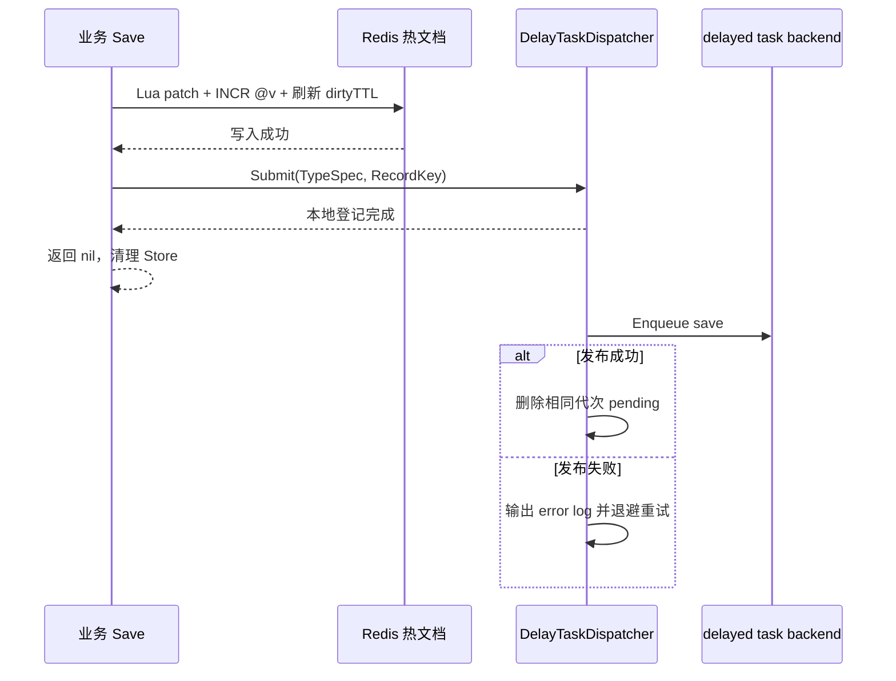
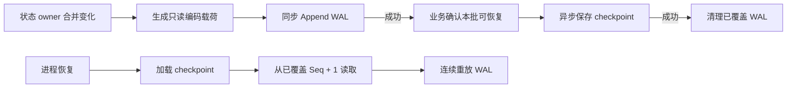

# tx 设计文档

本文面向 `tx` 的维护者、adapter 作者、代码生成器维护者，以及需要扩展底层能力的高级使用者。它解释框架为什么这样拆分、各模块内部如何协作、哪些状态可以共享、哪些边界必须失败，以及性能优化应以什么证据推进。

普通业务开发者应先阅读仓库根目录的 [README](../README.md)。README 是公共行为和使用方式的事实来源；本文是内部结构和技术选型的事实来源。当前进度见 [实施计划](IMPLEMENTATION_PLAN.md)，质量要求见 [架构审计标准](architecture_audit_standard.md)，某次审计的数字和证据见 `docs/audits/`。

## 阅读路径

本文按“系统职责 -> 数据内核 -> 存储 -> 单机事务 -> 分布式模块 -> 性能与维护”逐步深入：

1. 初次维护 `tx`：阅读“设计目标”“系统边界”和“依赖方向”。
2. 修改 GD、Store 或生成契约：阅读“数据对象与 Store”“生成式变更内核”。
3. 修改 Redis、Mongo 或 Fusion：阅读“存储抽象”和“存储后端”。
4. 修改 Procedure 或有状态运行时：阅读“单机事务”和“事务精确 Key 锁注册表”。
5. 修改服务拓扑：阅读“生命周期”和“分布式服务模块”。
6. 优化热点：最后阅读“性能分级与验证”，不要仅凭结构体外观实施优化。

每个核心章节尽量使用相同顺序：

1. 模块负责什么。
2. 模块明确不负责什么。
3. 对外暴露什么契约。
4. 内部由哪些组件组成。
5. 一次完整数据流如何运行。
6. 并发、错误与生命周期如何处理。
7. 为什么选择当前实现。

## 设计目标

`tx` 的最高优先级不是“所有路径都最快”，而是以下顺序：

1. 不产生脏数据，不把失败伪装成成功。
2. 业务 API 清晰、简洁、强类型，框架可以代理的细节保持黑盒。
3. 数据内核与存储、网络、并发调度保持单向依赖。
4. 高频路径以 benchmark、race、逃逸分析或 profile 为依据优化。
5. 低频路径优先正确性和可维护性。

由此得到几条贯穿全部模块的规则：

- 未识别状态默认失败，不默认成功。
- 存储成功前不能清理 Store 变更状态。
- 外部服务波动返回 `error`，不能让业务进程 panic。
- 编程契约错误应在生成期或开发期暴露，不能在运行时猜测修复。
- 纯算法层不感知 Redis、Mongo、gRPC、Actor 或业务项目。
- 跨 goroutine 共享数据时，必须明确复制或所有权转移规则。
- 新抽象只有在减少真实重复、稳定职责边界或降低调用复杂度时才引入。

### 命名规则

核心类型和高频状态必须让字段名与类型语义互相印证：

- `Kind` 表示互斥分类，例如 `FieldNameKind`、`KeyKind`；它不表达一次变更动作。
- `Op` 表示一条变更的操作语义，例如 `OpSet`、`OpReplace`、`OpDelete`、`OpClear`。
- `ops` 保存 `Op`；`dirty` 只用于布尔脏状态、脏子节点索引或脏通知。
- 同步原语以职责命名。事务锁条目使用 `owner`、`waiters` 和 `signal` 表达所有权、等待队列与唤醒职责，调用方不感知内部互斥实现。
- 时间优先使用 `time.Duration` 固化单位；容量和字节配置在名字中写清口径，例如 `MaxBacklogMessages`、`HeapSoftLimitBytes`。
- JSON、BSON、Msgpack 属于字段命名体系；Redis、Mongo 属于使用这些名称的存储边界，不为存储边界重复生成字段名身份。

公开名称一旦让调用者误解职责，应直接修正并同步生成代码和文档；当前工程不为未发布的中间名称保留兼容别名。

## 系统边界

### 四个工程的职责

```text
txgen 输入 Go 源文件
        |
        v
txgen 编译期扫描和生成
        |
        v
txgame 或 txgameslg 的 server/gen/data 与 gen/cmd
        |
        v
tx runtime 契约与 adapter
        |
        v
Redis / Mongo / etcd / gRPC / Actor
```

`tx`：

- 定义元数据、变更追踪、存储抽象、adapter 和可选运行时模块。
- 不读取业务工程 yml，不扫描业务 Go 源文件，不依赖 `txgen`。
- 不生成业务 facade，不决定业务对象如何创建或初始化。

`txgen`：

- 扫描 type 注解和 field struct tag。
- 校验能在编译前确定的冲突。
- 生成 GD、Store、字段 ID、字段名 resolver、存储定位和 cmd 胶水代码。
- 只依赖 `tx` 的稳定契约，不能要求 `tx` 反向认识生成器。

`txgame`：

- 是无状态游戏服务的生产工程组织方式和集成验证模板。
- 读取 yml、环境变量和命令行参数，构造具体 client 与实例配置。
- 提供 `db.Save(role)` 之类业务 facade。
- 以 `services/*` 组织 L4 微服务；服务专属 Handler、路由、Actor 和业务模块随所属 Service 放置。
- `server/internal` 只保存进程级组合根、配置转换和基础设施 facade，不作为业务代码汇总包。

`txgameslg`：

- 是有状态 SLG/MMO 服务的独立生产模板，不依赖 `txgame`。
- 使用 Actor 作为运行期权威对象的唯一串行命令入口，使用 Procedure 和 CacheManager 管理单机事务与分帧保存；对象的实际缓存结构由项目 SPI 决定。
- `slggame` 通过 Fusion 保存角色、军团等根对象；`slgworld` 通过 Mongo WAL 和 checkpoint 保存分区场景数据。
- 只依赖 `tx`、`txgen` 及自身生成产物；配置、服务组合、业务 SPI 和测试均在本项目闭环。

两个模板的业务模块按稳定能力、领域实现和事务编排分层：`modules/*_service.go` 使用包级函数提供 Handler 与 Procedure
共用的业务能力，`modules/internal/<domain>` 保存具体领域实现，`services/<name>/internal/procedure/P*.go` 负责编排
所属 L4 Service 的本机事务。业务能力不持有无状态 Service 实例，不判断当前事务层级，也不负责最终刷盘。

Procedure 单向依赖并组合 `modules` 的稳定业务能力，`modules` 禁止反向依赖 Procedure。Procedure 放在 Service 的
`internal` 目录而不是 `modules/internal`：这样所属 Service 的 Handler 可以启动根 Procedure，其他 L4 Service 又不能
越界调用。Go 的 `internal` 规则同时禁止 Handler 绕过稳定能力直接依赖 `modules/internal` 领域实现。

无状态 Handler 直接调用 `modules` 并显式保存根 GD；有状态 Handler 使用 `txn.Executor.Call` 启动根 Procedure。
父 Procedure 需要复用另一事务流程时，使用当前 `*txn.Tx.Call` 创建子 savepoint。每个 Procedure 只声明自己直接访问的锁，
子调用可以在运行时增加锁；错误的嵌套根调用仍会直接返回错误。该依赖方向借鉴 rj3d 的 Procedure 组合方式，但不依赖线程局部状态猜测根调用与子调用。

跨 L4 Service 调用必须经过 Actor/RPC client，并在目标服务内执行自己的 Procedure；即使多个 Service 聚合在同一进程，
也不扩大单机事务边界。运行模型属于整个 Service，进程启动后不能按请求切换。

### API 分层

同一个能力可能有三层入口：

| 层级 | 面向对象 | 示例 | 约束 |
| --- | --- | --- | --- |
| 业务层 | handler 和业务模块 | `db.Save(role)` | 不暴露 writer、Store、RecordKey 和根 context |
| 扩展层 | 项目装配和 adapter | `storage.Save(ctx, writer, role.Store())` | 显式表达存储依赖和生命周期 |
| 内核层 | 框架维护者和高级扩展 | `VisitChanges`、`txn.WithLocks` | 调用方必须理解所有权和并发契约 |

新增 API 时先判断它属于哪一层。不能因为测试方便，把内核对象泄露到业务层；也不能为了隐藏一切，阻断高级使用者实现 adapter 的可能。

### 运行时能力门面

`server.Server` 持有进程资源的完整实现，但标准服务只接收 `server.Context`。Context 是受控能力门面，
不是 Runtime 对象的字段集合。它可以执行业务写入和 Procedure，但不能接管进程资源生命周期：

| Context 能力 | 所属模块契约 | 服务可做什么 | owner 权限仍在哪里 |
| --- | --- | --- | --- |
| `Tasks()` | `lifecycle.Tasks` | 注册本服务后台任务、读取取消信号 | `Cancel/Wait` 在 `server.Server` |
| `Admission()` | `lifecycle.Admission` | 登记和封口本服务外部入口 | 进程排水顺序在 service host |
| `Storage()` | `server.Storage` | 安装业务 facade，并通过带健康保护的 reader/writer 读写变更 | client、健康状态、worker 和 Close 在 server |
| `WAL()` | `wal.Store` | 追加恢复记录、连续重放和 checkpoint 后清理 | backend、索引、连接和健康状态在 server |
| `RPC()` | `rpc.Registrar` | 启动前注册 protobuf service、读取 endpoint | Serve/Stop 在共享 Host |
| `Directory()` | `discovery.Directory` | 查询 running/指定实例快照 | watch 与 Replace 在 discovery runtime |
| `Actor()` | `actor.Messenger` | 解析 PID、单向投递、接收确认和业务调用 | Start/Shutdown/ActorSystem 在 actor runtime |
| `Transaction()` | `txn.Executor` | 执行根 Procedure | CommitParticipant 绑定在 StateRuntime，Flush 在 Cache Runtime |

门面返回专用 wrapper，而不是把具体指针仅仅窄化成接口。这样服务不能通过类型断言重新取得
`Cancel`、`Stop`、`Shutdown`、`Replace` 或 `Flush`。

`Context.Instance()` 返回 ownership-safe 的本地实例快照。运行时以锁保护实例状态，复制 `Services`
切片后再交给调用方；它不是 discovery 目录中可写的成员对象。状态顺序固定为
`starting -> running -> draining -> stopping`，服务可观测状态与对外注册状态使用同一语义。

`Context.Advanced()` 是第一版受控高级 SPI：

- `Redis()` 返回 `redis.ScriptRoutes`，允许基础设施 adapter 复用已经装配的 Redis 路由和连接；它不暴露
  Close 或连接池所有权。
- `Slots()` 返回 `discovery.SlotStore`，允许高级项目按完整 assignment 和 generation CAS 管理逻辑槽位；
  它不暴露 etcd client、成员 lease 或 discovery 快照写权限。

普通 handler 不应持有 `server.Context`。项目组合根通过 `server.WithSetup` 把 `Storage()` 包装成
`db.Save(role)` 等业务 facade；可选服务只在 `Start(Context)` 期间取得自己需要的能力。

## 依赖方向

核心依赖保持由上到下单向：

```text
anno / astscan
       |
       v
      meta
       |
       v
change <------ generated Store
  |
  v
storage contracts
  |
  +--------+---------+
  v        v         v
redis    mongo     fusion

optional modules:
lifecycle <- discovery / rpc / msgq / agent / actor / control / cache manager
change <- txn runtime <- cache manager -> storage contracts
```

关键约束：

- `change` 不能依赖 `storage`，否则纯变更算法会被具体 I/O 语义污染。
- `storage` 通用契约不能依赖 Redis 或 Mongo adapter。
- `modules/actor` 不代表 GD，不依赖 Store、Fusion 或 `txn.Runtime`。
- `modules/txn` 只依赖 `change`，不持有 writer 或具体 backend。
- `modules/cache` 依赖 `txn` 提交 SPI 和通用 `storage` 契约，不依赖 Redis、Mongo 或 Fusion 实现。
- 项目业务可以组合 Actor、Procedure 和存储 runtime，模块之间不反向耦合。

全局 registry、回调和 `any` 也可能形成隐式反向依赖。审查依赖时不能只看 import cycle。

### 模块组合规则

维护时按以下职责层次判断新增代码放置位置：

```text
change/meta/storage contracts
  -> storage backend 与 lifecycle/discovery/rpc/msgq/actor/txn 基础模块
  -> server/adapters 下的跨能力中立适配
  -> server/services 下的可选标准服务
  -> server.Server 进程装配与反序关闭
  -> txgame 配置转换、项目服务和业务 facade
```

- 基础模块声明最小消费契约。路由器依赖 `discovery.Directory`，不能依赖具体
  `*ServiceDirectory`；服务注册只依赖 `rpc.Registrar`，不能取得 `*rpc.Host`。
- 跨能力胶水必须有中立归属。例如 `server/adapters/msgqredis` 只把
  `redis.ScriptRoutes` 适配成 `msgq.SessionStore`，不启动 msgq，也不拥有 Redis client。
- 标准服务只负责本服务的配置、协议注册和资源启停。`agent` 不导入 `services/msgq`；同进程复用通过
  `LocalMsgQ` 契约，跨进程会话解析通过 `modules/msgq` 与中立 Redis adapter 完成。
- `server.Server` 可以实例化和编排下层模块，但下层模块不能反向访问 server 的内部 `runtime`。
- 测试 fake 放在 `server/internal/servertest`，不能为了测试构造任意 Runtime 而扩大生产 API。

### L0-L4 与能力模组

运行时使用下面的固定层级：

| 层级 | 职责 | 示例 |
| --- | --- | --- |
| L0 | 纯算法、基础结构和稳定契约 | `change`、`meta`、`lifecycle`、storage/WAL 契约 |
| L1 | 外部 backend 与传输 adapter | Redis、Mongo、gRPC、etcd adapter |
| L2 | 可复用运行时组件 | Fusion Strategy、RPC Host、Scheduler、Transaction Runtime、Actor Runtime |
| L3 | 进程装配与能力门面 | `server.Server`、CMod 依赖图、进程生命周期、受控 Context |
| L4 | 可由 `--services` 选择的服务 | agent、msgq、game、room、battlefield |

CMod 固定属于 L3，是带稳定身份、依赖关系和进程生命周期的能力门面。L0-L2 的算法、backend、Runtime 和 Scheduler
只能作为强类型组件被 CMod Builder 组合，不拥有全局 `CModID`。L4 服务只声明直接 `CModID`，`server` 使用同一个解析器
得到依赖闭包、稳定拓扑顺序、循环路径和缺失依赖。`Requires` 会选择依赖，`After` 只对已经选中的门面增加顺序边。
当前内置关系为：

```text
fusion-storage requires redis-storage, mongo-storage
fusion-storage components: scheduler=delay
state-runtime components: transaction=default, cache=<project>[checkpoint=<project>,wal=<backend>]
```

`state-runtime` 是项目注册的 L3 CMod。Transaction、Cache 和可选 WAL 都由它统一校验、启动、排水和停止；WAL 只在
Builder 指定的 L4 服务被选择时生效。`fusion-storage` 统一拥有 Delay Scheduler，服务不再分别选择 producer 与 consumer。
启动日志保留 CMod 拓扑顺序，同时输出过滤后的组件拓扑，便于核对当前进程实际创建了哪些组件。

Actor CMod 没有隐含普通 RPC 或服务发现依赖。ProtoActor Remote 与官方 etcd Cluster Provider 是 Actor Runtime
自身的传输和成员能力；L4 服务若同时使用普通 gRPC 或 `ServiceDirectory`，必须显式声明对应 CMod，避免把两套
独立通信拓扑错误耦合。

组件职责仍保持正交。Transaction 只负责锁、undo、savepoint、死锁检测和提交参与者调度；Cache 只登记根 Store 并决定
何时 Flush；Fusion 与 Mongo 是可选目标 Writer；WAL 只提供追加、重放和 checkpoint 契约。正交不等于平级暴露：
StateRuntime 负责把这些组件按明确顺序组合为一个进程能力门面。

典型 L4 组合与调度边界如下：

| 服务形态 | 显式 CMod | 运行期调度 |
| --- | --- | --- |
| 无状态请求服务 | RPC、Fusion | Handler 修改 GD 后显式保存；Fusion 内部运行 Delay Scheduler |
| 有状态逻辑服 | RPC、Fusion、StateRuntime | Procedure 只提交内存；StateRuntime 的 Cache 组件分帧写 Fusion |
| 有状态大世界 | RPC、Mongo、StateRuntime | Cache 的 WAL 子组件先可靠追加，再异步推进 Mongo checkpoint |

StateRuntime Builder 只组合组件，不隐式选择外部存储 CMod。启用 Mongo WAL 的服务仍须在自身 `Requires` 中显式声明
Mongo；使用 Fusion Writer 的服务显式声明 Fusion。这样配置关系在 L4 仍然可见，组件生命周期又不会泄漏为一组平级 CMod。

项目组合根负责创建唯一的 StateRuntime 实例：

```go
cacheComponent, err := cachemgr.NewComponent(config.CacheManagerConfig)
if err != nil {
	return nil, err
}
stateRuntime, err := server.NewStateRuntimeBuilder().
	Cache(cacheComponent).
	WAL(server.MongoWALForServices("slgworld")).
	Build()
if err != nil {
	return nil, err
}

return server.New(
	framework,
	server.WithCMod(stateRuntime),
	server.WithService(slggame, slgworld),
)
```

`Cache` 接收 `StateCache` SPI，`WAL` 接收 `StateWAL` SPI。项目可以替换缓存或 WAL 实现，但组件只能看到
`StateRuntimeContext` 提供的 Tasks、Storage、目标感知 WriteAdmission、Transaction、WAL 和提交参与者绑定接口，不能取得
`Server` 所有权。
内置 `MongoWALForServices` 只是 `StateWAL` 的第一种实现。Builder 生成的组件拓扑为：

```text
state-runtime
├── transaction=default
└── cache=txgameslg
    ├── checkpoint=mongo  [仅 services 包含 slgworld 时生效]
    └── wal=mongo         [仅 services 包含 slgworld 时生效]
```

启动时 StateRuntime 先根据本轮 `ServiceSelection` 判定 WAL 是否生效；生效时先校验并创建 WAL，再创建 Transaction，最后
启动 Cache 并绑定提交参与者。排水与停止从 Cache 开始，Mongo/Fusion 等外部 CMod 因拓扑在 StateRuntime 之后反向关闭，
因此最终 Flush 期间依赖仍然可用。组件不能自行注册 CMod、修改全局依赖图或关闭外部 backend。

启动固定执行“选择 L4 服务 -> 解析 CMod 闭包 -> 惰性转换闭包配置 -> 校验全部 CMod -> 按拓扑启动”。全部
校验通过前不能建立连接、监听端口或启动 goroutine。停止时先排水和停止 L4，再反向排水 CMod，取消并等待根
`WaitGroupContext`，最后反向关闭 CMod 持有的物理资源。

CMod 或 L4 Service 的 `Start` 允许分阶段创建连接、监听器和后台任务，因此实现 `Stop` 时必须保证幂等，并能清理
部分启动状态。每个 CMod 的 `Tasks()` 指向独立子 `WaitGroupContext`：某个单元的 `Start` 返回错误后，Host 先取消并等待
该单元登记的后台任务，再调用失败单元的 `Stop`；随后按逆拓扑顺序以相同流程停止此前成功启动的单元。这样 Redis、Mongo
等依赖不会在使用它们的 worker 仍运行时被提前关闭。启动错误与所有清理错误通过 `errors.Join` 一并返回。

`Server` 使用 `starting -> running -> stopping -> stopped` 单向状态机。`Context()` 只在完整启动成功后发布，启动中、失败回滚
和停止后均不可见；并发 `Stop` 必须等待 `Start` 完成后再关闭已经创建的全部资源，不能返回成功后留下继续运行的进程。
正常停止时先执行 CMod Drain，随后取消并等待根及全部子生命周期，最后才调用 CMod Stop 释放物理依赖。

`CModConfigProvider` 只在依赖图和 L4 服务集合确定后运行，接收只读 `AssemblySelection`。它解决同一份 YAML 被
agent、msgq、game 等不同进程复用时的配置边界：未选择 StateRuntime 时不解析事务时长，未选择 Actor 时不要求 Actor
host，未选择 Mongo 时不验证或连接 Mongo。
未知 YAML 字段仍由项目解析器在加载期拒绝。CMod ID 只用于依赖解析和启动日志；业务调用使用构造函数强类型注入或
`server.Context` 的稳定窄接口，不提供按字符串取 `any` 的 service locator。

`CModContext.HasCMod` 查询本轮已经解析完成的完整选择闭包，不是“此前已经启动”的瞬时状态。因此所有 Validator 都能在
创建连接之前按组合条件预检项目配置；Start 仍只能使用拓扑中已经位于自己之前的实际运行时能力。

## 元数据与代码生成边界

### 元数据链路

唯一输入链路是：

```text
Go 注释 / struct tag
        |
        v
anno 解析单条注解
        |
        v
astscan 绑定 package/type/field
        |
        v
meta 规范化和校验
        |
        v
txgen 模板生成
```

`anno` 不猜注解属于哪个类型；绑定关系必须由 AST 确定。`meta` 表达的是生成器和 runtime 共同理解的稳定语义，例如存储模式、路由字段、字段 ID 和多序列化名称。

`meta.Normalize` 是注解字符串进入强类型元数据的唯一转换边界。duration、bool 和 Mongo 数值参数必须在这里
严格解析并携带属性名返回错误，不能把非法输入静默转换为 `0` 或 `false`。纯整数 duration 按秒兼容既有输入，
但使用 `time.ParseDuration` 完成范围检查，避免整数乘法溢出产生错误生命周期。

紧凑注解参数必须保留声明顺序、重复项以及参数和裸 flag 的区别，不能先压入 `map[string]string` 再规范化。
Mongo 命名复合索引依赖同一个 `index:<name>` 在多个字段上重复出现，单个字段也可以同时声明命名索引和匿名
索引。例如 `Platform mongodb:"index:p_id"` 与 `PlatformUId mongodb:"index:p_id,index"` 共同声明
`p_id=(Platform, PlatformUId)`，并为 `PlatformUId` 额外声明一个匿名单字段索引。注解解析层只保存有序参数，
`meta.Normalize` 负责将其转换成强类型索引元数据。

`meta.Validate` 是存储元数据的唯一共享校验入口。除校验 `idField`、`routeBy` 的 Go 字段身份和类型外，它还
要求 Redis 的 `routeType/key` 与 Mongo 的 `routeType/collection` 是非空且没有首尾空白的原始文本。这些值
直接参与路由表、记录 key 和 collection 定位，校验层不能补默认值或静默去空白；txgen 和高级手工元数据调用方
都必须复用该入口并得到相同的失败语义，避免配置错误延迟到首次外部 I/O。通用 `meta.Registry` 允许保存只供独立模块
读取的部分元数据，因此不隐式调用完整存储校验；手工构造完整存储规范的高级调用方必须显式调用 `meta.Validate`。

存储模式同时决定允许存在的 type 级 backend 元数据：Redis、Mongo 模式只能携带各自的配置，Fusion 必须同时
携带两者。不能保留一份运行时不会消费的额外 backend 配置，否则生成器、RecordKey 解析和维护者会面对多套互相
矛盾的定位信息。字段 JSON/BSON/MessagePack 名称不属于 backend 启用开关，不受这项排他规则影响。

### 字段名体系

字段名本体是：

- Go 字段名。
- JSON 字段名。
- BSON 字段名。
- MessagePack 字段名。

Redis 和 Mongo 是使用这些名称的后端，不是额外的字段名体系：

- Redis JSON 文档使用 JSON 名。
- Mongo 完整编解码使用 BSON tag。
- cmd 下行协议使用 MessagePack 名。
- Store API 和 `LoadFields` 输入使用 Go 字段名。

生成输入采用统一的 ASCII 标识符契约：显式 Alias、JSON、BSON 和 Msgpack 名必须匹配
`[A-Za-z_][A-Za-z0-9_]*`。普通字段只接受 `omitempty`，匿名嵌入字段只接受 BSON/Msgpack 的 `inline`。
框架不为特殊静态字段名维护 TypeScript 引号属性、数据库名称转义或多边界兼容分支；txgen 在生成前失败。
运行期 `map[string]` 的动态 key 不属于这条规则，Mongo 边界仍按既定策略在不安全 key 上降级为整字段写。

部分读取是严格的元数据契约。`storage.ValidateLoadFields` 使用 `TypeSpec.Fields` 校验所有请求字段；
生成 helper、Redis/Mongo/Fusion adapter 与 cluster 路由都必须在自定义 loader、选路和外部 I/O 前完成校验。
未知字段统一返回 `storage.ErrUnknownField`，不能把只返回记录键或空字段投影解释为读取成功。空字段列表表示完整读取；
重复的合法字段不改变语义，可由具体读取器去重。该校验针对输入侧 Go 字段身份，读取结果仍按具体边界使用
JSON 或 BSON 名称。

生成 resolver 负责 `FieldID -> go/json/bson/msgpack name` 的静态映射。Redis、Mongo、Provider 在各自边界选择对应命名体系，运行时不通过反射重新推导生成期已经知道的关系。

字段编号从 1 开始连续分配，因此生成代码用私有定长表保存 Go 名和 JSON 名，通过 FieldID 直接索引。业务侧需要把 Go 字段名传给 `LoadFields`、`FindOptions` 等接口，所以生成 `GD*Field<Field>` 公开常量；JSON、BSON、MessagePack 名只在序列化和存储边界使用，不额外导出逐字段常量。BSON、MessagePack 仅为与 JSON 不同的字段生成覆盖分支，例如 Mongo `_id` 或协议短名。该布局避免按每个字段展开四套重复 switch，同时保持无反射、零运行时字符串转换和零分配。

生成代码还会基于上述名称表和紧凑字段类型表构建一份包内私有的只读 `TypeSpec`。生成的 Load、Find、Delete、SaveChange 和类型注册路径直接复用该静态元数据，不在每次 I/O 前重新展开字段描述。公开的 `GD*TypeSpec()` 与 `Store.TypeSpec()` 则通过 `meta.CloneTypeSpec` 返回隔离副本，调用方修改字段切片、存储指针、字段配置 map 或 Mongo 索引时不会污染生成包的静态规范。

`CloneTypeSpec` 只负责深拷贝可变成员；`TypeRef` 的去空格和完整名称补齐属于 Registry 注册边界。所有接收私有静态 `TypeSpec` 的 tx 内部 adapter 必须把它视为只读输入，不能修改其中的 map、slice 或指针成员。

Mongo 索引元数据由 `storage/mongoindex` 解析为 driver 无关模型。该包只依赖 `meta`，负责 BSON 路径转换、命名索引合并、
稳定匿名名称以及 TTL/文本权重语义校验；txgen 在生成前调用它，Mongo runtime 在创建索引前调用同一实现。具体 Mongo
driver 只负责把已经验证的模型转换为 `mongo.IndexModel`，生成器不会因此依赖 Mongo driver 或文档 codec。

### 生成包基础层

txgen 在每个 data 输出包只生成一份私有基础层，当前与类型注册表一起放在 `type_registry.go`。它不是业务 API，也不改变 `GD*`、`GD*Store` 和 `GD*StoreView` 的公开签名；职责是承接所有类型都会重复、但不需要逐字段静态展开的实现：

- 集合操作状态的复制、恢复和单 key 回滚。
- 普通字段赋值与 undo 登记。
- 已加载字段 bitset 的查询、设置和字段名枚举。
- RecordKey 字段补齐检查，以及单条/批量读取后的 Store 装配流程。
- StoreView 的叶子状态、路径尾部和低频状态查询辅助逻辑。

具体 `GD*Store.go` 仍保留生成期已知类型的字段 switch、集合 key/index 校验、StoreView `record/copy/visit`、嵌套 `ResolveValue` 和子 Store 路由。这些路径位于 setter、捕获、合并或文档遍历的高频调用链，静态生成能避免反射、`any` 断言和回调分发，并给编译器更多内联机会。顶层 `ResolveValue` 仍先经过单个紧凑字段 switch；只有指针、map 和 slice 的嵌套路径按类型静态展开。维护者不能只为缩短生成文件而把热路径改成动态注册表；也不能把低频固定流程重新复制到每个 Store。生成体积和运行时 benchmark 必须一起作为模板重构门槛。

### FieldID 稳定性

`FieldID` 是运行时变更路径的字段身份，不是网络协议号。它由生成代码为每个结构定义并配套 resolver。维护时必须保证：

- 同一生成版本内唯一。
- 变更创建方和解析方使用同一份生成代码。
- 不把 FieldID 直接持久化成长期数据库协议。
- 跨版本持久化任务保存记录定位，不保存依赖旧 FieldID 的长期变更流。

## 数据对象与 Store

### GD 的职责

`GD*` 是纯业务数据结构：

```go
type GDRole struct {
    RoleId int64
    Name   string
    Items  map[int32]*GDItem
}
```

它可以被 JSON、BSON、MessagePack 编解码，可以直接读取 public field，也可以用于快照差分。GD 不负责：

- 选择 Redis 或 Mongo。
- 持有数据库 client。
- 自动提交事务。
- 在字段中暴露 `*GD*Store`。

生成的便捷 setter 可以代理默认主 Store，但这不改变 GD 的数据职责。

### Store 的职责

`GD*Store` 是可变的变更追踪结构。它绑定一个 GD 数据指针，但不保存第二份完整业务数据：

```text
GDRole <--------------------- main GDRoleStore
唯一可变业务数据                可变状态树
                                   |
                                   | View(configure) 同步捕获
                                   v
	                            GDRoleStoreView
	                            ├── 稀疏 GDRole 值
	                            └── txgen 生成的强类型视图状态树
```

Store 负责：

- 提供强类型 setter 和集合 wrapper。
- 使用生成期字段槽位和集合 key/index 状态记录变更语义。
- 为子 Store 组合父路径。
- 在输出边界读取当前 GD 值。
- 为事务绑定临时 undo recorder。
- 同步捕获强类型 StoreView 并构建下行文档。

Store 不负责：

- 保存业务对象的历史完整副本。
- 自动选择持久化时机。
- 作为 cmd 或 GD 字段类型发送给客户端。

### Store 状态树

嵌套对象和集合形成 Store 组合树：

```text
GDRoleStore
  |
  +-- ItemsStore(map key=1001)
          |
          +-- GDItemStore
                  |
                  +-- Quantity
```

叶子 Store 只保存自己的局部字段状态；集合 Store 保存发生变化的 key/index 及对应子 Store，父级通过 `notifyDirty` 只记录“这个分支需要访问”。调用根 Store 的 `VisitChanges(visitor)` 时，框架才递归访问已标脏分支、追加集合 key/index，并得到：

```text
Items[1001].Quantity
```

因此 Store 状态树确实分层保存局部变更状态，但不会在每次修改时遍历整棵树，也不会让根 Store 长期保存一份已经展开的全路径副本。所谓“冒泡”是脏通知：子节点通知父集合对应 key/index 已变更；真正的路径拼接发生在输出边界。根 Store 只递归访问脏子节点索引，使用 `JoinPathLimited` 组合路径。生成 Store 的状态在记录时已经按字段或 key 唯一化，不需要输出后再做第二次压缩。父子关联属于 Store 路径关系，不代表 GD 对象只能有一个父节点。

### 共享指针与按路径追踪

同一个 `*GDItem` 可以放入多个玩家或多个集合。业务数据允许共享引用，变更身份由 Store 路径决定：

```text
roleA.Items[1] ----+
                   +----> same *GDItem
roleB.Items[9] ----+
```

两个根 Store 会创建各自的子 Store 路径。通过 `roleA.ItemsStore().Get(1)` 得到的 Store 只向 roleA 根记录变化；不能让裸 `item.SetQuantity()` 自动猜测应该写入哪个根或哪个 view。

### 主 Store、selector 与 StoreView

这三个对象的职责刻意分开：

- 主 Store 是唯一可变追踪对象，用于受控修改、持久化、undo 和有状态 Runtime 累计。
- selector 是 `View` 回调期间存在的临时 `GD*Store`。它复制主 Store 当前的选择状态，只允许 `Touch/UnTouch`；调用 `Set/Clear/Replace` 或集合增删改会立即 panic，暴露框架 API 的编程误用。
- StoreView 是生成的独立类型，例如 `GDRoleStoreView`。它持有捕获时刻的稀疏 `GDRole`、同源身份和 txgen 为 `GDRole` 生成的私有强类型状态树，不再持有根 GD、主 Store 或 selector。普通字段状态放在定长 `ops` 中，集合 key/index 使用原始 Go key 类型，生成对象子状态按需创建；完整 `change.Path` 只在 `VisitChanges` 输出边界临时组合。

默认捕获主 Store 当前全部变更：

```go
role.SetName("alice")
role.SetPower(0)

view, err := role.Store().View(nil)
if err != nil {
    return err
}

// Role 是捕获时刻的稀疏值；HasPower 能区分“选中的零值”和“未选择”。
fmt.Println(view.Role.Name) // alice
fmt.Println(view.HasPower()) // true
```

只选择广播字段时，先清空继承的选择，再 Touch 目标路径：

```go
view, err := role.Store().View(func(selector *data.GDRoleStore) {
    selector.AllUnTouch()
    selector.TouchName()
    selector.TouchPower()
})
if err != nil {
    return err
}

body, err := view.Document(change.FieldNameMsgpack)
```

`TouchPower` 只调整 selector，不修改 `role.Power`，也不污染主 Store。捕获过程只复制所选数据：标量直接赋值，嵌套指针、map、slice 只复制所需分支，整字段 Replace/Clear 才复制整个字段。因此成本与所选路径规模相关，不等于深复制整个根 GD。

StoreView 创建完成后，根 GD 的后续修改、map key 增删、slice 长度变化和指针替换都不会改变已经捕获的值。`view.Role` 对业务可读，但应在捕获后按不可变对象使用。根对象仍处于同一所有权区间时，用 `view.Capture(store, configure)` 直接累计当前批次；后续批次已经创建为独立 StoreView 或进入队列时，再通过 `Merge` 合并。两种方式都不能通过直接修改稀疏 Role 来补内容。

### 输出与帧内合并概览

生成代码提供两类输出入口：

- 主 Store 的 `VisitChanges(visitor)` 同步逐条访问当前规范化路径，不创建中间变更切片。Redis、Mongo、Fusion 与 Runtime 容量检查使用该入口。
- StoreView 的 `VisitChanges(visitor)` 访问生成的强类型视图状态树；`Document(kind)` 从 StoreView 自身的稀疏 GD 取值，不再读取根对象。

存储边界接受 `Source`，它组合 `VisitChanges` 与 O(1) 的 `HasChanges`。这避免 adapter 为判空先遍历一次、真正写入时再遍历一次，也把“源在状态不变时可重复访问”的契约固定在编译期。

`Source`、`Visitor` 和 `VisitChanges` 只描述同步遍历，不暗示返回新对象、改变字段名或构建文档。真正的输出转换由边界名称表达：`BuildDocument` 构建通用文档，Redis 构建 JSON patch，Mongo 构建 update document。`Path` 是结构化字段路径；输出后的字符串路径使用 `DocumentPath`，两者不会混用。

```go
if store.HasChanges() {
	err := store.VisitChanges(change.VisitorFunc(
		func(path change.Path, op change.Op) error {
			// 在回调内同步消费 path/op；不要保留可变 Store 引用。
			return nil
		},
	))
	if err != nil {
		return err
	}
}
```

字段名体系与使用边界保持正交：

```text
Store state (FieldID + PathKey + Op)
├── Document(FieldNameGo/JSON/BSON/Msgpack)  # 高级通用文档构建
├── cmd Provider                                    # 固定选择 Msgpack
├── Redis adapter                                   # 固定选择 JSON，并应用 Redis patch 规则
└── Mongo adapter                                   # 固定选择 BSON，并应用 Mongo update 规则
```

`Document(FieldNameJSON/BSON)` 只改变通用文档的路径名称，不会执行 Redis subKey 分组、Mongo
`_id` 保护或 unsafe key 降级。存储调用不能用它绕过 adapter。

Battlefield 一类按帧广播的对象，在同一个实体锁或 Actor 执行段内优先直接累计：

```go
frame, err := role.Store().View(nil)
if err != nil {
    return err
}
role.ClearChanges()

// 同一帧内后续逻辑继续修改相同 role。
item, _ := role.ItemsStore().Get(1001)
item.SetQuantity(7)
if err := frame.Capture(role.Store(), nil); err != nil {
    return err
}
role.ClearChanges()
body, err := frame.Document(change.FieldNameMsgpack)
```

累计规则由生成的强类型视图状态树与稀疏值复制共同完成：同字段或同 key 的后写覆盖先写，后续父字段 Replace/Clear/Delete 会清除此前子路径，互不相交的字段保留；Clear/Delete 后再出现子路径时，父路径提升为 Replace 并保留后批次捕获的数据。`Capture` 必须使用创建视图的同一个主 Store；即使两个主 Store 绑定同一个 GD 指针，也会返回 `ErrValueMismatch`，避免混淆两个独立追踪边界。`Capture` 会同步读取根 GD，因此只能在根对象所有权边界内调用，且不会替调用方清理源 Store。

如果后续批次已经创建为独立 StoreView，则使用 `frame.Merge(next)`；该路径只访问两份稀疏视图，不读取根 GD，适合批次已经进入帧队列后的合并。`Merge` 不修改 `next`，因此来源视图在合并后仍可读取或用于其他只读输出。

StoreView 已经与根 GD 脱离，可以在实体锁或 Actor 单线程区间内捕获后送入帧队列；发布后仍必须按只读对象使用。若先构建 `change.Document` 再跨协程，文档中的复杂 value 只可能引用 StoreView 的稀疏数据，不会引用根 GD，但同样不得在发布后修改。

### 两种变更模式

Store 受控修改模式：

```go
role.Store().SetName("alice")
item, _ := role.Store().ItemsStore().Get(1001)
item.SetQuantity(7)
```

- O(1) 更新字段槽位或集合 key/index 状态。
- 适合大对象、高频修改和有状态服务。
- 事务必须使用这一模式，undo 只覆盖受控 API。

Snapshot Diff 模式：

```go
role.BeginChange()
role.Name = "alice"
role.Items[1001].Quantity = 7
err := role.SaveChange(...)
```

- 允许自然修改 public field。
- 对整棵根对象创建基线并在结束时比较。
- 适合低频请求，不适合持续高频大对象循环。

同一变更周期不能混用两种模式。框架无法在裸字段写入时同步维护 Store 的实时变更状态和事务 undo。

## 生成式变更内核

当前内核由“GD 当前值、Store 状态树、同步遍历和输出边界”组成：

```text
GDRole                                      业务数据唯一事实源
└── GDRoleStore                             根 Store
    ├── ops[Name] = OpSet                   顶层字段槽
    ├── ops[Power] = OpSet
    └── GDRoleItemsMapStore                 map 集合 Store
        ├── ops[1001] = OpReplace           集合元素槽
        └── dirtyChildren[1002]
            └── GDItemStore
                └── ops[Quantity] = OpSet   子对象字段槽
```

Store 不保存第二份业务数据，也不保存每次操作的 value、时间或顺序。`GDRoleStore.Value`、集合 Store 的 `parent` 和子 Store 的 `Value` 都指向当前 GD 数据；Store 只保存“哪些持久化位置需要按什么语义重新读取”。

生成类型名直接携带容器语义：map 字段使用 `<GD><Field>MapStore`，slice 字段使用
`<GD><Field>SliceStore`。这些集合 Store 只能由所属 GD 或父 Store 的 `<Field>Store()` 创建，
不支持手工构造或零值使用。

### 限界上下文与固定术语

后续设计、评审和文档使用下表术语。一个词只在对应上下文内表达一种职责：

| 限界上下文 | 固定术语 | 对应 Go 结构或方法 | 精确定义 |
| --- | --- | --- | --- |
| 数据上下文 | 根 GD | 生成的 `GD*`，例如 `GDRole` | 一个可持久化聚合的业务数据对象，也是当前值的唯一事实源 |
| 数据上下文 | 当前值 | `GD*` 的字段 | 输出边界实际读取的最终业务值，不是 Store 中保存的副本 |
| 追踪上下文 | 主 Store | `GD*Store`、`GD*.Store()` | 绑定根 GD、允许受控修改并可交给持久化入口的 Store |
| 追踪上下文 | Store 状态树 | `GD*Store`、直接指针子 Store、集合 Store | 按生成类型和持久化路径组织的变更状态；树节点不保存父路径字符串 |
| 追踪上下文 | Store 变更状态 | 字段槽、集合元素槽、脏子节点索引 | 主 Store 当前保留的规范化操作集合；同一位置只保留最后语义，不保存业务值副本 |
| 追踪上下文 | 标脏 | `Set*`、`Touch*`、集合 Store 受控 API | 把一个持久化位置写入 Store 变更状态；不等于立即构建文档或执行 I/O |
| 追踪上下文 | 字段槽 | `GD*Store.ops[fieldID-1]` | 顶层或子对象普通字段的最后变更语义 |
| 追踪上下文 | 集合元素槽 | `<GD><Field>MapStore.ops[key]`、`<GD><Field>SliceStore.ops[index]` | map key 或 slice index 本身的最后 Replace/Delete 等语义 |
| 追踪上下文 | 脏子节点索引 | 生成的 map/slice Store `dirtyChildren` | 只标识哪些缓存子 Store 需要遍历，不保存路径或 value |
| 追踪上下文 | 脏通知 | `dirtyHook`、`notifyDirty`、`markChildDirty` | 把子 Store 加入父级待遍历索引或通知运行时；不是完整变更向根复制 |
| 加载上下文 | 已加载字段状态 | `loadedFields`、`LoadedFields()` | 描述部分加载结果，与字段是否变更相互独立 |
| 加载上下文 | 字段投影 | `Load*Fields`、`[]meta.FieldRef` | 指一次存储读取请求选择的字段集合；不是 Store 状态树、StoreView 或变更文档 |
| 快照差分上下文 | 快照基线 | `BeginChange()` 保存的根 GD 副本 | 只用于直接修改 public 字段后的差分，不是 StoreView，也不是待发送载荷 |
| 快照差分上下文 | 快照差分 | `BeginChange()`、`SaveChange()` | 比较根 GD 当前值与快照基线并生成变更；与主 Store 受控修改模式互斥 |
| 遍历上下文 | 变更源 | `change.Source` | 由 `HasChanges` 和 `VisitChanges` 组成的同步只读访问契约 |
| 遍历上下文 | 结构化路径 | `change.Path`、`PathNode`、`PathKey`、`FieldID` | 使用字段编号和强类型 key/index 表达的当前位置 |
| 遍历上下文 | 变更位置 | 一条结构化路径对应的位置 | 容量统计和去重使用的逻辑单位；不能写作含义不明的 dirty path |
| 遍历上下文 | 变更操作 | `change.Op` | 当前结构化路径上的 Set、Replace、Delete 或 Clear 语义 |
| 遍历上下文 | 同步遍历 | `VisitChanges(change.Visitor)` | 在当前调用栈中从 Store 状态树生成 `Path + Op`；不创建中间变更切片 |
| 取值上下文 | 值解析 | `change.ValueResolver`、`Store.ResolveValue` | 按结构化路径从当前 GD 读取最终值，并区分业务 nil 与解析失败 |
| 捕获上下文 | selector | `Store.View(func(*GD*Store))` 的回调参数 | 继承主 Store 当前选择状态的临时 Store；只允许 Touch/UnTouch，不允许修改业务数据，也不会返回给调用方 |
| 捕获上下文 | StoreView | 生成的 `GD*StoreView` | 持有捕获时刻的稀疏 GD 值、生成的强类型视图状态树和同源身份；不引用根 GD 或主 Store |
| 捕获上下文 | 稀疏 GD | `StoreView.Role` 等生成字段 | 只复制所选路径的强类型数据；字段为零值时使用 `Has<Field>()` 判断是否被选择 |
| 捕获上下文 | 同步捕获 | `Store.View(configure)` | 在当前调用栈内完成路径选择、状态规范化和值复制；返回后根 GD 的变化不影响 StoreView |
| 捕获上下文 | 同源累计 | `StoreView.Capture(store, configure)` | 在同一根对象所有权区间内，把当前 Store 的路径和值直接累计进既有视图；不创建中间 StoreView，也不清理源 Store |
| 合并上下文 | 帧内合并 | `StoreView.Merge(next)` | 按批次先后合并同一主 Store 捕获的独立 StoreView；`next` 表示后发生批次 |
| 合并上下文 | 覆盖吸收 | 父级 `OpReplace/OpClear/OpDelete` | 父路径已经完整决定写入语义，子路径不再单独输出 |
| 防御上下文 | 祖先提升 | 最近安全祖先的 `OpReplace` | 超深路径、Store 合并冲突或后端路径限制下的正确性降级 |
| 容量上下文 | 容量收敛 | `storage.CollapsibleChangeStore`、`CollapseChanges()` | 单根变更位置超预算后，清理细粒度状态并只 Replace 实际变脏的顶层分支 |
| 输出上下文 | 变更文档构建 | `Document(kind)`、`change.BuildDocument`、Redis/Mongo document builder | 转换字段名、解析值并形成目标边界需要的变更文档；不能简称为“投影” |
| 输出上下文 | 编码载荷 | BON/JSON/BSON `[]byte` | 由视图、变更文档或其他独立对象编码而成；发布后按只读载荷使用 |
| 发布上下文 | 只读发布 | `msgq.Pub` 等异步所有权交接 | 发布成功后调用方和消费方都不得修改、追加或复用载荷内存 |
| 持久化上下文 | 保存成功清理 | `storage.Save`、`Store.ClearChanges()` | 存储成功后递归清理 Store 状态，不修改 GD 数据 |
| 持久化上下文 | 保存失败保留 | `storage.Save` 的错误路径 | I/O 或边界构建失败时保留全部状态，供后续重试 |
| Fusion 上下文 | 纯净回源缓存 | Mongo 回源后写入 Redis、尚未承载业务变更的文档 | 可以使用有限 TTL；不是待回写事实 |
| Fusion 上下文 | 脏热数据 | Fusion 业务写入后、尚未完成 Mongo 可靠回写的 Redis 文档 | main、subKey 和 `@v` 使用 `dirtyTTL` 安全窗口，并由每次热写刷新 |
| Fusion 上下文 | 延迟保存任务 | `fusion.DelayedSave` | 到期后读取 Redis 当前完整文档并 Replace Mongo，不保存业务对象或变更文档 |
| Fusion 上下文 | TTL 收敛 | `storage.RevisionTTLApplier` | Mongo 保存成功后，仅在 revision 未变化时把 main、subKey 和 `@v` 的 TTL 统一缩短为 `delayDelTime` |
| 延迟任务上下文 | 任务租约 | `task.DelayTaskLease`、busy 状态 | worker 在限定时间内取得一次任务处理权；不能简称为 Store 或事务锁 |
| 延迟任务上下文 | 任务载荷 | Redis task backend 的 `payload` 字段 | 任务定位与执行参数的编码值；不是业务消息载荷，也不保存 GD 或 Store 变更状态 |
| 延迟任务上下文 | 后续到期时间 | Redis task backend 的 `pending` 字段 | 任务已被租用期间再次入队时保存的新到期时间；不是待刷根对象 |
| 有状态缓存上下文 | 缓存运行时 | `cache.Runtime` | StateRuntime Cache 组件依赖的提交、生命周期和实体释放 SPI；默认实现是 `cache.Manager`，不是业务对象缓存的固定形态 |
| 有状态缓存上下文 | 待刷根对象 | 默认 `cache.Manager.Pending()` 管理的 root | 已发生受控修改且尚未成功 Flush 的持久化根对象；一个 root 的多条路径只计一个 |
| 事务上下文 | 撤销记录 | `change.UndoRecorder`、`change.UndoFunc` | 恢复事务前 GD 值和 Store 状态；与帧内合并职责独立 |

“帧内合并”中的“帧”表示一次业务合并窗口，不限定为 20ms；网络上下文中的“协议帧”才表示 Agent `Frame`。Store 状态本身是按位置归一化的集合，遍历顺序不构成业务契约；`Capture` 的调用顺序和 `Merge(next)` 的参数顺序都具有“后批次覆盖前批次”含义。

### 生成 Store 的常驻状态

生成 Store 是持久化和下行变更构建共用的变更内核。txgen 已经知道每个类型的字段数量、字段 ID、集合类型和子对象类型，因此生成代码直接保存规范化状态：

```go
type GDRoleStore struct {
    Value *GDRole
    ops   [10]change.Op
    // generated child/collection stores...
}

type GDRoleItemsMapStore struct {
    parent        *GDRoleStore
    ops           map[int32]change.Op
    stores        map[int32]*GDItemStore
    dirtyChildren map[int32]struct{}
}
```

- 普通字段用 `ops[fieldID-1]` 保存最后语义；同一字段重复 `Set` 不追加条目。
- map/slice 的显式元素操作用 `ops[key/index]` 保存最后语义。
- 生成对象子字段的变化仍保存在对应子 Store；`dirtyChildren` 只索引真正变脏的子 Store，`stores` 可以缓存已经访问但仍干净的子 Store。
- 整字段 Replace/Clear 会在同步遍历时覆盖该字段下的 key/子 Store 状态；`UnTouch` 可以撤销显式选择，并重新暴露仍真实存在的子 Store 变更。
- `View(configure)` 只在回调期间复制这些规范化状态作为 selector；捕获完成后返回 StoreView，不返回复制的主 Store 状态树。

例如连续执行：

```go
role.ItemsStore().Set(1001, first)
role.ItemsStore().Set(1001, second)
role.ItemsStore().Set(1001, final)
```

常驻状态始终只有 `ops[1001] = OpReplace`。调用 `VisitChanges`、`Document(kind)` 或常规持久化 API 时会同步访问一条 `Items[1001] Replace`，不会创建中间变更切片。

Snapshot Diff 也先构造同一种临时生成 Store 状态，再走统一输出边界。这样两种变更模式共享字段槽、集合状态和子 Store 语义；下行文档与持久化 adapter 都直接同步消费。

### 标脏与路径组织

普通字段 setter 同时修改 GD 当前值和字段槽：

```go
role.SetName("alice")
role.SetName("bob")
```

两次调用只留下 `ops[fieldName-1] = OpSet`。Store 不保存两个字符串，输出边界最终从 `role.Name` 读取 `"bob"`。

复杂集合按“元素操作”和“子对象字段变化”分别记录：

```go
role.ItemsStore().Set(1001, item)       // ops[1001] = OpReplace
current, _ := role.ItemsStore().Get(2)
current.SetQuantity(7)                  // dirtyChildren[2] + 子 Store 的 Quantity 槽
```

`Set(key, value)` 遵循 Go map 赋值的整体覆盖语义，因此复杂 value 使用 Replace。`Get(key)` 返回绑定当前持久化位置的子 Store；子 Store 发生变化时，`dirtyHook` 只把该 key 加入 `dirtyChildren`，完整路径到 `VisitChanges` 时才按生成类型组装。

Slice 只有索引身份稳定时才能保留 index 级状态。`SetAt` 和元素子 Store 修改可以使用 index；Append、Insert、RemoveAt 或其他长度/顺序变化会把整个 slice 标为 Replace，避免旧 index 指向新元素。

同一个子 GD 指针可以挂载到多个根对象或集合位置。每个位置创建独立子 Store 并独立标脏；框架不会按指针身份自动把一次修改扩散到所有挂载位置。把同一对象 `Set` 到多个集合时，每个 `Set` 会分别记录该位置的 Replace；后续若要求所有位置同步更新，业务必须操作相应 Store 路径或整体 Touch 共同祖先。

### GD 运行时 sidecar

`GD*` 是业务数据载体，不应让 Store 引用、模式和 snapshot 基线永久放大每一个数据对象。生成结构只保留一个私有指针：

```go
type GDRole struct {
    // business fields...
    state *storeState[GDRole, GDRoleStore]
}

type storeState[V any, S any] struct {
    store    *S
    mode     change.Mode
    snapshot *V
}
```

`state` 在首次进入 Store 模式或 snapshot 模式时才分配。只做完整 JSON/BSON/Msgpack 编解码、跨层传递或只读访问的 GD 不承担 sidecar 分配。`Copy()` 和 `ResetStore()` 会清空 `state`；完整 `Load` 替换业务字段时也不会把临时对象的运行时状态复制给调用方。

集合内部按路径创建的子 Store 使用集合自己的 `stores` 绑定，不会把共享的子 GD 强行绑定到某一条父路径。这样同一个 `*GDItem` 可以出现在多个角色或多个集合中，每条路径仍独立记录 Store 变更状态。

### 同步遍历、捕获与帧内合并

主 Store 的 `VisitChanges(visitor)` 在调用栈内遍历规范化状态，按值传递 `Path + Op`。visitor 必须在回调内完成处理，不能把主 Store 或根 GD 指针交给无锁异步队列。Redis、Mongo、Fusion 与事务 Runtime 直接消费这一契约。

`View(configure)` 分成三个同步阶段：

1. 没有 configure 时直接遍历主 Store；有 configure 时，`selectionCopy()` 才复制 `ops`、集合元素槽、脏子节点索引和必要子 Store，形成临时 selector。
2. 可选 configure 回调用 Touch/UnTouch 调整 selector；任何数据修改 API 都被生成代码拒绝。
3. 生成 visitor 逐条把捕获时刻的值复制进稀疏 GD，并按字段类型写入 StoreView 自己的定长字段槽、强类型集合槽和按需子状态，不创建中间路径批次。

返回的 StoreView 实现 `change.Source`，但不实现 `storage.ChangeStore`。因此它可以构建下行文档和参与帧内合并，却无法在编译期传给 `storage.Save`。视图状态树只保存字段或集合位置上的 `change.Op`，业务值只存在于生成的稀疏 GD 中，不维护第二套 `any` value 日志。

Battlefield 等按帧广播场景在根对象所有权区间内通过 `StoreView.Capture(store, configure)` 直接累计：生成 visitor 把当前 Store 的本批值复制到既有稀疏 GD，并立即记录进同一棵生成状态树，避免临时 StoreView 的值复制和二次状态登记。若后续批次已经创建为独立视图，则通过 `StoreView.Merge(next)` 从 next 的稀疏 GD 复制值并合并状态；该过程不访问根 GD，也不修改 next。跨对象合并应在业务层分别构建独立视图或编码载荷后再组织消息。

捕获动作必须发生在实体锁、Actor 单线程或其他根 GD 所有权边界内，确保读到一致时刻的路径和值。StoreView 一旦返回便不受根 GD 后续修改影响；它可以进入异步帧队列，但从此必须只读。

### PathNode 与 PathKey

```go
const MaxPathDepth = 4

type Path struct {
    Nodes [MaxPathDepth]PathNode
    Depth uint8
}

type PathNode struct {
    Field FieldID
    Key   PathKey
}

type PathKey struct {
    Kind KeyKind
    Int  int64
    Uint uint64
    Str  string
}
```

一个节点把字段和进入该字段集合的 key 绑定在一起：

```text
Role.Items[1001].Quantity

Node 0 = FieldItems + KeyInt(1001)
Node 1 = FieldQuantity + KeyNone
Depth  = 2
```

这比把 `Items` 和 `1001` 分成两个节点更紧凑，也让“整个集合元素”和“元素子字段”天然具有前缀关系。

`Depth == 0` 表示空或无效路径。有效变更路径至少一层。`Path.Valid()` 同时校验深度、字段编号和 key
类型；所有公开文档/存储边界以及生成的 `ResolveValue`、路径 resolver 都必须先校验，再访问定长数组。
外部 `Source` 提供 `Depth > MaxPathDepth` 或未知节点时返回 `ErrInvalidPath`，不能因数组切片越界 panic。

### 最大深度

最大深度固定为 4。设计依据不是认为业务永远不会更深，而是控制每次路径传递、拼接和边界转换的固定成本。典型表达能力：

```text
Depth 1: Role.Name 或 Role.Items
Depth 2: Role.Items[1001].Quantity
Depth 3: Role.Items[1001].Buffs[5].Type
Depth 4: Role.Items[1001].Buffs[5].Attrs["ATK"].Value
```

路径超过上限时不能 panic，也不能截断后继续把叶子值写到祖先。`JoinPathLimited` 返回最近可表达祖先和 `complete=false`，生成 Store 必须把该祖先提升为整体 Replace，并输出可观测提示。

### Op

当前支持四种严格语义：

| 操作 | 含义 |
| --- | --- |
| `OpSet` | 设置当前路径值；用于字段或集合元素局部更新 |
| `OpReplace` | 用当前完整值覆盖路径，不保留旧对象中未出现字段 |
| `OpDelete` | 删除 map 元素或存储字段路径 |
| `OpClear` | 清空容器，但保留字段为空 map/slice |

`OpClear` 的空值类型必须由 `ValueResolver` 按完整路径解析。例如根字段是 `LordInfo`、实际变更路径是
`LordInfo.Skills` 时，边界读取 `Skills` 的 `[]int32` 类型并构造同类型空 slice；Redis/Mongo 不得只根据
`LordInfo` 猜成空对象。无法解析集合类型时写入失败并保留 Store 变更。

`Set` 和 `Replace` 必须区分。例如旧文档为：

```json
{"quantity": 1, "quality": 9}
```

当前 Go 对象只有：

```json
{"quantity": 3}
```

Replace 必须得到仅含 `quantity` 的对象，不能残留旧 `quality`。集合 wrapper 的 `Set(key, value)` 遵循 Go map 赋值的整体覆盖语义，因此复杂 value 记录 Replace；修改 value 的子字段才记录细粒度 Set。

未知 Kind 是协议错误。每个输出边界都必须明确拒绝，不能按 Set 或成功处理兜底。

### 延迟取值与异步边界

同步遍历事件不保存 value。输出边界通过生成 Store 的 resolver 读取当前值：

```text
VisitChanges(Path=Items[1001].Quantity, OpSet)
        |
        v
Store.ResolveValue(path)
        |
        v
当前 GD 中的 int64(7)
```

这使同一路径在一个周期内修改多次时无需保存多个中间值。生成 Store 的字段槽、集合状态和子 Store 索引已经只保留最终变更语义。

解析结果必须区分：

- `(nil, true)`：路径存在，业务值就是 nil。
- `(_, false)`：路径无法解析，属于错误。

不能把解析失败写成数据库 null。

`change.Document` 会创建独立的 `Set/Delete` map。若来源是主 Store，`Set` 中的复杂 map、slice 或指针 value 可能仍引用当前根 GD；若来源是 StoreView，它们只引用 StoreView 自己的稀疏数据。术语上必须区分三个阶段：

- 调用 `Document(kind)` 是“边界文档构建”。
- StoreView 是与根 GD 脱离的“独立视图”；把视图或变更文档编码为 BON/JSON/BSON 字节后，才得到编码载荷。
- 把编码载荷交给 msgq、网络或其他异步队列后进入“只读发布”阶段，各方都不得原地修改、追加或复用载荷内存。

只有不再引用根 GD 的独立视图或编码载荷才能退出对象锁；交给异步队列时优先使用编码载荷。否则后续 GD 修改可能改变待发送内容。只读发布是所有权契约，不表示 Go 运行时把 StoreView、map、slice 或 `[]byte` 变成不可写内存，也不限制根 GD 和主 Store 继续处理下一批业务变更。

### 确定性合并边界

主 Store 在每次记录时按字段槽或集合位置原地归一化，不提供批次合并 API。跨时刻的帧内累计发生在同类型 StoreView 上：同一根对象所有权区间内使用 `Capture`，已经创建为独立视图的批次使用 `Merge`，二者执行相同的确定性规则：

1. 同一字段槽或集合 key/index 由后者覆盖前者。
2. 后发生的父字段 Replace/Delete/Clear 清理更早子路径。
3. 前批次已记录父字段 Clear/Delete、后批次又捕获其子路径时，最终提升为父字段 Replace；`Capture` 从当前根 GD、`Merge` 从两份稀疏数据取得可靠值。
4. 后批次直接操作集合元素时，该 key/index 的元素状态覆盖此前同位置的子路径。
5. 后批次修改同一子路径时，`Capture` 复制当前 Store 对应的根值，`Merge` 复制后批次 StoreView 已捕获的值。
6. 互不相关的位置分别保留。
7. 超深路径在主 Store 捕获前提升为最近祖先 Replace；不安全后端 key 仍在具体存储边界提升，二者不由 StoreView 猜测。
8. 两份 StoreView 不是由同一个主 Store 捕获时返回 `change.ErrValueMismatch`，即使主 Store 恰好绑定同一个 GD 指针也不能合并。

它不会猜测：

- “先创建后删除，因此可完全抵消”的数据库状态推断。
- 依赖当前 map 是否原本存在的业务判断。
- 跨主 Store、跨 flush 批次的持久化日志重放压缩。

原因是主 Store 和 StoreView 都不持有数据库基线，也不保存创建来源。需要业务上下文的抵消必须由业务层决定；runtime 只维护当前 GD 的可靠写入位置。

同一所有权区间内直接累计并修改接收者状态：

```go
frame, err := role.Store().View(nil) // 前批次已独立捕获
if err != nil {
    return err
}
role.ClearChanges()

role.SetPower(100) // 后批次
if err := frame.Capture(role.Store(), nil); err != nil {
    return err
}
```

`Capture` 返回后，`frame` 同时保留前批次互不冲突的位置和后批次捕获值；随后不再读取 `role`，可以脱离 role 生命周期按只读视图保存，或编码后发布。若后批次已先创建为 `next`，改用 `frame.Merge(next)`，该过程完全不访问根 GD，也不会消费 next。

### 集合规则

Map：

- `Set(key, value)`：复杂 value 整体 Replace。
- `Delete(key)`：记录元素 Delete。
- `Get(key)` 返回子 Store：修改子字段记录细粒度路径。
- 新建元素后修改子字段：生成 Store 必须保证至少整体写入新元素，避免数据库出现残缺对象。

Slice：

- `SetAt(index, value)` 可以表示已存在索引的整体 Replace。
- 修改元素子字段可以记录 index 路径。
- Append、Insert、RemoveAt 或任何导致索引漂移的操作提升为整个 slice Replace。
- StoreView 在捕获时已经复制稳定 index 对应的值；捕获后 slice 长度变化不会改变旧 StoreView。

### 动态 key 的后端降级

`map[string]` key 在内存中可以包含任意普通字符串；runtime 不对业务 key 做私有编码。Mongo update path 中 `.` 是路径分隔符，前导 `$` 等形式也可能改变表达语义。因此 Mongo 边界遇到不能安全表达的 key 时：

1. 不修改 key。
2. 不生成转义后的数据库字段名。
3. 回溯到最近安全祖先。
4. 读取当前完整容器并整体 Replace。

这样运维直接查询数据库时看到的 key 与业务一致。代价是该次写入放大，但存储边界不是 setter 热循环。

### 物理尺寸与历史对照

定长路径消除了路径节点分配，但 `Path` 按值传递仍有固定复制成本。任何布局优化必须同时衡量：

- `PathKey` 与 `Path` 大小。
- 同步遍历与边界文档构建频率。
- map key 类型表达完整性。
- 生成代码改动范围。
- benchmark 中的真实收益。

不要为了“零分配”过早引入自研 value union、`unsafe` 字符串或后端专属二进制值。

2026-08-21 在 x86_64 macOS、Go 1.26.0 上，对 1024 个不同 map key 的生成 Store 基准进行同机前后对比：

| 场景 | 旧常驻 DeltaSet | 生成字段槽/key 状态 | 结果 |
| --- | ---: | ---: | --- |
| 记录 1024 个不同 key | 约 37.3-40.2 ms/op，1.57 MB/op | 约 0.43-0.44 ms/op，0.87 MB/op | 耗时约降低 98.8%，分配字节约降低 44% |
| 成功构建文档并清理 1024 个 key | 约 35.2-37.7 ms/op，1.51 MB/op | 约 0.41-0.44 ms/op，0.80 MB/op | 耗时约降低 98.9%，分配字节约降低 47% |
| 同一 key 重复修改 | 约 593-664 ns/op | 约 488-522 ns/op | 热路径约快 17%-25% |

这些数字用于证明本次物理模型选择，不是跨机器性能承诺。基准仍保留在 txgen 的 `BenchmarkGeneratedStoreDirtyRuntime`，模板或 runtime 改动后必须复跑。

2026-08-21 使用 Go 1.26.5 比较已删除的 `[]DeltaEntry` 中间批次实验路径与生成式同步遍历/合并，测试对象均为 1024 个不同 map key：

| 场景 | DeltaSet 路径 | 生成式同步遍历/合并 | 结果 |
| --- | ---: | ---: | --- |
| 只遍历脏路径 | 约 0.219-0.225 ms/op，693 KB/op，13 allocs/op | 约 0.083-0.087 ms/op，0 B/op，0 allocs/op | 遍历耗时约降低 60%，消除中间切片分配 |
| 生成 `change.Document` | 约 0.71-0.74 ms/op，1.16 MB/op，3015 allocs/op | 约 0.40-0.44 ms/op，212 KB/op，2996 allocs/op | 省去约 950 KB 中间 Delta/Clone；剩余分配来自最终字符串路径和文档 map |
| 16 批 x 64 key 帧合并 | 约 0.46-0.52 ms/op，1.16 MB/op，140 allocs/op | 约 0.17-0.18 ms/op，37 KB/op，17 allocs/op | 生成 Store 直接合并变更状态，最后只构建一次文档 |

这组结果决定只保留 `VisitChanges + Merge`。显式中间批次、通用 Compact 及其公开 API 已删除；表格仅记录技术选型依据。

2026-08-22 使用 Go 1.26.5，在 txgame 真实生成 `GDRole.Items` 上继续比较存储边界。对象包含 1024 个不同 map key，每个 key 修改 `Quantity`；两条路径都生成相同 Redis patch 或 Mongo update document：

| 场景 | 先创建 DeltaSet 中间批次 | Store 直接同步遍历 | 结果 |
| --- | ---: | ---: | --- |
| Redis document patch | 约 1.47-1.54 ms/op，1.31 MB/op，4713 allocs/op | 约 0.88-0.90 ms/op，359 KB/op，4692 allocs/op | 耗时降低约 40%，分配字节降低约 73% |
| Mongo update document | 约 13.37-14.55 ms/op，1.28 MB/op，5740 allocs/op | 约 0.98-1.00 ms/op，330 KB/op，5718 allocs/op | 避免中间批次、Clone、通用 Compact 和二次路径扫描，耗时降低约 93%，分配字节降低约 74% |

因此 Redis/Mongo/Fusion adapter 与 `cache.Manager` 直接消费 `Source`。旧的 `Build*WithDeltas` 与显式批次类型已经删除，`storage.Save` 不得重新引入中间批次层。

2026-08-22 删除显式批次 API 与过渡适配层后，使用 Go 1.26.5 在同一台 x86_64 macOS 设备复测：`VisitChanges1024` 为约 `0.082-0.088 ms/op, 0 B/op, 0 allocs/op`，`BuildDocument1024` 为约 `0.389-0.399 ms/op, 212 KB/op, 2996 allocs/op`，`MergeAndBuildFrameDocument` 为约 `0.167-0.174 ms/op, 37 KB/op, 17 allocs/op`。txgame 的真实生成结构边界中，Redis patch 为约 `0.873-0.928 ms/op, 359 KB/op, 4691 allocs/op`，Mongo update document 为约 `0.988-1.041 ms/op, 330 KB/op, 5717 allocs/op`。这些结果与删除前的同步遍历路径处于同一量级，说明精简公开 API 和运行时中间层没有引入可见性能回退。

同日增加公开 `Path` 合法性防线后，先消除边界、`FullPath` 与生成 resolver 的重复扫描，再以相同 1024 key 场景复测：Redis 为约 `0.920-0.992 ms/op, 359 KB/op, 4691 allocs/op`，Mongo 为约 `0.984-1.029 ms/op, 330 KB/op, 5716 allocs/op`。结果仍处于原有波动区间且分配次数未增加；完整节点校验只在 I/O/文档边界执行一次，生成 resolver 仅保留固定数组深度护栏。

2026-08-23 继续消除存储边界的重复路径构造：`Path.FieldNameAt` 在不创建 `DocumentPath` 的情况下解析单个字段，并保留嵌套类型的 `PathFieldNameResolver` 语义。Redis/Mongo 只用根 Go 字段查询元数据，因此不再为每条变更额外构造完整 Go 路径；JSON/BSON 输出路径仍在对应边界完整解析。相同 1024 key 基准中，Redis 从约 `359 KB/op, 4691 allocs/op` 降至 `292 KB/op, 2743 allocs/op`，Mongo 从约 `330 KB/op, 5716 allocs/op` 降至 `263 KB/op, 3768 allocs/op`，两者每次均减少约 66.5 KB 和 1948 次分配，耗时未出现稳定回退。

同日使用 txgame 真实生成 `GDRole.Items` 把容量成本拆为记录、遍历和最终边界三段。测试先创建 1024 个已有 `GDItem`，再通过子 Store 修改每个 `Quantity`：记录状态约为 `0.340-0.359 ms/op, 290 KB/op, 3126 allocs/op`；对已经记录的状态反复执行 `VisitChanges` 约为 `0.250-0.264 ms/op, 0 B/op, 0 allocs/op`；Redis patch 约为 `0.777-0.846 ms/op, 292 KB/op, 2743 allocs/op`，Mongo update document 约为 `0.848-0.871 ms/op, 263 KB/op, 3768 allocs/op`。这说明首次创建强类型集合子 Store 和最终文档仍是主要分配来源，保留状态的同步遍历不会在每轮 Flush 额外分配。当前不增加按估算字节拒绝或收敛的配置；只有真实服务证明 Store 状态树的常驻内存无法由 `MaxRootChanges`、`MaxPendingRoots` 和进程 Heap 观测解释时，才重新评审 byte 预算。

同日继续把生成 GD 的三个常驻运行时字段收敛为一个懒分配 sidecar。使用 txgame 的真实生成结构与参考工程做 `unsafe.Sizeof` 对比：

| 结构 | sidecar 前 | sidecar 后 | 参考工程 |
| --- | ---: | ---: | ---: |
| `GDRole` | 1048 B | 936 B | 936 B |
| `GDItem` | 56 B | 40 B | 40 B |
| 根 Store | 448 B | 448 B | 1440 B |
| Items 集合 Store | 32 B | 32 B | 32 B |
| Item Store | 56 B | 56 B | 64 B |

`GDRole` 的收益大于单个对象尾部减少的 16 B，是因为它按值包含的多个生成结构也同时缩小，收益会递归累积。sidecar 本身在真正进入 Store/snapshot 模式时按需分配；表格只比较结构体常驻内联尺寸。相同 benchmark 下，1024 个不同 map key 的当前结果约为 `0.44-0.45 ms/op, 0.855 MB/op`，成功构建文档并清理约为 `0.41-0.43 ms/op, 0.788 MB/op`，相对 sidecar 前继续减少约 15-17 KB/op，耗时保持同一量级。

sidecar 不是无条件收益：首次直接修改一个独立 GD 会多一次小对象分配。txgame 的真实 `GDRole` 首次标脏从约 `1600 B/op, 2 allocs/op` 变为 `1496 B/op, 3 allocs/op`，总字节减少且耗时处于同一波动区间；极小的独立 `GDItem` 从约 `128 B/op, 2 allocs/op` 变为 `136 B/op, 3 allocs/op`。集合中的生成对象子字段通过路径子 Store 修改，不会为每个值绑定 sidecar，因此大集合基准仍然净受益。`BenchmarkGeneratedStoreDirtyRuntime/FirstScalarWrite` 用于持续观察首次写入成本；若未来真实业务证明大量微型 GD 都作为独立根对象高频首次写入，再评估专用 fast path，不能以增加所有纯数据对象常驻尺寸为代价提前优化。

### StoreView 生成状态树

StoreView 不使用通用完整 `Path` 集合。txgen 已知每个 GD 类型的字段 ID、集合 key/index 类型和生成对象嵌套关系，因此为每个类型生成私有状态树。例如 `GDRole` 的普通字段操作保存在定长 `ops` 中，`Items` 使用 `map[int32]change.Op` 保存元素整体操作，并使用 `map[int32]*viewStateGDItem` 按需保存叶子字段状态。状态树的结构与 Go 类型一致；只有真正发生变更的集合 key 和子对象才分配节点。

`Record`、`Contains`、`Capture` 和 `Merge` 都直接访问这些强类型槽位。同位置后写覆盖、父路径吸收和 Clear/Delete 后子写提升在生成状态树内完成；`VisitChanges` 才递归组合定长 `change.Path` 并交给输出边界。整数 map key 从公开 `PathKey` 转回实际 Go key 前必须做无损范围校验，例如 `math.MaxInt64` 不能截断成 `int32(-1)` 后误命中已有状态或业务值。

2026-08-22 在 x86_64 macOS、Go 1.26.5 上，以 16 批、每批 64 个不同 map key 的真实生成 `GDRole` 回测：

| 场景 | 通用完整路径状态 | txgen 生成状态树 | 结果 |
| --- | ---: | ---: | --- |
| 先创建 16 份 StoreView、依次 Merge、最后构建文档 | 约 `2.020-2.202 ms/op, 1.866 MB/op, 6794 allocs/op` | 约 `1.34-1.53 ms/op, 0.694 MB/op, 6645 allocs/op` | 分配字节降低约 63%，耗时降低约 24%-39% |
| 同一所有权区间直接 Capture、最后构建文档 | 约 `1.340-1.377 ms/op, 1.267 MB/op, 5323 allocs/op` | 约 `1.02-1.18 ms/op, 0.537 MB/op, 5309 allocs/op` | 分配字节降低约 58%，耗时降低约 12%-26% |
| 1024 个已存在 map 元素只捕获叶子 `Quantity` | 无同版历史基线 | 约 `1.65-1.80 ms/op, 0.755 MB/op, 9156 allocs/op` | 持续观察深层叶子复制和最终文档成本 |

分配次数只小幅下降，说明剩余小对象主要来自稀疏值复制和最终 `change.Document` 的字符串路径/map，而不再来自每条变更保存完整 `Path`。基准由 `BenchmarkGeneratedStoreDirtyRuntime/CaptureMergeAndBuildFrameDocument`、`CaptureAndBuildFrameDocument` 和 `CaptureLeafAndBuildFrameDocument` 持续回归。

生成状态树需要保留类型专属热路径，但不意味着每个 Store 都应复制完整基础设施。2026-08-22 将集合状态、字段 undo、加载位图和读取装配下沉到生成包基础层后，txgame 真实 `GDRoleStore.go` 从 `29,434` 行、约 `723 KB` 降至 `21,663` 行、约 `584 KB`；全部 `*Store.go` 加 `type_registry.go` 从 `411,893` 行、约 `10.16 MB` 降至 `303,451` 行、约 `8.22 MB`，总行数减少约 `26.3%`，源码字节减少约 `19.1%`。固定 txgen fixture 的 `GDRoleStore.go` 受 `record/copy/visit` 和嵌套 resolve 静态展开保护，设置了 `4,550` 行和 `119.5 KB` 的体积回归上限。运行时分配次数保持不变，捕获、合并和文档构建仍以 `BenchmarkGeneratedStoreDirtyRuntime` 持续校验。

## 存储抽象

### 统一文档边界

通用存储层使用 JSON 字段名的 `map[string]any` 作为后端之间的公共文档：

```text
generated Store / TypeSpec
            |
            v
JSON-name Document
      /           \
     v             v
Redis JSON      Mongo BSON adapter
```

Mongo adapter 通过生成的 `DocumentFactory` 把公共文档还原为 GD，再由 Mongo driver 根据 BSON tag 编解码。这样 `_id`、缩写 BSON 名和 Redis JSON 名不会互相泄漏。

### RecordKey

`RecordKey` 是存储定位身份，通常包含：

- 记录 ID。
- route/shard key。
- 生成 TypeSpec 提供的类型和存储元数据。

RecordKey 不等于事务 LockKey：

- RecordKey 面向 Redis/Mongo 路由。
- LockKey 面向单机一致性域。
- 纯内存 GD 可以有 LockKey 而没有存储注解。

### 接口按能力拆分

存储接口不按每个业务操作组合成定制类型，而按基础能力拆分：

- `ChangeApplier`：应用当前规范化变更。
- `DocumentLoader` / `BatchDocumentLoader`：读取公共文档。
- `DocumentReplacer`：完整替换文档。
- `DocumentBackfiller`：仅在目标不存在时原子回填文档，并显式报告是否插入。
- `DeleteApplier`：Redis-only、Mongo-only adapter 的整记录删除能力。
- `RecordLocker`：记录级互斥。
- `RecordRevisionReader` / `RevisionDeleteApplier`：版本保护删除。

Redis 与 Mongo adapter 通过组合这些接口表达单后端能力；Fusion 组合读、写、回填和延迟回写能力，但不实现 `DeleteApplier`。公共 API 可以保持 `storage.Save`，而不是暴露 `ApplyInsert/ApplyUpdate/ApplyReplace` 组合给业务。

Fusion 根记录代表玩家、军团等长期身份数据。Redis 与 Mongo 无法在一次原子事务中共同物理删除；任一侧成功、另一侧失败，都可能导致旧 Mongo 回填 Redis、旧 Redis 延迟回写 Mongo，或调用成功但数据丢失。因此框架在生成期和类型系统中禁止 Fusion 根记录物理删除，业务使用显式状态字段完成逻辑删除。该限制只作用于整条根记录，不影响 `ItemsStore().Delete(key)` 这类集合元素变更。

### 保存成功边界

`storage.Save` 的核心契约：

```text
Store (Source)
    |
    v
writer.ApplyChangesWithOptions(...)
    |
    +-- success -> ClearChanges
    |
    +-- error   -> 保留全部变更状态
```

只要策略整体没有成功，就不能清理 Store。Fusion 的策略成功边界是 Redis patch 成功且根记录已经登记到进程内分发器；登记不执行外部 I/O。延迟任务 backend 发布失败发生在业务调用返回之后，由分发器保留本地 pending、输出结构化 error 日志并持续重试，不能反向把已经成功的 Redis 业务写改成失败。

### 文档返回值严格性

Loader 返回值必须成对成立：

- `exists=true` 时 document 非 nil。
- `exists=false` 时 document 必须 nil。

Replacer：

- 空 map 是合法空对象。
- nil map 没有明确写入语义，返回 `ErrNilDocument`。

未知 Lua 返回值、损坏 JSON、无有效变更、字段路径无法解析等都返回错误。不能把“不知道发生了什么”归类为成功。

## 存储路由

`storage.RouteTable` 是 Redis 与 Mongo 共用的启动期只读路由内核。数字 `routeBy` 直接转换为 `int64`；字符串
`routeBy` 使用 FNV-1a 32 位哈希，哈希值为零时归一化为 `1`。实现直接遍历字符串字节，不创建 hasher 或
`[]byte`，使高频路由保持零分配。相同输入必须在不同进程和不同存储 backend 得到相同路由值。

允许的 `routeBy` Go 类型由 `meta.Validate` 统一定义为内建整数、`byte`、`rune` 和 `string`。AST 扫描、txgen
和高级手工元数据都复用该入口；txgen 不维护第二份类型列表。这样不支持的类型会在扫描、生成或启动装配期失败，
不会拖到首次 Redis/Mongo 路由。`RouteTable` 仍保留运行期具体值校验，作为高级调用方绕过元数据后的最后防线。

路由按两步执行：先用路由值选择 `min/max` 区间，再用 `路由值 % len(shards)` 选择该区间的 endpoint。
FNV-1a 算法、字符串零值规则、区间和 shard 顺序共同组成持久化布局契约。字符串即使只含数字也按字符串哈希，
不能因为表现形式相同而与数值 ID 混用。

Fusion 只有一份 `RecordKey.ID` 和 `RecordKey.ShardKey`。`meta.Validate` 因此要求 Redis 与 Mongo 的 `idField`
引用相同 Go 字段，`routeBy` 也引用相同 Go 字段；否则生成层若优先取一侧字段，另一侧会把同一个值解释成不同
业务身份并产生错读写。`routeType` 不属于记录身份，可以在两个 backend 上不同。JSON、BSON、Msgpack 字段名
也不参与这项比较，它们继续由同一个 Go 字段在各自输出边界独立映射。

路由配置表达的是应用层独立存储终端，不展开终端内部拓扑。一条包含多个副本集成员或 `mongos` 地址的 Mongo URI
仍是一个 endpoint；云 Redis 代理后的节点和 slot 也不进入 `RouteTable`。原生集群内部扩缩容由驱动和云服务处理，
通常不修改应用配置。

已有数据后直接增加、删除或重排同一区间的 shard 会改变取模结果。tx 不热更新路由表，也不提供自动双读、双写
或数据迁移。应用层布局变更必须先封口写入、迁移并验证数据，再切换配置。单调递增数字 ID 可以通过保留旧区间、
为未来 ID 增加新区间来避免旧数据漂移；字符串哈希不具备时间或大小单调性，不能使用该方法区分新旧记录。

## Redis 后端

### 数据模型

Redis 使用 string 保存 JSON 文档：

```text
mainKey                   根文档
mainKey:<subKey>          拆分的大字段文档
mainKey@v                 热数据生命周期版本
mainKey@lock              回源、回写和删除互斥锁
```

带 subKey 的类型仍必须存在 main 文档。即使全部业务字段都拆到 subKey，main 至少保存 `{}`，作为热记录存在标记。

### 为什么业务文档不使用 Redis Hash 或 RedisJSON

当前默认选择普通 Redis string JSON：

- 所有 Redis 环境都支持，不依赖模块。
- Lua 可以原子合并 main/subKey 文档和版本。
- 与参考生产路径和云 Redis 代理兼容。

代价是 Lua 局部 patch 需要解码和重新编码对应 JSON 文档。RedisJSON/ReJSON 作为未来可选 backend 评估，不改变通用 Store 和变更遍历契约。

### Lua patch

Redis Lua 在对应 main/subKey 文档内应用 set/delete/clear/replace。局部路径缺少父对象时可以创建正确的中间 table；如果已存在父节点类型与路径要求冲突，返回错误，不把异常标量自动替换成容器。

Fusion 热写与普通 Redis 文档写入使用同一套 Lua：patch 文档、递增 revision，并持久化 main/subKey/`@v`。延迟任务登记属于进程内分发器职责，不向业务文档 Lua 增加第二类 key 或容量协议。

严格失败是为了暴露数据来源问题。运行时自动修复异常拓扑可能掩盖旧代码或人工写库造成的数据损坏。

### Cluster 路由

同一记录的 main、subKey、`@v` 和 `@lock` 必须共享 hash tag。云代理或单节点可直接执行 MGET；本地原生 Redis Cluster 在客户端按 slot/hash tag 分组后多次 MGET。

Lua 的 `KEYS[]` 是 Redis 命令显式标记的 key 参数。任意一次 Lua 调用涉及的 key 必须同 slot；云代理不能分析脚本内部任意字符串并替调用方拆分执行。

## Mongo 后端

Mongo 文档主键必然是 `_id`，但业务 `idField`、`routeBy` 和 BSON `_id` 绑定承担不同职责：

- BSON `_id`：Mongo 文档物理主键字段。
- `idField`：框架生成 RecordKey 和过滤条件所需业务字段。
- `routeBy`：选择 Mongo endpoint/shard 的路由字段。

同一字段可以同时承担这些角色，也可以分开。生成期必须校验 `_id` 绑定唯一，避免 routeBy/idField 与其他 `_id` 字段产生冲突。

局部变更最终转换为 Mongo `$set` / `$unset` 文档。Replace 复杂对象时，边界读取当前完整值并整体写入该路径；不能按子字段 set 后遗留旧 BSON 字段。

Mongo 写入不是 setter 热路径，优先使用官方 driver 的 BSON tag 映射保证正确性；只有 benchmark 证明必要时才为具体字段生成更低层编码。

字段索引注解支持三种组合：`mongodb:"index"` 声明匿名单字段索引；多个字段使用相同的
`mongodb:"index:<name>"` 声明按字段顺序聚合的命名复合索引；
`mongodb:"index::<field1>:<order1>:<field2>:<order2>"` 在单个字段上声明显式复合键。
`order`、`unique`、`weight` 和 `expire/expireAfter` 只修饰它们前面最近声明的索引；一个字段可以
通过重复 `index` 同时属于多个索引。普通索引键在元数据中用空路径表示“注解所在 Go 字段”，Mongo 边界再通过
`TypeSpec` 解析为 BSON 名；以 `.` 开头的路径表示当前字段下的相对 BSON 路径，其余显式路径已经是 BSON 路径。

Mongo CMod 在连接和生成类型注册表就绪后，只汇总当前服务 Mongo 路由表覆盖的类型；注册表中属于其他服务且
没有配置对应 `routeType` 的类型不参与本次初始化。相同非空名称的索引按字段声明顺序合并；匿名索引根据最终
BSON 键和顺序生成稳定名称。启动逻辑只创建缺失索引，不自动删除数据库已有索引，也不静默修改同名索引。
已有同名索引与生成规范不一致、同一个命名索引的 TTL 定义互相冲突、索引字段无法解析时，启动必须
fast-fail。多个实例并发启动复用 MongoDB 的幂等创建语义，不为 Mongo-only 服务额外引入 Redis 分布式锁。

Mongo 批量读取用 BSON 类型与编码值构造内部回序身份，不直接把 `any` ID 放入 Go map。
因此重复 ID 可以恢复到全部输入位置，`[]byte` 等合法但不可比较的 BSON 主键也不会触发
`hash of unhashable type` panic；无法编码成 BSON 的定位值必须在查询边界返回错误。

## Fusion 后端

### 职责

Fusion 是 Redis 热数据与 Mongo 冷数据的组合策略：

- Redis 承担在线热读写。
- Mongo 承担持久化完整文档。
- 延迟任务保存记录定位，稍后把 Redis 当前状态回写 Mongo。

Fusion 不是双写事务，也不是业务事件队列。

### 保存状态机

```text
业务 Store 变更状态
      |
      v
Redis Lua：patch + @v 递增 + 刷新 dirtyTTL
      |
      v
进程内 DelayTaskDispatcher 登记 TypeSpec + RecordKey
      |
      v
当前请求成功并清理 Store 变更状态

后台分发器
      |
      +---- 发布成功 -> 移除本地 pending
      |
      +---- 发布失败 -> error log + 有上限指数退避重试

到期 worker
      |
      v
claim save task -> 读取 @v 和 Redis 当前完整文档 -> Replace Mongo
      |
      +---- revision 未变化 -> 原子设置 delayDelTime TTL -> complete
      |
      +---- revision 已变化 -> 保留 dirtyTTL -> 重新排 save task
```

延迟任务不保存 GD 快照，也不保存每次变更。十分钟内修改同一角色多次，任务到期只读取一次 Redis 最终状态。

### 热写与任务发布

Redis 热文档和 delayed task backend 是两个独立写边界。第一版不引入持久化 outbox 或同槽索引，而是明确划分同步业务提交与后台任务发布：



本地 pending 按根记录身份去重，每次 Submit 生成递增代次。分发器复制当前 pending 后执行外部 I/O；只有发布成功且 map 中仍是同一代次时才删除，避免发布期间的新业务写被旧结果误清。下一轮按同一幂等任务键重发 save；任务 backend 合并重复任务，不产生并发 lease。

发布失败日志固定为 `fusion delay task publish failed`，包含 pending 数、重试等待和完整错误链，供外部日志中心告警。退避从一秒开始，倍增到一分钟后持续按封顶间隔重试，并使用随机扰动错开实例压力。业务不配置本地 pending 容量；相同根记录不会膨胀条数，剩余容量由进程内存和运行监控负责。

后台发布循环与关闭排空共享一个可被 context 中断的发布闸门，同一时刻只有一个执行者向 delayed task backend 发布快照。正常关闭时，CMod 依赖逆序保证 cache Manager 先完成内存 Store 的最终保存，Fusion 随后调用 `DelayTaskDispatcher.Drain`；每条任务只有在 backend 确认接收后才从 pending 删除。排空复用 `runtime.lifecycle.drainTimeout`，超时错误包含剩余 pending 数量，`Server.Stop` 汇总错误后继续释放资源，不能无限阻塞关闭。

```text
停止业务入口并等待已受理工作
        |
        v
cache Manager final Flush -> 新增本地 pending
        |
        v
Fusion Drain -> Redis delayed task backend 确认接收
        |
        v
取消根 WaitGroupContext -> 停止后台循环 -> 关闭存储连接
```

这个方案仍接受一个明确故障窗口：进程在 Redis 热写成功、任务持久化成功之前异常退出，或排空超时后被终止，本地 pending 不可恢复。选择该边界是为了避免每次热写增加持久化索引 I/O、全槽扫描、启动选举和容量闸门。正确性要求转化为两条可运维契约：进程存活时发布失败绝不静默；正常关闭必须先尝试排空；异常退出或排空超时时应排查根因，而不是依赖框架用更复杂的旁路协议掩盖崩溃。

任务载荷使用 JSON 保存定位信息，但 `ID` 与可选 `ShardKey` 不是裸 JSON number。线格式分别记录
`kind` 和十进制 `value`，claim 时据此恢复 `int/int8/int16/int32/int64/uint/uint8/uint16/uint32/uint64`
或 `string` 的原始 Go 动态类型。任务幂等键同样包含 `kind`，因此数值相同但 Go 类型不同的记录键不会碰撞。
例如 `uint32(7)` 不能恢复成 `int64(7)`；`uint64(9223372036854775809)` 在 claim、complete 和 retry
全链路中也必须保持同一个类型和值，不能舍入或改写为科学计数形式。其他动态类型在 backend I/O 前失败，
存储根的 `idField/routeBy` 则由 txgen 在生成期限制为 Go 内建 string/整数，runtime 不负责猜测具名类型。

### at-least-once

claim、lease、retry 和进程重启决定任务是 at-least-once。Mongo 回写必须幂等：同一 RecordKey 的当前 Redis 文档重复 Replace，只能得到相同或更新后的终态，不能重复发奖或累计统计。

重试原因写日志，不写入 Redis error hash，避免不可控错误文本占满内存。退避达到最大值后持续按封顶间隔重试，不能因次数耗尽丢弃持久化任务。

### 租约期间的新写入

Redis delayed task backend 在每个 bucket 中维护六类状态，六个 key 使用同一个 hash tag，因此单次 Lua 可以在 Redis Cluster 中原子访问：

| 状态 | 结构 | 职责 |
| --- | --- | --- |
| `due` | ZSet | 等待 claim 的任务与到期时间。 |
| `payload` | Hash | 每个幂等任务键的最新定位信息。 |
| `busy` | ZSet | 已发放 lease 的任务与租约到期时间。 |
| `token` | Hash | 隔离过期 worker 的 lease token。 |
| `attempts` | Hash | 当前失败周期的处理次数。 |
| `pending` | ZSet | 任务被租用期间再次入队时的后续到期时间。 |

任务被租用后，worker 可能已经读取 Redis 文档并开始写 Mongo；此时普通 Fusion 热写不会持有 worker 的记录锁。若入队只覆盖任务载荷字段 `payload`，旧 worker 随后的 `Complete` 会删除任务状态，Mongo 将永久停留在旧快照。因此 enqueue 在发现 `busy` 时必须同时更新最新任务载荷和后续到期时间，但不能发放第二份并发任务租约。

```text
t1  claim(save role:1001)，worker 读取 name=before-worker
t2  业务写 Redis name=during-worker，并 enqueue 同一任务
t3  enqueue 更新任务载荷，并把后续到期时间写入 pending
t4  旧 worker Replace Mongo(before-worker) 后 Complete
t5  Complete 原子地把 pending 移回 due，并重置 attempts
t6  新 worker 重新读取 Redis，Replace Mongo(during-worker)
```

`Complete` 表示旧处理周期成功，后续任务进入新的尝试周期，下一次 `Attempts` 从 1 开始。`Retry` 表示当前存储故障仍未解除，会采用最新任务载荷、清除单独的后续到期时间标记，并沿当前次数和退避时间继续重试。任务租约超时恢复同样清除后续到期时间标记，立即以最新任务载荷恢复当前任务，避免同一新写入被执行两次。

lease 的 Redis score 使用毫秒时间戳，因此显式 `LeaseTimeout` 必须至少为 `1ms` 且使用整毫秒。亚毫秒值或
带纳秒余数的值若直接截断，可能让新 lease 提前到期并被另一 worker 并发重领；标准 server 在启动校验阶段拒绝，
底层 backend 也在任何脚本调用前复用同一错误防线。

claim 必须先检查本批所有 `due` member 都存在对应任务载荷字段 `payload`，随后才能批量写入 `busy/token/attempts`。缺少任务载荷属于队列状态损坏：Lua 返回显式错误信封，Go adapter 返回错误，且整批状态保持不变。不能先租出部分正常任务再报错，因为调用方拿不到已经创建的任务租约；也不能删除损坏 member 后继续，否则会把待持久化记录静默丢弃。

Redis backend 会轮询多个 bucket，而不同 hash tag 之间不能组成一次原子操作。因此后续 bucket 失败时，`ClaimDue` 同时返回之前 bucket 已成功解析的 leases 和 error。Scheduler 必须像处理 `io.Reader` 的 `n > 0, err != nil` 一样，先逐条调用 handler 并执行 `Complete/Retry`，再向运行循环报告聚合错误。某一条 lease 的 `Complete/Retry` 失败时也继续处理本批剩余 lease；错误结果附带任务 Type、ID、Action，并使用 `errors.Join` 保留所有原始原因。这样不会为了隐藏部分结果额外执行不可靠的 Redis 回滚，也不会让已领取任务只能等待 lease 超时。

### 读取与并发回填

单条读取：

```text
读 Redis
  |
  +-- hit -> 返回
  |
  +-- miss
        |
        v
     获取 RecordLock
        |
        v
     二次读 Redis
        |
        +-- hit -> 返回较新热数据
        |
        +-- miss -> 读 Mongo 全文 -> Lua 仅缺失时回填 -> 返回所需字段
```

RecordLock 只串行化同一记录的回源读取，用来合并重复 Mongo I/O。正常玩家请求仍必须按角色稳定路由到同一个
逻辑 game owner，并由同一 Actor 邮箱串行处理；断线重连也应恢复到同一逻辑槽位。RecordLock 和条件回填都不替代
这条集群规则，也不提供分布式并发控制。

存储层仍应保证回填语义本身正确：adapter 使用一条 Lua 原子检查 main 文档是否存在，并在仍不存在时一起写入
main、已知 subKey 和 `@v`。如果检查时 main 已经存在，Lua 不修改任何热数据，Fusion 丢弃 Mongo 候选并重新读取
Redis。Mongo 返回不存在时也要再读 Redis，覆盖恢复工具、高级存储入口或异常双 owner 在回源期间创建热文档的边界。

```text
t1  Redis miss，取得 RecordLock，锁内复查仍 miss
t2  开始读取 Mongo，得到候选 name=cold
t3  另一个受控入口把 Redis 写成 name=hot
t4  条件回填 Lua 发现 main 已存在，返回 inserted=false
t5  Fusion 丢弃 cold，重读并返回 Redis 的 hot
```

Lua 检查和写入不可拆成 `EXISTS` 加普通 Replace 两次调用，否则热写仍可插入两次 Redis 命令之间。带 subKey 的类型
始终保留至少为 `{}` 的 main 文档，因此 mainKey 是这条热记录统一的存在标记；所有派生 key 共用同一 hash tag，脚本
在原生 Redis Cluster 中仍保持同槽原子执行。

RecordLock 以 Redis `PX` 保存租约，运行时只接受至少 `1ms` 的 TTL。Go 的 `time.Duration`
可以表达纳秒，但 Redis 入口使用毫秒整数；边界必须先拒绝会截断为 `0` 的亚毫秒值，不能依赖 Redis 命令错误兜底。
释放 RecordLock 属于已取得资源的清理动作，不能继续复用已经超时或取消的请求上下文。Fusion 使用
`context.WithoutCancel` 保留链路值并隔离请求取消：例如 Mongo 回源返回 `context.Canceled` 时，业务仍收到原错误，
但 Redis `Unlock` 仍有机会立即删除锁，而不是无谓等待 `PX` 租约自然过期。

批量读取先批量查询 Redis，再批量取得 Mongo 候选。每条 miss 在自己的 RecordLock 内二次读 Redis；锁内已命中的记录
直接丢弃旧候选，仍未命中时也必须走同一条件回填 Lua。若 Lua 输给并发热写则重读 Redis，不能因为候选已经批量取得
就无条件 Replace。这样既保留 Mongo 批量 I/O，也让单条与批量路径共享同一正确性规则。

### 热数据 TTL 与 revision

`delayDelTime` 是已确认回写后的热数据目标保留时间，不是 Mongo 删除时间。Mongo 回源产生、尚未承载业务变更的纯净缓存优先使用正数 `delayDelTime`；未配置或为 `-1` 时使用 `dirtyTTL`，不能生成永久 key。Fusion 业务写入后的脏热数据始终使用独立的 `dirtyTTL` 安全窗口。

延迟保存和 TTL 收敛必须：

1. 读取当前 `@v`。
2. 读取 Redis 当前热文档并回写 Mongo。
3. Lua 比较读取时 revision。
4. revision 未变化才把 main/subKey/version 的 TTL 一起设置为 `delayDelTime`。
5. revision 已变化说明有新写入，保留新写入刷新的 `dirtyTTL` 并重新排保存任务。

第 4 步只在 `delayDelTime > 0` 时执行；零值或 `-1` 表示不缩短，保留 `dirtyTTL` 作为最终兜底。

Fusion 发布侧只有延迟保存一种合法语义，因此 `DelayedSaveQueue.Enqueue` 接收强语义的 `DelayedSave`，不再暴露可填写任意动作的通用操作结构。该接口与业务侧严格有序的 `util.DelayQueue` 无关。持久化 task backend 仍保存 `Action="save"`，因为 worker 需要验证 Redis 中的任务载荷；未知 action 必须在读取任何业务文档前失败，不能默认按保存处理。

`dirtyTTL` 默认 30 天，并在 Fusion CMod 预检阶段对全部生成 TypeSpec 做配置校验：它必须至少为 `1ms`、使用整毫秒，并且严格大于每个 Fusion 类型的 `delaySaveTime` 和 `delayDelTime`。该规则保证正常调度下任务到期和确认后保留窗口都小于安全 TTL；它不是无限期持久化。配置层、TypeSpec、生成 Store 和 runtime 始终传递 `time.Duration`，只有 Redis adapter 在 I/O 边界转换为毫秒整数并调用 `PTTL/PEXPIRE/PSETEX`；txgen、Fusion 与 Redis 复用 `storage.ValidateExpiringTTL`，不能各自截断或取整。Mongo 或 Fusion 延迟任务队列故障时，Scheduler 持续重试并记录错误；若故障超过 `dirtyTTL`，Redis 可以自然淘汰数据。保存任务读取不到对应 Redis 文档时返回 `storage.ErrNotExists` 并保留任务，不能静默视为成功。

### 健康闸门

运行模式的先验条件：

| 模式 | 必须健康的 backend |
| --- | --- |
| Redis | Redis |
| Mongo | Mongo |
| Fusion | Redis 和 Mongo |

启动时探活并 fast-fail；Fusion 还必须完成 Redis/Mongo、延迟任务 backend、分发器和 Scheduler 的完整装配，任何组件缺失都不能启动业务服务。
运行期由真实 I/O 错误和后台探针维护 backend generation。每次业务调用不额外 Ping。

Redis 与 Mongo 的 Adapter/Cluster 构造器都在启动装配阶段校验完整 client、router 和 shard 集合，不能创建一个等待首次
业务 I/O 才失败的半装配对象。变更写入口把 nil 或 typed-nil `change.Source` 视为调用契约错误；有效 Source 明确返回
`HasChanges() == false` 时才执行无 I/O no-op。该区分避免“未提供输入”和“输入确实没有变化”被折叠成同一种成功结果。

Fusion 任一端已知不可用时，新业务读写返回 `ErrStorageUnavailable`，避免继续接受无法可靠持久化的状态。已经存在的延迟任务不被删除，worker 仍可继续重试，Mongo 恢复后正常消费。

只有 driver 能确认的网络、后端超时和服务端通信错误才包装为 `BackendError`。这条防线收敛在
`storage.NewBackendError`：即使 driver 将调用方自己的 `context.Canceled`、`context.DeadlineExceeded`
传入公共入口，它们也只结束当前请求，不能关闭全局健康闸门；RecordKey、变更流、
BSON、JSON、Lua 协议等本地语义错误同样不能把全局 backend 标成不可用。

## WAL

### 职责与边界

`wal` 是可选的 Write-Ahead Log（预写日志）基础能力，面向以内存作为运行期权威状态、但不能为每次变化同步重写大型持久化快照的有状态服务。它保护的故障窗口是：业务已经准备确认一批内存变化，而异步 checkpoint 尚未覆盖这批变化。

tx 选择“同步追加小型有序记录、异步更新较重 checkpoint”的组合：状态 owner 先在串行边界内合并变化并生成只读编码载荷；对于采用 WAL 保护的提交路径，只有追加成功后才把本批视为具备崩溃恢复依据。后台 checkpoint 成功并记录已覆盖的 `Generation + Seq` 后，安全门面才能清理旧日志。恢复时先加载 checkpoint，再连续重放其后的 WAL：



例如，一个 SLG 大世界服务可以让每个逻辑世界的 owner 在帧内合并建筑、资源点和行军单位的变化，然后把编码结果写入独立 stream；这里的服务和对象只用于解释使用场景，不属于 WAL 模型。WAL 不持有 GD、Store 或 StoreView 指针，也不替业务决定 Actor、场景、bucket、stream 或 checkpoint 的划分。

普通服务使用 `wal.Store.Replay` 完成连续分页恢复，页大小和“短页不等于结束”的判断留在 runtime 内部；`Read` 只保留为高级分页入口。`Replay` 返回错误时可能已经把日志前缀交给业务回调，因此调用方必须丢弃未完整恢复的内存对象并从 checkpoint 重建，不能把部分位置当作新 checkpoint。

WAL 与可靠业务消息队列是两个正交边界：

- WAL 保存同一状态流的有序恢复记录，核心操作是追加、按位置读取和 checkpoint 后清理。
- 可靠消息队列保存付费发奖、跨服务必达命令等待消费工作，核心操作是发布、消费、确认、重试和死信。
- `modules/msgq` 仍是允许实例崩溃后丢失未确认下行的会话邮箱，不能承担以上两种职责。

第一版只实现 Mongo backend。未来 RocketMQ backend 必须复用相同 WAL 契约，但它的连接、Topic、ConsumerGroup 和消息类型配置只在实现并完成真实链路测试时加入；当前不能保留无效占位配置或把未知 backend 静默回退到 Mongo。

### 记录身份

一条 WAL 记录至少包含：

```text
Namespace + StreamKey + Generation + Seq
PayloadVersion + PayloadHash + Payload + CreatedAt
```

- `Namespace` 隔离玩法或数据域。
- `StreamKey` 标识一条独立有序状态流，例如一个 world actor。
- `Generation` 隔离槽位交接或状态重建后的写入世代。
- `Seq` 是 generation 内从 1 开始严格递增的位置。
- `Payload` 是追加前已经完成编码的只读字节，不引用可变 Store 状态。
- `PayloadVersion` 供恢复代码选择解码器；`PayloadHash` 用于确认同位置重试是否真的是同一内容。

通用契约限制单条编码载荷最多 4 MiB，单次恢复返回的编码载荷总量最多 64 MiB、记录数最多 4096。官方 Mongo backend 还把 cursor batch 固定为最多 16 条，避免 driver 在恢复期间一次预取过多大文档。更大的状态必须按业务恢复单元拆分，不得依赖 Mongo 单文档物理上限。

Mongo backend 为 `(namespace, streamKey, generation, seq)` 建立唯一索引。相同位置、相同版本、相同哈希和相同编码载荷的重复追加按幂等成功处理；相同位置出现不同内容必须返回冲突错误，绝不能覆盖旧记录。第一版由单一 stream owner 串行分配 `Seq`，backend 不猜测缺口或自动改号；恢复读取必须验证连续性，发现缺口立即失败。

### checkpoint 与清理顺序

checkpoint 和 WAL 清理遵循固定顺序：

1. 在状态 owner 的串行边界内确定本批最终 `Seq`，生成只读编码载荷。
2. WAL 追加成功后，本批才具备可恢复性；追加失败不能把本批视为已经可靠提交。
3. 后台使用 WAL 重放或当前内存状态写入 checkpoint，并记录 checkpoint 已覆盖的 `Generation + Seq`。
4. `wal.Store.Checkpoint` 只有在 checkpoint 回调成功后，才会清理同一 stream 中不大于该位置的旧 WAL。

checkpoint 成功而日志清理前进程退出，只会留下可安全跳过的重复日志；先清理再写 checkpoint 会造成不可恢复的数据缺口，因此普通服务取得的 `wal.Store` 不暴露原始 `Trim`。自定义 backend 的高级扩展点 `wal.Backend` 才保留 `Trim`，并由安全门面统一控制调用顺序。第一版不配置自动 TTL，保留期只能作为未来运维保护项单独评审。

安全门面只在同一 stream 存在重叠 checkpoint 调用时保留一份短生命周期顺序状态：调用通过可响应 context 取消的 channel 信号量串行化，较大位置成功持久化后，仍在排队的较小位置返回 `ErrCheckpointRegression`，回调不会执行；最后一个调用退出时注册项立即删除，不随历史 stream 或 generation 累积。该状态只解决单进程重叠竞争；非重叠调用和跨进程仍要求单一 stream owner。Mongo 项目可以通过窄接口 `mongo.FencedChangeApplier` 把记录 ID 与 generation 字段合并成一次原子过滤；不匹配时返回 `mongo.ErrFenceRejected`。该接口不会进入通用 `storage.ApplyOptions`，Redis、Fusion、Transaction 和 WAL 都不感知 Mongo 的条件更新细节。WAL 不把业务 checkpoint 文档收归 backend，因此不能替业务伪造跨进程事务。

### 同步 Writer 与异步 checkpoint 调度

`wal/writer` 提供两条显式路径，不用布尔参数隐藏可靠性边界：

- `writer.Sync` 执行 `Append -> 目标持久化 -> WAL checkpoint`，适合写入延迟可接受、调用方需要等待最终存储完成的流程。
- `writer.Async` 执行 `Append -> Submit(Stream, ThroughSeq)`，追加成功后把较重持久化交给后台调度，适合状态 owner 按帧提交大世界 bucket。

`wal/checkpoint.Scheduler` 不缓存记录正文，只为每条 stream 保存最大的 `ThroughSeq`。同一 stream 严格串行，不同 stream
按 `Workers` 有界并行；新请求到达时只推进目标序号。失败请求保留在调度器中，按有界指数退避重试并输出结构化错误日志。
进程排水时，上层 CacheManager 先把仍然变脏的 Store 追加到 WAL，再调用 `WaitIdle` 等待已经登记的 checkpoint 完成；随后
根 `WaitGroupContext` 才能取消。后台 handler 必须按页读取 WAL，不能为方便而把一条 stream 的全部正文一次聚合到内存。

Go 1.26.5、Intel i9-9880H 下，`BenchmarkSchedulerSubmitCoalescedStream` 对正在执行的同一 stream 连续推进目标位置为
`78.40–85.02 ns/op`、`0 B/op`、`0 allocs/op`。该结果只作为当前 revision 的合并入口基线；worker 中的 BSON 编解码和
Mongo I/O 不包含在这个数字内。

```text
Procedure.Commit
  -> CacheManager 标记 root pending
  -> 帧边界 Flush
  -> Store 生成不可变变更帧
  -> writer.Async.Append WAL
  -> Submit(Stream, ThroughSeq)
  -> Store 清理本轮变更
  -> checkpoint worker 分页重放到目标存储
  -> 保存业务 Generation + Seq
  -> wal.Store.Checkpoint 清理已覆盖记录
```

这里的 **事务 savepoint** 与 **WAL checkpoint** 不是同一概念。savepoint 是一次根事务内部的内存 undo 边界；WAL checkpoint
是跨进程恢复时持久化状态已经覆盖到的日志位置。两者不能共用结构、序号或生命周期。

### Mongo backend

Mongo WAL 使用独立 collection，不复用 GD 文档 adapter，也不把 WAL 记录伪装成 GD。它复用项目已经装配的 Mongo route table，并由 `Namespace + StreamKey` 稳定生成 `int64` 路由键；generation 不参与路由，因此同一状态流换代后仍落在原分片。业务不能提供另一个分片键改变归属，路由键也不写入日志文档。单次读取只查询一个 `Namespace + StreamKey + Generation`，按 `Seq` 升序返回，超出记录或字节预算时按最后一个 Seq 继续分页。

稳定哈希只保证输入身份不变时路由键不变，不保证 route table 改动后 endpoint 仍然相同。WAL 分片集合、顺序和范围规则属于持久化布局契约；已有日志时不能直接修改。第一版不建设 placement 元数据或自动迁移，变更布局必须由运维先封口 stream、迁移 WAL 与 checkpoint、验证后再切换配置。

`server` 在 StateRuntime 启动期复用已经显式选择的 Mongo database 创建 WAL client，并为四元位置创建唯一索引；索引创建失败会使启动 fast-fail。Mongo WAL collection 强制使用 `majority + j:true` 写关注，不能继承更弱的 URI 默认值。第一版 Mongo WAL 要求 L4 服务同时声明 `CModMongoStorage` 和 `CModStateRuntime`，并由项目组合根通过 `MongoWALForServices` 把 WAL 挂到 Cache 组件下；Builder 不会隐式补齐 Mongo。框架通过 `Context.WAL()` 提供后端无关的安全 `wal.Store`；服务不能取得 Mongo client、原始清理入口或连接关闭权。WAL 操作复用 Mongo 健康闸门和 backend generation，不在每次追加前执行 Ping。

Mongo 服务不可用时，追加、读取和 checkpoint 都返回原始可识别错误，不 panic、不静默成功。WAL 是否阻止当前业务提交由上层状态模块决定；对于声明“先写 WAL 才提交”的路径，追加失败必须终止本次提交。进程排水时不再接受新的外部工作，已进入的 WAL 追加由全局 `WaitGroupContext` 等待完成。

## 单机事务

### 职责

`modules/txn` 为有状态单机服务提供：

- 多个 GD 根对象的稳定加锁。
- Store 受控修改的 undo log。
- savepoint 和子 Procedure。
- 提交时最终变脏根对象的包内收集。
- 在修改前调用可选 `CommitParticipant.Prepare`，并在提交或回滚时完成确认。

它不提供：

- 分布式锁。
- 跨进程事务。
- Redis/Mongo ACID。
- 裸 public field 写入的事务回滚。

无状态分布式游戏服务可以完全不使用该模块。

### Procedure 生命周期

```go
type Procedure interface {
    Locks(context.Context) ([]LockTarget, error)
    Process(*Tx) error
}
```

`Locks` 只声明当前 Procedure 直接访问的锁，不要求父过程展开全部子过程。一次根调用：

```text
根 Procedure.Locks
      |
      v
校验、排序、去重根直接锁集
      |
      v
按顺序获取精确 Key 锁
      |
      v
校验 pending 变更契约
      |
      v
创建 Tx 并绑定 Store undo recorder
      |
      v
Process
  |
  +-- tx.Call(child)
  |       |
  |       +-- child.Locks：复用已持有锁，获取新的直接锁
  |       +-- 为 child 建立 savepoint
  |       +-- child 失败只回滚到 savepoint
  |
  +-- 根 error：反向 undo
  +-- 根 success：丢弃 undo
             |
             v
      解除全部 Store recorder
             |
             v
      反向释放根与动态锁
             |
             v
      AfterRollback / AfterCommit
```

AfterCommit 在释放数据锁后执行。它不能回滚已经提交的内存状态；需要可靠投递时应使用项目选择的 outbox 或可靠消息队列。
Procedure 可能在死锁受害者重试中再次执行，因此对象字段应只保存不可变输入，外部 I/O 和消息投递必须登记到 `AfterCommit`。

### LockKey 与 LockTarget

`LockKey{Scope, Value}` 是单机一致性身份。`LockTarget` 额外包含：

- `Order`：锁层级，越小越先获取。
- `Store`：绑定 undo recorder 的根 Store。

例如军团交易：

```text
Order 10: guild:7
Order 20: role:1001
Order 20: role:1002
```

每个 `Scope` 在项目级注册表中占用唯一 `Order`。框架对每次 `Locks` 返回的直接锁批次按 `Order -> Value` 全序获取：先按锁域层级获取大锁和小锁，再在同一锁域内按对象键稳定排序。静态顺序会显著减少循环等待，但运行时子过程可能在父过程持锁后才发现新锁，因此等待图仍负责检测无法提前消除的动态环路。相同 Key 使用不同 Order 是定义错误；相同 Key 绑定不同 Store 也是错误。

生成对象的 `Order` 来自项目级事务锁域顺序注册表。txgen 在生成期把 `scope -> order` 编译进 `LockTarget()`；tx runtime 只消费整数和 `LockKey`，不读取项目 YAML，也不维护锁域名称映射。该生成期注册表与下文进程级精确 Key 锁注册表职责不同：前者定义锁域先后，后者负责每个具体对象键的互斥和生命周期。

若业务在根过程前已经知道完整对象集合，仍应使用 `LockSet` 一次获取，以减少等待和重试。若锁目标只能由运行时筛选结果或子 Procedure 决定，则由 `tx.Call(child)` 动态获取；框架通过等待图保证不会真正进入循环等待。

### 子 Procedure 与不可重入

Go `sync.Mutex` 不可重入。框架也不通过 goroutine ID 或第三方可重入锁改变调用模型：

- 嵌套 `txn.Run` / 根 `txn.Call` 被拒绝。
- 子逻辑使用 `tx.Call(child)`。
- child 声明已经持有的 Key 时只校验 Store 身份，不重复获取。
- child 声明新 Key 时按自己的直接锁批次排序并获取。
- 新锁与根锁一起持有到根事务提交或回滚，符合严格两阶段锁。
- child 业务失败只回滚自己的 savepoint；死锁受害者错误会把根事务标记为必须回滚。

这样可复用 Procedure 不依赖调用方展开实现细节，也不会因为重复声明同一 Key 而等待自己。

### Undo 与 savepoint

Store setter 在绑定 recorder 时先登记反向操作，再修改当前数据和变更状态。undo 闭包只捕获该操作恢复所需的局部旧值和局部变更状态，不复制整个 GD。

`tx.Do` 和 `tx.Call(child)` 进入前记录 savepoint：

```go
type savepoint struct {
    undos         int
    afterCommit   int
    afterRollback int
}
```

子调用失败时，从 undo 尾部反向执行到 savepoint，并截断该调用注册的回调。根调用失败则回滚到空 savepoint。

事务内必须使用传入锁目标对应的同一个 Store 实例。否则 undo recorder 与实际修改对象不一致，框架会拒绝子 Procedure 的 Store 绑定。动态 Store 在锁获取和 Runtime 容量预留成功后才绑定 recorder；若 child 尚未执行就失败，新锁可以立即释放，不会产生半绑定状态。

## 事务精确 Key 锁注册表

### 进程级全局结构

事务精确 Key 锁注册表是进程级全局对象，不属于单个 Procedure：

```go
var transactionLocks lockTable

type lockTable struct {
    shards     [64]lockShard
    entryPool  sync.Pool
    waiterPool sync.Pool
    waitsMu    sync.Mutex
    waits      waitGraph
}

type lockShard struct {
    mu      sync.Mutex
    entries map[LockKey]*lockEntry
}
```

同一进程的所有 `txn.Run`、根 Procedure 和 `txn.WithLocks` 共享它。另一个进程拥有自己的注册表，因此不能提供分布式互斥。

### 64 分片的准确含义

64 个 `lockShard.mu` 只保护注册表 map，不是固定业务锁。真正业务锁是每个完整 LockKey 对应的动态 `lockEntry`：

```text
shard 18
  |
  +-- role:1001 -> entry A -> owner / waiters A
  +-- role:9009 -> entry B -> owner / waiters B
```

即使两个 Key 哈希到同一个 shard，它们只在 reserve/release map 的极短临界区内竞争；事务执行期间分别由 entry A 和 entry B 记录所有权，可以并行。

这与固定分段业务锁不同：

```text
固定分段业务锁：hash(key) -> Mutex，碰撞 Key 共用整段事务锁
当前精确 Key 注册表：hash(key) -> map shard -> map[key] -> 独立 entry
```

分片数量只控制注册表元数据竞争和固定 mutex 成本，不限制可同时存在的业务 Key 锁数量。

### 锁所有权与可取消等待队列

```go
type lockEntry struct {
    mu      sync.Mutex
    owner   TransactionID
    waiters *lockWaiter
    tail    *lockWaiter
    refs    int
}
```

`owner == 0` 表示空闲。无竞争获取只短暂进入该条目的局部 mutex 并设置 owner，不进入全局等待图；不同 Key 的条目互不阻塞。发生争用时，请求者才创建或复用一个 waiter，登记等待边并进入条目的 FIFO 队列：

```text
transaction 18 --等待 role:1002--> transaction 23
                                          |
                                          +-- lockEntry.owner = 23
```

waiter 使用容量一的 `signal` channel 接收所有权转移，同时通过调用方 context 响应取消。等待图按 FIFO 前驱关系建边：队首等待当前 owner，后续 waiter 等待自己的前一个 waiter。释放者只需删除队首等待边、转移 owner 并发送 signal；中间 waiter 取消时，也只需把直接后继改接到自己的前驱。这样既不会保留指向已释放事务的陈旧关系，也避免每次授权遍历整条队列形成 O(n²) 成本。取消和授权同时发生时，条目状态决定唯一结果；若 context 已取消但所有权已经转移，请求者会立即释放该锁，不进入 Procedure。

`signal` 只负责唤醒，不代表锁本身；锁的唯一事实来源是 `lockEntry.owner`。因此死锁诊断不需要猜测 channel 中是否还有 token，也不依赖 goroutine ID。

### reserve、refs 与回收

reserve 流程：

1. 根据完整 LockKey 哈希选择 shard。
2. 短暂获取 shard mutex。
3. 精确查询 `entries[key]`。
4. 不存在时从 pool 取得或创建 entry。
5. `refs++`。
6. 释放 shard mutex。
7. 尝试取得 owner；只有发生争用时才进入等待图和队列。

`refs` 统计已经 reserve 的持有者和等待者。它保证仍有人引用 entry 时不会从 map 删除或回收到 pool；owner 和等待队列由 entry mutex 单独保护。

释放所有权后再在对应 shard 下 `refs--`。归零后删除精确 Key 映射，并把 entry 放入 `entryPool`。争用 waiter 也由 `waiterPool` 复用，稳定争用路径不会持续制造 channel 和节点分配。

### 单次事务持锁结构

全局注册表只负责定位锁。单次事务使用 `heldLockSet` 保存已经取得的 entry：

```go
type heldLockSet struct {
    inline   [4]heldLock
    overflow []heldLock
    count    int
}
```

四把以内的常见锁集直接放在值数组中，不分配 held-lock slice；更多锁才使用 overflow。失败或结束时按逆序释放，确保中途超时不会遗留已持有锁。

### 为什么不使用成熟可重入锁

当前需求是 Procedure 直接锁、动态扩锁、context timeout 和子 Procedure 复用，而不是任意嵌套重入。第三方可重入锁通常需要识别 goroutine 或改变调用模型，也不能自动发现多个根事务之间的动态扩锁死锁。禁止嵌套根事务，并让 child 通过同一个 `Tx` 复用 owner 身份，边界更明确。

### 等待图与技术选型

本轮先比较了四类方案：

1. **根过程静态展开完整子树。** 无运行时死锁检测成本，但运行时筛选玩家、条件分支和可复用 Procedure 必然让父过程知道全部子过程实现细节，破坏开闭原则，因此不再作为核心契约。
2. **Wait-Die / Wound-Wait。** 两者都用事务年龄打破循环；前者让年轻请求者回滚，后者允许老事务使年轻持有者回滚。它们适合高冲突数据库调度，但需要维护年龄和跨执行单元受害者状态，重试率受负载影响，也不能直接给出当前完整 Procedure 等待路径。tx 第一版不采用。
3. **通用图库。** Gonum、`dominikbraun/graph`、`yourbasic/graph` 能提供 DFS、拓扑和环检测，但它们面向任意多出边图，带来通用节点/邻接结构、遍历器或 visited 集合。事务同步执行时一个根事务同一时刻至多等待一把锁，通用结构超出需求。
4. **单出边等待图。** 当前采用。`waitsFor[waiter] = edge{blocker, lock, procedurePath}`；新增边前沿 blocker 链做指针追踪。现有图始终保持无环，所以首次回到 waiter 就得到唯一完整等待环。

等待图本身是无锁纯算法；`lockTable.waitsMu` 在争用边界保护它。无竞争锁不访问 `waitsMu`。发现环时，本次新增等待边不会写入图，请求当前边的根事务成为受害者：

```text
T1 [PGuildTrade -> PGrantItem] --role:1002--> T2
T2 [PRefreshGuild -> PLoadOwner] --guild:7----> T1
                                      |
                                      v
拒绝 T2 的新等待边，返回 DeadlockError.Cycle
```

`DeadlockError.Cycle` 的每个 `DeadlockStep` 都包含 `Waiter`、`Blocker`、`Lock` 和 `ProcedurePath`。`Blocker` 可能是当前锁持有者，也可能是 FIFO 队列中必须先推进的前驱事务；它准确表达等待图中的直接依赖，不把排队者误报为锁 owner。正常链路不构造诊断切片；只有确认成环时才分配完整链。错误可通过 `errors.Is(err, txn.ErrDeadlock)` 和 `errors.As(err, *txn.DeadlockError)` 识别。

标准 `txn.Call` 与 `txn.Runtime.Call` 最多自动重试三次死锁受害者。每次重试前完整 undo、解绑 recorder、释放锁和 Runtime 容量预留，并输出带完整等待链的 warning。`CallWithOptions` 供高级调用方设置 `DeadlockRetries`；零表示不重试。锁等待超时仍返回 context deadline/cancel 错误，不混同为死锁。

框架不会跨 goroutine 强制回滚另一个正在执行的根事务。当前请求者只让自己的根事务失败，符合 Go 同步调用和局部 undo 的所有权边界。Procedure 如果捕获 `tx.Call` 的死锁错误，根事务仍被标记为必须回滚；业务应立即返回该错误，不应继续外部副作用。

### 基准结论

2026-08-26 在 Intel i9-9880H、darwin/amd64、Go 1.26 上对改造前后各运行多轮。无竞争路径保持零分配并有所下降；等待图仅在争用时参与：

| 场景 | 改造前 | 等待图版本 | 分配 |
|---|---:|---:|---:|
| 单 Key 串行 | 267.7-286.1 ns/op | 221.0-264.3 ns/op | 0 allocs/op |
| 四 Key 串行 | 1.049-1.115 us/op | 0.890-1.082 us/op | 0 allocs/op |
| 离散 Key 并发 | 50.0-70.1 ns/op | 48.0-58.1 ns/op | 0 allocs/op |
| 同 Key 高争用 | 447.8-455.5 ns/op | 0.898-1.061 us/op | 0 allocs/op |

同 Key 极限争用约为旧实现的 2.0-2.4 倍，代价来自 owner、FIFO 公平唤醒和等待边维护；这条基准只测锁的取得与释放，没有任何业务处理，因此放大了协调成本。争用路径仍严格串行且稳定零分配。无环等待边的纯算法约 56-67 ns/op、零分配；确认两事务环约 182-209 ns/op、216 B/op、3 allocs/op，分配只用于完整诊断链。根 Procedure 约 1.28-1.42 us/op、1160 B/op、9 allocs/op；child 复用根锁约 1.44-1.70 us/op、1192 B/op、10 allocs/op；child 新增一把动态锁约 2.42-2.66 us/op、1481 B/op、14 allocs/op。第一版接受热点冲突路径的显式成本，以换取动态 Procedure 和完整可诊断等待环；后续只有真实服务 profile 证明同 Key 锁协调占主要耗时，才优化 waiter 协调，不能删除完整等待链。

数字属于特定机器和 revision，后续判断应重跑：

```bash
go test ./modules/txn -run '^$' \
  -bench '^(BenchmarkLockTableAcquireRelease|BenchmarkWithLocks|BenchmarkProcedureCall|BenchmarkWaitGraph)$' \
  -benchmem -count=5
```

不要为了优化注册表而退回“哈希碰撞共用业务锁”的固定 stripe 方案。

## 有状态事务与缓存运行时

`txn.Runtime` 是 Procedure 执行器，只负责锁、undo、savepoint、死锁检测和提交回调。最终变脏根对象在根事务仍持锁时确定，但不作为公共 API 暴露。Runtime 不持有 GD 缓存、存储 writer、Pending 集合或后台任务。

`modules/cache.Runtime` 是 StateRuntime Cache 组件使用的稳定 SPI，组合 `txn.CommitParticipant`、后台生命周期、最终刷盘和实体释放契约。`modules/cache.Manager` 是 tx 提供的默认实现，项目 Cache 组件在启动期创建或注入 Runtime，并由 StateRuntime 把它绑定为 `txn.CommitParticipant`：

1. `Prepare` 在 `Process` 前校验 `LockKey -> Store` 身份、存储准入和容量，并预留根对象。
2. Procedure 回滚时 `Abort` 释放预留；提交时无失败地登记最终变脏根对象。
3. 多次事务继续在同一 Store 状态树上累计，Pending 按根 `LockKey` 去重。
4. Flush 再次取得相同实体锁，在锁内同步访问 Store 与 GD 当前值；写入成功才清理，失败保留。
5. 根对象不再由 Actor 或场景持有时，必须在 Procedure 外调用 `Release`。它取得相同实体锁并在锁内确认 Pending、预留和 Store 状态，干净后解除身份并允许回收。

默认 Manager 不复制 GD，也不把引用 GD 的变更状态交给无锁异步写队列。同一 Manager 内相同 `LockKey` 不允许绑定不同 Store；对象可以由业务自行创建或加载，不要求经过指定加载函数。Store 不是并发安全容器，业务不能在实体锁外轮询 `HasChanges` 观察后台 Flush。

默认 Manager 不是完整的业务对象缓存，不定义 `LoadRole`、LRU、TTL 淘汰、Actor 归属、业务分片或二级索引。静态 `Config` 只保存调度和容量参数；writer 与写入闸门通过 `cache.Dependencies` 在 StateRuntime 启动期注入。项目需要缓存能力时有两种边界：

1. 普通项目直接使用默认 Manager，业务只通过项目 facade 调用 Procedure 和 `Release`。
2. 高级项目实现 `cache.Runtime`，优先以装饰器包装默认 Manager，并在外层增加加载、淘汰、业务索引、WAL/checkpoint 或项目指标。`txgameslg` 的 Cache 组件通过 Factory 创建该实现，事务和生命周期仍只依赖 SPI。

CacheManager 不绑定固定持久化目标。StateRuntime 启动期向项目 Factory 注入窄依赖，项目按已显式选择的服务组合决定 Writer：

| 服务形态 | L3 CMod | CacheManager Writer | 提交成功边界 |
| --- | --- | --- | --- |
| 无状态请求服务 | Fusion，不选择 StateRuntime | 无 CacheManager；业务调用 `db.Save(role)` | Redis 热写和本地延迟任务登记成功 |
| 有状态逻辑服 | Fusion、StateRuntime | mode-aware Fusion Writer | Procedure 只提交内存；帧 Flush 成功写入 Fusion 后清理 Store |
| 有状态大世界 | Mongo、StateRuntime | 项目 WAL Pipeline | Procedure 只提交内存；帧 Flush 追加 WAL 成功后清理 Store，Mongo checkpoint 异步完成 |

项目 Factory 只能取得 Writer、写入准入和可选 WAL 门面，不取得 `server.runtime`、Mongo client 或生命周期所有权。
StateRuntime 不会自动选择 Fusion 或 Mongo；L4 服务必须显式列出作为目标 Writer 或 WAL backend 的存储 CMod。

因此依赖方向固定为：

```text
txn.Runtime -> txn.CommitParticipant <- cache.Runtime SPI
                                  ^
                                  |
                     cache.Manager 默认实现
                                  ^
                                  |
                    项目 cacheMgr 可选装饰器
```

StateRuntime 不持有具体 `*cache.Manager`，项目 facade 也不能要求调用方取得该指针。完整替换 Runtime 属于高级扩展面；实现必须保持 `Prepare` 先于业务修改、`Commit` 不失败、失败 Flush 不清理变更、同一实体锁内读取 Store 等契约。

`txgameslg` 的 Cache 组件会先保留 facade 所有权，再绑定 CommitParticipant 并启动 Runtime；只有 `Runtime.Start` 成功后才开放业务 facade。开始 Drain 时先关闭 facade 准入并等待已经进入的调用完成，再执行 `Runtime.Shutdown`。`Start` 返回错误时组件会在 `ShutdownFlushTimeout` 内调用同一实例的 `Shutdown` 清理部分启动资源；本次 `Server.Start` 随即进入终止回滚，该 Server 实例不可再次启动。

带 WAL 的缓存 Runtime 必须按下面的顺序管理生命周期：

```text
Start:    WAL backend -> Transaction -> checkpoint Scheduler -> CacheManager
运行期:  Procedure -> pending root -> frame Flush -> Append WAL -> Submit checkpoint
Drain:    封口外部输入 -> CacheManager 最终 Flush -> checkpoint WaitIdle
Stop:     取消根 WaitGroupContext -> 停 worker -> 关闭 WAL/Mongo backend
```

如果 Append 失败，`storage.Save` 必须保留 Store 变更和 pending；如果 Mongo checkpoint 失败，Store 已可清理，因为不可变帧已在
WAL 中，调度器保留 stream 目标位置并重试。恢复时由业务 placement 枚举自己拥有的 bucket，读取每个 bucket 已保存的
`Generation + Seq`，连续重放 WAL 后重新加载完整 bucket；框架禁止扫描 WAL collection 猜测业务 owner。

发生 owner 交接或进程换代时，业务必须先封口旧 owner 的新输入，再按下面的顺序恢复和换代：

```text
加载旧 Generation + Seq
  -> 连续恢复旧 generation 的 WAL
  -> 以记录 ID + 旧 CheckpointGeneration 做 CAS
  -> 写入新 CheckpointGeneration，并把 CheckpointSeq 重置为 0
  -> 重新加载完整 bucket
  -> 开放新 actor 邮箱
```

`slgworld` 的 checkpoint worker 对业务变更和 checkpoint 位置更新都使用同一条 generation fence。旧 owner 的迟到任务在
Mongo 过滤阶段返回 `mongo.ErrFenceRejected`，不能覆盖新 owner。恢复器不负责停止旧 owner；如果旧 owner 在恢复读取完成后
仍能继续追加 WAL，就无法定义完整恢复边界，因此封口属于 placement/服务生命周期的前置契约。

新建恢复单元必须显式以 `Generation=1, Seq=0` 创建持久化记录。运行时不把 0 静默解释为 1，因为那会让内存 WAL stream
与 Mongo fencing 字段产生两个身份；未初始化 generation 必须在 Append 前失败。

### 容量保护

容量保护分为：

- `MaxRootChanges`：单根变更位置超过预算时，只把实际变脏的顶层分支收敛为 Replace。
- `MaxPendingRoots`：可选的待刷根对象数量硬限制。
- `HeapSoftLimitBytes`：进程 Heap 软告警，不拒绝业务。

`MaxRootChanges` 通过 Manager 的 `Source` visitor 装饰器执行。未超预算时，adapter 在构建完整内存文档的同一次遍历中完成计数，随后才执行第一次外部 I/O；超预算时 visitor 返回内部错误，adapter 丢弃尚未写出的临时文档，Manager 先记录当前状态树中实际变脏的顶层分支，再清理细路径并只把这些分支收敛为 Replace。比如 `Items[1].Quantity` 与 `Items[2].Quantity` 超预算后只输出当前完整 `Items`，不会把部分加载对象中未修改的 `Name`、`Power` 零值写入数据库。这个契约要求所有 `storage.ChangeApplier` 都先完整访问变更并处理错误，再进行外部 I/O，不能边遍历边写远端。

HeapAlloc 受整个进程影响，不能作为 Manager 拒绝服务的唯一依据。外部存储不可用时，应由项目健康闸门先拒绝新的持久化业务；已有待刷根对象保留并等待恢复。

## 生命周期

### WaitGroupContext

`lifecycle.WaitGroupContext` 统一提供：

- 根 context 取消信号。
- 后台 goroutine 注册。
- 停止新任务后的等待。
- 子生命周期组织。

优雅关闭不是立即 cancel 一切。正确顺序通常是：

```text
入口排水，停止接受新请求
        |
        v
等待已受理 handler / Procedure / mailbox 工作完成
        |
        v
停止项目服务并执行缓存管理器最终 Flush
        |
        v
停止共享 RPC，排空 Fusion 本地延迟任务登记
        |
        v
取消后台循环并等待退出
        |
        v
关闭 Actor、服务发现、存储 client 等物理资源
```

最终 Flush 使用独立限时 context，不能因为运行 context 已取消而立刻失败。超时必须返回错误并输出当前可观测状态，不能无限等待或静默退出。

控制面排水还有一份独立的服务端 `drainTimeout`。`lifecycle.Ingress` 原地维护已受理但未完成的工作计数，并通过
一次性完成 channel 让等待响应 context；它不为每次等待创建 goroutine。超时错误必须带服务名和 pending 数量，
`drainCoordinator` 将状态置为 `failed` 并记录错误。运维客户端自己的 RPC timeout 只限制客户端等待，不能替代
服务端上限。服务端超时只结束控制面的本次等待，不会重新开放入口，也不会把未完成工作从账本移除；后续显式
`Server.Stop` 仍会使用自己的 context 重新等待 pending 清零。排水失败后不能继续正常滚动发布，避免在仍有已受理
工作时把失败误判成安全关闭。

Actor 业务工作在 mailbox 成功接收 tx `Delivery` 前调用 `WaitGroupContext.BeginWork`，在 handler 同步返回后调用
`EndWork`。这一对低层入口避免为每条高频消息分配完成闭包，并使排队消息与执行中消息共享同一生命周期账本；
mailbox 溢出时立即回滚登记。只有 tx `Delivery` 属于业务工作，ProtoActor 的 `PoisonPill`、监督和集群控制消息不能
受根生命周期准入限制，否则 Runtime 关闭时会拒绝自身停止消息。ActorSystem 保存同一个只读标准 `context.Context`，
项目命令适配层把它嵌入生成的 `HandlerContext`；业务可将其传给下游 I/O，但不能取得 `WaitGroupContext.Cancel/Wait`。
正常关闭先调用 Actor `Drain` 封闭新 Delivery 并等待 mailbox 排空，此时根 context 保持有效；随后才能停止业务服务和
执行缓存管理器最终 Flush。Actor 排空受统一 `runtime.lifecycle.drainTimeout` 限制，超时错误包含剩余 Delivery 数量。

### 排水与关闭的区别

排水是入口策略：不再接受新的外部工作。关闭是资源生命周期：等待已进入工作，停止循环，Flush 并释放资源。

进入 draining 不应全局禁止所有数据库保存或 msgq 下行，否则已经受理的业务无法完成。Agent 上行和通用 RPC 入站通过 admission gate 封口；内部发送方收到 unavailable 后按自己的业务语义重试、补偿或丢弃。

## 分布式服务模块

### 进程运行时装配

`tx/server` 是每个物理进程唯一的运行时宿主。项目先把 yml、环境变量和命令行转换为强类型
`server.Config` 与 `server.RunOptions`；此后由 `server.Server` 按固定顺序装配并管理：

```text
project config parser
  -> server.Config
  -> server.New(options...)
  -> select services
  -> Storage + shared RPC Host
  -> Discovery / Actor / Transaction when configured or required
  -> generated data binding + project facade setup
  -> health workers + selected services
  -> RPC Serve + control ready + discovery running
```

项目不实现自己的 Host 或 Runtime。`txgame/server/internal/app` 只是 composition root：注册生成数据、安装 `db`
facade、注入身份解析/业务分发回调和声明可选业务服务。项目专属 SPI 与业务逻辑随所属 L4 Service 放在
`txgame/server/services/<name>`；`server/services/agent` 与
`server/services/msgq` 是 tx 提供的通用服务适配器；项目配置转换会延迟到对应服务真正被当前进程选中时执行，
未选服务的专属配置不能阻止其他服务启动。

`runtime.lifecycle.drainTimeout` 属于所有 L4 服务共享的进程生命周期配置，不由某个 CMod 或服务启用。入口等待与 Fusion 本地 pending 排空分别使用这项单阶段上限，零值使用 5 分钟默认值；txgame 模板显式配置该值，便于发布环境审阅。

每个 `server.Service` 用 `Spec` 声明稳定名称与框架能力依赖，并在 `Start(server.Context)` 中只注册或启动
本服务资源。`server.Context` 只暴露消费能力，不暴露进程资源所有权；普通业务 handler 应使用项目 facade。
服务启动失败时先清理失败服务自身的部分资源，再按已启动顺序逆序回滚；正常退出顺序固定为：

```text
discovery -> draining
  -> service ingress drain and accepted-work wait
  -> actor Delivery admission close and mailbox drain
  -> service stop
  -> project cleanup and generated storage unbind
  -> cache manager final flush
  -> shared RPC graceful stop
  -> fusion delay-task pending drain
  -> discovery stopping
  -> root WaitGroupContext cancel and wait
  -> actor shutdown
  -> discovery close
  -> storage close
```

Drain 期间不会提前取消根 `WaitGroupContext`，也不会关闭 msgq 下行所需的共享 RPC Host。只有服务入口和 Actor
业务邮箱完成封口并等待已受理工作后，Stop 才停止项目服务并进入最终 Flush 与资源关闭阶段。

实例只有在共享 RPC Host 和可选控制面都成功启动、discovery 成功发布 `running` 后，才把本地
`Context.Instance().Status` 切为 `running`。任一步失败都不会发布 `running`，而会进入启动回滚并转为
`stopping`；不能让服务在控制面尚不可用时提前进入普通路由。Drain 先向 discovery 发布 `draining`，再同步本地快照并封口入口；即使远端
状态更新失败，本地入口仍会排水且错误会明确返回，调用方不能把结果当成成功。

### 总体拓扑

```text
Client
  |
  v
Agent -----> msgq session mailbox
  |
  +---- command route ----> game / room / battlefield service
                                |
                                +---- gRPC service call
                                |
                                +---- ProtoActor PID delivery

etcd
  +---- service instance lease/watch
  +---- actor cluster provider
  +---- fixed logical slot assignment
```

模块化意味着这些服务可以同进程启动，也可以独立部署。进程内组合不能改变跨进程语义；例如 msgq 编码载荷的只读所有权规则在两种部署下都成立。

### discovery

`modules/discovery` 使用 etcd lease/watch 管理服务实例事实：

- 注册实例 ID、endpoint、version、services 和 status。
- keepalive 失效后自动摘除。
- `ServiceDirectory` 维护本地快照。
- 服务路由只选择 running 实例。
- 精确实例路由可以看到 draining/stopping，用于排空既有绑定。
- `SlotDirectory` 维护固定逻辑槽位的进程内快照，消息路由不读取 etcd。

实例 ID、endpoint、版本和服务列表在启动时动态构造，不写死在业务 yml。etcd 保存集群控制状态，不保存 GD 或业务地图数据。

固定槽位的数据流分为低频控制面与高频消息面：

```text
控制面 CreateSlot / PromoteSlot
            |
            v
      EtcdSlotStore CAS
            |
            v
       etcd Watch --------------+
                                |
                                v
Agent ResolveSlot -> CachedSlotStore -> SlotDirectory -> ServiceDirectory
                                本地内存          本地内存
```

`EtcdRegistry.Slots()` 是直接访问 etcd 的低级持久 Store；Server 对业务暴露的是组合后的 `CachedSlotStore`。缓存门面只把
创建和迁移委托给持久 Store，读取永远不回源。持久提交与 Watch 可见之间允许存在短暂收敛窗口，发布控制面必须观察目标
generation 后再放流。

实例目录与槽位目录属于同一个路由一致性域。Server 启动时等待两份首轮快照，再把实例标记为 `running`；任一 Watch
中断会同时清空实例目录、使槽位目录进入 unavailable，并按固定退避重新获取完整快照。此时路由默认失败，不能使用旧
assignment，也不能临时恢复成逐消息 etcd Get。该选择以不向错误 owner 投递为最高优先级。

`SlotRouter` 使用不含 `Services []string` 的 `RouteInstance` 值类型读取 endpoint，避免高频路由为防御性复制服务列表而
分配内存。2026-08-27 使用 Go 1.27.0 在 x86_64 macOS 上运行 `BenchmarkSlotRouterCachedResolve`，进程内稳定槽位解析约为
`118.6-120.1 ns/op, 0 B/op, 0 allocs/op`，且底层持久 Store 的读取次数为 0。

### rpc

`modules/rpc` 是普通服务/实例 gRPC 投递：

- ServiceRoute：从 running 副本选择目标。
- InstanceRoute：精确投递给已知实例。
- protobuf envelope 的 `payload` 字段承载业务 BON 编码载荷。

它不实现 Actor mailbox、会话 Seq/Ack 或业务幂等。发送结果不确定时不能由框架盲目重试；业务必须有独立幂等键。
客户端只接受 `Accepted=true` 且没有错误码的确认；成功位与错误码同时存在属于矛盾状态，统一按拒绝处理。

`modules/rpc.Host` 实现“每个物理进程一个普通 gRPC Host”：它唯一持有 listener 与 `grpc.Server`，直接接入
`lifecycle.WaitGroupContext`，并负责注册阶段、Serve 和幂等 Stop。`tx/server.Server` 创建 Host，让所选服务在启动期
注册 protobuf service，全部注册成功后启动 Host，并把实际 endpoint 发布到服务发现。
同进程的 msgq 与普通 RPC 因此可以共享 endpoint，但保持不同 protobuf service；任一服务不得自行关闭共享 listener。

### BON 解码边界

BON 的无符号长度使用 7-bit 变长整数，Go runtime 与 TypeScript 客户端共同锁定同一 wire format。多字节编码必须
写出移位后的最后 7 位，例如 `128 -> 0x80 0x01`，不能把原始低字节重复写入尾段。

解码器面对客户端输入时先验证物理下界，再分配动态容器：数组每个元素至少需要一个类型字节，文档每个成员至少需要
两字节字符串键和一字节值类型。声明数量超过剩余载荷可表达的上限时立即失败。容器递归深度固定限制为 64，防止小型
恶意载荷通过连续单元素容器消耗运行时栈；该限制独立于 Agent 的整帧字节上限。两端必须用相同边界测试同步演进。
TypeScript reader 使用无原型字典承载动态文档，并只从自有属性读取命令信封和 schema 字段；不能让动态 key 改写
临时对象原型或用继承属性绕过信封校验。

通用 `DeliveryService` 在同一个 gRPC server 中只能注册一次。聚合多个业务服务的进程应由项目提供一个进程级
Receiver，再按稳定消息元数据分发，不能让每个服务重复注册同名协议。Actor Remote 和 control 属于独立通信或运维
边界，继续使用专用入口，不因普通 RPC Host 合并而耦合生命周期或路由语义。

### msgq

`modules/msgq` 是客户端会话邮箱，不是所有服务消息的中心总线。它负责：

- `roleID -> session/connection/msgq instance` 绑定。
- 上行 Seq 连续性。
- 下行队列和 Ack。
- 断线重连时重发未确认消息。
- 本地 Topic 广播。

Redis 只保存带 TTL 的 owner 绑定；下行正文保存在 msgq 实例内存。实例崩溃允许丢失未确认下行，客户端重连后由业务状态重同步恢复。

gRPC client 只在同时得到合法响应时报告成功。空响应、非正数的下行 Seq、`Rec` 接收序号落后于请求、Ack 未原样
确认、空批次和批量消息为空、非正数或乱序时统一返回 `ErrInvalidMailboxResponse`；它们不能退化为零值成功。该错误
只说明本次传输确认不可信，框架不会自动重发业务载荷，避免在缺少幂等键时制造重复下行。

Agent 的会话来源是显式二选一：配置 `LocalMsgQ` 表示同进程复用，未配置时才通过 discovery 解析远端 msgq。
本地 provider 返回错误时必须让 Agent 启动失败，不能回退远端；否则一次本地装配顺序错误会被误判成跨进程
部署，并把半装配进程带入运行态。

### Agent

`modules/agent` 终止客户端 TCP/WebSocket 连接，处理 frame、握手身份、Seq/Ack 和路由描述。它不承载具体 game handler，也不要求所有命令先经过 game 中转。

生成的 `CmdDescriptor` 提供静态 CommandID、目标服务、Actor kind 和 route key 类型；项目 resolver 根据身份和业务映射决定具体 PID 或实例。

连接入口可以是真实客户端，也可以由项目扩展为本地驱动或旁路模拟连接。tx 提供基础网络 Agent，同时保持 dispatcher 接口开放。

项目通过 `server/services/agent.HandlerProvider` 在组合根注入认证与 Actor 路由。Provider 接收当前
`server.Context`，因此可以使用本次 Server 的 Actor、服务目录和逻辑槽位；它不能依赖包级可变注册表。无状态项目通常
解析 Virtual PID，有状态项目通常把业务槽位映射为固定 Kind 宿主 PID。

`Dispatcher` 返回 `DispatchResult`。`Payload == nil` 表示本次命令没有直接下行；非 nil payload 的所有权在返回后
转移给 Agent，调用方不能再修改。Agent 使用当前连接的完整 `SessionHeader` 把响应发布到 MsgQ，旧连接产生的迟到响应
不能进入已经替换的新会话。通用 Actor Dispatcher 对无响应命令使用 `Tell`，对声明响应类型的命令使用带 deadline 的
`Call`；Actor 返回的 BON bytes 不在 Agent 内反序列化。

### Actor

`modules/actor` 基于 ProtoActor-go 和官方 etcd Cluster Provider。它提供两类定位：

- Virtual Actor：按 `(kind, identity)` 由集群定位，适合无状态或可恢复实体。
- Fixed Kind：业务槽位确定物理实例，Runtime 在该实例内按 `Delivery.RouteKey` 惰性激活实体 Actor。

Actor 间跨实例通信是网状直连，不经过 msgq 中继。msgq 只负责客户端会话链路。

有状态 SLG/MMO 实体不能因为成员变化随机漂移。业务使用逻辑槽位和 generation 固定宿主；节点重启期间该槽位短暂不可用，恢复后原位重建。无状态轻量 Actor 才允许成员哈希变化后惰性重建。

每个固定 Kind 在进程内只有一个稳定宿主 Actor。外部 PID 只定位这个宿主，实体 ID 不拼进 PID，而是保留在强类型
`RouteKey` 中。宿主邮箱串行完成 `RouteKey -> child PID` 的 O(1) 查找；首次访问时创建并监视 child，后续消息保留原
sender 转发给同一 child。child 使用与 Virtual Actor 相同的有界邮箱、Acceptance 和生命周期统计，但不安装
ProtoActor ClusterIdentity 中间件，也不注册到 `disthash`。

服务发现实例同时发布两个不可混用的地址：

- `Instance.Endpoint`：当前进程共享 gRPC Host。
- `Instance.ActorEndpoint`：ProtoActor Remote。

`actor.NewKind` 声明 Virtual Actor；`actor.NewFixedKind` 声明固定实体。L4 服务仍统一放入
`server.Spec.ActorKinds`，Server 发现固定 Kind 后自动选择 Discovery CMod，并保证 Actor Remote 先启动、写入
`ActorEndpoint`，随后才注册实例 lease。固定宿主邮箱接入同一排水生命周期；进入排水后新 Delivery 不会创建实体，
已经转发到 child 的消息仍由 WaitGroupContext 等待完成。

### Actor mailbox

默认 Actor mailbox 有界且非阻塞：满时丢弃新消息，并在目标实例限频记录 overflow。普通 `Tell` 只表示本地 runtime 接受投递，不确认远端业务完成。

Actor 对外固定四种投递语义：

| API | 完成条件 | 适用场景 |
| --- | --- | --- |
| `Tell` | 本地 Runtime 接受投递 | 可丢通知、可由业务恢复的刷新 |
| `TellAccepted` | 目标 Actor 从邮箱取出消息 | 少量需要确认送达邮箱、但不等待业务完成的命令 |
| `CallFuture` | 立即返回本地 Future，稍后等待业务结果 | 可以并行完成其他工作的请求 |
| `Call` | 等待业务结果 | 必须取得 RoomReady、创建结果或查询结果后才能继续的流程 |

`TellAccepted` 的 Acceptance 在 receiver middleware 调用业务 Actor 之前返回；它不能代表业务成功。`Call` 复用
`CallFuture + Await`，不能另建第二套请求协议。所有等待入口必须带 deadline，超时表示结果不确定，不能自动
重试或切换 PID。取消一次 `Await` 只终止本地等待，不撤销已经投递的远端处理。

protobuf `Delivery` 使用内部 `DeliveryMode` 和 `request_id` 区分三类线上信封；业务结果使用 `Result` 信封，错误由
稳定 code 和诊断 message 表达。每个 Runtime 创建一个本地响应 Actor，把 Acceptance/Result 按 request ID 投递到
有界 pending 表。pending 容量由 `MaxPendingCalls` 限制，context 使用 `AfterFunc` 到期清理，不为每个 Future 常驻
等待 goroutine；Runtime 关闭会用 `ErrRuntimeStopped` 一次性完成所有 pending。成功 Result 必须携带非空
`MessageType`；空类型无法建立生成响应类型契约，响应 Actor 会将其判定为 `ErrInvalidResponse`。

L4 服务在 `server.Spec.ActorKinds` 中声明 Kind，L3 Server 自动将 Actor CMod 加入依赖闭包并在启动前拒绝重名。
普通可恢复实体使用 `actor.NewKind`，固定归属实体使用 `actor.NewFixedKind`；只有需要 ProtoActor 自定义 Strategy 的
高级项目才使用 `actor.AdaptKind`。底层
`ActorSystem` 保留为高级扩展面，不属于常规业务调用链。

2026-08-25 使用 Go 1.26.5 在 x86_64 macOS 上运行 `BenchmarkPendingCallsRoundTrip`，单次本地
`add -> resolve -> Await` 约为 `0.78-0.86 us/op, 408 B/op, 6 allocs/op`。该基线包含 Future、完成通知、
`context.AfterFunc` 和结果只读复制，不包含 Actor Remote 网络 I/O。当前不为这条低于网络开销的边界引入对象池；
只有实际 profile 证明 pending 生命周期成为瓶颈时，才评审更复杂的复用方案。

### control 与滚动发布

`modules/control` 提供受控运维接口：

- Status。
- Drain。
- WaitDrained。
- PromoteSlot。

运维平台负责滚动节奏和实例替换；tx 不主动操作 Kubernetes。正常发布流程：

```text
旧实例标记 draining
       |
       v
入口不再分配新工作
       |
       v
Ingress 等待已受理工作
       |
       v
最终 Flush
       |
       v
取消 WaitGroupContext 并等待后台循环退出
       |
       v
旧实例 stopping / 撤销 lease
       |
       v
新 running 实例以 CAS 提升逻辑槽位 generation
```

固定槽位不能在排水窗口随机改派。异常宕机和网络分区下的自动安全接管需要独立 fencing 设计，不属于正常优雅发布。

## 跨 goroutine 数据所有权

Go 没有只读 slice。所谓“零拷贝广播”依赖显式所有权转移：

```go
result, err := mailbox.Pub(ctx, requestWithPayload)
```

成功后：

- 调用方不得修改编码载荷。
- 不得 `append`。
- 不得归还 buffer pool。
- 消费方只能读取。

本地 Topic 广播的多个队列条目可以共享同一份只读正文。跨进程 gRPC 在序列化边界自然复制。网络写入采用 header/body 分段写，不在发送 goroutine 给共享编码载荷追加包尾。

如果调用方无法遵守所有权转移，边界必须复制。不能把共享可变引用称为 immutable。

## 可选业务工具

`util` 面向业务层提供可选工具，不属于 Store、Fusion、事务 Runtime 或服务进程装配。当前保留的两个核心组件有各自独立的限界上下文：

- `util.EventBus` 是进程内事件总线。普通异步事件允许多个协程并发执行；只有显式 transactional async 才按订阅者串行。它不保证 Store、Procedure 或跨服务消息的执行顺序。
- `util.DelayQueue` 是单个业务场景内的严格有序延迟命令队列。同到期任务按加入顺序由单 worker 执行并支持取消。它不是 Fusion 延迟任务队列，也不是可靠消息队列。

文档提到后者时必须写成“场景延迟队列”或完整的 `util.DelayQueue`；Fusion 使用“延迟保存任务”“热数据淘汰任务”和“Fusion 延迟任务队列”，不能统称为 DelayQueue。

## 错误、日志与可观测性

### 错误分类

框架错误大致分为：

- 调用契约错误：非法 LockKey、未知 Op、nil document。
- 数据协议错误：损坏 JSON、未知 Lua 返回值、路径类型冲突。
- 外部 backend 错误：Redis/Mongo/etcd/gRPC 网络或服务错误。
- 生命周期错误：排水拒绝、context 取消、Flush 超时。

只有明确的 backend 通信错误才能改变项目健康状态。错误链必须保留 `errors.Is/As` 可识别性。

### panic 边界

外部服务波动不能 panic。Store 在 view 模式下执行持久化写、事务使用错误 Store 等纯编程违约，可以在开发期快速暴露；公共网络和存储 API 仍优先返回明确 error。

事务 Process panic 时框架会执行 undo、解绑 recorder、释放锁和 rollback hook，然后重新 panic；它不是用于吞掉业务 panic 的恢复边界。项目应在请求最外层设置统一恢复和日志策略。

### 日志

`tx/log` 是基于 `slog` 的最小门面。库输出结构化事件，不持久化错误历史。项目可以替换默认 slog handler，实现级别、输出格式、日志中心和功能 logger。

高频错误需要限频，例如 Actor mailbox overflow；持续失败任务需要包含类型、记录键、attempt 和错误链，但不把无限错误字符串写回 Redis。

## 性能分级与验证

### 路径等级

| 等级 | 示例 | 目标 |
| --- | --- | --- |
| L0 | 变更路径拼接、frame header 编解码、队列游标 | 零分配或接近零分配 |
| L1 | Store setter、事务加锁、文档构建、Agent/RPC 转发 | 分配和复制有明确上限 |
| L2 | 配置解析、服务注册、错误构造、启动装配 | 优先清晰和正确 |

零分配不是所有代码的统一目标。大值类型复制、复杂 pool 生命周期和 `unsafe` 可能比一次受控分配更差。

### 必跑验证

核心变更至少运行：

```bash
go test ./... -count=1
go test -race ./... -count=1
go vet ./...
```

热点优化在同一机器和 Go 版本运行前后 benchmark：

```bash
go test ./tests -run '^$' -bench '<目标>' -benchmem -count=5
```

必要时再使用：

```bash
go test ./... -gcflags='all=-m=2'
go test ./tests -run '^$' -bench '<目标>' -memprofile /tmp/tx-mem.pprof
go tool pprof /tmp/tx-mem.pprof
```

### 性能优化边界

- 不依据另一个机器的绝对 ns/op 判断回归。
- pool 必须证明减少了稳定分配，且不会扩大对象生命周期。
- 结构体字段合并要测复制成本和 cache locality。
- 反射只在真实动态或低频边界使用；生成期可确定的关系应生成强类型代码。
- 为 benchmark 添加的 API 不能扩大生产导出面。

## 扩展模块的方法

新增 module 或 backend 前回答：

1. 它唯一负责什么？
2. 哪些职责明确不属于它？
3. 普通业务是否需要直接看到它？
4. 是否能用已有基础接口组合，而不是新增定制接口？
5. 它的失败会不会错误清理 Store 变更状态、丢队列或改变健康状态？
6. 它是否引入新的跨 goroutine 所有权？
7. 是否已有成熟库能承担通用部分？

成熟依赖优先用于数据库驱动、网络协议、服务发现和标准编解码。变更追踪、Store、Fusion 和事务锁顺序承载 tx 的一致性语义，只有候选库完整表达这些契约时才替换。

## 文档维护规则

- README 记录公共 API、配置、使用示例和调用方契约。
- 本文记录模块职责、内部算法、并发模型和技术选型。
- 实施计划只记录尚未完成的任务和待决策项，不复制稳定契约，也不保存已完成阶段的操作清单。
- 审计标准记录检查方法，审计报告记录特定 revision 的证据。
- 已淘汰方案不写入 README；如果理解当前设计必须知道取舍，只在本文简要说明原因。
- 行为变更必须同时检查 README 和本文是否需要更新。
- 文档、GoDoc、代码注释和模板注释必须复用“限界上下文与固定术语”中的名称；同一个词跨上下文有不同含义时必须补充限定词。
- `快照`只描述快照差分、服务发现快照等真实副本；StoreView 统一称为“视图”。`载荷`只描述编码后或协议传输的数据；StoreView 不是载荷。
- `投影`只在数据库读取字段投影等已有领域术语中使用。Store 到 `Path + Op` 的过程称“同步遍历”，生成 `change.Document` 的过程称“变更文档构建”。
- benchmark 数字必须注明日期、机器或链接到审计报告，不能表现成跨环境性能承诺。
