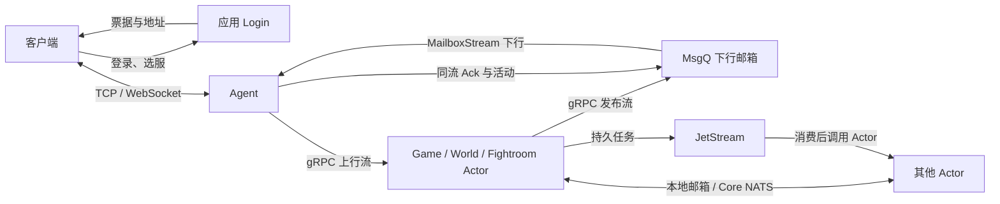

# tx 运行时设计

`tx` 是游戏后端的基础库。它管理进程能力、Actor、通信、GD 存取和生命周期；游戏如何登录、怎样建角、何时结算、如何合服，由应用工程实现。本文从首次接入者的视角解释当前结构，示例使用方式见 [README](../README.md)，具体参数和低层 API 见 [参考手册](api-reference.md)。

阅读时先看“工程边界、整体链路、启动”，再按业务选择“无缓存存储”或“共享实体与事务”。不要把一次发送、内存提交、Redis 热写和 Mongo 落盘理解为同一个成功边界。

## 工程与运行单位

| 工程 | 维护什么 | 不维护什么 |
| --- | --- | --- |
| tx | 通用运行时、存储适配、通信、Actor 放置与生命周期 | 固定游戏规则、账号/合服/赛季业务 |
| txgen | GD/Store、统一 cmd 与调用器、配置导出代码 | 运行中的数据库、缓存、服务集群 |
| txconfig | 策划 Excel 与配置组织规则 | 运行时合服状态、部署连接信息 |
| txgame | Bee 无状态应用、Login/Game/Fightroom/Sched 示例 | tx 私有内部实现 |
| txgameslg | Ant 有状态应用、共享实体与独占 World 示例 | 跨游戏通用的合服或世界规则 |
| txclient / txclientslg | 客户端会话、生成协议、应用验收负载 | 服务端归属权威与业务存储 |

应用的 `gen/` 与 `server/` 是独立 Go module；根 `cmd/` 是外部运维入口，命令的 Go 实现位于 `server/cmd/`。框架不读取 YAML、环境变量或命令行，应用将它们转换成强类型配置。

| 名称 | 生命周期与身份 |
| --- | --- |
| Server / Runtime | 一次应用启动拥有的进程运行时；正常进程运行一个 Bee 或 Ant Server |
| Service | Login、Agent、Game 等子服务；同进程可组合多个，能力按声明授权 |
| CMod | 进程内启用一次的能力模组，不是必须独立部署的微服务 |
| Actor | `Identity{Type, ID}` 定位的业务实体，有自己的邮箱与激活状态 |
| Slot | 稳定归属单位，映射到物理 InstanceID 和 Generation；可容纳多个 Actor |
| Session / Connection | 一次登录会话 / 该会话下的一次物理连接 |
| GD / Store | 业务数据 / 对同一数据的变更追踪视图，不是两份数据 |

服务 Context 是声明能力的视图，不代表每个子服务各建一个 Runtime。业务 Module 单例由项目管理；它可以保存配置缓存与自己拥有的资源，不因此获得分布式唯一性。

## 包结构与依赖方向

```text
应用注册、配置、Handler、业务 Module
  → bee/ 或 ant/               公共装配门面
  → runtime/                  当前操作的 Actor、存储、Procedure 能力
  → modules/                  可复用的通信、实体、事务、生命周期组件
  → storage/                  存储接口与 Redis/Mongo/Fusion 适配
  → meta/、change/、protocol/  数据与协议契约

bee/、ant/ → internal/framework/                  共享装配内核
                     → internal/actorhost/       本地激活与邮箱
                     → internal/actorplacement/  分组解析与缓存
                     → internal/actorrpc/        本地/NATS/gRPC 接线
                     → internal/instanceconn/    共享流生命周期
```

| 包 | 介绍与维护边界 |
| --- | --- |
| `meta/`、`anno/`、`astscan/` | 类型元数据及生成期注解解析；不连接外部存储 |
| `change/` | FieldID、路径、操作、合并与 Store 输出所需内核 |
| `protocol/`、`protocol/bon/` | 命令哈希、路由键、不透明身份和 BON 编码 |
| `storage/` | RecordKey、读写/版本/删除能力及后端适配 |
| `component/`、`lifecycle/` | 依赖图、准入、后台任务与关闭等待 |
| `modules/discovery/`、`etcd/` | 服务目录、实例身份、槽位权威与受控交接 |
| `modules/rpc/` | 共享 gRPC Host、路由和客户端 |
| `modules/actor/` | 类型、投递、调用结果、激活控制等公共契约 |
| `modules/agent/` | TCP/WebSocket 接入、认证适配和上行转发 |
| `modules/msgq/` | 会话绑定、下行内存邮箱、发布与订阅流 |
| `modules/tasks/`、`internal/taskqueue/` | JetStream 可靠任务的公开契约与消费适配 |
| `modules/txn/` | Lockey、Procedure、Undo、同步和异步执行 |
| `modules/entitycache/` | 同一应用的唯一实体对象、使用期、快照与回收 |
| `modules/writeback/` | 事务提交后脏根登记、周期和最终持久化 |
| `modules/control/`、`cmd/txctl/` | 状态查询、排水、槽位交接等运维入口 |
| `metrics/`、`log/`、`util/` | 指标封装、日志与不绑定玩法的基础工具 |

`internal/` 由公共门面接线，应用不直接依赖。基础数据包不反向引用 Actor、服务或应用生成包。生成代码依赖 tx，tx 不依赖 txgen 或某个游戏的 GD。

## 整体通信链路

复杂拓扑用 Mermaid 表达；下面的箭头不代表全局串行或事务：



etcd 管实例发现和槽位；Redis 管会话绑定及项目热数据；Mongo 管持久文档。它们都不是每条业务上行必须串行经过的节点。

## 启动、能力组合与执行上下文

包结构：`bee/`、`ant/` 定义 Builder、Service、Config；`internal/framework/assembly.go`、`cmod_*.go`、`server.go` 负责装配；`runtime/` 暴露执行期能力。

Bee 面向无状态业务装配，Ant 额外提供 Procedure 等有状态能力。应用显式声明 CMod，生成数据的存储注解只选择读写模式，不推导应用应启用的全部能力。

| CMod | 强依赖 | 说明 |
| --- | --- | --- |
| RPC、RedisStorage、MongoStorage | 无 | 连接与资源只创建一次 |
| Discovery | 无 | RPC 已启用时在其后启动 |
| SessionID | Discovery | 使用运行身份分配 SessionID |
| Actor | RPC、Discovery | 本地宿主及远端通信、归属接线 |
| TaskQueue | Actor | 任务消费复用 Actor 完成语义 |
| FusionStorage | RedisStorage、MongoStorage | 内部组合热写与延迟任务 |
| Procedure（Ant） | 无内置存储强依赖 | 事务执行器及提交参与者；存储仍由服务显式选择 |

`Requires` 递归启用依赖；`After` 只约束已选能力的顺序。间接启用不授予当前服务直接访问权，例如只声明 Fusion 不代表可以自行取得 Redis 命令客户端。完整服务注册表保留远端 Actor 类型，`RunOptions.Services` 只决定本进程启用哪些服务。

```text
应用解析配置、选择服务
  → Builder：生成类型目录 + ServiceRegistration + Setup
  → 校验配置/依赖图 → 启动选中 CMod 与共享连接、校验消费者静态契约
  → Setup 绑定应用入口 → 服务 Factory / Init：模块与 Handler 装配
  → RPC/控制监听、进程发现 Running
  → 可选 Service.Start：必备 Actor 加载与就绪等待
  → 检查启动错误 → 开放业务准入，子服务 Running
  → 启动可靠任务消费 → 再确认无启动错误，Start 成功
```

启动阶段的致命错误会取消启动操作并阻止成功收尾；RPC/控制面 Serve 非预期退出交给 Server 处理。失败只清理已取得资源，不恢复部分服务。准备消费者不领取任务，消费保持在业务就绪之后。

进程发现 Running、子服务 Running、Actor Ready 是三种状态。服务 Start 可用控制接口加载必备 Actor，不能等待尚未开放的普通业务入口。

Setup 将 `Context.Runtime()` Provider 绑定到项目 `db`、Actor 调用等入口；Handler 不保存装配 Context。Handler 外的应用适配层创建操作范围，业务 GD 查询显式沿用 ctx，Procedure 内使用 `tx.Context()`。取消和期限是执行边界，不是“传了 ctx 就自动进入事务”。

```text
Handler 边界：消息 Context → 有期限的操作 ctx
  → Module：沿用 ctx → 生成 Find / Snapshot 或远端调用
  → Procedure：派生事务 ctx → 共享锁与对象登记
  → 返回响应 → 结束操作范围
```

纯计算无需无用途 ctx；后台工作不能保存已结束的请求 ctx。完整用法见 [运行时访问](runtime-access.md)。

## 服务发现与 Actor 放置

包结构：`modules/discovery/{runtime,directory,slot,ownership}.go` 管目录和权威归属；`internal/actorplacement/` 管分组查询缓存；`internal/framework/placement.go` 接线；`internal/actorhost/` 在加载前核验归属。

实例启动取得新 InstanceID，稳定的业务 Slot 不随重启改名。Watch 更新目录，普通投递读取缓存；权威来源仍为 SlotStore 的 assignment 和 CAS。成员离线不等于可以自动认定旧实例不再执行。

Actor 身份使用 `Identity{Type string, ID string}`。Type 在应用内唯一且对应一个服务池，ID 在该 Type 内唯一。生成的 `*At`、`*Identity`、`Ref.Identity()` 统一编码，业务不手工拼接 `i:` 等前缀。

| 放置方式 | 用途 | 归属规则 |
| --- | --- | --- |
| 默认分区 | 普通 Role、Room 等 | ID 经 xxhash64 映射固定 1024 分区；分区共享实例，邮箱独立 |
| `WithSlotMapping` | 纯计算固定槽，如独立 World | 不做业务 I/O；映射须一致 |
| `WithPlacement(name)` | 多 Type 按业务组同实例 | 应用解析稳定 GroupID，tx 形成服务池/策略/组槽位 |

```text
Identity(Type, ID)
  → 类型目录 → 默认映射 / 纯映射 / 命名 Placement
  → Identity→SlotID 缓存命中：直接继续
       未命中：本地策略直调 / 进程级 RPC 查询目标服务
       → 校验并缓存成功结果
  → SlotID→InstanceID/Generation 目录
  → 目标实例：加载前权威核验 → 实体邮箱
```

命名策略只在目标服务本地被选中时装配，Agent/World 消费者不构造目标业务存储。冷查询按身份合并，所有等待者独立取消；共享查询由框架生命周期和查询期限管理。实际在途冷查询超过观察阈值只限频告警、不拒绝业务；缓存命中不计入冷查询，失败不缓存、不回退默认分区。具体观察边界见 [放置契约](actor-placement.md#缓存失败与生命周期)。首次归属先做容量预检，再 CAS 创建 assignment；CAS 后结果未知或容量变化不自动改派或重投。

SLG 示例由应用把 OriginServerID 解析为 MainServerID，作为 Role、Legion、ServerActor 的分组。合服与赛季规则不进入 tx。分组在运行期稳定；槽位换 owner 可保留 Identity→SlotID 缓存，改变分组则需要应用安排重启等流程。详细契约见 [Actor 放置](actor-placement.md)。

## Actor 激活、邮箱与控制

包结构：`modules/actor/` 的类型、MessageContext、控制与调用接口 是公共入口；`internal/actorhost/` 实现激活、容量、顺序邮箱、钝化和失败状态。

```text
普通投递 / EnsureActivation
  → 归属与容量准入 → 同身份合并首次加载
  → 工厂与初始化/激活回调
  → 必备业务加载完成 → Ready → 邮箱顺序消费
  → 空闲钝化 / ctx.Deactivate / 宿主排水
  → 拒绝新消息 → 等待已接纳消息 → 卸载与资源清理
  → 清理完成后释放 activation 名额
```

同一 Actor 串行，不同 Actor 可并行；多发送方、跨服务及混合传输不承诺全局顺序。共享无状态 Handler 和协议表只绑定一次，每次调用的身份、GD 状态与生命周期由 MessageContext 传入。

| 控制入口 | 成功表示什么 |
| --- | --- |
| Probe | 观察当前元数据；不分配、加载或读未就绪业务字段 |
| EnsureActivation | 发起/共享加载，返回当前状态；不等于 Ready |
| RetryActivation | 清除已结束失败后再确保加载，不替换正在加载/关闭的激活 |
| WaitReady | 通过 Probe 等待 Initializing→Ready，不发起加载或重试 |
| `ctx.Deactivate()` | 请求当前 Actor 卸载；不是删除持久数据或回收全部缓存 |

工厂与初始化回调不附加统一执行 deadline；具体业务 I/O 自行设置期限。调用者等待取消不撤销已开始的加载。业务决定“可进入”的必备内容，框架在回调成功后统一置 Ready，不增加 feature-ready 或手动 MarkReady。

容量分 activation 与 assignment：前者清理完成释放；后者按稳定归属占位，卸载不释放且要求一实体一槽。数量限额不是内存/CPU 硬保证。详细状态与关闭边界见 [Actor 生命周期](service-actor-lifecycle.md)。

## RPC 与内部调用

包结构：`modules/rpc/` 提供共享 gRPC Host/Sender；`internal/instanceconn/` 管实例流；`internal/actorrpc/` 适配直连与 NATS；`modules/actor/` 提供统一 Messenger。

`CModRPC().Client(route)` 复用进程连接。生成 Client/Ref 是调用器，不是每个业务模块各建网络连接。`ClientConn` 是连接抽象，不是一条双向流；长流复用底层连接，业务语义由协议定义。

| 入口 | 同 Runtime 实例 | 跨实例 | 等待到哪一步 |
| --- | --- | --- | --- |
| Tell | 本地邮箱 | Core NATS 客户端提交 | 不等业务执行 |
| TellAccepted | 本地邮箱接纳 | 当前连接的 NATS 服务端确认 | 不等持久化或业务完成 |
| CallFuture | 本地邮箱并返回 Future | NATS 请求结果协议 | Await 等待业务结果 |
| Call | 同一结果协议 | 同一结果协议 | 同步等待结果 |
| Agent Enqueue | 本地直连适配或 gRPC | gRPC 上行长流 | 本地传输提交，不等远端邮箱确认 |

```text
内部生成方法 → Identity + Delivery → 归属解析
  ├─ 同实例：本地邮箱
  └─ 跨实例：Core NATS → 目标本地邮箱
      → 生成协议分派 → 同一业务 Handler
      → Call 返回结果 / Tell 结束本次处理
```

`DeliveryOrigin` 只有 OriginClient、OriginInternal、OriginTask，不按业务节点类型扩展。来源决定外围响应与确认适配，不要求 Handler 判断“来自 Game 还是 World”。Call 的无响应体成功使用 `Result.Completed`；它不是客户端上行 Ack。

等待超时不能证明远端未执行；不自动重投。Handler 内同步等待会占用当前 Actor 处理，后台任务应由业务模块独立管理，完成后投递独立事件。框架不保证不同 Actor 产生的 Accepted 与完成通知的全局先后。

## 客户端协议与 Agent

包结构：`protocol/` 定义 CommandHash、RouteKey 和不透明 SessionIdentity；`modules/agent/` 实现连接、帧、分派；生成 DTO 和描述表在应用 `server/gen/cmd/`。

命令标识是消息名的固定 32 位哈希，由 txgen 生成完整描述表并检查本次输入碰撞；不使用人工消息号池或服务号段。Agent 读取帧头哈希和路由键定位 Actor，不解析业务 BON；命令名不在 BON 正文重复传输。

```text
客户端 → 应用 Login：认证、选服、建角预留/选角、签票
客户端 → Agent：不透明握手信息
  → 项目 IdentityResolver 校验身份与票据
  → MsgQ Init / Restore → 成功后 FrameReady
  → 同 socket 顺序读取上行
  → 连接内 UpSeq 过滤 → 生成路由描述 → 目标 Actor 长流
```

Login 业务、Claims 编解码及授权留在应用。框架保留不透明身份字节，不解释账号或合服规则。RoleID、WorldID 等路由身份与帧序号不同；生成注解决定目标 Actor 与身份来源。

| 值 | 权威位置与用途 |
| --- | --- |
| UpSeq | 客户端分配，Agent 当前连接过滤旧号；允许跳号，连接结束释放 |
| DownSeq | MsgQ 邮箱分配，标识该 Session 的下行顺序 |
| 客户端 Ack | 已处理的最大 DownSeq，交给 MsgQ 裁剪下行 |
| Call requestID / 压测关联标识 | 仅关联相应请求结果，不能作下行排序或裁剪依据 |

UpSeq 不进入业务 Delivery、MessageContext 或 MsgQ。客户端不保存上行重放队列，服务端不发送上行 FrameAck；FrameReady/DownMsg 的 Ack 固定为零。跨 Game/World 的响应按实际进入 MsgQ 的顺序编号，不保证匹配上行先后。

## MsgQ 下行邮箱与共享流

包结构：`modules/msgq/{mailbox,session,role}.go` 管内存队列和身份；`session_redis.go`、`role_redis.go` 管短期归属；`mailbox_stream.go`、`publish_stream.go`、`sender.go` 管传输。

MsgQ 是下行会话层，不是所有服务 RPC 的中转。Redis 保存 Session binding 和 Role owner，消息正文只驻留当前 MsgQ 内存；不承诺 MsgQ 崩溃后的未确认消息持久恢复。

```text
Game / World / Fightroom
  → Sender 的有界发布队列 → gRPC 发布流
  → owner MsgQ：Role 扇出多个 Session / 精确 Session
  → 邮箱编号 DownSeq、保留未确认消息
  → Agent 发起的 MailboxStream 推送下行
  → Agent 写客户端 → 客户端处理后上传 Ack
  → 同一 MailboxStream 回传 Ack → MsgQ 裁剪
```

SendRole/SendSession 是异步提交边界，成功不表示 MsgQ 已入队。MailboxStream 由 Agent 创建，双向复用多个 Session；MsgQ 在有数据时发送，无逐消息 Rec 往返。仅合并已排队消息的优化不增加等待窗口，不把固定凑批量当业务协议要求。

```text
新 Login：S1/C1 → 新票据 S2/C2 → 空的新邮箱
弱网恢复：S1/C1 → Restore S1/C2 → 原 owner 未确认下行
旧连接迟到的 Ack / 管理操作 → ConnectionID 校验拒绝
owner 或原邮箱已丢失 → 恢复失败 → 业务重新登录/状态重同步
```

Restore 必须命中原 Session 和 running owner，不跨 MsgQ 自动迁移。恢复只接续下行，不恢复上行游标。角色 owner 租期、会话 TTL 与 Agent 上行游标是不同概念；当前没有 Agent Rec lease。

多个授权 Session 可属于同一 Role，各自维护队列。Topic 广播只在单 MsgQ 内，不是全局 Pub/Sub。队列有条数/字节上限，容量不足必须显式失败，不无限增长或静默覆盖旧消息。示例 1024 条/8 MiB 是项目配置，不是当前构建的容量结论。

## 可靠任务

包结构：`modules/tasks/` 定义 Publisher/Task；`internal/taskqueue/` 适配 JetStream；`internal/framework/cmod_tasks.go` 管消费与关闭时序。

```text
业务发布 → JetStream 持久确认
  → durable 消费 → 按 Actor 归属执行 Call（OriginTask）
  → 业务成功返回 → ACK
  → 失败 / 未知 → 不伪装成功；按队列策略重投或转死信
```

同实例任务仍先进入 JetStream，不绕过持久入口。ACK 表示消费业务返回成功，不证明 Fusion 已写 Mongo；业务幂等、补偿与跨记录一致性仍由应用定义。队列不自动创建或修改生产共享流。

有限 MaxDeliver 需要预配置独立通知流与恢复 durable。恢复按“读源任务→持久转死信→删源残留→确认通知”推进，通知流不可写仍可能漏捕获。资源部署、磁盘同步、副本与故障域见 [JetStream 部署](deployment/jetstream-tasks.md)。

## 数据元数据与变更追踪

包结构：`meta/` 定义类型/字段/存储描述；`change/` 定义路径、操作与合并；`storage/changes.go` 消费输出；生成的 GD/Store 属于应用。

```text
生成输入 GD + 注解 → txgen → GD、Store、TypeSpec
业务读取 GD / 通过 Store 修改
  → FieldID 与根相对路径标脏 → Visit / Document 输出变更
  → Writer 应用变更 → 成功才清除本轮标记
```

GD 是数据，Store 引用同一数据并保存追踪状态。FieldID 是生成的稳定字段身份；协议名、JSON 名、BSON 名各有用途，不能混作数据库路径。共享子对象可能有多个根路径，StoreView 必须保持根相对追踪。

Set 写入零值，Replace 整体替换复杂值，Delete 删除路径/元素，Clear 清空容器。高频使用 Store setter；低频 BeginChange/SaveChange 采用快照差分。同一变更周期不混用两种追踪方式。事务 Undo 只覆盖受控 Store 修改，不能回滚任意公开字段赋值。

同步 Visit 可读取当前值；跨 goroutine、异步写回与消息发送必须捕获独立值或明确转移所有权。完整内部算法、路径/集合/深度约束见 [数据内核](data-kernel.md)。

## 存储接口与 Redis、Mongo、Fusion

包结构：`storage/` 按能力划分 Reader/Writer、条件创建/替换/删除；`storage/config/` 与路由表选择后端；`storage/redis/`、`storage/mongo/`、`storage/fusion/` 实现策略，`storage/task/` 支撑 Fusion 延迟任务。

生成的 `FindGD*(ctx, ...)` 从类型元数据选 Redis/Mongo/Fusion，普通业务不手选 Reader；显式 Load/Reader 用于基础设施或独占路径。RecordKey 保存完整记录身份，不等同于 Actor ID 或事务 Lockey。

| 路径 | 数据权威与成功边界 |
| --- | --- |
| Redis | JSON 文档与原子 patch，具名 backend 由云 Redis/自身集群分片 |
| Mongo | BSON 文档、索引和条件写；成功为该次驱动写入完成 |
| Fusion | Redis 热写 + 已登记延迟任务；不等 Mongo 最终回写 |
| Procedure/WriteBack | 内存提交 + 待写登记；随后才经过所选存储路径 |

Redis 不再做应用手工分片；具名 route 选择一个 backend。Lua 多键须满足槽约束；云代理跨槽能力需要部署验证，不以 Pipeline 自动等价跨槽原子操作。Mongo 的路由键选择明确数据库目标，不隐式跨分片扫描。

```text
Fusion 保存 → Redis 热写 → 本地延迟发布登记 → 返回
  → 后台持久发布记录定位任务
  → 延迟任务取得记录 → 写 Mongo → 确认修订/安排热数据保留
  → 新写入或失败：保持待处理，按既有策略重试
```

Fusion 延迟任务是热数据落库机制，不是应用 Sched 定时任务。`delaySaveTime` 为 Mongo 回写延迟，`delayDelTime` 为确认回写后的热数据保留时间，dirtyTTL 为未确认数据保护。保存或清理失败不能先清脏标记；异常退出可能丢失尚未持久发布的本地任务登记，不能宣称跨存储 ACID。

Mongo 原生高级查询返回官方 Database/Collection，复用已连接路由；取得句柄后的游标、错误和关闭由应用管理，不自动纳入 Procedure/EntityCache。不能原生修改正在受管的同一实体。条件版本 API 只保护单文档替换，不能实现多文档事务。详细接口与后端状态见 [存储参考](api-reference.md#redis-存储模型)。

## 共享实体与独占实体

包结构：`modules/entitycache/` 管条目、使用期和管理接口；`runtime/entity.go` 连接执行范围；生成的私有 Descriptor 与 Clone 在应用 data 包，不要求启动时逐 GD 登记。

`data.entityCache` 是生成期选项；缓存启用时持久根须声明事务能力，少数独占根用 `@noEntityCache` 排除。txgame 默认无缓存，txgameslg 启用共享缓存，但 GDWorld/GDWorldBucket 独占排除。

```text
共享读取 → SnapshotGD(ctx,id)
  → 使用权 → 同一记录锁 → 深复制 → 释放 → 独立只读结果

共享修改 → 有效 Procedure → FindGD(tx.Context(),id)
  → 唯一对象 + 使用权 + 锁/Undo/写回预留
  → Store 修改 → 提交或回滚 → 释放锁与使用权

独占 World → 原生 Mongo 游标 → 唯一网格 GD
  → 网格邮箱串行修改/保存 → 排水最终保存 → 成功后释放
```

使用权只防回收，字段并发安全由 Procedure 记录锁保障；不增加另一套业务锁，也不自动给每个 Handler 开事务。无事务取得共享可变对象会失败；普通 Snapshot 包含已提交未写回状态，单记录一致但不保证跨记录同一时刻。

Go 公开字段不能防止非法保存裸指针。共享 GD、子对象、map/slice 不得带出事务继续读写；响应必须复制。独占 World 由应用保证邮箱所有权，不能同时保留另一份可写 EntityCache 对象。

EntityCache 是应用 Runtime 组件，不是独立 CMod，也不是分布式缓存。Otter 选择软容量候选；使用中、创建中或待写对象不为满足容量而丢弃。Actor 卸载不意味着缓存淘汰。

### 观察与管理

包结构：`modules/entitycache/management.go`、`release.go`；调用入口 `txruntime.EntityCache(ctx)`。

| API | 行为 |
| --- | --- |
| Stats | 框架条目和回收元数据，不读业务字段或估算内存 |
| List | 有界类型筛选、返回 EntryRef，不承诺稳定分页 |
| SnapshotCached | 只命中缓存，在记录锁内深复制，不加载或刷新热度 |
| TryRelease | 尝试安全回收，不刷盘、不删除记录、不卸载 Actor |

EntryRef 绑定驻留代次，旧引用不能作用于重新加载的对象。管理快照/回收在 Procedure 外执行；排水关闭新管理操作并等待已接纳操作实际结束，不能抢先释放正在复制的对象。详见 [管理 API](entity-cache-management.md)。

## Procedure、Lockey 与 WriteBack

包结构：`modules/txn/` 维护事务、锁表、Undo、提交参与者、异步队列；`modules/writeback/` 接受脏根并持久化；`ant/cmod_procedure.go` 和 `internal/framework/procedure.go` 管装配与关闭。

Lockey 表示一致性域，不依赖 GD 已加载。生成输入集中声明 `LockType` 枚举，GD 使用 `@transaction` 的 lock 注解引用名称；枚举值越大越先获取，同类别整数 ID 数值排序。多个 GD 可共享一个 RoleLock，但对象与写回登记仍独立。

```text
txruntime.Call(ctx,p)
  → p.Locks：预声明已知 Lockey → 排序取得锁
  → p.Process(tx)：FindGD(tx.Context(),id) / db.Create / db.Remove
      → 未知键动态补锁 → Store 修改 / 子 tx.Call
  → 成功：登记 WriteBack、发布创建/隐藏删除
  → 失败：Undo、撤销占位与子过程回调
  → 解锁 → 同步后续 Procedure → 释放使用权 → Call 返回
```

动态补锁保留等待图死锁检测，根事务作为受害者时完整回滚；标准 Call 有限重试，因此不可回滚副作用放在提交后处理。嵌套根事务被拒绝，子 Procedure 使用同一 Tx/savepoint。具体锁实现见 [精确锁注册表](lock-registry.md)。

| 调用 | 事务与等待边界 |
| --- | --- |
| `txruntime.Call(ctx,p)` | 同步根事务，等待提交后续过程结束 |
| `tx.Call(child)` | 当前根内子事务/savepoint，锁持有至根结束 |
| `tx.CallAfterCommit(next)` | 根提交解锁后按登记顺序执行独立根事务，外层仍同步等待 |
| `txruntime.Submit(ctx,p)` | 独立异步根事务，返回 Future；不是投递 Actor 邮箱 |

Submit 默认 64 个执行、8192 个总接纳，期限从接纳开始计算，包含排队。队列有界、满额立即拒绝；FIFO 出队不保证并发完成顺序。接纳后使用独立操作 ctx，不继承 Handler 结束取消，不携带请求资源；业务把所需身份放入 Procedure 字段。Await 取消只结束等待，不能取消已接受任务。详见 [同步调用](procedure-calls.md) 与 [Submit](procedure-submit.md)。

### 创建、删除与持久化

```text
db.Create(tx.Context(), 新GD)
  → 记录锁、唯一缓存占位、WriteBack 容量预留
  → 本事务可见；其他调用不能取得半创建对象
  → 回滚撤销占位 / 提交发布原对象并保留首次写入意图

WriteBack
  → 同一记录锁 → 持久化首次创建/更新/删除
  → 成功：清待写状态
  → 失败：保留对象与 pending → Flush / 排水重试
```

首次写入采用条件创建，不可在结果未知后用 Upsert 覆盖已有记录。删除失败不重新暴露旧对象，需协调在途写回防止旧任务复活数据。共享根不能自行 Save 绕过事务；无缓存或独占类型可直接 Save。

WriteBack 将内存提交落到所选 Writer；Writer 为 Fusion 时还有 Redis→Mongo 延迟阶段，Writer 为 Mongo 时直接写 Mongo。它不是 World 邮箱保存的另一层，也不是进程崩溃 WAL。内存提交不能证明存储完成，跨记录不提供数据库原子提交。

## 排水、正常交接与故障

包结构：`lifecycle/` 管准入及工作计数；`internal/framework/{drain,shutdown,handoff}.go` 编排；`modules/control/` 提供外部请求。

```text
关闭服务外部准入
  → 排空已领取的可靠任务（此时 Actor 入口仍可用）
  → 关闭 Actor 新准入、排空已接受邮箱工作并卸载
  → 通知全部服务后台任务取消 → 有期限等待实际退出（超时保留并重试）
  → ServiceFlusher.Flush：独占数据最终保存
  → CMod 排水：Procedure 排队/执行与最终 WriteBack 等
  → 传输收尾
      ├─ PrepareHandoff 成功：保留连接/租约 → 控制面逐槽 CAS 晋升
      └─ Stop：服务 Stop → 根任务限时退出 → 释放依赖与绑定 → CMod Stop → Stopped
```

已接纳但尚未入队、排队中与执行中工作都必须计入。超时仅结束等待，资源保持以便有限重试；重试耗尽返回错误，进程按项目入口非零退出。正常关闭不能把持久化失败记为成功。致命身份丢失是独立强制退出路径，内存状态不因此获得恢复保证。

CMod 与初始化回滚同样遵守关闭期限；未完成的工作保留依赖重试，最终释放阶段不重复排水。Placement/CMod 的任务视图只允许登记工作，不交付取消和等待所有权。部分 CMod 启动失败时只清理，不执行正常 Drain。启动错误必须终止本次启动，失败清理不维持部分服务运行。详细契约见 [关闭边界](runtime-access.md#cmod-与初始化回滚的关闭边界)。

已接纳工作可以调用下游，但下游已关准入时允许失败；排水不保证整个跨 Actor 链成功。需要可靠重试的工作应采用任务队列与业务幂等，不能为了排水恢复上行重放或自动扩展调用链协议。

StateDrained 仅代表相应入口排空，不可替代完整 PrepareHandoff 成功；控制面不因成员失联自动晋升。部署维护者必须确认旧 owner 已停止写入，不能把网络分区当作旧进程死亡。

## 日志、指标与诊断

包结构：`log/` 统一日志，`metrics/` 包装 Prometheus，`modules/control/` 暴露诊断控制协议，`storage/io_stats.go` 提供验收构建的存储统计。

```text
框架模块事件 → tx metrics 注册/观测 → HTTP /metrics → Prometheus 抓取
框架错误/排水失败 → 结构化日志 → 项目日志接收与告警
诊断控制请求 → 实例状态/槽位/存储 I/O 快照
```

指标标签用服务、阶段、结果等有界值，不放 RoleID/SessionID 等高基数身份。Prometheus 抓取不等于每条消息远程发送，也不替代 pprof CPU/分配画像。普通构建不启用 `txbench` 存储逐调用计时；专项验收可开启，性能比较必须记录采集条件。

公开错误区分未接纳、执行失败与结果未知；RPC 超时不能解释为业务未执行。恢复 panic 不应吞掉错误，更不能兜住 Go map 并发访问的 runtime fatal；共享数据必须遵守记录锁和快照契约。

## 如何扩展与验收

新增业务节点通常只需要应用 ServiceRegistration、生成 cmd 类型及 Handler/Actor 工厂，复用现有 CMod；不修改 tx 的 Origin 枚举或增加专用连接管理。新增业务模块只依赖项目公开模块入口；模块单例不负责 Actor 投递与分布式锁。

新增存储后端、公共协议或运行时行为时，更新实际契约、生成器和相应验证，不能仅替换 README 示例。测试职责：tx 保留可靠性和并发边界，txgen 保留生成契约，应用/客户端负责真实集群接入与吞吐。功能通过不等于 race 通过，有限本地请求不等于云端容量。

- 当前任务与验收索引：[IMPLEMENTATION_PLAN](IMPLEMENTATION_PLAN.md)。
- 应用边界：[txgame 设计](../../txgame/docs/design.md)、[txgameslg 设计](../../txgameslg/docs/design.md)。
- 开发约束：[工程约定](engineering-conventions.md)；问题分级：[审计标准](architecture_audit_standard.md)。
- 专项量化：[实体访问](entity-access-acceptance.md)、[缓存管理](entity-cache-management-acceptance.md)、[滚动发布](procedure-rollout-acceptance.md)。

设计文档描述现行契约；实施计划只列当前待办；有日期的报告保留当时条件和限制。已完成施工步骤由 Git 历史追溯，不要求读者先读多轮计划才能理解当前系统。
