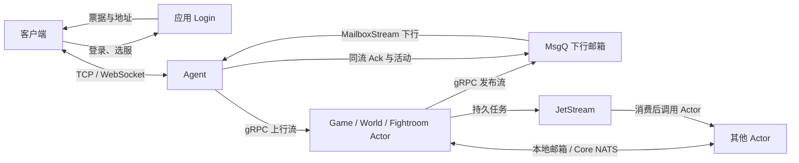
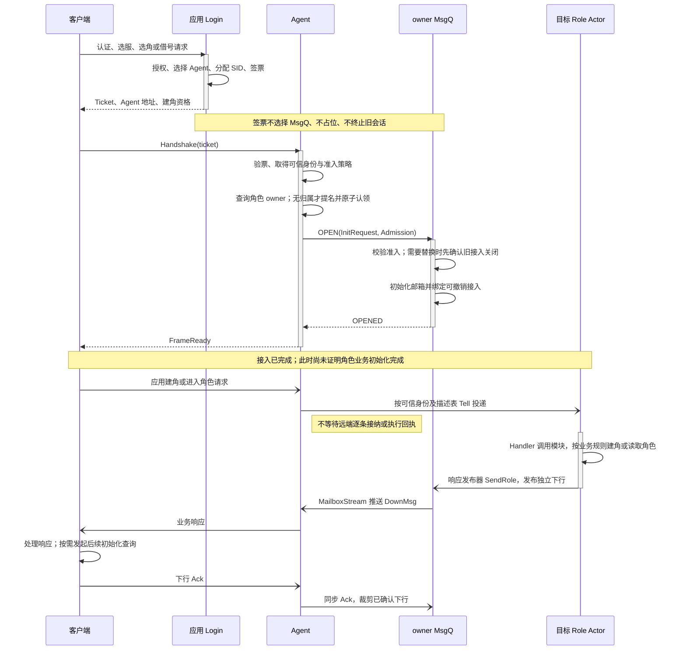
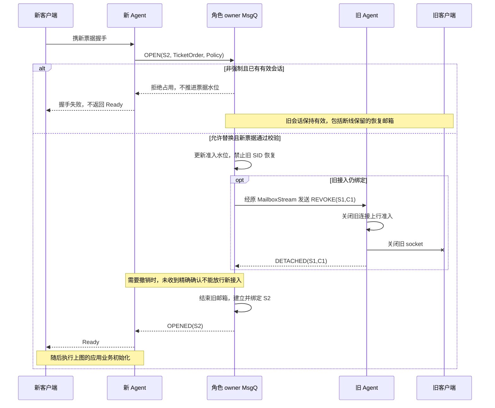
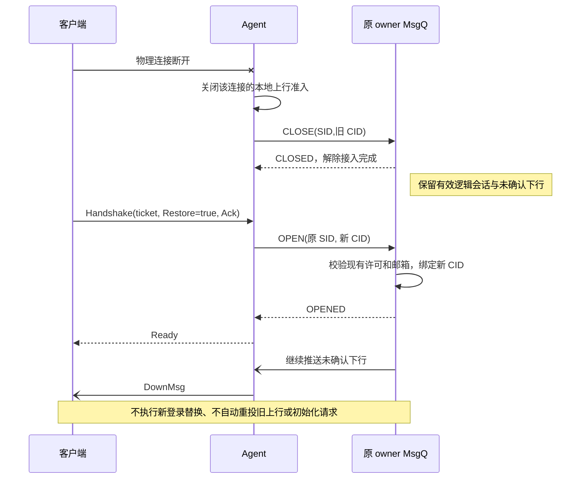
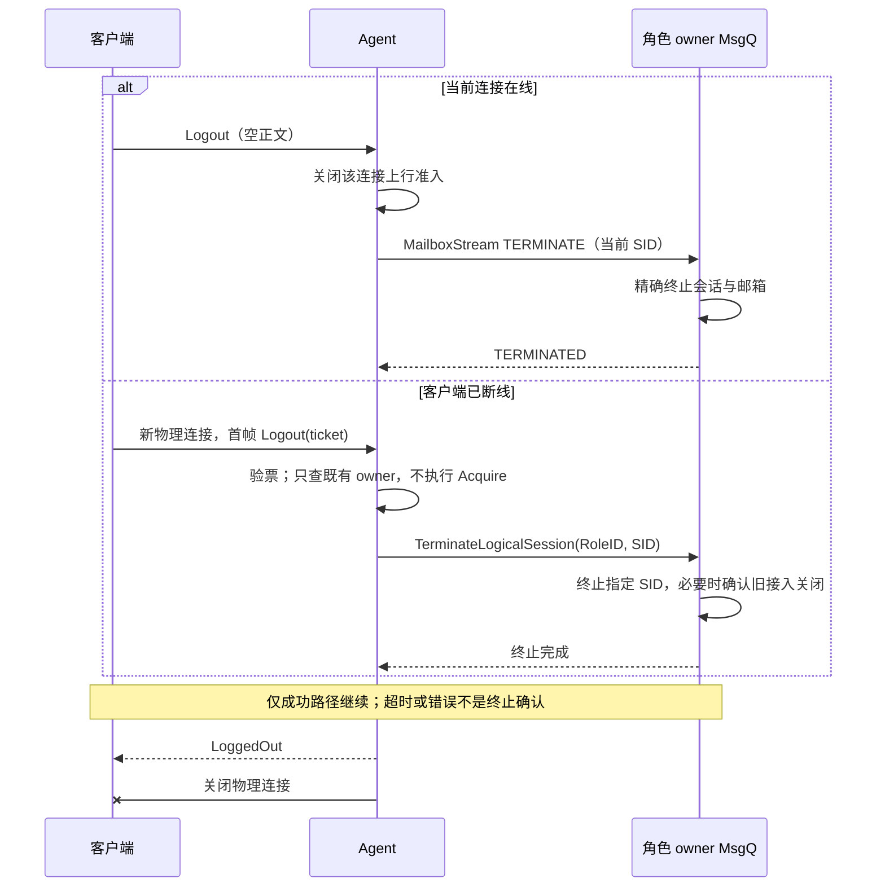

# tx 运行时设计

`tx` 是游戏后端的基础库。它管理进程能力、Actor、通信、GD 存取和生命周期；游戏如何登录、怎样建角、何时结算、如何合服，由应用工程实现。本文从首次接入者的视角解释当前结构，示例使用方式见 [README](../README.md)，具体参数和低层 API 见 [参考手册](api-reference.md)。

阅读时先看“工程边界、整体链路、启动”，再按业务选择“无缓存存储”或“共享实体与事务”。不要把一次发送、内存提交、Redis 热写和 Mongo 落盘理解为同一个成功边界。

Actor 寻址与正常关闭归属的目标见 [专项实施计划](actor-routing-lifecycle-plan.md)，其中包含目标架构、生命周期流程及分批验收。[条件路由修正](actor-placement.md)和正常 Stop 后的条件释放已接入；失联或收尾失败不触发自动改派。

## 工程与运行单位

以下工程在工作区中同级放置；树表示目录归属，不表示互相 import：

```text
workspace/
├── tx/             # 通用运行时、存储、通信、Actor 放置与生命周期；不实现玩法
├── txgen/          # GD/Store、cmd/调用器及配置生成；不承接运行中的存储和集群
├── txconfig/       # 策划 Excel 与组织规则；不保存运行时合服状态或部署连接信息
├── txgame/         # Bee 无状态应用，维护 Login/Game/Fightroom/Sched 业务及装配
├── txclient/       # txgame 配套客户端：会话、生成协议、业务展示与验收负载
├── txgameslg/      # Ant 有状态应用，维护共享实体、独占 World 及项目部署策略
└── txclientslg/    # txgameslg 配套客户端；不引用另一组客户端的生成产物
```

两组应用不互相 import，也不访问 tx 私有实现；业务身份、合服、赛季和世界规则留在各自应用。客户端不维护服务端归属权威或业务存储。

应用的 `gen/` 与 `server/` 是独立 Go module；根 `cmd/` 是外部运维入口，命令的 Go 实现位于 `server/cmd/`。框架不读取 YAML、环境变量或命令行，应用将它们转换成强类型配置。

| 名称 | 生命周期与身份 |
| --- | --- |
| Server / Runtime | 一次应用启动拥有的进程运行时；正常进程运行一个 Bee 或 Ant Server |
| Service | Login、Agent、Game 等子服务；同进程可组合多个，能力按声明授权 |
| CMod | 进程内启用一次的能力模组，不是必须独立部署的微服务 |
| Actor | `Identity{Type, ID}` 定位的业务实体，有自己的邮箱与激活状态 |
| Slot | 稳定归属单位，映射到物理 InstanceID 和 Generation；可容纳多个 Actor |
| Session / Connection | 一次登录会话 / 该会话下的一次物理连接 |
| GD / Store | 业务数据 / 对同一数据的变更追踪视图，不是两份数据 |

服务 Context 是声明能力的视图，不代表每个子服务各建一个 Runtime。业务 Module 单例由项目管理；它可以保存配置缓存与自己拥有的资源，不因此获得分布式唯一性。

## 包结构与依赖方向

L0～L4 按职责划分，不对应五个目录。尤其 `storage/` 同时包含契约、后端适配和运行时，`modules/` 同时包含通用组件与标准服务；`internal/` 仅表示 Go 可见性。

```text
职责分层（不是实际目录）
├── L0  数据、协议与纯计算契约，不拥有外部资源
├── L1  后端驱动和传输适配
├── L2  可复用运行时及其接线，不规定项目服务如何组合
├── L3  进程组合、CMod 依赖、资源所有权与执行期能力视图
└── L4  标准服务及接入适配；应用自定义服务也位于这一使用层
```

`component/`、`lifecycle/`、`metrics/`、`log/` 是多层复用的横向机制。使用生命周期计数或指标并不获得进程资源的关闭权限；所有权仍由 L3 装配维护。项目配置、Handler 和业务 Module 位于应用工程，不进入 tx 的层级实现。

下面箭头统一表示“依赖方 → 被依赖能力”，不是必须逐层穿过的调用流水线：

```text
应用组合根 → Bee/Ant → internal/framework → L2 运行时 → 所需 L1 适配 / L0 契约
应用业务与生成代码 → runtime.Provider → 已绑定的 L2 公开能力
L4 服务实现 → 所需 L2 公开能力 / L0 契约
L4 注册适配 → Bee/Ant 的 Service / CMod 声明契约
L1 适配 → L0 契约
```

高层可以直接使用所需的低层公共契约，不为层级形式增加转发包装。同级组件允许按职责单向组合，例如 EntityCache 使用事务锁和写回安全判定；禁止循环依赖和反向取得宿主生命周期权限。公共包可以暴露私有内核的稳定类型，不能据此要求把全部 `internal/` 归到同一层。

实际包结构如下，只展开职责边界与主要入口，不穷举文件：

```text
tx/
├── meta/                 # [L0] 类型/字段/存储描述及 TypeRegistry
├── anno/                 # 生成期注解契约，不连接外部存储
├── astscan/              # Go 源码扫描与注解解析
├── change/               # [L0] FieldID、路径、操作和 Store 变更合并
├── protocol/             # [L0] CommandHash、RouteKey、不透明 Session 身份
│   └── bon/              # BON 编解码
├── storage/              # 根包 [L0]：RecordKey、读写/版本/删除契约
│   ├── config/           # 存储配置结构与校验，不读取项目 YAML
│   ├── redis/            # [L1] Redis 后端适配
│   ├── mongo/            # [L1] Mongo 后端适配
│   ├── task/             # Fusion 延迟落盘任务契约
│   │   └── redis/        # [L1] 延迟任务 Redis 实现
│   ├── runtime/          # [L2] 共享存储能力装配
│   └── fusion/           # [L2] Redis 热写与延迟 Mongo 回写
├── etcd/                 # [L1] 客户端、租约、revision、快照、Watch 和 CAS
├── sessionid/            # 独立写入发号；借用写入器，不拥有连接或成员租约
├── modules/              # 通用组件；service 子包另承接标准服务
│   ├── discovery/        # [L2] 成员目录、槽位权威、归属缓存与正常交接
│   ├── rpc/              # [L2] 共享 gRPC Host、路由及客户端
│   ├── actor/            # [L2] Type、投递/调用、激活控制等公共入口
│   ├── agent/            # [L2] TCP/WebSocket、认证适配和上行转发
│   │   └── service/      # [L4] 标准 Agent 服务
│   ├── msgq/             # [L2] 会话绑定、下行邮箱、发布与订阅流
│   │   └── service/      # [L4] 标准 MsgQ 服务
│   ├── tasks/            # [L2] 可靠任务公开契约
│   ├── txn/              # [L2] Lockey、Procedure、Undo、同步/异步执行
│   ├── entitycache/      # [L2] 唯一实体对象、使用期、快照与回收
│   ├── writeback/        # [L2] 脏根登记、周期写回与最终持久化
│   └── control/          # 状态查询、排水和槽位交接协议
├── bee/                  # [L3] 无状态应用的 Builder、Server、CMod 声明
│   └── services/         # [L4] Agent/MsgQ 注册适配
├── ant/                  # [L3] 有状态应用装配，增加 Procedure 等能力
│   └── services/         # [L4] Agent/MsgQ 注册适配
├── runtime/              # [L3] Provider 与执行期能力，不持有第二套连接
├── internal/             # 私有实现；不是单独一个层级
│   ├── framework/        # [L3] CMod 依赖、进程装配、资源所有权与关闭编排
│   ├── actorhost/        # [L2] 激活、顺序邮箱、容量、钝化与失败状态
│   ├── actorplacement/   # [L2] 分组查询、本地/远端装配与缓存
│   ├── actorrpc/         # [L2] Actor 直连与 NATS 适配
│   ├── instanceconn/     # [L2] 实例连接缓存与退役回收
│   └── taskqueue/        # [L2] JetStream 消费与完成语义适配
├── component/            # 横向机制：依赖图与组件生命周期
├── lifecycle/            # 横向机制：准入、工作计数与关闭等待
├── metrics/              # 横向机制：Prometheus 指标封装
├── log/                  # 横向机制：统一日志
├── util/                 # 业务可选的进程内工具，由使用方拥有生命周期
│   ├── delay_queue.go    # 本地到期任务串行调度，不是 CMod 或持久化调度服务
│   └── event_bus.go      # 本地事件发布与订阅
└── cmd/txctl/            # 控制面命令工具，不进入业务热路径
```

`internal/` 由公共门面接线，应用不直接依赖。基础数据包不反向引用 Actor、服务或应用生成包。生成代码依赖 tx，tx 不依赖 txgen 或某个游戏的 GD。

### 业务本地有序调度

`util.DelayQueue` 与 EventBus 一样是应用可选择使用的工具，例如战场实例用它安排延迟动作，再按序投递自身邮箱。它不依赖 CMod、Redis 或 Actor，不承担 Fusion 回写任务和 sched 持久化任务的职责，也不因示例当前没有调用而作为废弃实现删除。

```text
业务 Add / AddScheduled
  → 到期时间堆（相同到期时间按登记顺序）
  → 每个 tick 取出到期批次
  → 单协程逐项执行回调（不持堆锁）
  → 周期任务沿用 TaskID，以回调完成时间 + interval 续排

业务外部 Stop
  → 关闭接纳与周期续排
  → 等待已派发批次完成
  → 释放未派发任务并结束
```

周期任务首次在下一次调度时执行，不等待第一个 interval；后续不追赶补跑错过的周期。`Remove` 可以取消尚未开始的回调或阻止正在运行的周期任务再次续排，不能中断已开始的回调。慢回调会推迟后续任务，tick 不是实时执行保证；如果回调只是向另一条邮箱投递，目标的执行边界仍由该邮箱负责。

`Stop` 是终止操作，可并发调用且均等待实际结束；必须在回调外调用，业务应保证回调最终退出。停止后 `Add` / `AddScheduled` 返回 `ErrDelayQueueStopped`，`AfterFunc` 返回 nil；再次使用须创建新队列，不新增自动恢复或持久化能力。

## 整体通信链路

复杂拓扑用 Mermaid 表达；下面的箭头不代表全局串行或事务：



etcd 管实例发现、槽位和新 Session 发号；Redis 管会话绑定及项目热数据；Mongo 管持久文档。普通上下行及同 Session 恢复不增加发号写入，它们都不是每条业务上行必须串行经过的节点。

## 启动、能力组合与执行上下文

```text
tx/
├── bee/                          # [L3] Bee 应用门面，独立维护能力政策
│   ├── builder.go                # Builder：配置、服务与元数据登记
│   ├── context.go                # Context：服务声明允许的能力视图
│   ├── service.go                # Service / ServiceRegistration：服务接入契约
│   └── server.go
│       └── Server
│           ├── Start             # 启动选中服务；失败回滚
│           ├── Run               # 等待退出或致命错误，有限重试关闭
│           └── Drain / Stop      # 入口排水 / 完整收尾
├── ant/                          # [L3] Ant 应用门面，与 Bee 隔离差异化变更
│   ├── builder.go                # Builder：有状态服务装配入口
│   ├── context.go                # Context：服务声明允许的能力视图
│   ├── service.go                # Service / ServiceRegistration：服务接入契约
│   └── server.go
│       └── Server                # Start / Run / Drain / Stop：同名同义的生命周期入口
├── component/                    # 横向机制：通用组件依赖图及生命周期
│   └── host.go
│       └── Host                  # 按依赖启动，逆序排水和关闭
├── internal/framework/           # [L3] 共享资源与装配实现
│   ├── assembly.go               # 连接发现、存储、事务等运行时
│   ├── cmod_*.go                 # CMod 依赖与能力装配
│   └── server.go
│       └── Server.Start / Run    # 启动阶段、失败回滚与退出编排
└── runtime/                      # [L3] 执行期能力视图
    └── access.go                 # Provider：从操作上下文访问已绑定能力
```

Bee 面向无状态业务装配，Ant 额外提供 Procedure 等有状态能力。应用显式声明 CMod，生成数据的存储注解只选择读写模式，不推导应用应启用的全部能力。

Bee/Ant 各自的能力门面属于 L3，`bee/services/`、`ant/services/` 注册适配属于 L4。这些面向应用的政策与适配允许独立实现，以隔离后续差异化变更；共有公开 API 仍保持同名同义。独立实现不扩展为重复创建底层连接或运行时，资源所有权仍归共享装配内核。

`GeneratedData(data.DefaultTypeRegistry())` 只登记类型元数据，供 Mongo 索引和 Fusion 变更解码等能力使用；通用接口是 `meta.TypeRegistry`。它不绑定 Reader，不启用存储 CMod，也不在关闭时清理生成包全局变量。默认 `Find/Snapshot` 从显式 ctx 的 Provider 取得存储能力；独立工具需要自选资源时使用显式 `Load*(ctx, reader, ...)`。

| CMod | 强依赖 | 说明 |
| --- | --- | --- |
| RPC、RedisStorage、MongoStorage | 无 | 连接与资源只创建一次 |
| Discovery | 无 | RPC 已启用时在其后启动 |
| SessionID | Discovery | 借用共享 etcd 连接发号，由框架核对准入与身份有效性 |
| Actor | RPC、Discovery | 本地宿主及远端通信、归属接线 |
| TaskQueue | Actor | 任务消费复用 Actor 完成语义 |
| FusionStorage | RedisStorage、MongoStorage | 内部组合热写与延迟任务 |
| Procedure（Ant） | 无内置存储强依赖 | 事务执行器及提交参与者；存储仍由服务显式选择 |

`Requires` 递归启用依赖；`After` 只约束已选能力的顺序。间接启用不授予当前服务直接访问权，例如只声明 Fusion 不代表可以自行取得 Redis 命令客户端。完整服务注册表保留远端 Actor 类型，`RunOptions.Services` 只决定本进程启用哪些服务。

内建 Fusion 分发器、回写调度器及 Redis/Mongo 健康探测均登记到所属 `CModContext.Tasks()`。启动失败的逆序回滚先取消并等待当前组件工作实际退出，再关闭其依赖；等待超时保留组件与连接供后续有限重试清理，不能因为进程根任务稍后才取消，就提前关闭后台工作正在使用的存储。

Procedure 对 Redis、Mongo、Fusion 都声明弱顺序依赖，保证已选存储先于写回组件启动；不会因此启用未选择的后端。共享 GD 的生成描述在查询、快照和创建/删除前检查调用服务声明的存储能力，缓存命中与冷加载遵循同一规则；检查只读进程内能力，不创建 Reader 或访问存储。

```text
应用解析配置、选择服务
  → Builder：生成类型目录 + ServiceRegistration + Setup
  → 校验配置/依赖图 → 启动选中 CMod 与共享连接、校验消费者静态契约
  → Setup 绑定应用入口 → 服务 Factory / Init：模块与 Handler 装配
  → RPC/控制监听、进程发现 Running
  → 可选 Service.Start：必备 Actor 加载与就绪等待
  → 检查启动错误 → 开放业务准入，子服务 Running
  → 启动可靠任务消费 → 再确认无启动错误，Start 成功
```

`Start` 负责启动并返回，`Run` 进一步等待调用方取消或框架致命错误引发的生命周期取消，再调用 `Stop`；收尾未完成时最多追加三次重试。直接使用 `Start` 的调用方需要自行安排 `Stop`，包括启动失败但回滚尚未完成的情况。

启动阶段的致命错误会取消启动操作并阻止成功收尾；RPC/控制面 Serve 非预期退出交给 Server 处理。失败只清理已取得资源，不恢复部分服务。准备消费者不领取任务，消费保持在业务就绪之后。

Agent 的 TCP/WebSocket 监听异常同样通过 `Context.ReportFatal` 报告宿主，不只记录日志后保持 Running。服务只取得报告能力，不能直接取消或关闭共享运行时。完整玩家连接另有组件级生命周期登记：排水先关闭监听和业务准入，已接纳业务结束后取消连接并等待实际退出，最后才释放会话路由器；连接等待超时保留依赖供重试。

进程发现 Running、子服务 Running、Actor Ready 是三种状态。服务 Start 可用控制接口加载必备 Actor，不能等待尚未开放的普通业务入口。

Setup 将 `Context.Runtime()` Provider 绑定到项目 `db`、Actor 调用等入口；Handler 不保存装配 Context。Handler 外的应用适配层创建操作范围，业务 GD 查询显式沿用 ctx，Procedure 内使用 `tx.Context()`。取消和期限是执行边界，不是“传了 ctx 就自动进入事务”。

```text
Handler 边界：消息 Context → 有期限的操作 ctx
  → Module：沿用 ctx → 生成 Find / Snapshot 或远端调用
  → Procedure：派生事务 ctx → 共享锁与对象登记
  → 返回响应 → 结束操作范围
```

纯计算无需无用途 ctx；后台工作不能保存已结束的请求 ctx。完整用法见 [运行时访问](runtime-access.md)。

## 服务发现与 Actor 放置

```text
tx/
├── modules/discovery/                    # [L2] 成员目录与稳定逻辑槽位归属
│   ├── runtime.go
│   │   └── Runtime
│   │       ├── Watch / WaitReady          # 维护成员、槽位视图 / 等待初始快照
│   │       ├── Slots / AuthoritativeSlots # 只读归属 / 权威存储 SPI
│   │       └── Close                      # 注销成员并释放自身拥有的资源
│   ├── directory.go                       # ServiceDirectory：服务成员查询
│   ├── slot.go
│   │   ├── SlotReader / SlotStore         # 只读归属 / 创建与晋升的持久 SPI
│   │   └── SlotResolver
│   │       ├── ResolveSlot                # 读取归属并校验成员，不触发共享刷新
│   │       └── ResolveServiceSlot         # 附加服务校验，可加入限时刷新
│   ├── slot_refresh.go                    # BindRefresh / Invalidate：共享查询与旧归属失效
│   ├── slot_directory.go                  # 槽位快照、版本合并与缓存读取
│   ├── ownership.go
│   │   └── SlotOwnership
│   │       ├── Ensure                     # 首次分配与既有归属复核
│   │       └── Handoff                    # 预检、源端收尾与条件晋升
│   ├── local_assignments.go               # LocalAssignments.Claim：只认领本实例
│   └── slot_release.go                    # 正常收尾后条件释放，保留 Generation
└── internal/
    ├── actorplacement/                    # [L2] 业务分组查询与缓存
    ├── framework/placement.go             # [L3] 放置能力接线
    └── actorhost/                         # [L2] Actor 加载前执行归属核验
```

### 运行身份与 SessionID

每次启动生成 `AppID-UUID` 形式的 InstanceID，同进程组合子服务共用，业务按不透明身份使用。Discovery 为成员登记保留独立租约；不再分配 work slot。新 Session 由 Login 调用原有 `CModSessionID().AllocateSessionID(ctx)`，每次独立 Put 并使用成功响应的 etcd revision；编号不编码 InstanceID、时间或逻辑槽位。

SessionID 保持 `0 < id <= 2^53-1`，可由 JavaScript 安全整数表示；它不是连续业务序号，也不保证并发响应按编号顺序到达。取消、错误、范围越界或返回前身份失效均不返回成功编号，允许已写入但未返回的编号形成空号；不预取、不自动重试或降级发号。单次写入失败不代表 Discovery 已失去租约。同 Session 断线恢复沿用原编号和既有 Seq/Ack 契约。

框架持有进程级 etcd 客户端，Discovery 通过 `NewRuntimeWithClient` 借用，发号器通过最小 `RevisionWriter` 借用。先停止借用者再关闭连接；独立使用 `discovery.NewRuntime` 时仍由该 Runtime 创建并关闭自己的客户端。

将规范化的 Discovery `Prefix` 去掉 `/instances` 后记为 `R`，同一环境全部 Login 覆盖固定短值到 `R + "-session-ids/issuer"`，不为每个 Session 建键、不挂成员租约。例如 `/txgame/local/instances` 派生 `/txgame/local-session-ids/issuer`；该键位于 `/txgame/local/` 的成员/槽位 Watch 与容量 CAS 域之外，发号不会触发目录刷新或使槽位比较失效。

```text
进程启动 → AppID-UUID → 成员租约注册 → 服务启动钩子成功 → 开放 Login 发号
新 Session → 核对准入与身份 → 独立 Put → 检查 revision、取消和身份 → 返回编号
正常关闭 → 关闭准入并取消在途发号 → 完成排水与必要写回 → 条件释放 Actor 槽位
         → 注销成员并 Revoke → 关闭共享 etcd 连接
```

首次从旧拼号算法切换须统一停止旧 Login 发号、结束旧会话并使旧票据失效后重新登录，不承诺两种算法混部互斥。此后同一算法下重启不重置 revision。保留有效 Session 的 etcd 快照恢复或集群重建必须保证 revision 高于此前发号上界；无法证明时先使旧会话/票据失效。删除发号键不会重置集群 revision，也不能充当恢复安全证明。ACL 和备份要求见 [API 参考](api-reference.md#服务发现)。MVCC 历史由 etcd 运维策略管理，tx 负责目录 Watch 的失效与快照恢复，业务不参与清理；配置与维护边界见 [etcd 使用与维护](api-reference.md#etcd-使用与维护)。

### Actor 归属与目录

稳定的业务 Slot 不随实例重启改名。Watch 更新目录，普通投递读取缓存；权威来源仍为 SlotStore 的 assignment 和 CAS。成员离线不等于可以自动认定旧实例不再执行。

`SlotResolver.ResolveSlot` 只读取归属并校验成员。`ResolveServiceSlot` 还核对服务类型；启动时绑定 `BindRefresh` 后，归属缺失、缓存过期或成员暂不可用可进入按服务/槽位合并的限时查询。成员不可用且调用方未设期限时直接报错，已释放槽位和目录不可用也不进入刷新。单个调用方取消只结束自己的等待，共享查询由宿主和独立期限管理；刷新不改派、不重投业务消息。

槽位目录首次加载和 Watch 重连时发布完整快照，正常 Watch 每批只更新变化项；整批解码校验成功后，在同一锁内更新并发出一次通知。主动查询和 Watch 共用版本保护，旧事件不能覆盖更新归属；Watch 中断后目录不可用，必须由新一轮完整快照恢复。服务成员目录和冷分配容量快照保持原有实现，测量范围与证据见 [目录更新验收](actor-placement-acceptance.md#2026-11-02-目录更新测量与增量发布)。

```text
启动 / 重连 → 完整槽位快照 → 可查询
正常变化批次 → 校验 → 原子更新变化项 → 通知缓存使用者
Watch 中断 → 拒绝旧轮次发布 + 目录不可用 → 重连重建
```

Actor 身份使用 `Identity{Type string, ID string}`。Type 在应用内唯一且对应一个服务池，ID 在该 Type 内唯一。生成的 `*At`、`*Identity`、`Ref.Identity()` 统一编码，业务不手工拼接 `i:` 等前缀。

| 放置方式 | 用途 | 归属规则 |
| --- | --- | --- |
| 默认分区 | 普通 Role、Room 等 | ID 经 xxhash64 映射固定 1024 分区；分区共享实例，邮箱独立 |
| `WithSlotMapping` | 纯计算固定槽，如独立 World | 不做业务 I/O；映射须一致 |
| `WithPlacement(name)` | 多 Type 按业务组同实例 | 应用解析稳定 GroupID，tx 形成服务池/策略/组槽位 |

```text
Identity(Type, ID)
  → 类型目录 → 默认映射 / 纯映射 / 命名 Placement
  → Identity→SlotID 缓存命中：直接继续
       未命中：本地策略直调 / 进程级 RPC 查询目标服务
       → 校验并缓存成功结果
  → SlotID→InstanceID/Generation 目录
  → 目标实例：加载前权威核验 → 实体邮箱
```

命名策略只在目标服务本地被选中时装配，Agent/World 消费者不构造目标业务存储。冷查询按身份合并，所有等待者独立取消；共享查询由框架生命周期和查询期限管理。实际在途冷查询超过观察阈值只限频告警、不拒绝业务；缓存命中不计入冷查询，失败不缓存、不回退默认分区。具体观察边界见 [放置契约](actor-placement.md#缓存失败与生命周期)。首次归属先做容量预检，再 CAS 创建 assignment；CAS 后结果未知或容量变化不自动改派或重投。

SLG 示例由应用把 OriginServerID 解析为 MainServerID，作为 Role、Legion、ServerActor 的分组。合服与赛季规则不进入 tx。分组在运行期稳定；槽位换 owner 可保留 Identity→SlotID 缓存，改变分组则需要应用安排重启等流程。详细契约见 [Actor 放置](actor-placement.md)。

### 显式槽位登记与 etcd 更新

槽位名由应用映射规则确定，框架保存 `SlotAssignment{SlotID, RuntimeInstanceID, Generation}`。登记槽位只建立路由归属，不创建通信 Actor，不加载业务数据。Ant 应用通过 `CModLocalAssignments().Claim(ctx, slotID, previousOwner)` 认领本实例槽位，不传目标 InstanceID 或 generation，不自连控制面。`modules/control` 的 `CreateSlot/PromoteSlot` 保留给外部管理工具；不由应用直接覆盖 etcd 键。

`tx/modules/discovery/local_assignments.go` 将认领绑定到当前运行身份，复用权威 SlotStore 的 CAS 与已有版本缓存合并。Runtime 的持久槽位依赖要求 `VersionedSlotReader`，保证成功后的回读具有 revision，不使用无版本回退。`Runtime.Slots()`、`CModSlots()` 和 `Advanced.Slots()` 只读本地目录；完整持久 SPI 由组合根通过 `AuthoritativeSlots()` 取得，不从缓存门面转换出写权限。

实例注册绑定存活租约，assignment 则持久保存在该租约之外。正常 Stop 成功收尾后将本实例归属改为空 owner 并递增代次；租约失效不释放，任何路径都不删除记录重置代次。新进程有新的 InstanceID，不能仅凭相同启动参数或槽位名继承旧身份。Generation 是应用层归属代数，etcd ModRevision 是并发写入比较版本，两者不等同于业务数据版本。

```text
首次登记
  应用确定 SlotID → CModLocalAssignments.Claim
    → 目标基础设施已登记 Running（不等于业务已开放）
    → CreateSlot：Generation=1，原子比较槽位尚不存在后写入
    → 权威带 revision 读回 → 合并本地槽位目录
    → 应用确认本机归属后加载其业务对象

正常停服与重新分配
  旧实例关闭准入并标记 Draining
    → 已接纳工作、业务收尾、WriteBack 和传输输出完成
    → Service.Stop 排空模块自有队列并关闭服务资源
    → ReleaseSlots：逐槽 CAS，A/gN → 空 owner/g(N+1)
    → 关闭连接、注销实例身份
  普通服务池下一次寻址
    → 读到空闲记录 → 容量预检 → CAS 认领为 B/g(N+2)
    → 新宿主按需激活通信 Actor
  指定宿主（如示例 World）
    → 新进程按启动参数调用 Claim 认领空闲记录
    → 权威回读并合并本地目录 → 业务加载 → 开放准入

显式交接（保留的高级流程）
  PrepareHandoff：完成收尾但保留 A/gN
    → 控制面 PromoteSlot：CAS 为 B/g(N+1)
    → 旧实例 Stop，不再对交接槽位执行自动释放
```

Claim 对缺失槽位创建 generation 1，对正常释放记录递增认领，已属本实例时幂等返回；仍属于其他实例时，要求 `previousOwner` 精确匹配且运维已确认旧进程停止写入。写入成功后权威回读并按 revision 合并缓存，不等待 Watch，也不在应用轮询；目录不可用仍失败关闭。未知写入结果直接返回错误，不自动重试或再次递增，由运维核对持久记录。

CreateSlot 的槽位已存在、PromoteSlot 的旧值不匹配或 CAS 冲突，都不能解释为更新成功。多槽位更新逐条执行，不承诺一批槽位原子切换；运维保留待更新列表并逐条核对，不删除全部 assignment 来绕过版本校验。

框架校验目标实例状态与记录版本；“旧进程已经停止写入”由部署编排确认，不能以暂时失联、租约消失或只看到邮箱排空替代。停服重登记无需旧进程在线调用 PrepareHandoff；在线交接仍是另一种通用能力，是否采用由应用部署策略决定，tx 不强制应用滚动运行。

释放点位于所有 Service.Stop 成功之后、进程发现连接关闭之前，以覆盖服务自有后台队列。此后基础设施连接关闭若失败，不回滚已经安全释放的槽位。

正常释放由 `modules/discovery/slot_release.go` 的 `SlotReleaser` 承接，默认 etcd 实现逐槽核对完整 owner/generation 后 CAS。部分释放成功后可重试剩余记录；迟到释放不覆盖新 owner。释放失败保留发现连接，沿用 Server.Stop 有限重试；启动回滚、致命身份丢失和 PrepareHandoff 不走此分支。组合进程在全部服务已接纳工作及写回结束后才释放，不能由单个子服务提前调用。自定义 SlotStore 若不实现该可选 SPI，仍需显式管理归属。

EtcdSlotStore 在创建和晋升时把目标成员状态与容量快照纳入同一原子检查：只接纳 Starting/Running 成员，支持本实例启动期认领，预检后进入 Draining 的目标不能取得新槽位。普通 SlotRouter 的管理入口额外要求目录中的目标为 Running。存储校验不依赖 SlotRouter 对具体存储类型的断言；直接使用持久 SPI 也不能绕过。自定义 SlotStore 负责实现等价写入契约。空 owner 不计入实例 assignment 配额，Watch 原样保留空闲记录。Generation 不提供 Mongo/Redis 写入隔离，也不是故障接管证明。

### 部署指定宿主的路由边界

类型可声明 `txactor.WithExplicitAssignment()`：普通寻址、EnsureActivation 和 RetryActivation 只使用已登记 assignment；缺失返回 `ErrSlotNotFound`，空闲返回 `ErrSlotReleased`，旧 owner 下线返回不可用，不从服务池自动选择实例。该选项属于共享 Type 契约，Agent、内部调用端与目标宿主使用同一声明；成功登记后仍可按需激活通信 Actor。

`WithSlotMapping` 只决定 SlotID，`WithExplicitAssignment` 决定能否自动分配，两者职责独立。热路径继续读取 Watch 缓存，不增加逐消息 etcd 查询。普通 Role/Room 未设置该选项，保留既有动态首次分配。该策略不解释 WorldID、世界加载、房间创建或赛季规则。

## Actor 激活、邮箱与控制

```text
tx/
├── modules/actor/                    # [L2] 应用借用的 Actor 契约
│   ├── config.go                    # 包级说明及运行时配置
│   ├── identity.go                  # Identity：Type / ID 身份
│   ├── type.go
│   │   ├── NewType / MustType       # 声明行为工厂
│   │   └── With*                    # 放置、显式归属与空闲卸载选项
│   ├── behavior.go                  # Behavior、Context 与本地投递契约
│   ├── message.go                   # MessageContext 与协议分派
│   ├── runtime.go
│   │   ├── Caller / Teller          # 结果调用 / 单向投递的最小能力
│   │   ├── Messenger               # 统一 Call、CallFuture、Tell、TellAccepted
│   │   └── Runtime                 # 组合消息投递和 Controller，不暴露宿主关闭权
│   ├── control.go
│   │   ├── Controller              # Probe / EnsureActivation / RetryActivation
│   │   └── WaitReady               # 只读等待，不发起加载
│   ├── activation.go               # 激活状态及元数据
│   └── future.go                   # Result / Future：业务结果与等待
└── internal/
    ├── actorhost/                   # [L2] 激活、容量、顺序邮箱与卸载的实现
    └── actorresult/result.go        # 公共结果别名的实现；Await 不暴露结果完成权
```

```text
普通投递 / EnsureActivation
  → 归属与容量准入 → 同身份合并首次加载
  → 工厂与初始化/激活回调
  → 工厂及初始化/激活回调完成 → Ready → 邮箱顺序消费
  → 空闲钝化 / ctx.Deactivate / 宿主排水
  → 拒绝新消息 → 等待已接纳消息 → 卸载与资源清理
  → 清理完成后释放 activation 名额
```

同一 Actor 串行，不同 Actor 可并行；多发送方、跨服务及混合传输不承诺全局顺序。共享无状态 Handler 和协议表只绑定一次，每次调用的身份、GD 状态与生命周期由 MessageContext 传入。

| 控制入口 | 成功表示什么 |
| --- | --- |
| Probe | 观察当前元数据；槽位缺失或正常释放返回 Unloaded，归属不可用仍返回错误；不分配、加载或读未就绪业务字段 |
| EnsureActivation | 发起/共享加载，返回当前状态；不等于 Ready |
| RetryActivation | 清除已结束失败后再确保加载，不替换正在加载/关闭的激活 |
| WaitReady | 通过 Probe 等待 Initializing→Ready，不发起加载或重试 |
| `ctx.Deactivate()` | 请求当前 Actor 卸载；不是删除持久数据或回收全部缓存 |

工厂与初始化回调不附加统一执行 deadline；具体业务 I/O 自行设置期限。调用者等待取消不撤销已开始的加载。框架在回调成功后统一置 Ready，只表达 Actor 通信入口初始化完成；应用放入回调的加载仍须完成。World、Room 业务对象由应用模块管理，生命周期不强制绑定 Actor，业务自行判断是否可用；不增加 feature-ready 或手动 MarkReady。服务 Flush 仍负责必要持久化，完整边界见 [生命周期契约](service-actor-lifecycle.md)。

容量分 activation 与 assignment：前者清理完成释放；后者按稳定归属占位，卸载不释放且要求一实体一槽。数量限额不是内存/CPU 硬保证。详细状态与关闭边界见 [Actor 生命周期](service-actor-lifecycle.md)。

## RPC 与内部调用

```text
tx/
├── modules/rpc/                      # [L2] 普通 gRPC 传输，不处理 Actor 放置和邮箱
│   ├── client.go
│   │   ├── Access                   # 应用借用注册和路由客户端能力，包级说明
│   │   └── Sender.Client            # 适配生成的原生 gRPC 客户端
│   ├── route.go                     # ServiceRoute / InstanceRoute / Resolve
│   ├── sender.go
│   │   ├── Sender                   # TellAccepted / Call / CallStream / TellStream
│   │   ├── Dialer / Connection      # 连接建立与管理 SPI
│   │   └── Stream*Connection        # 长流调用与单向发送 SPI
│   ├── delivery.go
│   │   ├── Receiver                # 返回接收回执，不隐含业务已完成
│   │   ├── StreamCallReceiver       # 独立请求并发执行并返回结果
│   │   ├── StreamSubmitReceiver     # 同一流按读取顺序提交接收队列
│   │   ├── NewAdmissionReceiver     # 登记至接收回调返回
│   │   └── RegisterDeliveryService  # 绑定接收 SPI 到共享 Host
│   ├── call.go                      # CallReceiver、Result 及同步调用准入包装
│   └── host.go
│       ├── Registrar               # 服务借用协议注册权
│       └── Host                    # 装配层拥有监听、启动与关闭
└── internal/
    ├── instanceconn/                # [L2] 实例连接缓存与退役回收
    └── actorrpc/                    # [L2] Actor 直连与 NATS 适配
```

按 Actor 身份调用读 [Messenger](../modules/actor/runtime.go)，激活控制读
[Controller / WaitReady](../modules/actor/control.go)。普通 gRPC 注册与调用读
[Access](../modules/rpc/client.go)，接收适配的并发与完成边界读
[接收 SPI](../modules/rpc/delivery.go)和[CallReceiver](../modules/rpc/call.go)；应用不直接导入 internal 实现。

`CModRPC().Client(route)` 复用进程连接。生成 Client/Ref 是调用器，不是每个业务模块各建网络连接。`ClientConn` 是连接抽象，不是一条双向流；长流复用底层连接，业务语义由协议定义。

内置成员目录的有效快照更新会通知连接缓存；实例消失或地址变化时，缓存摘除旧连接并在自己的观察任务中关闭，不阻塞发现 Watch，也不在每条消息上扫描目录。Starting、Draining、Stopping 成员仍在目录内时不视为退役；Watch 失联造成的暂时失效不触发回收。缓存关闭等待观察任务实际结束。自定义 Directory 可提供同样的只读变更与退役查询能力，否则仍由缓存整体关闭释放连接。

| 入口 | 同 Runtime 实例 | 跨实例 | 等待到哪一步 |
| --- | --- | --- | --- |
| Tell | 本地邮箱 | Core NATS 客户端提交 | 不等业务执行 |
| TellAccepted | 本地邮箱接纳 | 当前连接的 NATS 服务端确认 | 不等持久化或业务完成 |
| CallFuture | 本地邮箱并返回 Future | NATS 请求结果协议 | Await 等待业务结果 |
| Call | 同一结果协议 | 同一结果协议 | 同步等待结果 |

Agent 使用 `CModActorDirect().Tell`，属于上述 Tell 语义的 gRPC 直连实现，不是第五种业务调用。`actor.Teller` 是 `Messenger` 中 Tell 的最小接口；写流成功不表示远端邮箱接纳，发送锁和流控仍可能等待。业务服务之间的普通 Tell 保持本地邮箱 / Core NATS 路径。

低层 gRPC 发送入口使用 `TellStream` 表示长流单向写入，`TellAccepted` 表示等待接收端 `Receiver.Deliver` 返回接纳回执；`Call` / `CallStream` 等待业务结果。接纳回执确认哪一层由接收适配明确，不能据此推断持久化或业务成功。原生 gRPC 线协议、接收侧分派和邮箱操作保留技术命名，不机械套用四种发送模式。

共享流的开流与发送等待遵循操作 Context：尚未取得发送权时取消只退出本次等待；已进入 gRPC `Send` 而被流控阻塞时，取消整条共享流并等待 Send 实际返回。同流其他未完成调用可能失败，结果未知、不自动重投；后续新请求重新开流。每条流复用一个取消监视，不逐消息启动 goroutine 或注册取消回调。`CallStream` 已发送、仅等待业务结果时，通常发送按请求编号的取消控制项；控制队列满或发送失败仍可能使共享流失效。取消不证明业务已停止。

```text
内部生成方法 → Identity + Delivery → 归属解析
  ├─ 同实例：本地邮箱
  └─ 跨实例：Core NATS → 目标本地邮箱
      → 生成协议分派 → 同一业务 Handler
      → Call 返回结果 / Tell 结束本次处理
```

`CallFuture` 返回前仍要完成寻址与提交；句柄不代表业务成功。创建时的 Context 继续约束结果等待生命周期，`Await(ctx)` 仅增加本次等待的取消或期限，不能延长创建时的期限；取消等待不撤销已接纳业务。详细契约见 [Future](../modules/actor/future.go)。

接收准入包装只登记到 `next.Deliver` / `next.Call` 返回。如果实现入队或启动后台工作后返回，后续工作由接收队列或目标宿主管理排水，不由包装器自动追踪。长流的单向提交在读取循环内顺序调用，独立结果调用可并发；具体 SPI 不能被统一理解为串行业务执行。

`DeliveryOrigin` 只有 OriginClient、OriginInternal、OriginTask，不按业务节点类型扩展。来源决定外围响应与确认适配，不要求 Handler 判断“来自 Game 还是 World”。Call 的无响应体成功使用 `Result.Completed`；它不是客户端上行 Ack。

等待超时不能证明远端未执行；不自动重投。Handler 内同步等待会占用当前 Actor 处理，后台任务应由业务模块独立管理，完成后投递独立事件。框架不保证不同 Actor 产生的 Accepted 与完成通知的全局先后。

## 客户端协议与 Agent

```text
workspace/
├── tx/
│   ├── protocol/           # [L0] CommandHash、RouteKey、不透明 SessionIdentity
│   └── modules/agent/      # [L2] 连接、帧与分派
├── txgame/
│   └── server/gen/cmd/     # txgame 的生成 DTO 与描述表
└── txgameslg/
    └── server/gen/cmd/     # txgameslg 的生成 DTO 与描述表
```

命令标识是消息名的固定 32 位哈希，由 txgen 生成完整描述表并检查本次输入碰撞；不使用人工消息号池或服务号段。Agent 读取帧头哈希和路由键定位 Actor，不解析业务 BON；命令名不在 BON 正文重复传输。

### 签票、接入与业务初始化时序

下图横向为参与方，时间从上向下推进。虚线箭头是操作结果，开口箭头是异步投递；`OPENED` 必须被等待，业务 Tell 的完成不等于业务响应到达。




Login 业务、Claims 编解码及授权留在应用。Login 不选择 MsgQ、不预占会话、不查询在线状态，也不承接退出管理。框架保留不透明身份字节，不解释账号或合服规则。RoleID、WorldID 等路由身份与帧序号不同；生成注解决定目标 Actor 与身份来源。

`FrameReady` 只确认本次 Agent 接入及 MsgQ 邮箱绑定完成，不代表角色已创建、角色数据已加载或业务登录完成，也不等同于 Actor 生命周期的 Ready。此后客户端才发送应用定义的进入角色或建角协议，沿上图的正常上下行链路继续。

框架不识别登录业务命令，也不自动补发初始化请求。当前 txgame 客户端在 Ready 后发送 `Role_Enter`，收到 `Role_EnterResp` 后发送 `Bag_Get`；txgameslg 客户端仅在 Login 返回 `canCreateRole=true` 时发送并等待 `Create_Role`，已有角色跳过建角，不存在自动 `Role_Enter` 步骤。具体调用与包位置分别见 [txgame 登录流程](https://github.com/ngnl47/txgame/blob/master/docs/login_authorization.md)和 [txgameslg 登录流程](https://github.com/ngnl47/txgameslg/blob/main/docs/login_authorization.md)。`send` 返回不等于业务响应已到达，业务初始化失败也不回滚已完成的会话接入。

两组示例采用独占登录。非强制借号选择 `RejectExisting`；本人重新登录或经过应用授权的强制借号选择 `ReplaceExisting`，策略随票据签名。操作者账号仍在应用 Claims 中，不冒充目标角色的账号。框架不识别 GM，也不按协议划分双端广播。

```text
tx/modules/                         # 以下为 L2 接入与邮箱协作的关键职责导航
├── agent/
│   ├── types.go                    # 项目接入 SPI 与装配选项，包级 GoDoc
│   │   ├── IdentityResolver        # 验票与可信身份
│   │   ├── Dispatcher              # 顺序投递当前连接的上行
│   │   └── Transport               # 帧读写与物理连接关闭
│   ├── session.go
│   │   └── Server
│   │       ├── Serve / serve       # 单连接入口、流程编排和统一收尾
│   │       ├── authenticate        # 首帧检查与验票
│   │       └── openSession         # 定位 MsgQ、登记连接、等待接纳
│   ├── session_connection.go
│   │   └── activeSession           # 单条物理连接的资源
│   │       ├── run                 # Ready、并行下行和串行上行
│   │       ├── readFrames          # Ack、上行分发与在线 Logout
│   │       ├── logout              # 逻辑终止、等待在途写、回复 LoggedOut
│   │       ├── close               # 等待下行、解绑、确认远端解除接入
│   │       └── disconnect          # 关闭本地准入与传输
│   └── session_registry.go         # 初始化/活动连接登记与并发终止协调
└── msgq/
    ├── mailbox.go                  # Server：内存邮箱、序号和裁剪
    ├── session.go                  # 包级 GoDoc、会话归属存储契约
    ├── client.go
    │   ├── SessionClientRouter     # Acquire 定位 owner 并复用连接；Close 管理连接
    │   ├── SessionClient           # Agent 借用的会话操作，不暴露连接关闭权
    │   └── SessionConnection       # 路由器拥有的共享连接
    ├── mailbox_stream.go
    │   ├── MailboxStreamSession    # 已接纳的单会话句柄：读、确认、续期、关闭与终止
    │   └── grpcMailboxStream       # 多 Session 复用流；分派数据及控制回执
    ├── mailbox_stream_server.go
    │   ├── MailboxStream           # gRPC 服务入口，创建每流私有对象
    │   └── mailboxStreamServer
    │       ├── run                 # 请求分派
    │       ├── readLoop/writeLoop  # 唯一流接收/发送
    │       ├── openSession         # 先登记，再启动接入工作
    │       ├── runSession          # 接纳、撤销协调、OPENED
    │       ├── forwardDown         # 读取邮箱并提交发送
    │       ├── closeSession        # 解除接入，按需终止逻辑会话
    │       └── close               # 取消本流工作
    ├── admission.go                # 角色准入、票据水位和撤销协调
    ├── admission_client.go         # 角色级查询/退出，不为离线退出分配新 owner
    ├── role_lifecycle.go           # 替换期间保留归属，正常关闭后条件释放
    └── session_redis.go            # 准入 CAS 与角色、会话归属存储
```

先读职责导航定位入口，再查方法 GoDoc 的调用契约：Agent 项目扩展见
[types.go](../modules/agent/types.go)，会话借用与连接所有权见
[client.go](../modules/msgq/client.go)，单会话操作的等待与失败边界见
[MailboxStreamSession](../modules/msgq/mailbox_stream.go)。导航不穷举辅助方法，也不重复维护参数和错误清单。


`serve` 只编排验票、接入与运行阶段；`activeSession` 持有当前物理连接的资源。接入失败也交给同一收尾入口，初始化期间收到终止请求时先完成既有补偿。运行结束先等待下行写协程实际退出，再注销本地连接、关闭接入并等待 MsgQ 解除绑定确认；普通断线保留逻辑邮箱。主动退出单独等待邮箱终止与在途写结束，再发送 `LoggedOut`，其确认期限不受下行协程结束时取消连接上下文的影响。

`MailboxStream` 为每条共享流创建一个私有 `mailboxStreamServer`，集中持有流上下文、收发队列和接入表，不拥有逻辑邮箱。单一发送协程写流，接收协程交给主循环分派；OPEN 先登记再异步接纳，解除接入在独立工作中等待，避免阻塞顶号所需的 DETACHED。流退出取消本流工作，底层接收随 gRPC 方法返回结束；取消不替代远端解除接入确认。关键入口的 GoDoc 保留简短流程总览，帮助定位这些并发和完成边界。

共享流两端均按 `RoleID + SessionID + ConnectionID` 登记接入及分派回执。同 Session 恢复时，新旧物理连接可短暂同时登记，由 MsgQ 原有角色准入串行化撤销旧入口与接纳新入口；Agent 的流目录不凭 SessionID 相同提前拒绝。旧 Close 只移除自己的完整身份，已解除句柄的迟到控制完成后不留目录记录。在线 Terminate 的完整身份校验与实际终止共用同一次角色准入，避免等待期间连接已切换而终止恢复后的会话。客户端 socket close 不是远端解除接入屏障，也无需为此添加固定重连延时。

### 顶号与独占借号时序




角色 owner MsgQ 是唯一协调点。复用旧 MailboxStream 定向撤销，不查询全部 Agent、不在 Agent 间广播，也不为顶号迁移 MsgQ。撤销只证明旧接入已关闭，不撤回已经投递到 Actor 的业务，不等待业务执行结束，不销毁 World/Room。

签票不占位。较新票据被接纳后，较早票据不能首次接入或抢回；非强制拒绝不推进水位、不改变旧会话。`TicketOrder` 是应用签入票据的独立顺序字段，两组应用复用本次 etcd 发号值；通用 SessionID 仍是不透明身份。首次接入受 `ExpiresAt` 限制，恢复受当前许可和原邮箱约束。逻辑退出清除当前 SID，但保留已接纳水位，不能随邮箱删除让旧票复活。

### 断线与恢复时序



### 主动退出时序




恢复后的 Ready 只表示原会话重新绑定连接，之后继续接收邮箱内未确认下行；两组客户端不会因重连再次自动发起建角或进入角色请求。业务需要重新拉取状态时由应用显式发起，不能把结果未知的旧上行当作恢复任务重投。强制借号或本人顶号建立的是新 SID，Ready 后沿各自应用的新登录初始化流程执行。

离线退出不创建业务连接、邮箱或角色归属。`LoggedOut` 只能在终止确认完成后发送；通信失败不是退出完成。普通断线和临时依赖不可用不等于永久失效。控制确认不阻塞共享流接收循环，不持有初始化分片锁等待网络；关闭回执使用共享流生命周期，不能随已取消的玩家 ctx 被丢弃。

正常 MsgQ 关闭先封住 Init/Restore，撤销有效接入并等待精确关闭确认，之后按完整 owner 身份条件释放角色归属，并清理成功释放项的邮箱；释放失败项保留供重试。流断开不替代关闭确认；未确认返回错误并保留必要状态，沿现有有界关闭规则处理，不增加自动故障接管。低层 MsgQ 多 Session 能力独立保留，示例通过验票后的 `AuthResult.Admission` 选用独占策略。

| 值 | 权威位置与用途 |
| --- | --- |
| UpSeq | 客户端分配，Agent 当前连接过滤旧号；允许跳号，连接结束释放 |
| DownSeq | MsgQ 邮箱分配，标识该 Session 的下行顺序 |
| 客户端 Ack | 已处理的最大 DownSeq，交给 MsgQ 裁剪下行 |
| Call requestID / 压测关联标识 | 仅关联相应请求结果，不能作下行排序或裁剪依据 |

UpSeq 不进入业务 Delivery、MessageContext 或 MsgQ。客户端不保存上行重放队列，服务端不发送上行 FrameAck；FrameReady/DownMsg 的 Ack 固定为零。跨 Game/World 的响应按实际进入 MsgQ 的顺序编号，不保证匹配上行先后。

## MsgQ 下行邮箱与共享流

```text
tx/
└── modules/msgq/           # [L2] 下行邮箱与会话组件
    ├── mailbox.go         # 内存队列
    ├── session.go         # Session 绑定与路由
    ├── role.go            # Role 归属契约与路由
    ├── session_redis.go   # Session 短期归属
    ├── role_redis.go      # Role 短期归属
    ├── mailbox_stream.go  # Agent 与 MsgQ 的接入控制及下行共享流
    ├── publish_stream.go  # 业务服务向 MsgQ 的发布流
    └── sender.go          # 下行发送入口
```

MsgQ 是下行会话层，不是所有服务 RPC 的中转。Redis 保存 Session binding 和 Role owner，消息正文只驻留当前 MsgQ 内存；不承诺 MsgQ 崩溃后的未确认消息持久恢复。

```text
Game / World / Fightroom
  → Sender 的有界发布队列 → gRPC 发布流
  → owner MsgQ：Role 扇出多个 Session / 精确 Session
  → 邮箱编号 DownSeq、保留未确认消息
  → Agent 发起的 MailboxStream 推送下行
  → Agent 写客户端 → 客户端处理后上传 Ack
  → 同一 MailboxStream 回传 Ack → MsgQ 裁剪
```

SendRole/SendSession 是异步提交边界，成功不表示 MsgQ 已入队。MailboxStream 由 Agent 创建，双向复用多个 Session；仅低频接入、撤销、解除接入和退出等待专用完成回执，Ack、Renew 与下行推送保持单向热路径，不扩展通用 Call/Tell/Future API。MsgQ 在有数据时发送，无逐消息 Rec 往返。仅合并已排队消息的优化不增加等待窗口，不把固定凑批量当业务协议要求。

MailboxStream 与 PublishStream 的首次建立及断流重建都属于连接所有者：锁外只建立一次，并发请求共享结果，各自的 ctx 只取消等待，不取消其他会话共用的流。关闭连接会取消建流并拒绝新请求；迟到结果直接清理，不重新装入已关闭连接。已接纳的发布队列仍沿用既有排水与失败语义，不增加逐条回执或自动重投。

```text
新 Login：签发 S2 票据，不影响 S1/C1 → S2 接入 Agent 完成替换 → S2/C2 空邮箱
弱网恢复：S1/C1 → Restore S1/C2 → 原 owner 未确认下行
旧连接迟到的 Ack / 管理操作 → ConnectionID 校验拒绝
owner 或原邮箱已丢失 → 恢复失败 → 业务重新登录/状态重同步
```

Restore 必须命中原 Session 和 running owner，不跨 MsgQ 自动迁移。恢复只接续下行，不恢复上行游标。角色 owner 租期、会话 TTL 与 Agent 上行游标是不同概念；当前没有 Agent Rec lease。

多个授权 Session 可属于同一 Role，各自维护队列。Topic 广播只在单 MsgQ 内，不是全局 Pub/Sub。队列有条数/字节上限，容量不足必须显式失败，不无限增长或静默覆盖旧消息。示例 1024 条/8 MiB 是项目配置，不是当前构建的容量结论。

## 可靠任务

```text
tx/
├── modules/tasks/                         # [L2] 应用可见的可靠任务契约
│   └── tasks.go
│       ├── Publisher.Publish              # 等待持久发布确认，不等待业务完成
│       └── Config                         # 绑定预建的流、durable 与恢复资源
└── internal/
    ├── taskqueue/                         # [L2] JetStream 消费适配
    │   ├── worker.go
    │   │   ├── Task                       # 内部任务信封：Actor 身份与消息
    │   │   ├── Prepare                    # 静态校验，不领取任务
    │   │   ├── PreparedConsumer.Start     # 业务准入开放后开始领取任务
    │   │   ├── Processor.Process          # Actor Call、续期、成功 ACK 或永久拒绝转死信
    │   │   └── Worker.Drain               # 停止领取并等待回调，不代表全部业务成功
    │   └── recovery.go
    │       └── Recovery.Process           # 耗尽通知：转死信、删源残留、确认通知
    └── framework/cmod_tasks.go            # [L3] 发布连接、消费启停与 Actor 关闭顺序
```

```text
业务发布 → JetStream 持久确认
  → durable 消费 → 按 Actor 归属执行 Call（OriginTask）
  → 业务成功返回 → ACK
  → 失败 / 未知 → 不伪装成功；按队列策略重投或转死信
```

发布超时或连接错误可能发生在持久写入之后，不能据此推断任务未发布。`Publisher` 不自动按业务身份去重；业务主动重发和消费重投都需要幂等约束。

同实例任务仍先进入 JetStream，不绕过持久入口。ACK 表示消费业务返回成功，不证明 Fusion 已写 Mongo；业务幂等、补偿与跨记录一致性仍由应用定义。队列不自动创建或修改生产共享流。

有限 MaxDeliver 需要预配置独立通知流与恢复 durable。恢复按“读源任务→持久转死信→删源残留→确认通知”推进，通知流不可写仍可能漏捕获。资源部署、磁盘同步、副本与故障域见 [JetStream 部署](deployment/jetstream-tasks.md)。

## 数据元数据与变更追踪

```text
workspace/
├── tx/
│   ├── meta/                             # [L0] 类型、字段与存储描述
│   │   ├── types.go                      # TypeSpec / TypeRef：生成元数据契约
│   │   └── registry.go
│   │       ├── TypeRegistry              # 框架与生成代码使用的只读接口
│   │       └── Registry
│   │           ├── RegisterType / Freeze # 复制登记 / 关闭登记入口
│   │           └── Lookup / TypeSpecs    # 返回独立的描述副本
│   ├── change/                           # [L0] 变更路径、同步访问与文档构建
│   │   ├── path.go                       # Path：根相对结构化路径
│   │   ├── source.go                     # Source / Visitor：同步枚举变更
│   │   ├── codec.go
│   │   │   ├── BuildDocument             # 读取最终值并构建后端无关文档
│   │   │   └── DocumentBuilder.Document  # 返回共享 map 的视图，不是深复制快照
│   │   └── undo.go                       # 受控修改的撤销契约
│   └── storage/changes.go                # 消费变更输出的公共写入入口
├── txgame/server/gen/data/                # txgame 的生成 GD / Store
└── txgameslg/server/gen/data/             # txgameslg 的生成 GD / Store
```

```text
生成输入 GD + 注解 → txgen → GD、Store、TypeSpec
业务读取 GD / 通过 Store 修改
  → FieldID 与根相对路径标脏 → Visit / Document 输出变更
  → Writer 应用变更 → 成功才清除本轮标记
```

`meta.Registry` 登记时复制描述，`Lookup` 和 `TypeSpecs` 返回独立副本；`Freeze` 只关闭登记，不影响查询。只读 `TypeRegistry` 的使用者仍应把元数据视为描述，而不是运行时业务状态。

GD 是数据，Store 引用同一数据并保存追踪状态。FieldID 是生成的稳定字段身份；协议名、JSON 名、BSON 名各有用途，不能混作数据库路径。共享子对象可能有多个根路径，StoreView 必须保持根相对追踪。

Set 写入零值，Replace 整体替换复杂值，Delete 删除路径/元素，Clear 清空容器。高频使用 Store setter；低频 BeginChange/SaveChange 采用快照差分。同一变更周期不混用两种追踪方式。事务 Undo 只覆盖受控 Store 修改，不能回滚任意公开字段赋值。

同步 Visit 可读取当前值。`BuildDocument` 不深复制 `ValueResolver` 返回的字段值；`DocumentBuilder.Document` 连顶层 map 也与构建器共享，不能作为独立快照使用。跨 goroutine、异步写回与消息发送必须捕获独立值或明确转移所有权。完整内部算法、路径/集合/深度约束见 [数据内核](data-kernel.md)。

## 存储接口与 Redis、Mongo、Fusion

```text
tx/
├── runtime/                            # [L3] 应用使用当前服务已声明的能力
│   ├── access.go                       # Reader / Writer：取得能力，不创建连接
│   ├── persist.go                      # Create / Save / Remove：按事务及对象所有权分流
│   └── mongo.go                        # 原生句柄入口，调用者管理操作和游标
└── storage/                            # 根包 [L0]：后端无关契约
    ├── adapter.go                      # RecordKey：记录身份与存储路由键
    ├── changes.go
    │   ├── DocumentLoader / ChangeApplier # 文档读取与规范化变更应用
    │   ├── Create / Save               # 显式 Writer，全字段 Upsert / 增量更新
    │   └── DocumentBackfiller           # 仅记录不存在时写入
    ├── version.go                      # 版本基线与条件文档替换
    ├── config/                         # 后端配置，不读取应用 YAML
    ├── route_table.go                  # 按路由键选择存储目标
    ├── redis/                          # [L1] Redis JSON 文档、Lua patch 与条件写
    ├── mongo/                          # [L1] Mongo BSON 文档、版本写与原生句柄
    ├── runtime/                        # [L2] 共享存储资源装配，区别于顶层 runtime/
    │   ├── runtime.go
    │   │   └── Runtime
    │   │       ├── StartRedis / StartMongo / StartFusion # 建立连接与组合策略
    │   │       ├── ChangeWriter         # 按元数据选后端并检查健康状态
    │   │       └── CloseRedis / CloseMongo # 由宿主在依赖工作退出后关闭连接
    │   └── workers.go                  # 启动 Fusion 后台工作、排空本地待发布登记
    ├── fusion/                         # [L2] 热写与异步 Mongo 回写
    │   ├── strategy.go                 # Strategy：热写、读取与回源
    │   ├── create.go / delete.go        # 条件创建与同步删除路径
    │   ├── dispatcher.go               # DelayTaskDispatcher：本地合并、持久发布与发布排水
    │   ├── queue.go                    # TaskQueue：记录身份转换为延迟任务
    │   ├── scheduler.go                # Scheduler：领取任务、消费与重试
    │   └── handler.go                  # StorageTaskHandler：回写、删除意图及修订校验
    └── task/                           # 延迟任务契约及 Redis 实现，不是业务 Sched
```

生成的 `FindGD*(ctx, ...)` 从类型元数据选 Redis/Mongo/Fusion，普通业务不手选 Reader；显式 Load/Reader 用于基础设施或独占路径。RecordKey 保存完整记录身份，不等同于 Actor ID 或事务 Lockey。

| 路径 | 数据权威与成功边界 |
| --- | --- |
| Redis | JSON 文档与原子 patch，具名 backend 由云 Redis/自身集群分片 |
| Mongo | BSON 文档、索引和条件写；成功为该次驱动写入完成 |
| Fusion 保存 | Redis 热写 + 本地延迟发布登记；不等任务持久发布或 Mongo 回写 |
| Procedure/WriteBack | 内存提交 + 待写登记；随后才经过所选存储路径 |

应用 `txruntime.Create/Save/Remove` 与底层 `storage.Create/Save` 不是两套可互换的业务入口：前者按执行上下文和共享对象约束选择路径，后者只操作显式传入的 Store/Writer，不建立 Procedure、缓存或记录锁。

```text
应用 GD 写入口
  ├─ 有效 Procedure：Create / Remove → 预留 → 根提交 → WriteBack
  │    └─ Save 被拒绝；共享修改经 Store 跟踪后由事务提交
  └─ 事务外非共享对象：Create / Save / Remove → Writer → 对应存储路径
       └─ 成功清 Store 变更；错误保留本地标记，但不证明后端完全未执行
```

事务外的直接 `Create` 是全字段 Upsert，已有记录可能被更新；需要“存在则拒绝”时使用条件创建能力。Procedure 经 WriteBack 的首次写入使用条件创建，两者不能混用。Fusion 删除采用同步完成路径；失败时保留删除意图并由既有延迟任务处理，不套用保存接口的成功边界。

Redis 不再做应用手工分片；具名 route 选择一个 backend。Lua 多键须满足槽约束；云代理跨槽能力需要部署验证，不以 Pipeline 自动等价跨槽原子操作。Mongo 的路由键选择明确数据库目标，不隐式跨分片扫描。

```text
Fusion 保存 → Redis 热写 → 本地延迟发布登记 → 返回
  → 后台持久发布记录定位任务
  → 延迟任务取得记录 → 写 Mongo → 确认修订/安排热数据保留
  → 新写入或失败：保持待处理，按既有策略重试
```

`DrainDelayTaskDispatcher` / `DelayTaskDispatcher.Drain` 只确认本地待发任务已经发布到延迟队列，不等待消费者将全部记录写入 Mongo；调用前由宿主排空产生新登记的业务和 WriteBack。发布失败保留未确认 pending，可再次等待，不能将等待超时当作后台工作已经退出。

Fusion 延迟任务是热数据落库机制，不是应用 Sched 定时任务。`delaySaveTime` 为 Mongo 回写延迟，`delayDelTime` 为确认回写后的热数据保留时间，dirtyTTL 为未确认数据保护。保存或清理失败不能先清脏标记；异常退出可能丢失尚未持久发布的本地任务登记，不能宣称跨存储 ACID。

Mongo 原生高级查询返回官方 Database/Collection，复用已连接路由；取得句柄后的游标、错误和关闭由应用管理，不自动纳入 Procedure/EntityCache。不能原生修改正在受管的同一实体。条件版本 API 只保护单文档替换，不能实现多文档事务。详细接口与后端状态见 [存储参考](api-reference.md#redis-存储模型)。

## 共享实体与独占实体

```text
workspace/
├── tx/
│   ├── modules/entitycache/             # [L2] 唯一实体、共享加载与使用期
│   │   ├── cache.go
│   │   │   └── Cache.Use               # 使用期间防回收，不替代记录锁
│   │   ├── scope.go
│   │   │   └── Cache.Find              # 将使用权绑定到操作范围或事务
│   │   ├── runtime.go
│   │   │   ├── Descriptor              # 生成根的能力检查、加载、Store 与深复制
│   │   │   └── Runtime
│   │   │       ├── Start               # 绑定宿主 Tasks，启动维护并接入关闭
│   │   │       ├── Find                # 有效 Procedure 中登记对象、锁及写回预留
│   │   │       └── Snapshot            # 加载或命中后，在记录锁内深复制
│   │   ├── load.go                     # 同键共享加载、查询独立取消
│   │   ├── create.go                   # 创建占位、提交发布与回滚撤销
│   │   └── remove.go                   # 删除预留、可见性与持久化完成释放
│   └── runtime/
│       └── entity.go                   # [L3] EntityCache：取得受限 Access
└── txgameslg/
    └── server/gen/data/                 # 生成查询与私有 Descriptor、Clone；不手改
```

私有 Descriptor 与 Clone 属于应用生成包，不要求启动时逐 GD 登记。

`data.entityCache` 是生成期选项；缓存启用时持久根须声明事务能力，少数独占根用 `@noEntityCache` 排除。txgame 默认无缓存，txgameslg 启用共享缓存，但 GDWorld/GDWorldBucket 独占排除。

```text
共享读取 → SnapshotGD(ctx,id)
  → 使用权 → 同一记录锁 → 深复制 → 释放 → 独立只读结果

共享修改 → 有效 Procedure → FindGD(tx.Context(),id)
  → 唯一对象 + 使用权 + 锁/Undo/写回预留
  → Store 修改 → 提交或回滚 → 释放锁与使用权

独占 World → 原生 Mongo 游标 → 唯一网格 GD
  → 网格邮箱串行修改/保存 → 排水最终保存 → 成功后释放
```

使用权只防回收，字段并发安全由 Procedure 记录锁保障；不增加另一套业务锁，也不自动给每个 Handler 开事务。无事务取得共享可变对象会失败；普通 Snapshot 包含已提交未写回状态，单记录一致但不保证跨记录同一时刻。

Go 公开字段不能防止非法保存裸指针。共享 GD、子对象、map/slice 不得带出事务继续读写；响应必须复制。独占 World 由应用保证邮箱所有权，不能同时保留另一份可写 EntityCache 对象。

EntityCache 是应用 Runtime 组件，不是独立 CMod，也不是分布式缓存。Otter 选择软容量候选；使用中、创建中或待写对象不为满足容量而丢弃。Actor 卸载不意味着缓存淘汰。

同键冷加载共享宿主任务，各查询只取消自己的等待。加载使用独立期限与存储能力，不继承请求事务或实体使用期；加载实际退出前保留占位与工作登记，关闭时先等工作再释放存储。正式宿主在发布能力前 Start，独立装配同样显式绑定 Tasks，详见 [GD 访问契约](runtime-access.md#统一-gd-实体访问)。

### 观察与管理

```text
tx/
└── modules/entitycache/                 # [L2] 观察与回收边界
    ├── access.go
    │   └── Access                      # 业务视图，不提供生命周期或写回预留
    │       ├── Find / Snapshot          # 生成查询的受管对象/独立快照入口
    │       ├── Stats / List             # 规模与有界元数据，不读取业务字段
    │       └── SnapshotCached / TryRelease # 只操作指定驻留代次，不加载存储
    ├── management.go
    │   ├── EntryRef                    # 引用驻留代次，不持有对象使用权
    │   └── Runtime
    │       ├── DrainManagement         # 关闭快照/回收准入并等待，保留元数据观察
    │       └── CloseManagement         # 关闭全部管理入口并等待实际退出
    └── release.go                      # 自动回收候选、安全检查与延迟重试
```

调用入口是 `txruntime.EntityCache(ctx)`。

| API | 行为 |
| --- | --- |
| Stats | 框架条目和回收元数据，不读业务字段或估算内存 |
| List | 有界类型筛选、返回 EntryRef，不承诺稳定分页 |
| SnapshotCached | 只命中缓存，在记录锁内深复制，不加载或刷新热度 |
| TryRelease | 尝试安全回收，不刷盘、不删除记录、不卸载 Actor |

EntryRef 绑定驻留代次，旧引用不能作用于重新加载的对象。管理快照/回收在 Procedure 外执行；排水关闭新管理操作并等待已接纳操作实际结束，不能抢先释放正在复制的对象。详见 [管理 API](entity-cache-management.md)。

## Procedure、Lockey 与 WriteBack

```text
tx/
├── runtime/
│   └── procedure.go                    # [L3] 应用 Call/Submit，连接服务执行能力
├── modules/
│   ├── txn/                            # [L2] 本机事务与已接纳工作
│   │   ├── runtime.go
│   │   │   ├── Executor                # 应用只取得 Call/Submit
│   │   │   ├── Runtime.Call / Drain    # 根工作登记、执行与关闭等待
│   │   │   └── CommitParticipant       # 分批预留、持锁提交、失败撤销的 SPI
│   │   ├── txn.go
│   │   │   ├── Procedure               # Locks 预声明、Process 业务执行
│   │   │   ├── Tx.Call / Do            # 同一根事务的子过程与 savepoint
│   │   │   ├── Tx.CallAfterCommit      # 根解锁后同步执行独立后续过程
│   │   │   └── run                     # 提交/回滚、解锁、回调与使用权清理
│   │   ├── access.go
│   │   │   └── Tx.Enlist / OnFinish    # 对象登记与根工作结束时释放使用权
│   │   ├── submit.go
│   │   │   ├── Runtime.Submit          # 独立期限、有界排队与执行额度
│   │   │   └── Future.Await / Done     # 观察实际完成，不撤销已接纳任务
│   │   ├── lockey.go / lock_table.go / wait_graph.go # 锁身份、持有与死锁检测
│   │   └── create.go / remove.go       # 创建/删除预留及提交、回滚协作
│   └── writeback/                      # [L2] 持有写回预留、脏根与持久化状态
│       ├── manager.go
│       │   ├── Runtime                 # 宿主持有的写回 SPI，不管理业务对象生命周期
│       │   └── Manager
│       │       ├── Prepare             # 对象身份校验与待写容量预留
│       │       ├── Start / Run         # 宿主 Tasks 驱动周期刷写
│       │       ├── Flush               # 刷写本次 pending 快照，保留失败项
│       │       ├── Shutdown            # 最终刷空，不关闭准入、任务或连接
│       │       └── TryRelease          # 干净且无预留时释放写回身份，不替代缓存回收
│       └── create.go / remove.go       # 首次条件创建、删除及缓存预留协作
├── ant/
│   └── cmod_procedure.go               # [L3] Procedure 能力声明与装配门面
└── internal/framework/
    └── procedure.go                    # [L3] Runtime 装配、绑定参与者与关闭
```

Lockey 表示一致性域，不依赖 GD 已加载。生成输入集中声明 `LockType` 枚举，GD 使用 `@transaction` 的 lock 注解引用名称；枚举值越大越先获取，同类别整数 ID 数值排序。多个 GD 可共享一个 RoleLock，但对象与写回登记仍独立。

```text
txruntime.Call(ctx,p)
  → p.Locks：预声明已知 Lockey → 排序取得锁
  → p.Process(tx)：FindGD(tx.Context(),id) / db.Create / db.Remove
      → 未知键动态补锁 → Store 修改 / 子 tx.Call
  → 成功：登记 WriteBack、发布创建/隐藏删除
  → 失败：Undo、撤销占位与子过程回调
  → 解锁 → 同步后续 Procedure → 释放使用权 → Call 返回
```

生成查询经 `Tx.Enlist` 登记对象时，先取得对应锁，再通过 `CommitParticipant.Prepare` 预留该对象的写回资源，然后才允许受控修改。同一根事务可以多次预留；不是在业务开始前一次性预留全部对象。根提交时，各预留只处理自身负责的待写对象并释放其余额度；创建、删除使用各自的预留和提交前校验。SPI 见 [提交参与者](../modules/txn/runtime.go)、[创建预留](../modules/txn/create.go)与[删除预留](../modules/txn/remove.go)。

动态补锁保留等待图死锁检测，根事务作为受害者时完整回滚；标准 Call 有限重试，因此不可回滚副作用放在提交后处理。嵌套根事务被拒绝，子 Procedure 使用同一 Tx/savepoint。具体锁实现见 [精确锁注册表](lock-registry.md)。

| 调用 | 事务与等待边界 |
| --- | --- |
| `txruntime.Call(ctx,p)` | 同步根事务，等待提交后续过程结束 |
| `tx.Call(child)` | 当前根内子事务/savepoint，锁持有至根结束 |
| `tx.CallAfterCommit(next)` | 根提交解锁后按登记顺序执行独立根事务，外层仍同步等待 |
| `txruntime.Submit(ctx,p)` | 独立异步根事务，返回 Future；不是投递 Actor 邮箱 |

Submit 默认 64 个执行、8192 个总接纳，期限从接纳开始计算，包含排队。队列有界、满额立即拒绝；FIFO 出队不保证并发完成顺序。接纳后使用独立操作 ctx，不继承 Handler 结束取消，不携带请求资源；业务把所需身份放入 Procedure 字段。Await 取消只结束等待，不能取消已接受任务。详见 [同步调用](procedure-calls.md) 与 [Submit](procedure-submit.md)。

### 创建、删除与持久化

```text
db.Create(tx.Context(), 新GD)
  → 记录锁、唯一缓存占位、WriteBack 容量预留
  → 本事务可见；其他调用不能取得半创建对象
  → 回滚撤销占位 / 提交发布原对象并保留首次写入意图

WriteBack
  → 同一记录锁 → 持久化首次创建/更新/删除
  → 成功：清待写状态
  → 失败：保留对象与 pending → Flush / 排水重试
```

首次写入采用条件创建，不可在结果未知后用 Upsert 覆盖已有记录。删除失败不重新暴露旧对象，需协调在途写回防止旧任务复活数据。共享根不能自行 Save 绕过事务；无缓存或独占类型可直接 Save。

WriteBack 将内存提交落到所选 Writer；Writer 为 Fusion 时还有 Redis→Mongo 延迟阶段，Writer 为 Mongo 时直接写 Mongo。它不是 World 邮箱保存的另一层，也不是进程崩溃 WAL。内存提交不能证明存储完成，跨记录不提供数据库原子提交。

写回关闭由宿主按依赖关系编排，不由 `Manager.Shutdown` 包办：

```text
业务入口关闭、已接纳业务与独占数据收尾
  → Procedure.Drain：关闭新根准入，等待已接纳事务及后续工作
  → WriteBack.Shutdown：反复 Flush，直到 pending 为空
  → 使用 Fusion 时：DrainDelayTaskDispatcher 发布完本地待发登记
  → 宿主停止并等待所属后台任务实际退出
  → 关闭存储连接
```

单次 `Flush` 成功不保证并发新增的 pending 已刷空；`Shutdown` 成功也只达到所选 Writer 的完成边界。失败保留待写对象及依赖，沿用宿主有限重试；取消或超时不强制终止底层 I/O，不能提前释放资源。完整关闭阶段见下节，接口见 [WriteBack Runtime/Manager](../modules/writeback/manager.go)与 [Fusion 后台入口](../storage/runtime/workers.go)。

## 排水、正常交接与故障

```text
tx/
├── lifecycle/                         # 横向机制：准入、取消与实际完成计数
│   ├── admission.go                   # Admission：接纳与完成回调
│   ├── ingress.go
│   │   └── Ingress
│   │       ├── Enter / BeginWork      # 入队前接纳并登记
│   │       ├── BeginDrain             # 关闭新准入，不取消已接纳工作
│   │       └── WaitContext            # 有期限等待，超时后可再次等待
│   ├── context.go
│   │   ├── Tasks / TaskView           # 模块只登记后台工作，不拥有取消和等待权
│   │   └── WaitGroupContext           # 宿主的任务计数、取消与实际退出等待
│   └── service.go                     # ServiceStatus：子服务阶段与失败信息
├── internal/framework/                # [L3] 关闭与交接编排
│   ├── drain.go                       # drainCoordinator：控制面排水请求与状态
│   ├── shutdown.go
│   │   └── Server
│   │       ├── Drain                  # 服务、可靠任务与 Actor 入口排水
│   │       ├── finishWork             # 后台退出、最终写回与传输收尾
│   │       └── Stop                   # 完整关闭，未完成阶段保留资源供重试
│   └── handoff.go                     # PrepareHandoff：收尾后保留资源供归属晋升
└── modules/control/
    ├── lifecycle.go                   # 排水请求与状态查询契约
    └── handoff.go                     # HandoffController：交接准备契约
```

```text
关闭服务外部准入
  → 排空已领取的可靠任务（此时 Actor 入口仍可用）
  → 关闭 Actor 新准入、排空已接受邮箱工作并卸载
  → 通知全部服务后台任务取消 → 有期限等待实际退出（超时保留并重试）
  → ServiceFlusher.Flush：独占数据最终保存
  → CMod 排水：Procedure 排队/执行与最终 WriteBack 等
  → 传输收尾
      ├─ PrepareHandoff 成功：保留连接/租约 → 控制面逐槽 CAS 晋升
      └─ Stop：服务 Stop → 条件释放本实例槽位 → 根任务限时退出 → 释放依赖与绑定 → CMod Stop → Stopped
```

已接纳但尚未入队、排队中与执行中工作都必须计入。超时仅结束等待，资源保持以便有限重试；重试耗尽返回错误，进程按项目入口非零退出。正常关闭不能把持久化失败记为成功。致命身份丢失是独立强制退出路径，内存状态不因此获得恢复保证。

CMod 与初始化回滚同样遵守关闭期限，Service Flush、CMod Drain 和 Service Stop 也分别受 `drainTimeout` 与调用方期限约束；未完成的关闭以 `component.ErrStopDeferred` 保留对象和依赖重试，已结束的普通错误仍记录并继续释放。最终释放阶段不重复排水。Placement/CMod 的任务视图只允许登记工作，不交付取消和等待所有权。部分 CMod 启动失败时只清理，不执行正常 Drain。启动错误必须终止本次启动，失败清理不维持部分服务运行。详细契约见 [关闭边界](runtime-access.md#cmod-与初始化回滚的关闭边界)。

已接纳工作可以调用下游，但下游已关准入时允许失败；排水不保证整个跨 Actor 链成功。需要可靠重试的工作应采用任务队列与业务幂等，不能为了排水恢复上行重放或自动扩展调用链协议。

StateDrained 仅代表相应入口排空，不可替代完整 PrepareHandoff 成功；控制面不因成员失联自动晋升。部署维护者必须确认旧 owner 已停止写入，不能把网络分区当作旧进程死亡。

## 日志、指标与诊断

```text
tx/
├── log/                              # 横向机制：统一结构化日志
│   └── log.go                        # SetDefault / NewLogger：进程日志入口与命名记录器
├── metrics/                          # 横向机制：进程级 Prometheus 注册表
│   ├── metrics.go
│   │   ├── Handler                   # 暴露采集入口
│   │   ├── RegisterMailboxSnapshot   # 登记邮箱统计回调；解除登记不是关闭屏障
│   │   └── Record*                   # 记录链路阶段、耗时与结果，使用有界标签
│   └── listen.go                     # Listen / Listener.Close：显式 HTTP 监听与关闭
├── modules/control/                  # 诊断控制协议
│   ├── lifecycle.go                  # 排水状态及等待
│   ├── slot.go                       # 槽位归属和容量查询
│   └── storage_io.go                 # 存储 I/O 诊断请求与返回
└── storage/io_stats.go               # 存储 I/O 统计结构，供验收构建使用
```

```text
框架模块事件 → tx metrics 注册/观测 → HTTP /metrics → Prometheus 抓取
框架错误/排水失败 → 结构化日志 → 项目日志接收与告警
诊断控制请求 → 实例状态/槽位/存储 I/O 快照
```

`RegisterMailboxSnapshot` 维护一个进程级来源，后登记替换前登记，不自动聚合。各指标独立读取，回调需支持并发、保持只读且快速；组合指标不承诺同一时刻快照。返回的解除函数只移除自己的登记，不等待已开始的采集结束，资源关闭不能依赖它证明回调已经退出。

指标标签用服务、阶段、结果等有界值，不放 RoleID/SessionID 等高基数身份。Prometheus 抓取不等于每条消息远程发送，也不替代 pprof CPU/分配画像。普通构建不启用 `txbench` 存储逐调用计时；专项验收可开启，性能比较必须记录采集条件。

公开错误区分未接纳、执行失败与结果未知；RPC 超时不能解释为业务未执行。恢复 panic 不应吞掉错误，更不能兜住 Go map 并发访问的 runtime fatal；共享数据必须遵守记录锁和快照契约。

## 如何扩展与验收

新增业务节点通常只需要应用 ServiceRegistration、生成 cmd 类型及 Handler/Actor 工厂，复用现有 CMod；不修改 tx 的 Origin 枚举或增加专用连接管理。新增业务模块只依赖项目公开模块入口；模块单例不负责 Actor 投递与分布式锁。

新增存储后端、公共协议或运行时行为时，更新实际契约、生成器和相应验证，不能仅替换 README 示例。测试职责：tx 保留可靠性和并发边界，txgen 保留生成契约，应用/客户端负责真实集群接入与吞吐。功能通过不等于 race 通过，有限本地请求不等于云端容量。

- 当前任务与验收索引：[IMPLEMENTATION_PLAN](IMPLEMENTATION_PLAN.md)。
- 应用边界：[txgame 设计](https://github.com/ngnl47/txgame/blob/master/docs/design.md)、[txgameslg 设计](https://github.com/ngnl47/txgameslg/blob/main/docs/design.md)。
- 开发约束：[工程约定](engineering-conventions.md)；问题分级：[审计标准](architecture_audit_standard.md)。
- 专项量化：[实体访问](entity-access-acceptance.md)、[缓存管理](entity-cache-management-acceptance.md)、[滚动发布](procedure-rollout-acceptance.md)。

设计文档描述现行契约；实施计划只列当前待办；有日期的报告保留当时条件和限制。已完成施工步骤由 Git 历史追溯，不要求读者先读多轮计划才能理解当前系统。
