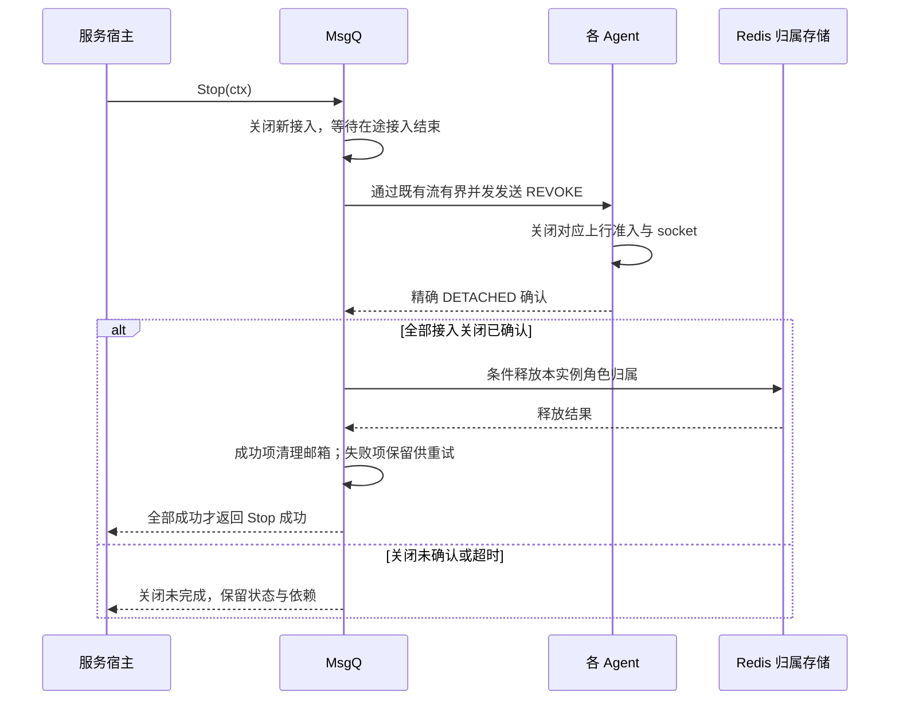

# 独占接入与 MailboxStream 协调实施计划

状态：按 2026-11-03 最新共识实施与本地验收完成，未提交。Login 预留模型已撤回；本计划与验收报告仅描述当前 MsgQ 协调方案。

**目标：** 恢复 Login 的独立签票职责，由角色归属 MsgQ 通过现有 MailboxStream 协调顶号；不增加 Agent 间通信、不扩展通用四语义 API。

**执行方式：** 按批次实施和记录验证，关键行为先写失败回归；遵循 [工程约定](engineering-conventions.md) 和 [审计标准](architecture_audit_standard.md)。保留已有无关变更，不提交，不跑云测试。

## 已确认边界

- Login 只负责认证、选角色、借号授权、选 Agent、分配 SessionID 和签票。不选择 MsgQ、不预留会话、不查询在线状态、不关闭其他连接、不承接退出管理。
- 签票不占位。客户端抵达 Agent 后竞争接入；较新票据被接纳后，较早票据不得首次接入或抢回。非强制被拒不改变原会话或票据水位。
- 应用将授权后的 RejectExisting/ReplaceExisting、首次接入期限和票据顺序签入票据。当前应用以 etcd 本次发号值作为明确的 TicketOrder，不把所有 SessionID 的通用契约改成有序，不增加第二次发号。
- Agent 验票后才 Acquire MsgQ，复用 RoleID 现有 owner，无归属才提名并原子确认。顶号不同时迁移 MsgQ。
- owner MsgQ 是角色内唯一协调点。通过旧 MailboxStream 定向撤销旧接入，不查询或广播全部 Agent，不建立 Agent↔Agent、MsgQ↔MsgQ 顶号 RPC。
- Init 与可撤销流绑定完成后才能 Ready。撤销回执证明旧 Agent 已停止接纳新上行并关闭旧连接，不证明已投递的 Actor 业务结束。
- 正常断线只解除物理接入，保留恢复窗口和邮箱；主动退出、被顶号使原 SID 失效。恢复只续接现有会话，不执行替换或自动重新 Login。
- 退出按验签后的精确 RoleID/SID 处理。连接内退出由当前 Agent 执行；离线退出可携票连接 Agent 发退出控制，不创建业务会话，不经过 Login。
- Ack 只裁剪下行，Renew 和数据推送保持单向语义。专用流仅增加接入完成、撤销、解除接入/退出完成控制，不开放通用 Call/Tell/Future API。
- 等待控制回执不阻塞共享流接收循环，不持有角色初始化分片锁等待网络。控制回执使用共享流生命周期，不能被已取消的玩家 Session ctx 截断。
- 替换中的角色仍占用 owner。正常 MsgQ 关闭先关闭新接入、确认既有接入停止，再条件释放 owner；失败不以流断开代替成功，不新增自动故障接管。
- 整体 Agent×MsgQ 按需共享直连保留；取消的是顶号的 Agent 间网状协调。

## 包结构与职责

```text
tx/
├── modules/msgq/
│   ├── admission*.go            # 角色准入、票据水位、精确终止；不暴露签票预留编排
│   ├── mailbox_stream.go        # 共享流的类型化接入、撤销、解除接入与完成确认
│   ├── grpc.go、proto/、pb/     # 专用流传输；protobuf 按固定 protoc 入口生成
│   ├── role_lifecycle.go        # owner 占用及正常关闭释放边界
│   └── session_redis.go         # 复用单角色 Redis CAS，不新增中心进程
├── modules/agent/
│   ├── types.go、session.go     # 可信验票结果、连接入口编排及远端接入
│   ├── session_connection.go    # 单连接资源、Ready/收发、主动退出及统一收尾
│   └── session_registry.go      # 本地精确连接登记与控制；不承担远端顶号广播
└── docs/                       # 当前契约、实施状态与验收记录

txgame/、txgameslg/
└── server/services/
    ├── login/                  # 仅授权与签票；移除会话控制装配及 HTTP logout
    ├── internal/session/       # 签名的准入策略、TicketOrder、时效
    └── agent/handler/          # 验票后向 tx 提交通用准入结果

txclient/、txclientslg/
└── src/                        # Agent 接入结果、显式退出、停止永久失效后的自动恢复
```

## 时序

### 签票、接入与业务初始化

完整参与方、等待和异步下行关系见[签票、接入与业务初始化时序](design.md#签票接入与业务初始化时序)。Login 只签票；Agent 必须等远端 OPENED 才发 Ready；业务初始化及其响应发生在 Ready 之后。

Ready 仅表示接入完成；角色创建、加载和业务可用性由应用协议确认。txgame 当前执行 `Role_Enter → Role_EnterResp → Bag_Get → Bag_GetResp`；txgameslg 仅对 `canCreateRole=true` 执行 `Create_Role → Create_RoleResp`，已有角色跳过建角后由用户发起业务命令。协议细节与代码入口分别维护在两组应用的 `docs/login_authorization.md`，tx 不增加固定登录业务步骤。

### 顶号与借号

见[顶号与独占借号时序](design.md#顶号与独占借号时序)。非强制占用时直接拒绝，不撤销旧会话。替换的精确关闭确认必须匹配 SID/CID，不能让迟到结果放行失效候选；协调只经过角色 owner MsgQ，不增加 Agent 间通信。

### 断线、重连和退出

见[断线与恢复时序](design.md#断线与恢复时序)及[主动退出时序](design.md#主动退出时序)。普通断线保留恢复窗口；原会话重连 Ready 后只续接下行，不自动重发初始化或结果未知的上行。本人顶号和强制借号接纳新 SID 后，继续新登录的业务初始化流程。

没有 owner 不得因为退出而创建邮箱/角色归属。失效水位不能随邮箱删除而清空；恢复缺失的会话必须失败，不能补建。退出仅在精确终止确认成功后返回 LoggedOut。

### 正常 MsgQ 关闭




普通流断开不能作为关闭确认。未确认时返回错误并保留必要状态，沿现有有界关闭/运维边界处理，不引入网络分区下自动接管。

## 实施批次

### 1. MsgQ 流内协调

- [x] 覆盖回归：同角色跨两接入端点替换、非强制拒绝、较早未用票据拒绝、退出后 fresh/restore 拒绝。
- [x] 统一正式接入入口 OpenMailboxStream(ctx, InitRequest, onRevoke)，返回前完成远端 Init 和控制绑定；可信准入为 SessionAdmission{Policy, TicketOrder, ExpiresAt}。
- [x] 补 OPENED/撤销/解除接入/退出确认，保留数据/Ack/Renew 现有发送语义，同进程同契约。
- [x] 删除 Prepare/Finish 与 SessionReservation 外部编排接口；保留必要只读查询和精确终止能力。
- [x] 覆盖初始化中撤销、迟到回执、其他角色不被控制等待阻塞、共享流失败、关闭失败不提前释放 owner。
- [x] 固定 protoc v7.36.0 重新生成；MsgQ 单测、真实 Redis 定向回归和 race。

### 2. Agent 与应用边界

- [x] Agent 接收验签后的主体和准入策略，握手使用统一流接入；撤销仅关闭本地准入/socket，不能回调 MsgQ 再次发起终止。
- [x] 移除 SessionController 顶号广播及其专用权威成员查询装配；保留原有独立管理 API 的必要能力，清理由本轮新增的无用实现。
- [x] Login 去掉 MsgQ/Agent 控制依赖、签票失败终止补偿和 logout HTTP；签票策略及顺序不可被客户端篡改。
- [x] 明确 FrameLogout/FrameLoggedOut 的主动及离线退出契约；旧票永久失效停止自动恢复。
- [x] 两组应用同步修改关键测试；验证 MsgQ 不可用不影响纯签票、签票本身不踢人/占位、接入时才判占用。

### 3. 客户端、回归及文档

- [x] 两客户端退出改为 Agent 控制帧，登录 HTTP 成功与 Agent 接入成功分开；同步 CLI 和有限验收夹具。
- [x] tx 完整 go test、受影响 Agent/MsgQ race；两组 server 完整 go test；两客户端 npm test 与 build。
- [x] 本地有限多 Agent/多 MsgQ 契约验证：角色复用唯一 owner、无 Agent 间控制、正常 MsgQ Stop 后归属释放；不跑云压测。
- [x] 更新 design/API、应用登录职责、客户端 README、当前实施索引和验收记录；旧验收标明旧模型，不冒充新方案证据。
- [x] 按 ponytail-review 和现有审计标准整体检查差异，修复本轮范围内问题，记录结果，不提交。

## 验收记录

本轮测试日志：`/private/tmp/tx-mailbox-takeover-20261103/`。已记录命令、实际结果及未验证边界；本轮结果见 [验收报告](exclusive-session-acceptance-20261103.md)；旧预留模型日志独立保留，不替代本轮验证。
